# 7.1 解读Tony F. Heinz的综述

> **跨章阅读提示（B666，Q010/Q028）：** 本节式(4)以厚度积分定义面量，式(13a)又将体分布写为面量乘δ函数；这一定义链可供本节阅读，不能代替1.1、1.3尚未给出的跨节归一化关系。式(13b)、(16)的负时间指数与1.3式（1）的正时间指数相反。比较两节的复数辐射因子前，须同时核对复振幅、复波矢、介质参数及出射方向；本提示未改变原式或其适用条件。

原稿：广濑千秋的Heinz综述解读笔记；中文翻译：章力。底本：`日语原版/Chapter7/chap7-1.pdf`，14页。

> **译校状态（2026-10-22）：** B609—B624完成底本14页全部正文、证明框和原注；原作省略处明确保留。复杂公式组采用原式图，尚非全部可编辑LaTeX。Q274—Q292待核，未新增已采用修正。
>
> **阅读导引（译者）：** 本稿以和频过程的应用为目标，解读Heinz关于表面与界面二阶非线性光学的综述。先读极化薄片模型与边界条件，再读辐射场、菲涅尔变换、表面与体相响应；四个独立附录见本章阅读导航。原稿内部从第2章开始编号，按原文保留，不是本项目章节号。

这里针对Tony Heinz的综述——T. F. Heinz，*Second-order nonlinear optical effects at surfaces and interfaces*（《表面与界面的二阶非线性光学效应》），收于H. E. Ponath、G. I. Stegeman编 *Nonlinear Surface Electromagnetic Phenomena*（《非线性表面电磁现象》），Elsevier，1991，第5章——以应用于和频过程为目标，介绍要点并推导主要公式。

> **来源说明（译者）：** 以下译的是广濑的解读笔记；文中对原综述的概述和推导按笔记呈现，未以另行查阅的Heinz原章内容替换。

## 第2章 宏观描述（Macroscopic description）

### 2.1 唯象模型（Phenomenological model，PDF p1）

描述两个具有中心对称性（或各向同性）的介质之间的界面光学现象时，将界面区域与体相区域分开考虑更为方便。这里的“界面”，指电子结构、分子取向等物性及电磁场状况显著不同于体相的区域；在多数体系中，其厚度约为数埃。

就界面非线性光辐射而言，可以假设存在电流薄片 $\boldsymbol J_s$，或广义非线性源极化薄片 $\boldsymbol P_s$ 来讨论，两者满足 $\boldsymbol J_s=\partial\boldsymbol P_s/\partial t$。将光电场写为 $\boldsymbol E(t)=\boldsymbol E(\omega)e^{-i\omega t}+\mathrm{c.c.}$，极化的傅里叶分量表示为

$$
\boldsymbol P_s(\Omega)=\chi_s^{(2)}(\Omega=\omega_1+\omega_2):\boldsymbol E(\omega_1)\boldsymbol E(\omega_2).
\tag{1}
$$

在广泛采用的模型中，求表面膜的非线性极化时，将界面区域或膜看作介电常数为 $\varepsilon'$ 的物质层，并在式(1)中使用**膜内部的电场强度**。该模型还认为，界面区域的非线性源极化产生光时，也通过同一个线性介电常数 $\varepsilon'$ 起作用。不过，$\varepsilon'$ 依赖波长，因此在红外光、可见光及和频光频率处，其取值不同。

> **读式说明（译者）：** $\chi_s^{(2)}$ 为本段的面二阶非线性极化率，$\boldsymbol P_s$ 为面源极化；这里不增补体积、膜厚或 $\varepsilon_0$ 因子。“同一个介电常数”指同一模型中的线性介电响应，不表示三个频率处取相同数值。$\mathrm{c.c.}$ 表示前项的复共轭，时间因子按本段的负号约定读取。原文将中心对称与各向同性并列列出，译文不把两者定义为同义词。

<!-- 原文定位：PDF p1的2.2开头至页末麦克斯韦方程及附带关系；连同p2首幅示意图 -->

### 2.2 极化薄片的边界条件（Boundary conditions of a polarized sheet，PDF p1起）

这篇综述提出了另一种求解方法，替代Bloembergen与Pershan的方法。在B & P的处理中，假设存在有限厚度的非线性膜，赋予其体极化（volume polarization），并据此建立公式，也就是用极化的体积元进行讨论。原文指出，因此，当膜厚相对于波长变为无穷小时，和频电场便趋于零，与单分子层及更低覆盖度下仍能检测到信号的实验事实矛盾。Heintz的论文（此处沿原拼法）所采用的极化薄片方法，假设厚度无穷小的二维极化面元，克服了这一矛盾。

> **原文疑点（Q274，译者）：** “膜厚趋零则和频场消失”的结论取决于极限过程中保持哪些源量不变；固定体极化与固定沿厚度积分的面极化并不是同一极限。原稿此段未明确这一条件，译文保留其判断，不将它推广为对B & P方法的一般否定。本批未另行核验所引综述及B & P原文。人名在本段原印Heintz，而题名与引言为Heinz，分别保留。

所讨论的区域如下图所示。通过匹配极化薄片两侧的电场与磁场，可以得到和频光的表达式。

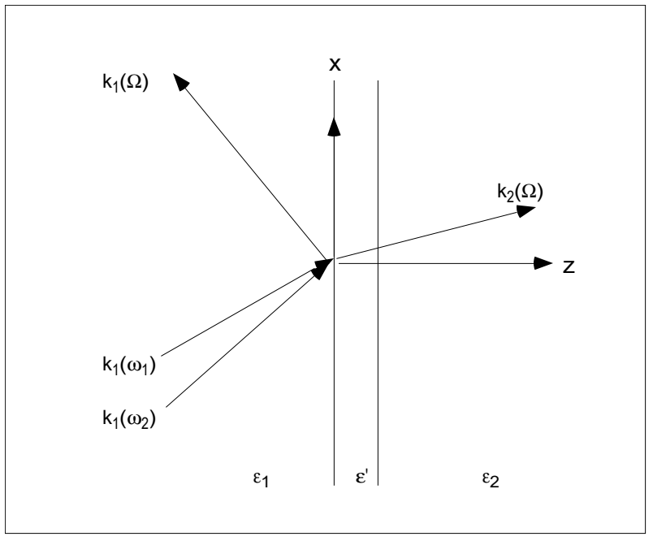

> **图示说明（译者）：** 介质1、膜和介质2分别标为 $\varepsilon_1$、$\varepsilon'$、$\varepsilon_2$；$x$ 沿界面，$z$ 沿法向并指向介质2。两束入射光的波矢标为 $\boldsymbol k_1(\omega_1)$、$\boldsymbol k_1(\omega_2)$，两侧和频出射波矢标为 $\boldsymbol k_1(\Omega)$、$\boldsymbol k_2(\Omega)$。图由原p2页首移至本段引句后，图形与标记未改；不据图为膜厚或各介电常数补入数值。

介电质中的电磁场满足以下麦克斯韦方程（Born & Wolf，第1章）：

$$
\begin{aligned}
\nabla\cdot\boldsymbol D&=4\pi\rho,\\
c\nabla\times\boldsymbol E+\frac{\partial\boldsymbol B}{\partial t}&=0,\\
\nabla\cdot\boldsymbol B&=0,\\
c\nabla\times\boldsymbol H-\frac{\partial\boldsymbol D}{\partial t}&=4\pi\boldsymbol j.
\end{aligned}
$$

其中，

$$
\boldsymbol D=\varepsilon\boldsymbol E,\qquad
\boldsymbol H=\mu^{-1}\boldsymbol B,
$$

$$
4\pi\nabla\cdot\boldsymbol j=-\nabla\cdot\frac{\partial\boldsymbol D}{\partial t},\qquad
\frac{\partial\rho}{\partial t}+\nabla\cdot\boldsymbol j=0.
$$

> **单位与符号说明（译者）：** 本组方程保留原文的 $4\pi$ 与 $c$，按原来的高斯单位制形式读取，不改成SI形式；$\rho$ 是电荷密度，$\boldsymbol j$ 是电流密度。此处 $\varepsilon$ 是介质本构关系中的介电常数，与膜的 $\varepsilon'$ 区分；$\mu$ 按原式保留，不预先取1。后文会进一步说明本问题中的电荷、电流与源极化的关系。

<!-- 原文定位：PDF p2图后首段、原括注及式(2a)—(2d)，止于Born & Wolf边界条件引句前 -->

这里考虑的体系没有净电荷或电流，只具有极化 $\boldsymbol P$。换一种说法，体系整体保持电中性，但内部仍发生电荷偏移，并以极化来表示。因此，成立以下关系：

$$
\frac{\partial\boldsymbol P}{\partial t}=\boldsymbol j,\qquad
\rho=-\nabla\cdot\boldsymbol P.
$$

（原文说明，这可由

$$
\frac{\partial\rho}{\partial t}=-\nabla\cdot\boldsymbol j
=-\nabla\cdot\frac{\partial\boldsymbol P}{\partial t}
$$

或由

$$
\boldsymbol P=\int\boldsymbol r\rho\,dv
$$

得到。）

> **原文疑点（Q275，译者）：** 原括注的 $\int\boldsymbol r\rho\,dv$ 通常给出所积分电荷分布的总偶极矩，而本段散度方程中的 $\boldsymbol P$ 是空间分布的极化量；两者的体积归一化、积分范围及对应关系在此未说明。这里保留同一个原符号与原括注，不补除体积的因子，也不将它直接当作局部关系的完整推导。由时间导数关系返回 $\rho=-\nabla\cdot\boldsymbol P$ 时，静态部分的条件也有待说明。

因此，麦克斯韦方程变为

$$
\nabla\cdot\boldsymbol D=-4\pi\nabla\cdot\boldsymbol P,
\tag{2a}
$$

$$
c\nabla\times\boldsymbol E+\frac{\partial\boldsymbol B}{\partial t}=0,
\tag{2b}
$$

$$
\nabla\cdot\boldsymbol B=0,
\tag{2c}
$$

$$
c\nabla\times\boldsymbol H-\frac{\partial\boldsymbol D}{\partial t}
=4\pi\frac{\partial\boldsymbol P}{\partial t}.
\tag{2d}
$$

> **读式说明（译者）：** 开头“没有净电荷或电流”按原文措辞保留；结合紧随其后的关系式，此处仍有由极化产生的局部电荷密度 $\rho$ 和电流密度 $\boldsymbol j$，不能把该句读成 $\rho$、$\boldsymbol j$ 处处为零。式(2a)、(2d)把 $\boldsymbol P$ 写作显式源，沿前页的 $4\pi$、$c$ 形式，不把它再次自动并入 $\boldsymbol D=\varepsilon\boldsymbol E$。这里的 $\boldsymbol P$ 与前面的面源极化 $\boldsymbol P_s$ 分别保留，薄片极限的具体联系待后文。

<!-- 原文定位：PDF p2 Born & Wolf边界条件引句至p3式(4)后薄片δ表示末，止于路径积分论述前 -->

Born & Wolf教材第1.1节列出的界面边界条件如下。

1. 磁感应强度 $\boldsymbol B$ 的法向分量在界面两侧连续：

$$
B_z(2)-B_z(1)=0.
$$

2. 表面存在电荷密度时，电位移 $\boldsymbol D$ 的法向分量在表面发生不连续变化：

$$
D_z(2)-D_z(1)=4\pi\rho.
$$

3. 电场 $\boldsymbol E$ 的面内分量在界面两侧相等：

$$
\boldsymbol E_t(2)-\boldsymbol E_t(1)=0.
$$

4. 表面存在电流密度时，磁场 $\boldsymbol H$ 的面内分量发生不连续变化：

$$
c[\boldsymbol H_t(2)-\boldsymbol H_t(1)]=4\pi\boldsymbol j.
$$

> **原文疑点（Q276，译者）：** 这里的 $\rho$、$\boldsymbol j$ 用于表面电荷、电流的跳跃条件，但原式沿用前文符号，没有注明它们是面密度还是沿厚度积分后的量；磁场切向跳跃式也未显式写出法向矢量及叉乘的方向关系。正文按原式保留，不补下标或旋转方向因子，后续须与作者给出的极化薄片条件一起核验。

代入 $\partial\boldsymbol P/\partial t=\boldsymbol j$ 与 $\rho=-\nabla\cdot\boldsymbol P$，原文指出，当前体系的边界条件成为：“$D_z+4\pi P_z$、$\boldsymbol E_t$、$B_z$、$\boldsymbol H_t$ 这四个量在界面两侧相等。”把它们写成跨越界面的积分，得到

$$
\int_{0^-}^{0^+}(D_z+4\pi P_z)\,dz
=\int_{0^-}^{0^+}\boldsymbol E_t\,dz
=\int_{0^-}^{0^+}B_z\,dz
=\int_{0^-}^{0^+}\boldsymbol H_t\,dz.
\tag{3}
$$

由此，

$$
\int_{0^-}^{0^+}D_z\,dz
=-4\pi\int_{0^-}^{0^+}P_z\,dz
\equiv-4\pi P_{s,z}.
\tag{4}
$$

$P_{s,z}$ 表示无穷薄的极化薄片。因此，将极化写成

$$
\boldsymbol P=\boldsymbol P(x,y)\delta(z).
$$

> **原文疑点与记号说明（Q277，译者）：** 式(3)原印为四个积分相等，没有等于零的末项。它把不同物理量及标量、切向矢量积分连在一起，从“两侧连续”到这一积分式、再到式(4)的论证尚需核验，不能直接当作一般恒等式使用。这里保留全部等号与原积分上下限，也未补零。随后原句以 $P_{s,z}$ 指薄片，又在δ函数表示中把厚度分布及其面内系数都记作 $\boldsymbol P$；译文保留这些符号，不提前换成后文才明确写出的 $\boldsymbol P_s(x,y,t)$。式(4)中的 $P_{s,z}$ 则依原式表示对 $P_z$ 沿厚度积分所得的面量。

<!-- B613：PDF p3路径积分至2.2末；原式跳号照录。 -->
原论文巧妙地使用路径积分（这也是 Born & Wolf 采用的方法），导出了下列表达式。

$$\Delta B_z=B_z(z=0^+)-B_z(z=0^-)=0.\tag{5}$$

$$\Delta\boldsymbol H_t=\boldsymbol H_t(z=0^+)-\boldsymbol H_t(z=0^-)
=\frac{4\pi}{c}\frac{\partial\boldsymbol P}{\partial t}\times\boldsymbol n_z.\tag{7}$$

$$\Delta D_z=D_z(z=0^+)-D_z(z=0^-)=-4\pi\nabla_t\cdot\boldsymbol P(x,y).\tag{9}$$

其中，

$$\nabla_t=\boldsymbol n_z\frac{\partial}{\partial x}+\boldsymbol n_y\frac{\partial}{\partial y}.\tag{10}$$

$$\Delta\boldsymbol E_t=\boldsymbol E_t(z=0^+)-\boldsymbol E_t(z=0^-)
=-\frac{4\pi}{\varepsilon'}\nabla_tP_z.\tag{11}$$

> **原文疑点（Q278）：** 式(10)的首个单位矢量原印为 $\boldsymbol n_z$，与“面内梯度”及 $\partial/\partial x$ 不一致，候选为 $\boldsymbol n_x$；保留原印。式(7)、(9)、(11)沿用原文 $\boldsymbol P$，汇总式才明确写 $\boldsymbol P_s$。

最后一式偏离通常的连续条件，是按原论文图2b所示路径积分得到的结果。原作者解释说：对穿过薄片的 $E_z$ 作积分时，必须允许这一积分具有有限值。

汇总如下：

$$\Delta D_z=-4\pi\nabla_t\cdot\boldsymbol P_s,\tag{12a}$$

$$\Delta\boldsymbol E_t=-\frac{4\pi}{\varepsilon'}\nabla_tP_{s,z},\tag{12b}$$

$$\Delta B_z=0,\tag{12c}$$

$$\Delta\boldsymbol H_t=\frac{4\pi}{c}\frac{\partial\boldsymbol P_s}{\partial t}\times\boldsymbol n_z.\tag{12d}$$

即使极化薄片的线性响应并非各向同性，只要它在 $(x,y,z)$ 系中为对角形式，把 $\varepsilon'$ 换成 $\varepsilon'_{zz}$，上述四式仍然成立。

> **译者记号说明：** 原句将 $\varepsilon'$ 称为“线性极化率”。这里所指仍是前文定义的膜层介电常数，不能据此将其等同于 $\chi^{(1)}$；原文的命名差异予以标明。

<!-- B614：PDF p3的2.3至p5首行。 -->
### 2.3 极化薄片的辐射

原论文讨论的是二次谐波产生（SHG）；这里尝试将其改写为和频过程（SFG）。把两个平面波在表面诱导的极化看作极化薄片，写成

$$\boldsymbol P(x,y,z,t)=\boldsymbol P_s(x,y,t)\delta(z),\tag{13a}$$

$$\boldsymbol P_s(x,y,t)=\boldsymbol P_s\exp(ipx-i\Omega t)+\mathrm{c.c.}\tag{13b}$$

（c.c. 表示紧邻其前的一项的复共轭，即 $e^{ia}$ 对应的 $e^{-ia}$。）

由面二阶非线性极化率 $\chi_s^{(2)}$ 引起的源项 $\boldsymbol P_s$，稍后再详细讨论。现在只需知道，它可以作为以波矢 $p\boldsymbol u_x$ 和频率 $\Omega$ 描述、并在空间中变化的薄片来处理。极化薄片向介电常数为 $\varepsilon_1$ 的介质1辐射“反射光”，向介电常数为 $\varepsilon_2$ 的介质2辐射“透射光”。

反射光的波矢为

$$\boldsymbol k_1=p\boldsymbol u_x-q_1\boldsymbol u_z.\tag{14a}$$

$p$ 与 $q_1$ 分别表示波矢的 $x$ 分量及法向分量的大小；$p$ 在两个介质中相同。

$$q_1=\sqrt{\varepsilon_1K^2-p^2}.\tag{14b}$$

$K=\Omega/c$ 为自由空间波数，$\varepsilon_1$ 为频率 $\Omega$ 下的介电常数。所考虑的波离开界面传播，因此，当 $\varepsilon_1$ 为实数且 $p^2<\varepsilon_1K^2$ 时，须取 $q_1>0$。更一般地，若 $p^2>\varepsilon_1K^2$ 或 $\varepsilon_1$ 为复数，波随远离界面而衰减，此时式(14b)中的 $q_1$ 应具有非负的虚部。

透射光满足

$$\boldsymbol k_2=p\boldsymbol u_x+q_2\boldsymbol u_z,\tag{15a}$$

$$q_2=\sqrt{\varepsilon_2K^2-p^2}.\tag{15b}$$

这里也有 $q_2>0$（更一般地，$\operatorname{Im}q_2>0$）。

> **译者说明：** 此处“$>0$”按原文保留；前一段对 $q_1$ 使用的是“虚部非负”。无损传播波的虚部可以为零，应用时须结合传播或衰减分支选择，不能机械要求所有情形均严格大于零。

同一极化薄片成对产生的反射波和透射波，在薄片两侧满足式(12)。为简化讨论，先取 $\varepsilon_1=\varepsilon_2=\varepsilon'$，则两个介质中的光电场为

$$\boldsymbol E_i(x,y,z,t)=\boldsymbol E_i(\Omega)\exp(i\boldsymbol k_i\boldsymbol x-i\Omega t)+\mathrm{c.c.}\tag{16}$$

$$\boldsymbol E_i=\boldsymbol E_i(\Omega)=\frac{2\pi iK^2}{q_i}
\left[\boldsymbol P_{sv}-\boldsymbol u_{ki}(\boldsymbol u_{ki}\cdot\boldsymbol P_s)\right].\tag{17}$$

> **原文疑点（Q279）：** 式(17)方括号内第一项原印为 $\boldsymbol P_{sv}$，后文解释则为 $\boldsymbol P_s$；候选是多印了下标 $v$。式(16)保留原式波矢与位置矢量的并置写法，按平面波语境理解为内积。

$\boldsymbol u_{ki}$ 是沿光传播方向的单位矢量，$\boldsymbol u_{ki}=\boldsymbol k_i/(\boldsymbol k_i\cdot\boldsymbol k_i)^{1/2}$。式(17)括号内表示从 $\boldsymbol P_s$ 中减去沿 $\boldsymbol u_{ki}$ 的投影。因此，辐射电场正比于源极化的横向分量，并垂直于光的传播方向。

引入偏振方向单位矢量 $\boldsymbol e_i$，满足 $\boldsymbol k_i\cdot\boldsymbol e_i=0$，则

$$\boldsymbol e_i\cdot\boldsymbol E_i=\frac{2\pi iK^2}{q_i}(\boldsymbol e_i\cdot\boldsymbol P_s).\tag{18}$$

将式(17)右边与 $\boldsymbol u_{ki}$ 作内积即可看出，$\boldsymbol E_i$ 垂直于 $\boldsymbol u_{ki}$。所以 $\boldsymbol E_i$ 和 $\boldsymbol e_i$ 都在垂直于传播方向的平面内，式(18)给出电场在 $\boldsymbol e_i$ 上的投影。（进行圆偏振或椭圆偏振实验时，需要这项讨论。）

无论如何，从式(16)至此的讨论只适用于 $\varepsilon_1=\varepsilon_2=\varepsilon'$，不具有一般性。去除此近似的一般推导见[附录A（7.2）](7.2%20附录A：去除等介电常数近似的式17推导.md)；用于实际体系的表达式请参阅该附录。

<!-- B615：PDF p5线性响应与式(19)—(20)、折射率表示。 -->
#### 线性响应与菲涅尔变换

体相和薄膜都具有线性响应。要将其纳入，只需考虑适当的菲涅尔变换。为对称地处理界面激发和由该激发产生的辐射，可以对入射光——即从两个体相进入介电常数为 $\varepsilon'$ 的膜的光——作菲涅尔修正。

用 $\boldsymbol e_i$ 表示介质1或2中光电场的偏振矢量，满足 $\boldsymbol k_i\cdot\boldsymbol e_i=0$。若光在介质 $i$ 中朝介质 $j$ 传播，电场为 $E_0\boldsymbol e_i$，那么它在界面区域产生的电场可写为 $E_0\boldsymbol e$，其中

$$\boldsymbol e=\boldsymbol F_{i\to j}\boldsymbol e_i.\tag{19}$$

分别考虑 s、p 偏振后，可用透射系数表示 $\boldsymbol F_{i\to j}$。若 $\varepsilon_1=\varepsilon'$ 或 $\varepsilon_2=\varepsilon'$，折射率相同的界面不发生反射，便得到通常的菲涅尔因子。若膜的介电常数与两侧都不同，则在图示坐标系中表示变换较方便。各向同性体相对应

$$\boldsymbol F_{i\to j}=F^{xx}_{i\to j}\hat{\boldsymbol x}\hat{\boldsymbol x}+F^{yy}_{i\to j}\hat{\boldsymbol y}\hat{\boldsymbol y}+F^{zz}_{i\to j}\hat{\boldsymbol z}\hat{\boldsymbol z},\tag{20a}$$

$$F^{xx}_{i\to j}=\frac{2\varepsilon_iq_j}{\varepsilon_jq_i+\varepsilon_iq_j},\tag{20b}$$

$$F^{yy}_{i\to j}=\frac{2q_i}{q_i+q_j},\tag{20c}$$

$$F^{zz}_{i\to j}=\frac{2(\varepsilon_i\varepsilon_j/\varepsilon')q_i}{\varepsilon_jq_i+\varepsilon_iq_j}.\tag{20d}$$

$q_i$（$i=1,2$）是式(14b)、(15b)定义的法向波矢量；与附录A的记号对应为 $q_1=-k_{1z}$、$q_2=k_{2z}$。推导见[附录B（7.3）](7.3%20附录B：式20的推导.md)。

这些式子描述穿过膜到达另一侧的光与入射光的关系。除 $z$ 分量外，膜的介电常数都不出现，所以 $x$、$y$ 分量与无膜时相同。（广濑对有限厚度膜所作的推导——其他推导也有——在膜厚趋于零时也给出这一关系。）

实际使用时，往往采用折射率而非介电常数。追踪膜的生长还需要适用于不可忽略膜厚的表达式。下面先把式(20)写为折射率和波数的形式，再将膜内光场分成两个传播方向，纳入多重反射。

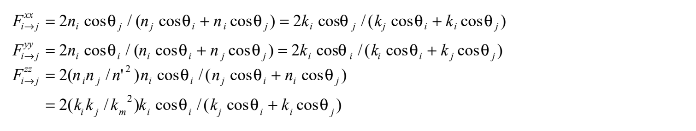

> **公式保真说明：** 本章较长的原式组采用清晰原式图，正文与解释均译为中文。图内的系数、上下标和推导中间步骤保持原印；这些公式图尚非可编辑的 LaTeX。

<!-- B616：PDF p5末跨p6，上下行膜内场及式(21)—(22)。 -->
#### 膜内两个传播方向的场

膜内光场包括朝介质1传播、波矢为 $\boldsymbol k_s=k_x\boldsymbol u_x-q_m\boldsymbol u_z$ 的“向上光、反射光”，以及朝介质2传播、波矢为 $\boldsymbol k_s=k_x\boldsymbol u_x+q_m\boldsymbol u_z$ 的“向下光、透射光”。原文称“式(20b)至式(29d)”给出两者电场的矢量和。考虑不可忽略的膜厚时，还需要分别给出两个方向的系数。

> **原文交叉引用疑点（Q280）：** 原印“(29d)”在本节并不存在，按上下文候选为“(20d)”；保留原引用并说明。两个方向原文都记 $\boldsymbol k_s$，这里按原记号区分其正负号。

**向上光：**

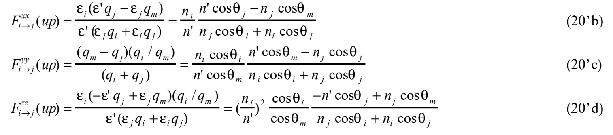

**向下光：**

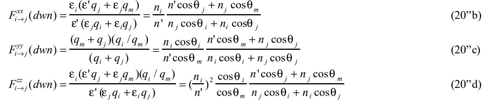

膜内多重反射的处理见[附录C（7.4）](7.4%20附录C：式20的折射率表示与多重反射.md)。

由式(19)、(20)可得膜内偏振矢量的表达式，从而把线性响应——即介质间介电常数的差别——纳入极化薄片的辐射，得到

$$\boldsymbol e_i\cdot\boldsymbol E_i=2\pi i q_i^{-1}K^2(\boldsymbol e\cdot\boldsymbol P_s),\qquad K=\omega/c.\tag{21}$$

也可写成

$$\boldsymbol e_i\cdot\boldsymbol E_i=2\pi i\frac{K}{\sqrt{\varepsilon_i}}\sec\theta_i(\boldsymbol e\cdot\boldsymbol P_s),\tag{22a}$$

$$\sec\theta_i=\frac{\sqrt{\varepsilon_iK}}{q_i}.\tag{22b}$$

在没有吸收等损耗时，$\theta_i$ 是光的传播方向与表面法线之间的夹角。

> **原文疑点（Q281）：** 式(22b)原式根号覆盖 $\varepsilon_iK$；由式(21)、(22a)及 $q_i=\sqrt{\varepsilon_i}K\cos\theta_i$ 比较，候选为 $\sqrt{\varepsilon_i}K/q_i$。保留原式，不把候选直接代入。

<!-- B617：PDF p6—7式(21)证明框全部。 -->
#### 式(21)的证明

由附录A的结果，即式(A9)、(A10)，有

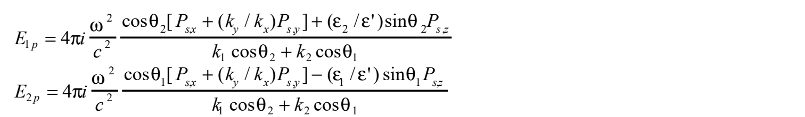

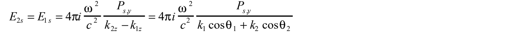

将其变形如下：

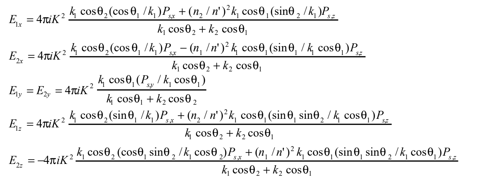

这里使用以下关系：

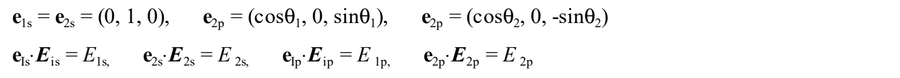

因此，

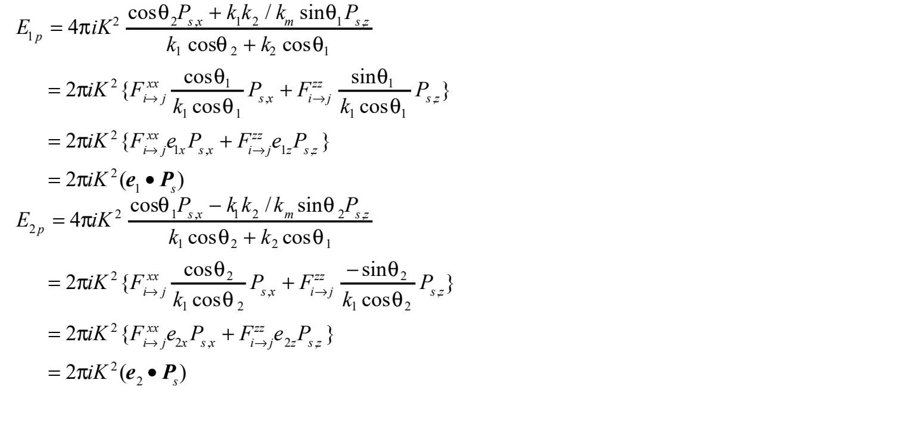

此外，由于定义为 $\boldsymbol e=\boldsymbol F_{i\to j}\boldsymbol e_i$，所以 $\boldsymbol e_2$ 与 $\boldsymbol e$ 的关系必须从 $\boldsymbol e=\boldsymbol F_{2\to1}\boldsymbol e_2$ 导出。

> **原文疑点（Q282）：** 证明框中的单位矢量关系把两个 p 偏振矢量都标成 $\boldsymbol e_{2p}$，其中含 $\theta_1$ 的一个候选为 $\boldsymbol e_{1p}$。末组出现 $k_1k_2/k_m$，而前面的介电常数比涉及波数平方；又在改写为偏振矢量后，原先的法向波数分母不再出现，末行与式(21)的 $q_i^{-1}$ 因子不一致。原式图保留每一步，尚不能据此认定证明闭合；需对照原综述及附录A、B复算。此处 $\boldsymbol e_1,\boldsymbol e_2$ 与修正后的 $\boldsymbol e$ 的混用也一并待核。

<!-- B618：PDF p7的2.4至p9首段计算说明。 -->
### 2.4 表面非线性响应

为完成唯象模型的表述，下面考察此前使用的非线性极化薄片与表面二阶非线性极化率张量之间的关系。基本式为

$$\boldsymbol P_s(\omega)=\chi_s^{(2)}(\omega=\omega_1+\omega_2):\boldsymbol E(\omega_1)\boldsymbol E(\omega_2).\tag{23}$$

这里的 $\boldsymbol E(\omega_1)$、$\boldsymbol E(\omega_2)$ 是介电常数为 $\varepsilon'$ 的介质内部的电场 $\boldsymbol E_m$ 或 $\boldsymbol E_{m'}$。把激发光视为平面波，从介质 $i$ 一侧入射的电场为

$$\begin{aligned}
\boldsymbol E_i(x,y,z,t)&=\boldsymbol E_i(\omega)\exp(i\boldsymbol k_i\cdot\boldsymbol x-i\omega t)+\mathrm{c.c.}\\
&=E_i(\omega)\boldsymbol e_i(\omega)\exp(i\boldsymbol k_i\cdot\boldsymbol x-i\omega t)+\mathrm{c.c.}
\end{aligned}\tag{24}$$

式中 $\omega$ 表示 $\omega_1$ 或 $\omega_2$，$\boldsymbol e_i(\omega)$ 是单位矢量。（按广濑在附录中的记号，下标 $i$ 则为 $m$。）把介质 $i$ 内波矢的正 $z$ 分量的大小记为 $q_i$，朝界面传播的激发光波矢为

$$\boldsymbol k_1=p\boldsymbol u_x+q_1\boldsymbol u_z\quad\text{（从介质1到界面）},\tag{25a}$$

$$\boldsymbol k_2=p\boldsymbol u_x-q_2\boldsymbol u_z\quad\text{（从介质2到界面）},\tag{25b}$$

$$q_i=\sqrt{\varepsilon_i(\omega/c)-p^2}.\tag{26}$$

（设激发光在 $xz$ 平面内传播，即入射面为 $xz$ 面。）

> **原文疑点（Q283）：** 式(26)的 $\omega/c$ 原印没有平方，与式(14b)、(15b)及量纲不符，候选为 $\sqrt{\varepsilon_i(\omega/c)^2-p^2}$。式(24)后括注把介质侧下标 $i$ 对应到膜内 $m$，而后文又区分两者，按原文保留，不能将外场直接当作膜内场。

在这一定义下有

$$\boldsymbol P_s(\omega)=\chi_s^{(2)}(\omega=\omega_1+\omega_2):\boldsymbol e_{i1}(\omega_1)\boldsymbol e_{i2}(\omega_2)E_{i1}(\omega_1)E_{i2}(\omega_2).\tag{27}$$

这里的 $\boldsymbol e_{i1}(\omega_1)$、$\boldsymbol e_{i2}(\omega_2)$，原文称为对激发光场施加菲涅尔因子修正后得到的偏振矢量〔式(20)、(19)〕，即

$$\boldsymbol e(\omega)=\boldsymbol F_{i\to j}\boldsymbol e_i(\omega),\qquad i=i1\text{ 或 }i2.\tag{28}$$

（广濑原注：多半，这一式子是把下列关系写成一般形式。）

$$\boldsymbol e(\omega_1)=\boldsymbol F_{i1\to j}\boldsymbol e_{i1}(\omega_1),\qquad
\boldsymbol e(\omega_2)=\boldsymbol F_{i2\to j}\boldsymbol e_{i2}(\omega_2).$$

这里考虑光从介质 $i$ 穿过界面进入介质 $j$。将相应频率的介电参数和式(26)给出的 $q_i$ 代入式(20)，便得到所用的 $\boldsymbol F$。

> **记号待核（Q284）：** 原文式(27)用带介质下标的 $\boldsymbol e_{i1},\boldsymbol e_{i2}$ 表示已经修正的矢量，但式(28)将 $\boldsymbol e_i$ 放在修正前一侧，式(29)又使用无下标 $\boldsymbol e$。两套记号不能未经核验互换。原文此处还把用于菲涅尔因子的介电参数称为“极化率”；结合式(20)，这里指 $\varepsilon$，不是额外引入的 $\chi$。

结合式(22)和式(27)，将界面和频过程与体相电场联系起来：

$$\boldsymbol e_i(\omega)\cdot\boldsymbol E_i(\omega)=
\frac{2\pi i\omega\sec\theta_i(\omega)}{c\sqrt{\varepsilon_i(\omega)}}
\left[\boldsymbol e(\omega)\cdot\chi_s^{(2)}:\boldsymbol e(\omega_1)\boldsymbol e(\omega_2)\right]
E_{i1}(\omega_1)E_{i2}(\omega_2).\tag{29}$$

此式给出由介质 $i1$ 中的激发光 $\boldsymbol e_{i1}(\omega_1)$ 和介质 $i2$ 中的激发光 $\boldsymbol e_{i2}(\omega_2)$ 共同激发的和频光电场振幅及偏振矢量；对任一输出介质 $i=1,2$ 均适用。

计算所需的膜内偏振矢量 $\boldsymbol e(\omega)$、$\boldsymbol e(\omega_1)$、$\boldsymbol e(\omega_2)$，由式(19)、(20)求出。波矢的面内分量为 $p(\omega_1)$、$p(\omega_2)$、$p(\omega)=p(\omega_1)+p(\omega_2)$，垂直分量则用式(14)、(15)、(26)计算。（也就是说，先求各介质中相同的面内分量，再算垂直分量。）由 $\theta_i$ 为光路与界面法线的夹角，可得

$$\sec\theta_i(\omega)=\frac{\sqrt{\varepsilon_i(\omega)}\,\omega}{cq_i(\omega)}.$$

（广濑原注：原文的语法有问题。）

<!-- B619：PDF p9各向异性与不同入射面至p10的式32参数定义。 -->
#### 一般入射几何与辐照度

只要 $\varepsilon_1$、$\varepsilon_2$、$\varepsilon'$ 各向同性，即便它们为复数，式(29)也成立。若膜层各向异性，但具有张量主轴，可写成

$$\boldsymbol\varepsilon'=\varepsilon'_{xx}\hat{\boldsymbol x}\hat{\boldsymbol x}+\varepsilon'_{yy}\hat{\boldsymbol y}\hat{\boldsymbol y}+\varepsilon'_{zz}\hat{\boldsymbol z}\hat{\boldsymbol z},$$

则把 $\varepsilon'$ 换为 $\varepsilon'_{zz}$ 后也可使用。

此前推导假定两个激发光共用同一入射面，但式(29)适用于更一般的情况。式(20)中的菲涅尔变换是以 $xz$ 为入射面写出的，用于其他几何时须作相应变换。两个激发光的入射面不同时，还须根据下面的面内波矢关系，以及介质 $i$ 中的线性色散式〔式(14)、(15)，其中取 $p^2=\boldsymbol p(\omega)\cdot\boldsymbol p(\omega)$〕求出和频光方向：

$$\boldsymbol p(\omega)=\boldsymbol p(\omega_1)+\boldsymbol p(\omega_2).\tag{30}$$

为用两个输入频率的辐照度（irradiance）表示频率 $\omega$ 的输出辐照度，采用平面波关系

$$I=\frac{c\sqrt\varepsilon\,|E|^2}{2\pi}.$$

由式(29)得到

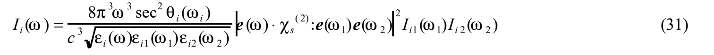

$I_{i1}(\omega_1)$ 是从介质 $i1$ 入射的 $\omega_1$ 光辐照度；$I_{i2}(\omega_2)$ 是从介质 $i2$ 入射的 $\omega_2$ 光辐照度；$I_i(\omega)$ 是以偏振矢量 $\boldsymbol e_i(\omega)$ 向介质 $i$ 输出的和频光辐照度。这里 $\boldsymbol e_i(\omega)$ 对应经过适当菲涅尔修正后的 $\boldsymbol e(\omega)$。

> **原文疑点（Q285）：** 式(31)的频率因子原印为 $\omega^3$，后续式(32)、(33a)则为 $\omega^2$；从式(29)的振幅平方及平面波辐照度关系复算时，也应核验此前因子。式(31)角度的频率自变量原写 $\omega_i$，未另行定义。保留原式图，不作无注释统一。

与实验比较时，更方便的是有限空间宽度激发光束产生的和频光总功率。假设几何光学适用，可由式(31)得到以下结果。

若两个激发光的传播方向和尺寸均相同，以 $A$ 为光束横截面积，则以偏振 $\boldsymbol e_i(\omega)$ 向介质 $i$ 辐射的和频光总功率为

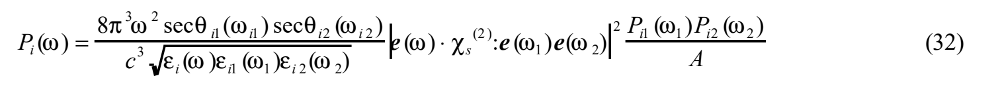

其中，$P_{i1}$、$P_{i2}$ 为激发光总功率，$\theta_{i1}$、$\theta_{i2}$ 为激发光入射角。

<!-- B620：PDF p10任意光束至2.5前。 -->
#### 有限光束与空间重叠

当激发光具有任意空间宽度（束径）时，

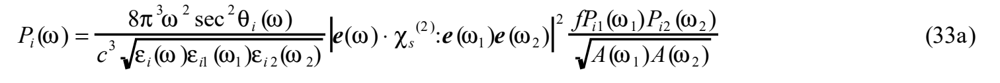

式中 $A(\omega)$ 是用光束总功率 $P(\omega)$ 除以代表性辐照度 $I^0(\omega)$——中心或峰值处的值——所定义的有效面积：

$$A(\omega)=P(\omega)/I^0(\omega).\tag{33b}$$

两个激发光束的重叠由无量纲因子 $f$ 表示：

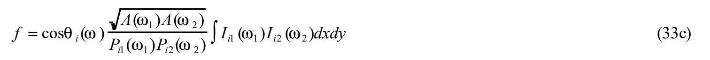

积分在非线性膜的平面上进行。

当共线的高斯激发光聚焦在界面上，并在界面形成束腰时，由式(21)〔原文如此引用〕有 $A(\omega_1)=\pi r_1^2$、$A(\omega_2)=\pi r_2^2$。也就是说，设强度分布为 $\exp(-r^2/r_0^2)$，按束中心测得的强度计算。（广濑原注：是否将总强度除以中心强度定义为面积，再由此求出 $r$？）此时

$$f=\frac{\cos\theta_i(\omega)/\cos\theta(\omega)}{r_1/r_2+r_2/r_1},\qquad\theta(\omega)\text{：入射角。}$$

> **译者说明：** 原文高斯光束段的式(21)引用与主题未直接对应，暂按原引用保留，见Q280的交叉引用待核项。式(33a)、(33c)中的面积乘积均在平方根内，不能按文本层提取结果漏掉根号。此处 $P$ 表示光功率，与前文的极化矢量 $\boldsymbol P$ 区分。

<!-- B621：PDF p10的2.5至p12首段。 -->
### 2.5 体相非线性响应

考虑体相极化时，按非局域性（nonlocality）的程度作多极展开。（例如，电荷分布仅向两侧分开时是偶极分布，呈纺锤状时是四极分布，等等。）

$$\begin{aligned}
\boldsymbol P^{\mathrm{nls}}(\omega)={}&\chi^{(2)}(\omega=\omega_1+\omega_2):\boldsymbol E(\omega_1)\boldsymbol E(\omega_2)\\
&+\tfrac12\chi_q^{(2)}(\omega=\omega_1+\omega_2):\boldsymbol E(\omega_1)\nabla\boldsymbol E(\omega_2)\\
&+\tfrac12\chi_q^{(2)}(\omega=\omega_1+\omega_2):\boldsymbol E(\omega_2)\nabla\boldsymbol E(\omega_1).
\end{aligned}\tag{34}$$

以 $a$ 为原子尺度，以 $l$ 为电场显著改变的空间尺度，则式(34)第二、三项相对于第一项的贡献可按 $a/l$ 估计。$a\sim1\,\text{Å}$，$a/l\sim ka$；可见光的波数约为 $10^{-3}\,\text{Å}^{-1}$，所以 $a/l\ll1$。在均匀体相内，展开应当很快收敛，因此描述体相响应时，只需考虑首个非零项。

当第一项（电偶极项）为零时，界面、表面研究便获得一个有用的切入点。典型例子是具有中心对称（反演对称）的体系。进一步限于 SHG 时，即使无中心对称，各向同性体系及具有432（$O$）对称性的晶体也属于这种情形。

对于液体、气体等无序物质，应考虑宏观体积上的平均。若无中心对称的分子随机取向，只有分子为手性分子时，宏观体系才不具有中心对称。原文接着说：只有分子点群的对称元素中不含“反演”操作和“旋转”操作时，体相中心对称才被破坏，偶极项才非零。

> **原文疑点（Q286）：** 上句“旋转”按日文原印保留；手性点群可以含正常旋转轴，疑为涉及非正常旋转的用词错误，不能把这句话作为手性点群的一般判据。原文又在讨论体相贡献时写 $\chi_s^{(2)}$，其中面下标与语境不一致，亦保留待核。

非相干的非线性辐射则略有不同：在液体、非晶固体等能形成局部非中心对称结构的体系中，应有可能观测到这一现象。

有时可巧妙选择激发光和和频光的偏振组合，消去体相电偶极项。适用条件是体相对称性高、独立的 $\chi_s^{(2)}$ 分量少，例如具有 $T_d$ 对称性的 GaAs。

现在转向体相不含电偶极项的情形。此时最低阶非零项是电四极项和磁偶极项，它们由电场与电场空间导数的乘积表示。

**［广濑原作中略：原综述用约两页讨论 SHG 中的四极项。这里只摘录对 SFG 也可能有意义的部分。］**

对于具有 $m3m\,(O_h)$ 或 $432\,(O)$ 对称性的立方介质，以 $i,j$ 表示晶轴，独立张量分量为

$$\chi^{(2)}_{q,iiii},\quad\chi^{(2)}_{q,iijj},\quad\chi^{(2)}_{q,ijij},\quad\chi^{(2)}_{q,ijji}.$$

二次谐波极化的 $i$ 分量为

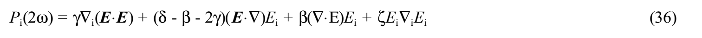

上述唯象参数定义为

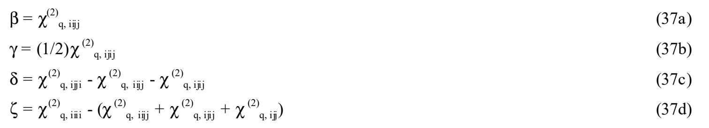

> **原文疑点及局部符号（Q287）：** 式(37d)括号末项原印 $\chi^{(2)}_{q,ijj}$，比其他四指标分量少一个指标，候选为 $\chi^{(2)}_{q,ijji}$，保留原图。本处 $\beta,\gamma,\delta,\zeta$ 是体相四极响应的唯象参数，不能套用前章分子一阶、二阶超极化率的命名。

$\beta$、$\gamma$、$\delta$ 描述各向同性响应。在均匀介质中，式(36)第三项可忽略〔麦克斯韦方程给出 $\nabla\cdot\boldsymbol E=\nabla\cdot\varepsilon^{-1}\boldsymbol D=0$〕。在单频平面波范围内，激发电场为横向场，所以第二项也可忽略。但只要不使用圆偏振，第一项总是存在，并具有“沿 $\boldsymbol k_i$ 方向振荡，即 transverse”的 $P_i$。各向同性体系中 $\zeta=0$。

> **原文疑点（Q288）：** 原文将“沿波矢方向”称为 transverse（横向），两者相矛盾；下文讨论将该 $\gamma$ 项称为 longitudinal（纵向）。这里照录并指出差异，不把原词悄然改为纵向。

<!-- B622：PDF p12“372页中段起”至p13首句，式38—40。 -->
#### 体相极化与表面极化

**［广濑原注：从原综述第372页中段起。］**

用单一波矢 $\boldsymbol k_b$ 表示体相非线性极化：

$$\boldsymbol P(x,y,z,t)=\boldsymbol P_b(\omega,\boldsymbol k_b)
\exp(i\boldsymbol k_b\cdot\boldsymbol x-i\omega t)\theta(z)+\mathrm{c.c.}\tag{38}$$

$\theta(z)$ 是阶跃函数，表示假定介质1一侧没有非线性极化。$\boldsymbol k_b$ 可取为两个激发光波矢之和。向介质1输出的光的方向由 $\boldsymbol k_b$ 平行于界面的分量匹配决定。因此，描述体相非线性极化的辐射时，也可将它替换成放在界面上的一张极化薄片：

$$\boldsymbol P_s^{\mathrm{eq}}(x,y,z,t)=\boldsymbol P_s^{\mathrm{eq}}(\omega,\boldsymbol k_b)
\exp(i\boldsymbol k_b\cdot\boldsymbol x-i\omega)\delta(z)+\mathrm{c.c.}\tag{39}$$

> **原文疑点（Q289）：** 式(39)指数中原印 $-i\omega$，缺少时间 $t$，候选为 $-i\omega t$；保留原式。这里 $\theta$ 是阶跃函数，与前文入射角的同字母记号无关。

上标 eq 表示用等效薄片表示实际极化。为考虑深度效应，将体相看作多张极化薄片的叠加，并计入源极化相位（两个激发波矢之和与位置矢量的内积）与介质2内非线性光相位（和频波矢与位置矢量的内积）之间的差，得到

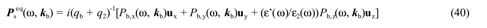

其中 $q_b$ 是 $\boldsymbol k_b$ 的 $z$ 分量，$q_2$ 是介质2中频率 $\omega$ 光波的法向波矢。$P_{b,z}$ 前的系数来自把极化薄片看作位于介电常数 $\varepsilon'(\omega)$ 的介质中。体相产生的非线性光可再用式(21)等具体写出。

式(40)的含义是：描述从体相向介质1辐射的光时，决定非线性极化有效大小的是距离界面不超过相干长度 $l_c=(q_s+q_2)^{-1}$ 的体相极化。在“反射”配置中，$q_s$、$q_2$ 都为正，相干长度较短。原文括注为

$$q=q_2:\qquad l_c=\left|\frac{\Lambda}{2\cos\theta_2(\omega)}\right|,\qquad
\Lambda=\frac{2\pi c}{\omega\sqrt{\varepsilon_2(\omega)}};$$

$$\cos\theta_2(\omega)=\frac{(\omega/c)q_2}{\sqrt{\varepsilon_2(\omega)}}.$$

$\Lambda$ 为介质2内部的波长。若泵浦光从介质2一侧入射，相干长度会大得多。

> **原文疑点（Q290）：** 式(40)用 $q_b$，随后的相干长度却写 $q_s$；括注又写未加下标的 $q=q_2$。原式 $l_c=(q_s+q_2)^{-1}$ 与使用波长 $\Lambda$ 的表达式存在 $2\pi$ 因子的核验问题，且所印余弦关系的 $\omega/c$ 位置也与色散关系不符。候选应从 $q_2=\sqrt{\varepsilon_2}(\omega/c)\cos\theta_2$ 重新推导，尚未采用修正。

就“反射”而言，相干长度约为 $\Lambda$ 的量级，式(40)给出的有效面极化约为 $\Lambda P_b$。另一方面，四极项相对于电偶极项约为 $a/\Lambda$。因此，以 $P_d$ 表示电偶极允许的非线性源极化，反射配置中体相项的等效面极化约为 $P_s^{\mathrm{eq}}\sim aP_d$，即与界面区域贡献同量级。不过，对于介电常数较大的物质，体相内的屏蔽可能减小体相贡献。

由于式(40)中的体相项含相干长度，原则上可通过改变激发光入射角，区分体相项与表面项。

<!-- B623：PDF p13余下，纵向体相响应与等效表面响应。 -->
#### 纵向体相响应与表面项的不可区分性

**［广濑原注：随后三页讨论四极项，这里只记要点。］**

在各向同性且均匀的介质中，体相非线性源极化的最低阶非局域项具有

$$\boldsymbol P(\omega)=\gamma\nabla(\boldsymbol E\cdot\boldsymbol E)
+(\delta-\beta-2\gamma)(\boldsymbol E\cdot\nabla)\boldsymbol E$$

的形式。第一项，即纵向极化产生的辐射，不能与界面辐射区分。纵向极化（$\gamma$ 项）产生的 p 偏振振幅正比于 $\boldsymbol e_p\cdot\boldsymbol P_s^{\mathrm{eq}}$。这里 $\boldsymbol e_p$ 为 p 偏振矢量，而 $\boldsymbol P_s^{\mathrm{eq}}$ 是体相非线性极化

$$\boldsymbol P_b(\omega)=i\gamma\boldsymbol k_s[\boldsymbol E(\omega_i)\cdot\boldsymbol E(\omega_j)]$$

对应的等效面极化。

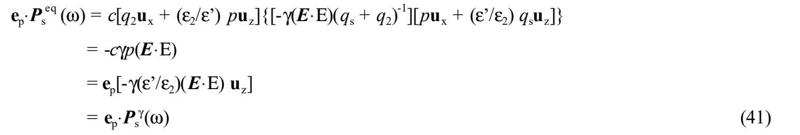

$$\boldsymbol P_s^\gamma(\omega)=-\gamma\frac{\varepsilon'}{\varepsilon_2}
[\boldsymbol E(\omega_i)\cdot\boldsymbol E(\omega_j)]\boldsymbol u_z
\quad\text{（面极化）}.\tag{42}$$

引入 $\boldsymbol P_s^\gamma\parallel\boldsymbol u_z$ 这一面极化性质后，不使用 $\boldsymbol k_s$ 也能重现纵向体相极化的角度和偏振特征。因此，体相纵向极化与面极化的 $z$ 分量不可区分。

当介质1、2都具有非线性时，有

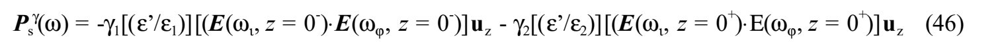

相应的等效面二阶非线性极化率为

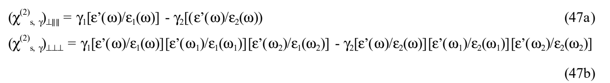

$\perp$ 表示 $z$ 方向，$\parallel$ 表示面内 $x,y$ 方向。

> **原文疑点（Q291）：** 式(46)两侧贡献原印均为负号，而式(47a)、(47b)是介质1项减介质2项，符号衔接需结合两侧法线方向重推。式(41)未定义的系数 $c$、矢量并置与点积及 $q_s$ 的记号也保留原图，不能仅因同字母就把此 $c$ 指定为光速。式号从(42)跳至(46)，原作未列(43)—(45)，译文不补造。

若 $(\boldsymbol E\cdot\nabla)\boldsymbol E$ 可忽略，则两个具有中心对称的介质产生的和频响应，可用以下有效面二阶非线性极化率张量描述：

$$\chi_{s,\mathrm{eff}}^{(2)}=\chi_s^{(2)}+\chi_{s,\gamma}^{(2)}.\tag{48}$$

其中 $\chi_s^{(2)}$ 是描述局域在界面或表面的电流的面二阶非线性极化率；$\chi_{s,\gamma}^{(2)}$ 则表示体相纵向非线性极化的贡献。

<!-- B624：PDF p14全页；原作略去处保留。 -->
### 2.6 讨论

（广濑原作省略。）

## 3 实验

### 3.1 各向同性介质

原综述表1汇总了代表性对称性下，各向同性介质中具有非零值的极化率张量分量。[附录D（7.5）](7.5%20附录D：和频张量的非零分量.md)增加了一些对称性。

下面仅作十分粗略的概括。

“各向同性”表面的张量分量取决于是否存在垂直于表面的镜面。存在这样一个镜面时，下列分量可非零：

$$\chi^{(2)}_{s,\perp\perp\perp},\quad\chi^{(2)}_{s,\perp\parallel\parallel},\quad
\chi^{(2)}_{s,\parallel\perp\parallel},\quad\chi^{(2)}_{s,\parallel\parallel\perp}.$$

没有镜面对称时，还可增加

$$\chi^{(2)}_{s,xyz}=-\chi^{(2)}_{s,yzx},\qquad
\chi^{(2)}_{s,xzy}=-\chi^{(2)}_{s,yxz},\qquad
\chi^{(2)}_{s,zxy}=-\chi^{(2)}_{s,zyx}.$$

> **原文疑点（Q292）：** 第一组原印为 $xyz$ 与 $yzx$ 互为负值；常见按前两指标配对的候选为 $xyz$ 与 $yxz$，而原文后两组的配对也须整体核验。这里保留全部原指标，不能单独替换一个后便假定整组对称关系成立。

手性分子的液面在宏观上各向同性，但没有垂直于界面的镜面。

**具有镜面对称的界面产生 SFG、SHG 的特点：** 两个激发光的偏振相同时，生成 p 偏振光；两者互相正交时，生成 s 偏振光。垂直入射不产生该信号，因为 $\chi^{(2)}_{s,\parallel\parallel\parallel}=0$。

各向同性表面具有 $C_{4v}$ 或更高对称性时，和频张量有以下四组独立分量：

$$\begin{aligned}
\chi^{(2)}_{s,\perp\perp\perp}&:\quad\chi^{(2)}_{s,zzz},\\
\chi^{(2)}_{s,\perp\parallel\parallel}&:\quad\chi^{(2)}_{s,zxx}=\chi^{(2)}_{s,zyy},\\
\chi^{(2)}_{s,\parallel\perp\parallel}&:\quad\chi^{(2)}_{s,xzx}=\chi^{(2)}_{s,yzy},\\
\chi^{(2)}_{s,\parallel\parallel\perp}&:\quad\chi^{(2)}_{s,xxz}=\chi^{(2)}_{s,yyz}.
\end{aligned}$$

偏振选择实验的讨论：原作省略。

利用参考样品产生干涉条纹的讨论：原作省略。

### 3.2 各向异性介质

例如单晶表面、重构表面等。

具有 $m3m\,(O_h)$ 及 $432\,(O)$ 对称性的晶体，其表面对称性为：

| 晶面 | 表面对称性 |
| --- | --- |
| (110) | 二重旋转对称 |
| (111) | 三重旋转对称 |
| (001) | 四重旋转对称 |

以下原作略。

（广濑原注：电偶极近似适用性的讨论见原综述第400—410页。）
