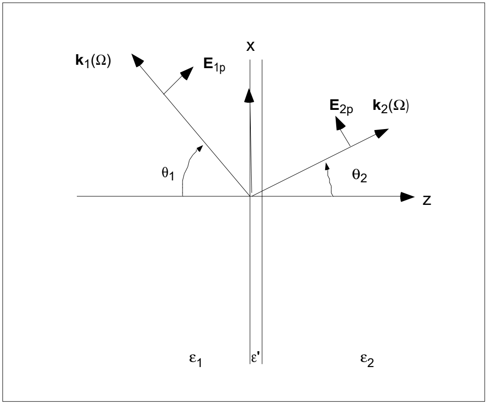
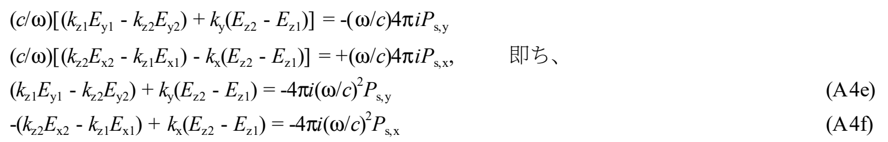
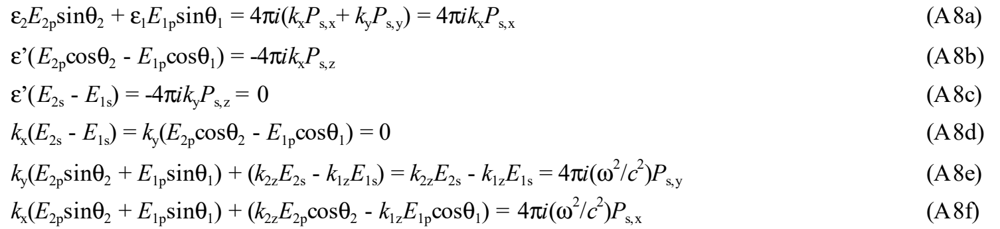
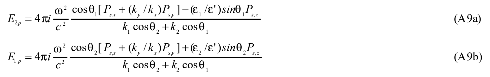

# 7.2 附录A：去除等介电常数近似的式(17)推导

<!-- B625：底本chap7-2.pdf p1全页。 -->
> 本附录属于广濑对 Heinz 综述的解读笔记；对应[7.1式(17)](7.1%20解读Tony%20F.%20Heinz的综述.md)。正文与原注已译，复杂原式按图保留；疑似笔误均未擅自采用修正。

## 波矢、场方向与基本关系

波矢和电场矢量如下图。

先汇总基本量之间的关系：

$$k=(n/c)\omega,\qquad\varepsilon=(c^2/\omega^2)k^2,\qquad\lambda=c/\nu.$$

> **译者辨读说明：** 最后一式分母为频率 $\nu$，不是前一个式子中的折射率 $n$；按原PDF字形区分，不照搬文本层的拉丁字母识别结果。

考虑单频光（平面波），利用微分算符 $\nabla$ 可替换为 $i\boldsymbol k$，由式(2b)得到电场和磁场的关系：

$$\boldsymbol H=(\omega/c)\boldsymbol k\times\boldsymbol E.\tag{A1}$$

$$\begin{aligned}
H_x&=(\omega/c)(k_yE_z-k_zE_y),\\
H_y&=(\omega/c)(k_zE_x-k_xE_z),\\
H_z&=(\omega/c)(k_xE_y-k_yE_x).
\end{aligned}\tag{A2}$$

将电场分成 transverse（面内）分量与 longitudinal（垂直）分量，写为 $\boldsymbol E=\boldsymbol E_t+E_z\boldsymbol u_z$，则

$$\begin{aligned}
\boldsymbol H&=\boldsymbol H_t+H_z\boldsymbol u_z\\
&=(\omega/c)\{\boldsymbol k_t\times\boldsymbol E_t+k_z(\boldsymbol u_z\times\boldsymbol E_t)+E_z(\boldsymbol k_t\times\boldsymbol u_z)\}.
\end{aligned}$$

> **原文疑点（Q293）：** 式(A1)、(A2)及其后无编号式的系数原印为 $\omega/c$；由式(2b)及时间因子 $e^{-i\omega t}$ 在非磁性假设下导出的是 $c/\omega$，附录B也使用后者。原文未说明附录A采用不同归一化，保留原系数待核。此外，这里的“面内／垂直”是相对于界面，不是相对于波矢；不能据英文 transverse、longitudinal 就认定与通常横波、纵波定义一致。

如图，取两个光线（波矢）构成的平面为 $xz$ 面，从介质1指向介质2的界面法线为 $z$ 轴；原点取界面上的发光位置。此时 $k_{1z}<0$、$k_{2z}>0$。p 偏振电场 $\boldsymbol E_p$ 的方向选择有 $180^\circ$ 任意性，这里按图选取，所以 $E_{1z}>0$、$E_{2z}<0$。还应记住下列关系。

<!-- B626：PDF p2全页与p3式A7，跨页波矢组完整。 -->
## 将边界条件写成场分量

$$\varepsilon=(c^2/\omega^2)k^2.\tag{A3}$$

用以上关系改写正文式(12a)—(12d)。由式(12a)得

$$\varepsilon_2E_{z2}-\varepsilon_1E_{z1}=-4\pi i\boldsymbol k_t\cdot\boldsymbol P_{s,t}
=-4\pi i(k_xP_{s,x}+k_yP_{s,y}).\tag{A4a}$$

由式(12b)得 $\boldsymbol E_{t2}-\boldsymbol E_{t1}=-(4\pi i/\varepsilon')P_{s,z}\boldsymbol k_t$，即

$$E_{x2}-E_{x1}=-(4\pi i/\varepsilon')k_xP_{s,z},\tag{A4b}$$

$$E_{y2}-E_{y1}=-(4\pi i/\varepsilon')k_yP_{s,z}.\tag{A4c}$$

由式(12c)得 $(k_xE_{y2}-k_yE_{x2})-(k_xE_{y1}-k_yE_{x1})=0$，即

$$k_x(E_{y2}-E_{y1})=k_y(E_{x2}-E_{x1}).\tag{A4d}$$

由式(12d)得

> **译者提示：** 原图第三行前的“即ち”意为“即”。此处原式已使用 $c/\omega$，与前页(A1)、(A2)的 $\omega/c$ 差异见Q293。

$\boldsymbol k_1$、$\boldsymbol k_2$、$\boldsymbol k_s$ 的 $x$、$y$ 分量在界面两侧相同。两个激发光共用同一入射面时，可选择坐标使 $k_y=0$。

式(A4d)可从(A4b)、(A4c)导出，(A4a)可从(A4e)、(A4f)导出，所以六式中只有四式独立。后者的推导可对 $(\mathrm{A4e})k_y+(\mathrm{A4f})k_x$，结合 $\boldsymbol k_i\cdot\boldsymbol E_i=0$ 和 $k_i^2=(\omega/c)^2\varepsilon_i$ 进行。

设 $\boldsymbol E_1$、$\boldsymbol E_2$ 与 $xz$ 面的夹角分别为 $\tau_1$、$\tau_2$。（绕 $\boldsymbol k$ 轴使 $xz$ 面转到 $\boldsymbol E$ 所在方向，定义为正方向。）

$$\begin{aligned}
E_{1p}&=E_1\cos\tau_1,&E_{2p}&=E_2\cos\tau_2,\\
E_{1s}&=E_1\sin\tau_1,&E_{2s}&=E_2\sin\tau_2.
\end{aligned}\tag{A5}$$

所考虑的介质均匀，波也为均匀波，$\boldsymbol E$ 与 $\boldsymbol H$ 正交。用 $\theta_1$、$\theta_2$ 表示场和波矢的坐标分量：

$$\begin{aligned}
E_{x1}&=E_{1p}\cos\theta_1,&E_{x2}&=E_{2p}\cos\theta_2,\\
E_{y1}&=E_{1s},&E_{y2}&=E_{2s},\\
E_{z1}&=E_{1p}\sin\theta_1,&E_{z2}&=E_{2p}\sin\theta_2.
\end{aligned}\tag{A6}$$

$$\begin{aligned}
k_x&=k_{x1}=k_{x2}=k_1\sin\theta_1=k_2\sin\theta_2,\\
k_y&=k_{y1}=k_{y2}=0,\\
k_{1z}&=-k_1\cos\theta_1,\qquad k_{2z}=+k_2\cos\theta.
\end{aligned}\tag{A7}$$

> **原文疑点（Q294）：** 式(A6)的 $E_{z2}$ 原印为正号，与p1选定的 $E_{2z}<0$ 及图中方向不一致；候选为 $-E_{2p}\sin\theta_2$。式(A7)末尾原印角度不带下标，候选为 $\theta_2$。这里保留原印，不将符号改动藏在后续推导中。

<!-- B627：PDF p3式A8至全文末。 -->
## 解出两侧辐射振幅

将式(A6)、(A7)代入(A4a)—(A4f)，得到

从(A8a)、(A8b)，利用

$$\varepsilon_1\sin\theta_1\cos\theta_2+\varepsilon_2\cos\theta_1\sin\theta_2
=\frac{c^2}{\omega^2}(k_1\cos\theta_2+k_2\cos\theta_1),$$

得到

> **原文疑点（Q295）：** 上述无编号恒等式右侧只含一次波数，与左侧及 $\varepsilon=(c^2/\omega^2)k^2$ 的量纲不一致，疑缺切向波数因子。由 $k_1\sin\theta_1=k_2\sin\theta_2=k_x$ 可构造带 $k_x$ 的候选，但整条推导仍需结合Q294的符号问题核验，暂不采用。

这一结果说明：即使 $\varepsilon_1=\varepsilon_2=\varepsilon'$，普通反射的反射率为零，仍会产生和频光，并且原文指出 $|E_{1p}|\ne|E_{2p}|$。

> **译者限定说明：** 不同方向的辐射振幅一般可不同；上句不等式沿原文保留，特殊源分量或几何下仍可能相等，不宜视作所有情形都严格不等的定理。

把(A8c)、(A9a)、(A9b)代入(A8e)，得

$$E_{2s}=E_{1s}=4\pi i\frac{\omega^2}{c^2}\frac{P_{s,y}}{k_{2z}-k_{1z}}
=4\pi i\frac{\omega^2}{c^2}\frac{P_{s,y}}{k_1\cos\theta_1+k_2\cos\theta_2}.\tag{A10}$$

对(A9)、(A10)加入 $\varepsilon_1=\varepsilon_2=\varepsilon'=1$ 的条件，可以验证正文式(17)得到满足。（关键是此时 $k_1=k_2$、$\theta_1=\theta_2$。）
