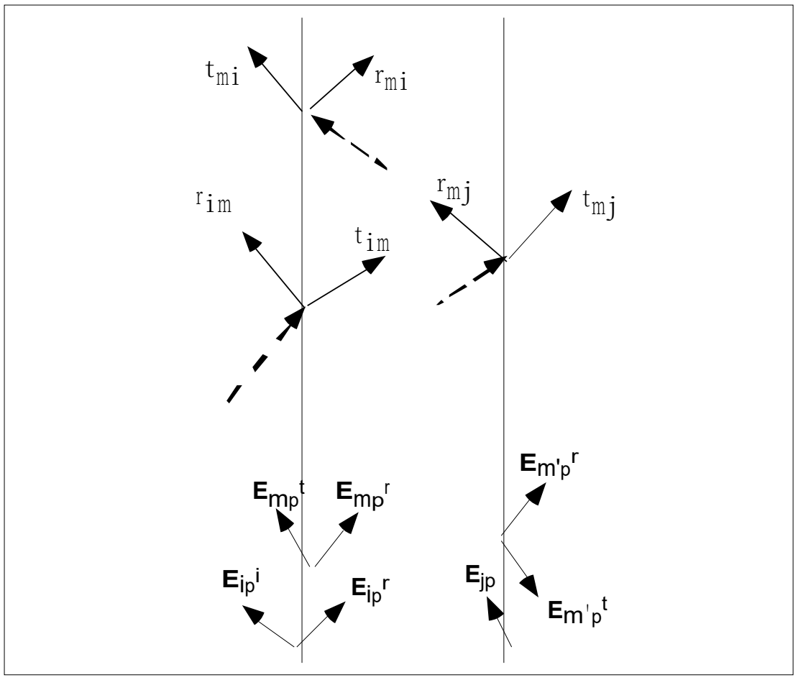
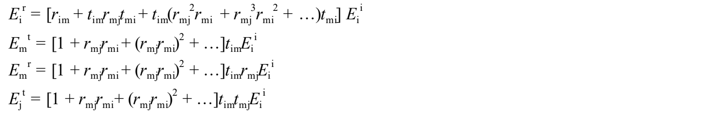
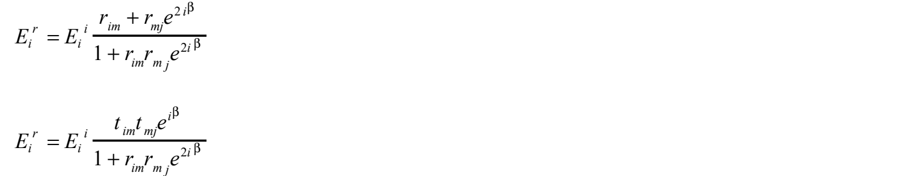
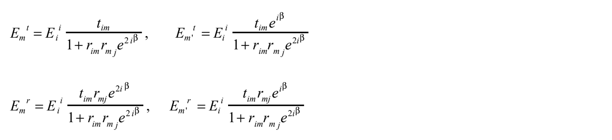
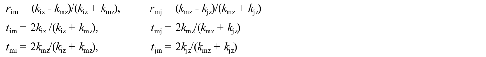
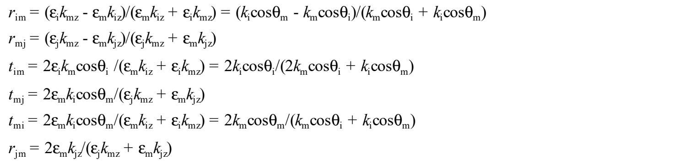
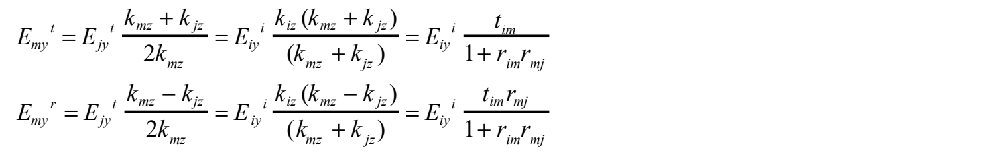
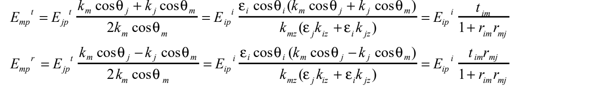

# 7.4 附录C：式(20)的折射率表示与多重反射

<!-- B631：底本chap7-4.pdf p1全页。 -->
> 接续[附录B（7.3）](7.3%20附录B：式20的推导.md)，对应正文式(20)的扩展。式中的 $r,t$ 为振幅反射、透射系数；$m,m'$ 区分膜的两个边界位置。所有公式步骤按原印保留。

## 路径记号与多重反射求和

如下图，用“起始”和“结果”的介质作下标，表示相关光的反射系数 $r$ 与透射系数 $t$。对于反射，下标依次为光所在一侧的介质、构成反射界面的另一侧介质；对于透射，下标依次为入射侧介质、透射侧介质。

计入多重反射，并区分膜两侧电场的传播方向，可得

使用 $r_{im}=-r_{mi}$、$r_{im}^2+t_{im}^2=1$，并计入厚度方向的光程，令 $\beta=(2\pi/\lambda_0)nd\cos\theta_m$，得

> **原文疑点（Q297）：** 原印 $r_{im}^2+t_{im}^2=1$ 对通常电场振幅的透射系数并非普遍成立，需区分功率归一化与 $t_{im}t_{mi}$ 等乘积关系。紧随其后的两个闭式左端均标为 $E_i^r$，第二个右端是含 $t_{im}t_{mj}$ 的透射路径，候选左端为 $E_j^t$。保留原式，不在未明确归一化前套用该恒等式。

<!-- B632：PDF p2全页。 -->
膜内两端、两个方向的电场为

## s、p偏振的界面系数

反射、透射系数如下。

**s 偏振：**

**p 偏振：**

> **原文疑点（Q298）：** p 偏振组的 $t_{im}$ 第二个分母原印为 $2k_m\cos\theta_i+k_i\cos\theta_m$，与前一个介电常数表示不一致；$t_{mj}$ 分子原印含 $k_i$，而该界面连接 $m,j$；末行左端写 $r_{jm}$，右侧却是形式类似透射系数的 $2\varepsilon_mk_{jz}/(\varepsilon_jk_{mz}+\varepsilon_mk_{jz})$，候选标签为 $t_{jm}$。这些条目需成组复算，保留原图，不任选一个表达式当作已确认正确值。

## 与零厚度结果的对应

由附录B式(B2)得到的关系可写为

由式(B4)得到的关系可写为

这些式子与计入多重反射后令膜厚趋于零的极限一致。
