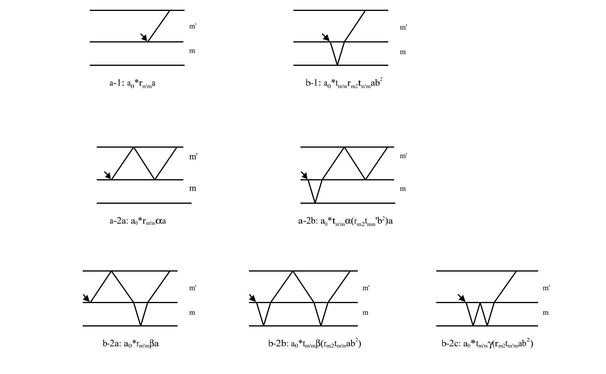
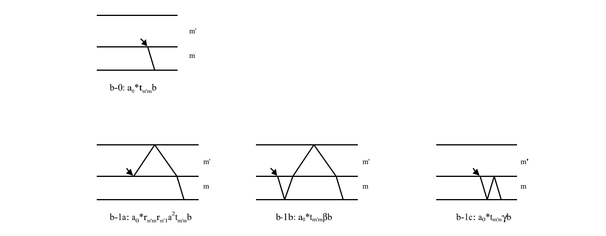
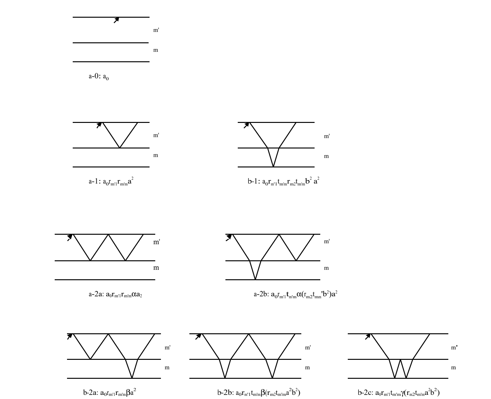
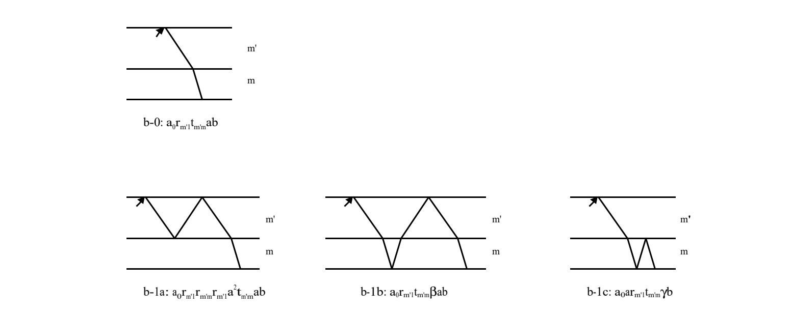
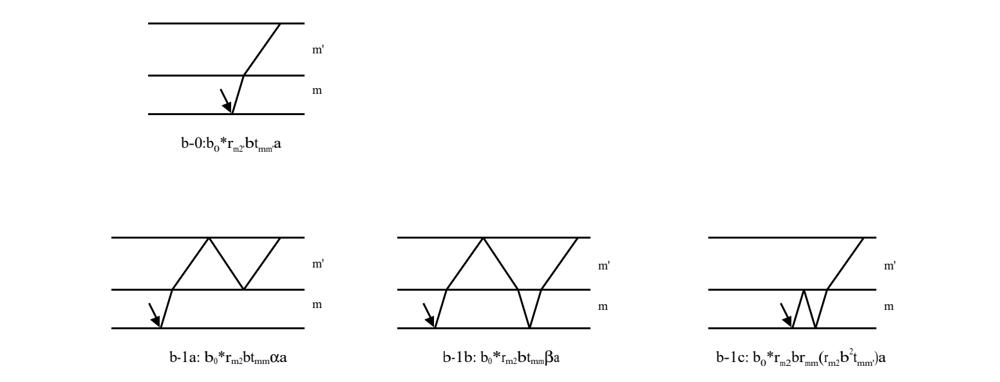
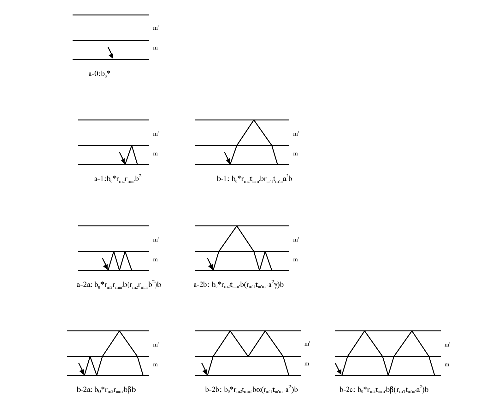
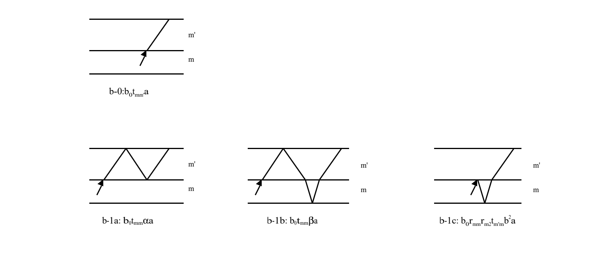
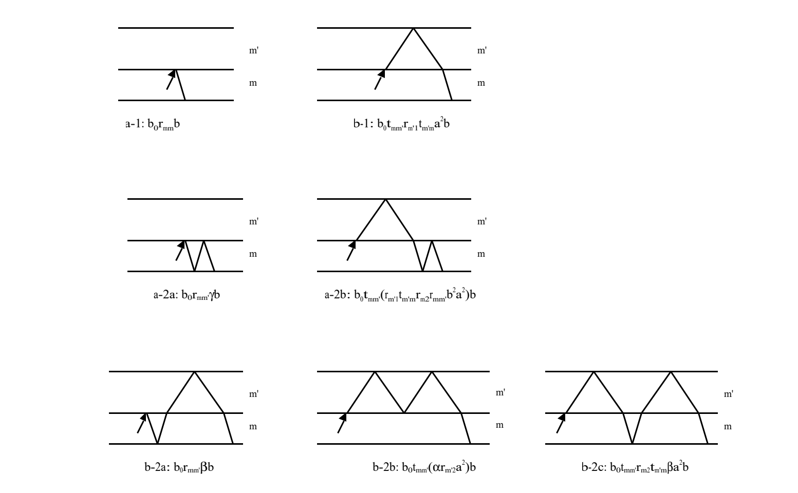

# 3.2 双层膜和频的一般式

> 原作：广瀬千秋（广濑千秋）
> 中文翻译：章力；本轮校订日期：2026-10-20。
> 底本：`日语原版/Chapter3/chap3-2.pdf`，共13页。B228—B248完成全13页本轮译校：33个唯一编号式，8组共46幅光路子图及附录A、B完整保留；原文疑点Q113—Q121保留待核，未采用原文公式修正。

## 阅读导引

1. 系数等（p1—2）：反射与透射系数、坐标分量转换，以及极化与辐射场之间的L系数。
2. 二层系概述2.1（p2—4）：相位和多重反射单元、四矩阵、共同分母Z，以及两膜层内正反向源的8条场表达式。
3. 详论2.2前部（p4—8）：从路径分支建立递推和逆矩阵求和，分别处理m′层两种源的反射、透射光，附23幅光路子图。
4. 详论2.2后部（p8—12）：反向组织m层路径与递推，求两种源的反射、透射光，附23幅光路子图。
5. 附录A（p12—13）：有限矩阵等比级数、逆矩阵求和及原文的收敛条件。条件存在疑点，参看Q120。
6. 附录B（p13）：以两端向量变化及相似变换说明矩阵表达的等价性；引用号与括注疑点见Q121。

建议先核源所在膜层、初始方向和观测出口，再选取场表达式。原文中若干矩阵化简、层标和相位不一致均保留并注；完成译校不等于这些原式已获理论确认。

## 引言

作为文件《膜产生的和频过程》的延伸，这里求出膜层数为两层时的表达式。（三层及以上会涉及张量的级数，过于复杂。）

## 1. 系数等

### 反射系数与透射系数

将电场表示为表面固定坐标系中的分量时，利用下列反射系数与透射系数关系来表示各坐标分量。

> **译者注（局部约定）：** 此处的$r$、$t$分别为电场振幅反射系数和透射系数。$s$、$p$标记偏振，$x$、$y$、$z$标记坐标分量；$z$分量与$p$偏振的反射系数之间保留原文的负号。不将它们改称光强反射率或透射率。

$$
r_{1m,s} = \frac{n_1 \cos\theta_1 - n_m \cos\theta_m}{n_1 \cos\theta_1 + n_m \cos\theta_m}, \quad
t_{1m,s} = \frac{2n_1 \cos\theta_1}{n_1 \cos\theta_1 + n_m \cos\theta_m}
$$

$$
r_{1m,p} = \frac{n_1 \cos\theta_m - n_m \cos\theta_1}{n_1 \cos\theta_m + n_m \cos\theta_1}, \quad
t_{1m,p} = \frac{2n_1 \cos\theta_1}{n_1 \cos\theta_m + n_m \cos\theta_1}
$$

$$
r_{1m,x} = -r_{m1,x} = r_{1m,p}, \quad r_{1m,y} = -r_{m1,y} = r_{1m,s}, \quad r_{1m,z} = -r_{m1,z} = -r_{1m,p}
$$

$$
r_{2m,x} = -r_{m2,x} = r_{2m,p}, \quad r_{2m,y} = -r_{m2,y} = r_{2m,s}, \quad r_{2m,z} = -r_{m2,z} = -r_{2m,p}
$$

$$
t_{1m,x} = (\cos\theta_m / \cos\theta_1) t_{1m,p}, \quad t_{1m,y} = t_{1m,s}, \quad t_{1m,z} = (\sin\theta_m / \sin\theta_1) t_{1m,p}
$$

$$
t_{m1,x} = (\cos\theta_1 / \cos\theta_m) t_{m1,p}, \quad t_{m1,y} = t_{m1,s}, \quad t_{m1,z} = (\sin\theta_1 / \sin\theta_m) t_{m1,p}
$$

$$
t_{2m,x} = (\cos\theta_m / \cos\theta_2) t_{2m,p}, \quad t_{2m,y} = t_{2m,s}, \quad t_{2m,z} = (\sin\theta_m / \sin\theta_2) t_{2m,p}
$$

$$
t_{m2,x} = (\cos\theta_2 / \cos\theta_m) t_{m2,p}, \quad t_{m2,y} = t_{m2,s}, \quad t_{m2,z} = (\sin\theta_2 / \sin\theta_m) t_{m2,p}
$$

$$
t_{1m,\alpha} t_{m1,\alpha} = 1 + r_{1m,\alpha} r_{m1,\alpha} = 1 - r_{1m,\alpha}^2, \quad
t_{2m,\alpha} t_{m2,\alpha} = 1 + r_{2m,\alpha} r_{m2,\alpha} = 1 - r_{2m,\alpha}^2, \quad (\alpha = x, y, z)
$$

### L系数与电场振幅

L系数将极化与由该极化产生的光的电场振幅联系起来：

$$
E_{\mathrm{SF},\alpha}=\sum_{\beta}L_{\alpha\beta}P^{\mathrm{SF}}_{\beta}
$$

根据广义斯涅耳折射公式，所产生的和频光既有向上的（$-$），也有向下的（$+$）。此外，L系数的表达式随极化所在位置而异。最初导出的公式考虑无限薄的膜$m$发生极化，以及由此向介质1和介质2射出的光，将$s$、$p$偏振的电场振幅与极化的$x$、$y$、$z$分量联系起来；这里将其推广。另外，省略公共因子$4\pi i\omega_{\mathrm{SF}}/c$（用波矢代替折射率时，为$4\pi i\omega_{\mathrm{SF}}^2/c^2$）。

L系数的记法为$L_{i/j,s(p),\alpha}$：当极化薄片$m'$夹在$i$层与$j$层之间时，它表示极化的$\alpha$分量（$\alpha=x,y,z$）与其所产生光的$s$或$p$偏振分量之间的系数。向上（$-$）与向下（$+$）的光分别以上标$-$和$+$区分。

> **译者注（局部约定）：** 此处L连接极化分量与辐射场偏振分量；上下标顺序与前式$L_{\alpha\beta}$的抽象分量记法应结合各自定义阅读。下列折射率比按原文不补SF下标，$m'$、$m''$是各界面极化薄片的标记，不自行等同于下一部分中的有限厚度膜层。所省略的公共因子按本节原文保留。

对于介质1与层叠膜$m$之间的极化薄片$m'$所产生的光：

$$
L^{-}_{1/m,p,x} = \frac{\cos\theta_{m,\text{SF}}}{n_{1,\text{SF}} \cos\theta_{m,\text{SF}} + n_{m,\text{SF}} \cos\theta_{1,\text{SF}}}
$$

$$
L^{-}_{1/m,s,y} = \frac{1}{n_{1,\text{SF}} \cos\theta_{1,\text{SF}} + n_{m,\text{SF}} \cos\theta_{m,\text{SF}}}
$$

$$
\begin{aligned}
L^{-}_{1/m,p,z} & = \frac{(n_m/n_{m'}) \sin\theta_{m',\text{SF}}}{n_{1,\text{SF}} \cos\theta_{m,\text{SF}} + n_{m,\text{SF}} \cos\theta_{1,\text{SF}}} \\
& = \frac{(n_m/n_{m'})^2 \sin\theta_{m,\text{SF}}}{n_{1,\text{SF}} \cos\theta_{m,\text{SF}} + n_{m,\text{SF}} \cos\theta_{1,\text{SF}}}
\end{aligned}
$$

$$
L^{+}_{1/m,p,x} = \frac{\cos\theta_{1,\text{SF}}}{n_{1,\text{SF}} \cos\theta_{m,\text{SF}} + n_{m,\text{SF}} \cos\theta_{1,\text{SF}}}
$$

$$
L^{+}_{1/m,s,y} = \frac{1}{n_{1,\text{SF}} \cos\theta_{1,\text{SF}} + n_{m,\text{SF}} \cos\theta_{m,\text{SF}}}
$$

$$
\begin{aligned}
L^{+}_{1/m,p,z} & = -\frac{(n_1/n_{m'}) \sin\theta_{m',\text{SF}}}{n_{1,\text{SF}} \cos\theta_{m,\text{SF}} + n_{m,\text{SF}} \cos\theta_{1,\text{SF}}} \\
& = -\frac{(n_1/n_{m'})^2 \sin\theta_{1,\text{SF}}}{n_{1,\text{SF}} \cos\theta_{m,\text{SF}} + n_{m,\text{SF}} \cos\theta_{1,\text{SF}}}
\end{aligned}
$$

对于介质2与层叠膜$m$之间的极化薄片$m''$所产生的光：

$$
L^{-}_{2/m,p,x} = \frac{\cos\theta_{2,\text{SF}}}{n_{2,\text{SF}} \cos\theta_{m,\text{SF}} + n_{m,\text{SF}} \cos\theta_{2,\text{SF}}}
$$

$$
L^{-}_{2/m,s,y} = \frac{1}{n_{2,\text{SF}} \cos\theta_{2,\text{SF}} + n_{m,\text{SF}} \cos\theta_{m,\text{SF}}}
$$

$$
\begin{aligned}
L^{-}_{2/m,p,z} & = \frac{(n_2/n_{m''}) \sin\theta_{m'',\text{SF}}}{n_{2,\text{SF}} \cos\theta_{m,\text{SF}} + n_{m,\text{SF}} \cos\theta_{2,\text{SF}}} \\
& = \frac{(n_2/n_{m''})^2 \sin\theta_{2,\text{SF}}}{n_{2,\text{SF}} \cos\theta_{m,\text{SF}} + n_{m,\text{SF}} \cos\theta_{2,\text{SF}}}
\end{aligned}
$$

$$
L^{+}_{2/m,p,x} = \frac{\cos\theta_{m,\text{SF}}}{n_{2,\text{SF}} \cos\theta_{m,\text{SF}} + n_{m,\text{SF}} \cos\theta_{2,\text{SF}}}
$$

$$
L^{+}_{2/m,s,y} = \frac{1}{n_{2,\text{SF}} \cos\theta_{2,\text{SF}} + n_{m,\text{SF}} \cos\theta_{m,\text{SF}}}
$$

$$
\begin{aligned}
L^{+}_{2/m,p,z} & = -\frac{(n_m/n_{m''}) \sin\theta_{m'',\text{SF}}}{n_{2,\text{SF}} \cos\theta_{m,\text{SF}} + n_{m,\text{SF}} \cos\theta_{2,\text{SF}}} \\
& = -\frac{(n_m/n_{m''})^2 \sin\theta_{m,\text{SF}}}{n_{2,\text{SF}} \cos\theta_{m,\text{SF}} + n_{m,\text{SF}} \cos\theta_{2,\text{SF}}}
\end{aligned}
$$

对于层叠膜内部的极化薄片所产生的光：

$$
L^{-}_{m/m,p,x} = L^{+}_{m/m,p,x} = \frac{\cos\theta_{m,\text{SF}}}{2 n_{m,\text{SF}} \cos\theta_{m,\text{SF}}}
$$

$$
L^{-}_{m/m,s,y} = L^{+}_{m/m,s,y} = \frac{1}{2 n_{m,\text{SF}} \cos\theta_{m,\text{SF}}}
$$

$$
L^{-}_{m/m,p,z} = -L^{+}_{m/m,p,z} = \frac{\sin\theta_{m,\text{SF}}}{2 n_{m,\text{SF}} \cos\theta_{m,\text{SF}}}
$$

## 2. 二层系（$1/m'/m/2$）的和频

### 2.1 概述

下文所用符号定义如下。

#### 到达第一个界面之前的相位变化

$$
a_0 = \exp(i z_1 / \cos\theta_{m'}), \quad a^*_0 = \exp[i (h_{m'} - z_1) / \cos\theta_{m'}]
$$

$$
b_0 = \exp(i z_1 / \cos\theta_{m'}), \quad b^*_0 = \exp[i (h_{m'} - z_1) / \cos\theta_{m'}]
$$

（这里需要注意，带$*$号的量并不表示复共轭。）

> **译者注（原文疑点Q113，PDF p2）：** 原文将$b_0$、$b_0^*$分别写成与$a_0$、$a_0^*$相同的表达式，仍使用$z_1$、$h_{m'}$和$\theta_{m'}$，此处照录。若$b_0$对应$m$层内源点，候选为相应的$z_2$、$h_m$、$\theta_m$写法，须结合后续路径定义核验；未采用替换。这些相位指数未显式写波数因子，原页亦未在此说明长度归一化，不自行补入。

#### 多重反射中的单元

$$
\alpha = r_{m'1} r_{m'm} a^2, \quad a = \exp(i h_{m'} / \cos\theta_{m'})
$$

$$
\beta = r_{m'1} t_{m'm} r_{m2} t_{mm'} a^2 b^2
$$

$$
\gamma = r_{m2} r_{mm'} b^2, \quad b = \exp(i h_m / \cos\theta_m)
$$

$$
X = \begin{bmatrix}
\alpha & \beta \\
\alpha & \beta + \gamma
\end{bmatrix}, \quad
X' = \begin{bmatrix}
\alpha + \beta & \beta\gamma \\
1 & \gamma
\end{bmatrix}
$$

$$
Y = \begin{bmatrix}
\beta + \gamma & \alpha\beta \\
1 & \alpha
\end{bmatrix}, \quad
Y' = \begin{bmatrix}
\gamma & \beta \\
\gamma & \alpha + \beta
\end{bmatrix}
$$

$$
\begin{aligned}
Z&=|E-X|=|E-X'|=|E-Y|=|E-Y'|\\
&=1+r_{1m'}r_{m'm}a^2+(r_{m'm}+r_{1m'}a^2)r_{m2}b^2
\end{aligned}
$$

> **译者注（矩阵记号）：** 由本段矩阵级数及逆矩阵的用法，这里的$E$应读作二阶单位矩阵，竖线表示行列式；它与后面表示电场的$E^\pm$不同。此说明为译者依据上下文作出的记号解释，原文未在本段另列定义。$a$、$b$为传播相位因子，$\alpha$、$\beta$、$\gamma$为反射和透射因子与相位的组合，不等同于其他章节的分子响应系数。

#### $m'$层中深度$z_1$处产生的和频光

**$E^+$源（初始向下传播的光）**

$$
\begin{aligned}
E^-(0^-)
&=t_{m'1}a_0^*a
\begin{bmatrix}r_{m'm}&t_{m'm}r_{m2}t_{mm'}b^2\end{bmatrix}\\
&\qquad\cdot[E+X+X^2+\cdots]
\begin{bmatrix}1\\1\end{bmatrix}L^+_{m'/m'}P(z_1)\\
&=t_{m'1}a_0^*a
\begin{bmatrix}r_{m'm}&t_{m'm}r_{m2}t_{mm'}b^2\end{bmatrix}\\
&\qquad\cdot[E-X]^{-1}
\begin{bmatrix}1\\1\end{bmatrix}L^+_{m'/m'}P(z_1)\\
&=t_{m'1}a_0^*a(r_{m'm}+r_{m2}b^2)L^+_{m'/m'}P(z_1)/Z
\end{aligned}
\tag{2.1}
$$

$$
\begin{aligned}
E^+(h_m^+)
&=t_{m2}a_0^*t_{m'm}b
\begin{bmatrix}1&\alpha\end{bmatrix}
[E+Y+Y^2+\cdots]
\begin{bmatrix}1\\0\end{bmatrix}L^+_{m'/m'}P(z_1)\\
&=t_{m2}a_0^*t_{m'm}b
\begin{bmatrix}1&\alpha\end{bmatrix}
[E-Y]^{-1}
\begin{bmatrix}1\\0\end{bmatrix}L^+_{m'/m'}P(z_1)\\
&=t_{m2}a_0^*t_{m'm}bL^+_{m'/m'}P(z_1)/Z
\end{aligned}
\tag{2.2}
$$

> **译者注（转录与排版）：** 两式按原页保持“行向量—矩阵级数（或逆矩阵）—列向量”的顺序；旧译将第一个等号后的列向量提前，现已恢复底本顺序。式(2.1)为适应页面宽度分行，续行的乘点仅为排版所加。$0^-$、$h_m^+$等场位置记法均依本节原式，不改成其他章节的界面坐标。

**$E^-$源（初始向上传播的光）**

$$
\begin{aligned}
E^-(0^-)
&=t_{m'1}a_0
\begin{bmatrix}\alpha&\beta\end{bmatrix}
[E+X+X^2+\cdots]
\begin{bmatrix}1\\1\end{bmatrix}L^-_{m'/m'}P(z_1)\\
&=t_{m'1}a_0
\begin{bmatrix}\alpha&\beta\end{bmatrix}
[E-X]^{-1}
\begin{bmatrix}1\\1\end{bmatrix}L^-_{m'/m'}P(z_1)\\
&=t_{m'1}a_0(1+r_{mm'}r_{m2}b^2)L^-_{m'/m'}P(z_1)/Z
\end{aligned}
\tag{2.3}
$$

$$
\begin{aligned}
E^+(h_m^+)
&=t_{m2}a_0r_{m'1}at_{m'm}
\begin{bmatrix}1&\alpha\end{bmatrix}
[E+Y+Y^2+\cdots]
\begin{bmatrix}1\\0\end{bmatrix}L^-_{m'/m'}P(z_1)\\
&=t_{m2}a_0r_{m'1}at_{m'm}
\begin{bmatrix}1&\alpha\end{bmatrix}
[E-Y]^{-1}
\begin{bmatrix}1\\0\end{bmatrix}L^-_{m'/m'}P(z_1)\\
&=t_{m2}a_0r_{m'1}t_{m'm}abL^-_{m'/m'}P(z_1)/Z
\end{aligned}
\tag{2.4}
$$

> **译者注（原文疑点Q114，PDF p3，式2.3—2.4）：** 式(2.3)前两行的行向量原印为$[\alpha,\beta]$，但按已定义的$X$计算，该矩阵乘积为$(\alpha+\beta-\alpha\gamma)/Z$，与末行的$(1+r_{mm'}r_{m2}b^2)/Z$不一致。若将行向量改为$[1,0]$，可得到末行所写的$(1-\gamma)/Z$，但这仅是待核候选，本译文仍保留原向量。式(2.4)前两行的外部因子均未写$b$，末行却含$b$；由于其中的矩阵乘积为$1/Z$，两种写法亦存在待核差异。候选为前两行补$b$或另核末行相位，均未采用。两式完整三行按底本保留，未用候选值替换。

> **译者注（旧译转录修复）：** 两式首行恢复为“行向量—矩阵级数—列向量”的原文次序；式(2.4)补回旧译遗漏的逆矩阵中间行。这些属于旧译修复，不是对原文公式的修正。

#### $m$层中距$m'/m$界面深度$z_2$处产生的和频光

**$E^+$源（初始向下传播的光）**

$$
\begin{aligned}
E^-(0^-)
&=t_{m'1}b_0^*r_{m2}ab
\begin{bmatrix}t_{m'm}&\gamma t_{m'm}\end{bmatrix}\\
&\qquad\cdot[E+X'+X'^2+\cdots]
\begin{bmatrix}1\\0\end{bmatrix}L^+_{m/m}P(z_2)\\
&=t_{m'1}b_0^*r_{m2}ab
\begin{bmatrix}t_{m'm}&\gamma t_{m'm}\end{bmatrix}\\
&\qquad\cdot[E-X']^{-1}
\begin{bmatrix}1\\0\end{bmatrix}L^+_{m/m}P(z_2)\\
&=t_{m'1}b_0^*t_{mm'}r_{m2}abL^+_{m/m}P(z_2)/Z
\end{aligned}
\tag{2.5}
$$

$$
\begin{aligned}
E^+(h_m^+)
&=t_{m2}b_0^*t_{m'm}b
\begin{bmatrix}\gamma&\beta\end{bmatrix}
[E+Y'+Y'^2+\cdots]
\begin{bmatrix}1\\1\end{bmatrix}L^+_{m/m}P(z_2)\\
&=t_{m2}b_0^*t_{m'm}b
\begin{bmatrix}\gamma&\beta\end{bmatrix}
[E-Y']^{-1}
\begin{bmatrix}1\\1\end{bmatrix}L^+_{m/m}P(z_2)\\
&=t_{m2}b_0^*(1+r_{1m'}r_{m'm}a^2)L^+_{m/m}P(z_2)/Z
\end{aligned}
\tag{2.6}
$$

> **译者注（原文疑点Q115，PDF p3，式2.5—2.6）：** 式(2.5)前两行的行向量含$t_{m'm}$，末行却写$t_{mm'}$。按前述$X'$求矩阵乘积，得到$t_{m'm}/Z$，层标差异保留原样；候选为统一至同一透射方向，须结合光路核验。式(2.6)前两行保留外部$t_{m'm}b$及行向量$[\gamma,\beta]$，其中矩阵乘积为$[\gamma(1-\alpha)+\beta]/Z$；末行则不含该外部因子，括号为$1+r_{1m'}r_{m'm}a^2=1-\alpha$，两者一般不一致。候选为重新核对行向量和外部路径因子的配置，未采用替换。$b_0^*$仍沿用本节原定义，相关层标疑点见Q113。

> **译者注（旧译转录修复）：** 已恢复两式首行的“行向量—矩阵级数—列向量”顺序，并补回两式旧译遗漏的逆矩阵中间行。式(2.5)续行乘点仅为排版所加；所有原文因子均保留。

**$E^-$源（初始向上传播的光）**

$$
\begin{aligned}
E^-(0^-)
&=t_{m'1}b_0\begin{bmatrix}1&\gamma\end{bmatrix}
[E+X'+X'^2+\cdots]
\begin{bmatrix}1\\0\end{bmatrix}L^-_{m/m}P(z_2)\\
&=t_{m'1}b_0\begin{bmatrix}1&\gamma\end{bmatrix}
[E-X']^{-1}
\begin{bmatrix}1\\0\end{bmatrix}L^-_{m/m}P(z_2)\\
&=t_{m'1}b_0at_{mm'}L^-_{m/m}P(z_2)/Z
\end{aligned}
\tag{2.7}
$$

$$
\begin{aligned}
E^+(h_m^+)
&=t_{m2}b_0b
\begin{bmatrix}r_{mm'}&t_{mm'}r_{m'1}t_{m'm}a^2\end{bmatrix}\\
&\qquad\cdot[E+Y'+Y'^2+\cdots]
\begin{bmatrix}1\\1\end{bmatrix}L^-_{m/m}P(z_2)\\
&=t_{m2}b_0b
\begin{bmatrix}r_{mm'}&t_{mm'}r_{m'1}t_{m'm}a^2\end{bmatrix}\\
&\qquad\cdot[E-Y']^{-1}
\begin{bmatrix}1\\1\end{bmatrix}L^-_{m/m}P(z_2)\\
&=-t_{m2}b_0b(r_{m'm}+r_{1m'}a^2)L^-_{m/m}P(z_2)/Z
\end{aligned}
\tag{2.8}
$$

> **译者注（原文疑点Q116，PDF p3—4，式2.7）：** 按前面定义的$X'$，行向量$[1,\gamma]$、逆矩阵与列向量$[1,0]^{\mathsf T}$的乘积为$1/Z$。原式前两行的外部因子只有$t_{m'1}b_0$，末行却另含$at_{mm'}$。候选为前两行补入该路径因子或重新核对末行，尚未采用；三行均按原页保留。$b_0$定义的层标疑点仍见Q113。

> **译者注（旧译转录修复）：** 恢复两式首行的矩阵乘法顺序，补回两式旧译遗漏的逆矩阵中间行。式(2.8)为适应页面宽度分行，续行乘点仅为排版所加。

### 2.2 详论

考察光即将出射到外部之前的电场振幅。

#### $m'$层中深度$z_1$处产生的和频光

光的路径在来自介质1的光于介质2的界面发生反射、折射时出现分支选择。恰当地计入这种选择，并考虑使$E^+$反转为$E^-$的反射次数增加，便可求得所需的表达式。

按照所产生的光最初到达$m'/m$界面时的行为分类。对于在$m'/m$界面反射的情形，再增加一次反转时衍生出的路径可写为：

$$
\begin{aligned}
xr_{m'm}y
&\Rightarrow xr_{m'm}r_{m'1}a^2r_{m'm}y
=xr_{m'm}\alpha y,\\
xt_{m'm}r_{m2}t_{mm'}r_{m'1}a^2b^2r_{m'm}y
&=xt_{m'm}\alpha[r_{m2}t_{mm'}b^2]y.
\end{aligned}
\tag{2.9}
$$

对于透过$m'/m$界面、在$m/2$界面反射的情形，再增加一次反转时衍生出的路径可写为：

$$
\begin{aligned}
x't_{m'm}y'
&\Rightarrow xr_{m'm}r_{m'1}a^2t_{m'm}y'\\
&=xr_{m'm}[r_{m'1}a^2t_{m'm}]y',\\
xt_{m'm}r_{m2}t_{mm'}r_{m'1}a^2b^2t_{m'm}y'
&=xt_{m'm}\beta y',\\
xt_{m'm}r_{m2}r_{mm'}b^2y'
&=xt_{m'm}\gamma y'.
\end{aligned}
\tag{2.10}
$$

（先参照下文的具体例子，可能更容易理解。）

> **译者注（局部记号与原文疑点Q117，PDF p4）：** 这里的$x$、$x'$、$y$、$y'$用于光路因子的组织，不按坐标分量解读。式(2.10)箭头左端原印$x'$，箭头右端及后续各支写$x$，本段未说明二者关系，此处保留差异。候选为同一前置因子的记号统一，但应结合后续递推定义核验，未采用。式(2.9)—(2.10)内的$\alpha$、$\beta$、$\gamma$沿用2.1的多重反射组合定义。

因此，将经历$n$次反转的光在出口正下方的电场写为：

$$
x (r_{m'm} y_n + t_{m'm} y_n') = x (r_{m'm}, \; t_{m'm}) \begin{bmatrix} y_n \\ y_n' \end{bmatrix}
$$

则经历$(n+1)$次反转的光在出口正下方的电场可写为：

$$
\begin{aligned}
& x \bigl[ r_{m'm} (\alpha y_n + r_{m'1} t_{m'm} a^2 y_n') \\
&\qquad + t_{m'm} (\alpha r_{m2} t_{mm'} b^2 y_n + \beta y_n' + \gamma y_n') \bigr] \\
&= x (r_{m'm}, \; t_{m'm})
\begin{bmatrix}
\alpha & r_{m'1} t_{m'm} a^2 \\
r_{m2} t_{mm'} b^2 \alpha & \beta + \gamma
\end{bmatrix}
\begin{bmatrix} y_n \\ y_n' \end{bmatrix} \\
&= x (r_{m'm}, \; t_{m'm})
\begin{bmatrix}
\alpha & r_{m'1} t_{m'm} a^2 \\
r_{m2} t_{mm'} b^2 \alpha & \beta + \gamma
\end{bmatrix}^{n+1}
\begin{bmatrix} y_0 \\ y_0' \end{bmatrix}
\end{aligned}
$$

根据附录，当右端矩阵的幂趋于零时，合成电场（存在零次项贡献时）为：

$$
\begin{aligned}
E_{\mathrm{net}}
&= x (r_{m'm}, \; t_{m'm})
\begin{bmatrix}
1 - \alpha & -r_{m'1} t_{m'm} a^2 \\
-r_{m2} t_{mm'} b^2 \alpha & 1 - \beta - \gamma
\end{bmatrix}^{-1}
\begin{bmatrix} y_0 \\ y_0' \end{bmatrix} \\
&= \frac{1}{1 - \alpha - \beta - \gamma + \alpha\gamma} \;
x (r_{m'm}, \; t_{m'm})
\begin{bmatrix}
1 - (\beta + \gamma) & r_{m'1} t_{m'm} a^2 \\
r_{m2} t_{mm'} b^2 \alpha & 1 - \alpha
\end{bmatrix}
\begin{bmatrix} y_0 \\ y_0' \end{bmatrix}
\end{aligned}
\tag{2.11}
$$

> **译者注（递推与收敛条件）：** 本段保留原文“矩阵的幂趋于零”及“存在零次项贡献”的条件，不能将式(2.11)视为不附条件的级数恒等式。$y_n$、$y_n'$为两类路径的递推分量；本段公式统一使用$x$，但未显式解释前式的$x'$，故Q117仍保留待核。

##### $E^+$源（初始向下传播）

**反射和频光 $E^-(0^-)$**

在到达出口之前，$E^+$ 变为 $E^-$ 的反射次数为 1 次的情况如下图所示（a-1 和 b-1）。考虑反射次数为 2 的情况时，按产生的光最初到达 $m'/m$ 界面时的行为分类：从路径 a-1（在 $m'/m$ 界面处反射）衍生出路径 a-2a 和 a-2b；从路径 b-1（穿过 $m'/m$ 界面并在 $m/2$ 界面反射）衍生出路径 b-2a、b-2b 和 b-2c。

图内标记与各路径因子按原图保留；$m'$与$m$分别标示两膜层。

应用 (2.11) 式，令 $x = a^*_0$、$y_0 = a$、$y_0' = r_{m2} t_{mm'} b^2 a$。于是：

$$
\begin{aligned}
E_{\mathrm{net}}
&= \frac{1}{1 - \alpha - \beta - \gamma + \alpha\gamma} \;
a^*_0 (r_{m'm}, \; t_{m'm})
\begin{bmatrix}
1 - (\beta + \gamma) & r_{m'1} t_{m'm} a^2 \\
r_{m2} t_{mm'} b^2 \alpha & 1 - \alpha
\end{bmatrix}
\begin{bmatrix} a \\ r_{m2} t_{mm'} b^2 a \end{bmatrix} \\
&= \frac{r_{m'm} (1 - r_{m2} r_{mm'} b^2) + r_{m2} (1 + r_{mm'} r_{m'm}) b^2}{1 - \alpha - \beta - \gamma + \alpha\gamma} \; a^*_0 a \\
&= a^*_0 a \; \frac{r_{m'm} + r_{m2} b^2}{1 - \alpha - \beta - \gamma + \alpha\gamma}
\end{aligned}
\tag{2.12}
$$

**透射和频光 $E^+(h_m^+)$**

图内标记与各路径因子按原图保留；$m'$与$m$分别标示两膜层。

应用 (2.11) 式，令 $x = a^*_0$、$y_0 = 0$、$y_0' = b$。于是：

$$
\begin{aligned}
E_{\mathrm{net}}
&= \frac{1}{1 - \alpha - \beta - \gamma + \alpha\gamma} \;
a^*_0 (r_{m'm}, \; t_{m'm})
\begin{bmatrix}
1 - (\beta + \gamma) & r_{m'1} t_{m'm} a^2 \\
r_{m2} t_{mm'} b^2 \alpha & 1 - \alpha
\end{bmatrix}
\begin{bmatrix} 0 \\ b \end{bmatrix} \\
&= \frac{t_{m'm}}{1 - \alpha - \beta - \gamma + \alpha\gamma} \; a^*_0 b
\end{aligned}
\tag{2.13}
$$

##### $E^-$源（初始向上传播）

**反射和频光 $E^-(0^-)$**

同理，此时可能的路径如下图所示。

图内标记与各路径因子按原图保留；$m'$与$m$分别标示两膜层。

此时存在直接出射的项 $a_0$，以及遵循上述公式的项。对后者应用 (2.11) 式，令 $x = a_0 r_{m'1}$、$y_0 = a^2$、$y_0' = r_{m2} t_{mm'} a^2 b^2$。于是：

$$
\begin{aligned}
E_{\mathrm{net}}
&= a_0 + \frac{1}{1 - \alpha - \beta - \gamma + \alpha\gamma} \;
a_0 r_{m'1} (r_{m'm}, \; t_{m'm})
\begin{bmatrix}
1 - (\beta + \gamma) & r_{m'1} t_{m'm} a^2 \\
r_{m2} t_{mm'} b^2 \alpha & 1 - \alpha
\end{bmatrix}
\begin{bmatrix} a^2 \\ r_{m2} t_{mm'} a^2 b^2 \end{bmatrix}\bigr] \\
&= a_0 + \frac{r_{m'1} (r_{m'm} + r_{m2} b^2) a^2}{1 - \alpha - \beta - \gamma + \alpha\gamma} \; a_0 \\
&= \frac{1 - r_{m'm} r_{m2} b^2}{1 - \alpha - \beta - \gamma + \alpha\gamma} \; a_0
\end{aligned}
\tag{2.14}
$$

> **译者注（原文疑点Q118，PDF p7）：** 式(2.14)第一行在初值列向量后多印一个右方括号，以下保留该原字形。原图部分路径因子的层标及$a^2$字形亦有不一致，保留原图，不据相似路径改写。

**透射和频光 $E^+(h_m^+)$**

同理，此时可能的路径如下图所示。

图内标记与各路径因子按原图保留；$m'$与$m$分别标示两膜层。

应用 (2.11) 式，令 $x = a_0 r_{m'1} a$、$y_0 = 0$、$y_0' = b$。于是：

$$
\begin{aligned}
E_{\mathrm{net}}
&= \frac{1}{1 - \alpha - \beta - \gamma + \alpha\gamma} \;
a_0 r_{m'1} (r_{m'm}, \; t_{m'm})
\begin{bmatrix}
1 - (\beta + \gamma) & r_{m'1} t_{m'm} a^2 \\
r_{m2} t_{mm'} b^2 \alpha & 1 - \alpha
\end{bmatrix}
\begin{bmatrix} 0 \\ b \end{bmatrix} \\
&= \frac{r_{m'1} t_{m'm}}{1 - \alpha - \beta - \gamma + \alpha\gamma} \; a_0 a b
\end{aligned}
\tag{2.15}
$$

> **译者注（原文疑点Q118，PDF p8）：** 本段指定$x=a_0r_{m'1}a$，式(2.15)第一行外部因子却只写$a_0r_{m'1}$，末行又含$a$；候选为第一行补$a$，尚未采用。

#### $m$层中距$m'/m$界面深度$z_2$处产生的和频光

此时，光路的分支选择出现在从介质 2 来的光在介质 1 界面处发生反射和折射时。每增加一次 $E^-$ 反转为 $E^+$ 的反射就计入一次，由此可求得所需的表达式。

和上面一样，按产生的光最初到达 $m/m'$ 界面时的行为进行分类：在 $m/m'$ 界面反射的基础上，再增加一次反转时衍生出的路径可表示如下。

$$
x r_{mm'} y \;\Rightarrow\; x r_{mm'} r_{m2} b^2 r_{mm'} y = x r_{mm'} \gamma y
$$

$$
x t_{mm'} r_{m'1} t_{m'm} a^2 r_{m2} b^2 r_{mm'} y = x t_{mm'} [r_{m'1} t_{m'm} a^2] \gamma \, y
\tag{2.16}
$$

此外，穿过 $m'/m$ 界面并在 $m/2$ 界面处反射的光，再增加一次反转时衍生出的路径可表示如下。

$$
x' t_{mm'} y' \;\Rightarrow\; x r_{mm'} r_{m2} b^2 t_{mm'} y' = x r_{mm'} [r_{m2} b^2 t_{mm'}] y'
$$

$$
x t_{mm'} r_{m'1} t_{m'm} a^2 b^2 t_{mm'} r_{m2} y' = x t_{mm'} \beta \, y'
$$

$$
x t_{mm'} r_{m'1} r_{m'm} a^2 y' = x t_{mm'} \alpha \, y'
\tag{2.17}
$$

> **译者注（原文疑点Q119，PDF p8）：** 原文此处仍称“透过$m'/m$界面、在$m/2$界面反射”，而本段$m$层的逆向路径描述涉及另一侧的反射；不按对称性替换原层名。式(2.17)同样由$x'$转写为$x$，关系仍待核，关联Q117。

因此，若将经过 $n$ 次反转的光在出口正下方的电场设为：

$$
x (r_{mm'} y_n + t_{mm'} y_n') = x (r_{mm'}, \; t_{mm'}) \begin{bmatrix} y_n \\ y_n' \end{bmatrix}
$$

则经过 $(n+1)$ 次反转的光在出口正下方的电场可表示为：

$$
\begin{aligned}
& x \bigl[ r_{mm'} (\gamma y_n + r_{m2} b^2 t_{mm'} y_n') \\
&\qquad + t_{mm'} (r_{m'1} t_{m'm} a^2 \gamma \, y_n + \alpha y_n' + \beta y_n') \bigr] \\
&= x (r_{m'm}, \; t_{m'm})
\begin{bmatrix}
\gamma & r_{m2} t_{mm'} b^2 \\
r_{m'1} t_{m'm} a^2 \gamma & \alpha + \beta
\end{bmatrix}
\begin{bmatrix} y_n \\ y_n' \end{bmatrix} \\
&= x (r_{m'm}, \; t_{m'm})
\begin{bmatrix}
\gamma & r_{m2} t_{mm'} b^2 \\
r_{m'1} t_{m'm} a^2 \gamma & \alpha + \beta
\end{bmatrix}^{n+1}
\begin{bmatrix} y_0 \\ y_0' \end{bmatrix}
\end{aligned}
$$

由附录可知，当右边矩阵的幂收敛于零时，合成电场（在有零次项贡献时）为以下形式：

$$
\begin{aligned}
E_{\mathrm{net}}
&= x (r_{m'm}, \; t_{m'm})
\begin{bmatrix}
1 - \gamma & -r_{m2} t_{mm'} b^2 \\
-r_{m'1} t_{m'm} a^2 \gamma & 1 - (\alpha + \beta)
\end{bmatrix}^{-1}
\begin{bmatrix} y_0 \\ y_0' \end{bmatrix} \\
&= \frac{1}{1 - \alpha - \beta - \gamma + \alpha\gamma} \;
x (r_{m'm}, \; t_{m'm})
\begin{bmatrix}
1 - (\alpha + \beta) & r_{m2} t_{mm'} b^2 \\
r_{m'1} t_{m'm} a^2 \gamma & 1 - \gamma
\end{bmatrix}
\begin{bmatrix} y_0 \\ y_0' \end{bmatrix}
\end{aligned}
\tag{2.18}
$$

> **译者注（原文疑点Q119，PDF p9）：** 初始电场的行向量为$(r_{mm'},t_{mm'})$，随后递推的两行及式(2.18)却写$(r_{m'm},t_{m'm})$。原式照录，候选为统一至本段$m$层路径的反向系数，但未采用。后面的具体应用式又使用$(r_{mm'},t_{mm'})$，不能据此静默修订本通式。

##### $E^+$源（初始向下传播）

**反射和频光 $E^-(0^-)$**

此时可能的路径如下图所示。

图内标记与各路径因子按原图保留；$m'$与$m$分别标示两膜层。

应用 (2.18) 式，令 $x = b^*_0 r_{m2} b$、$y_0 = 0$、$y_0' = a$。于是：

$$
\begin{aligned}
E_{\mathrm{net}}
&= \frac{1}{1 - \alpha - \beta - \gamma + \alpha\gamma} \;
b^*_0 b r_{m2} (r_{mm'}, \; t_{mm'})
\begin{bmatrix}
1 - (\alpha + \beta) & r_{m2} t_{mm'} b^2 \\
r_{m'1} t_{m'm} a^2 \gamma & 1 - \gamma
\end{bmatrix}
\begin{bmatrix} 0 \\ a \end{bmatrix} \\
&= \frac{r_{m2} t_{mm'}}{1 - \alpha - \beta - \gamma + \alpha\gamma} \; b^*_0 a b
\end{aligned}
\tag{2.19}
$$

> **译者注（原图记号，Q119）：** p9图内部分系数带额外撇号或层标差异，保留原图；式(2.19)的行向量按原页采用$(r_{mm'},t_{mm'})$，与通式(2.18)的写法差异仍待核。

**透射和频光 $E^+(h_m^+)$**

此时可能的路径如下图所示。

图内标记与各路径因子按原图保留；$m'$与$m$分别标示两膜层。

此时存在直接出射的项 $b^*_0$，以及遵循上述公式的项。对后者应用 (2.18) 式，令 $x = b^*_0 r_{m2} b$、$y_0 = b$、$y_0' = r_{m'1} t_{m'm} a^2 b$。于是：

$$
\begin{aligned}
E_{\mathrm{net}}
&= b^*_0 + \frac{1}{1 - \alpha - \beta - \gamma + \alpha\gamma} \;
b^*_0 b r_{m2} (r_{mm'}, \; t_{mm'})
\begin{bmatrix}
1 - (\alpha + \beta) & r_{m2} t_{mm'} b^2 \\
r_{m'1} t_{m'm} a^2 \gamma & 1 - \gamma
\end{bmatrix}
\begin{bmatrix} b \\ r_{m'1} t_{m'm} a^2 b \end{bmatrix} \\
&= b^*_0 + \frac{b^2 r_{m2} (r_{mm'} + r_{m'1} a^2)}{1 - \alpha - \beta - \gamma + \alpha\gamma} \; b^*_0 \\
&= \frac{(1 + r_{1m'} r_{m'm} a^2)}{1 - \alpha - \beta - \gamma + \alpha\gamma} \; b^*_0
\end{aligned}
\tag{2.20}
$$

##### $E^-$源（初始向上传播）

**反射和频光 $E^-(0^-)$**

此时可能的路径如下图所示。

图内标记与各路径因子按原图保留；$m'$与$m$分别标示两膜层。

应用 (2.18) 式，令 $x = b_0$、$y_0 = 0$、$y_0' = a$。于是：

$$
\begin{aligned}
E_{\mathrm{net}}
&= \frac{1}{1 - \alpha - \beta - \gamma + \alpha\gamma} \;
b_0 (r_{mm'}, \; t_{mm'})
\begin{bmatrix}
1 - (\alpha + \beta) & r_{m2} t_{mm'} b^2 \\
r_{m'1} t_{m'm} a^2 \gamma & 1 - \gamma
\end{bmatrix}
\begin{bmatrix} 0 \\ a \end{bmatrix} \\
&= \frac{t_{mm'}}{1 - \alpha - \beta - \gamma + \alpha\gamma} \; b_0 a
\end{aligned}
\tag{2.21}
$$

**透射和频光 $E^+(h_m^+)$**

此时可能的路径如下图所示。

图内标记与各路径因子按原图保留；$m'$与$m$分别标示两膜层。

应用 (2.18) 式，令 $x = b_0$、$y_0 = b$、$y_0' = r_{m'1} t_{m'm} a^2 b$。于是：

$$
\begin{aligned}
E_{\mathrm{net}}
&= \frac{1}{1 - \alpha - \beta - \gamma + \alpha\gamma} \;
b_0 (r_{mm'}, \; t_{mm'})
\begin{bmatrix}
1 - (\alpha + \beta) & r_{m2} t_{mm'} b^2 \\
r_{m'1} t_{m'm} a^2 \gamma & 1 - \gamma
\end{bmatrix}
\begin{bmatrix} b \\ r_{m'1} t_{m'm} a^2 b \end{bmatrix} \\
&= \frac{(r_{mm'} + r_{m'1} a^2)}{1 - \alpha - \beta - \gamma + \alpha\gamma} \; b_0 b
\end{aligned}
\tag{2.22}
$$

> **译者注（原图记号，Q119，PDF p12）：** 原图部分路径的反射层标与相邻路径不一致（如b-2b中的层标），原图和式(2.22)各自按原页保留，不以路径对称性统一。

### 附录 A：矩阵的等比级数

如第 2 章所示，在处理 $1/m'/m$ 系中的 和频光时，会出现二维矩阵等比级数的求和问题。在此推导该和的表达式。

设单位矩阵为 $E$，一般矩阵为 $A$。

$$
E = \begin{bmatrix} 1 & 0 \\ 0 & 1 \end{bmatrix}, \quad
A = \begin{bmatrix} a_{11} & a_{12} \\ a_{21} & a_{22} \end{bmatrix}
\tag{A.1}
$$

通过矩阵乘法，可以容易地验证以下关系式成立（将右边展开即可）。

$$
E - A^2 = (E - A)(E + A)
\tag{A.2}
$$

$$
E - A^3 = (E - A)(E + A + A^2)
\tag{A.3}
$$

$$
E - A^{(n+1)} = (E - A)(E + A + A^2 + \cdots + A^n)
\tag{A.4}
$$

当行列式 $|E - A|$ 不为零，即矩阵 $E - A$ 存在逆矩阵 $(E - A)^{-1}$ 时，以下关系式成立。

$$
E + A + A^2 + \cdots + A^n = (E - A)^{-1} (E - A^{n+1}) \qquad (n \ge 0)
\tag{A.5}
$$

由于 (A.5) 式对 $n = 0, 1, 2$ 均成立，故 (A.5) 式是普遍成立的关系式。

当矩阵 $A$ 的所有矩阵元素的绝对值均小于 1 时，矩阵 $A^n$ 收敛于零。因此，以下公式成立。

$$
\lim_{n \to \infty} (E + A + A^2 + \cdots + A^n) = (E - A)^{-1} \qquad (\text{当 } |A_{ij}| < 1 \text{ 对所有 } i, j \text{ 成立})
\tag{A.6}
$$

---

> **译者注（原文疑点Q120，PDF p13）：** “所有元素的绝对值均小于1”一般不足以保证$A^n\to0$。例如$A=\begin{bmatrix}0.6&0.6\\0.6&0.6\end{bmatrix}$的元素均小于1，但其特征值为$1.2$和$0$，矩阵幂不趋于零。候选条件是谱半径$\rho(A)<1$，但此处仍保留原文条件及式(A.6)，未替换。原文从$n=0,1,2$的验证推及一般$n$的句子也照译；一般有限级数恒等式可由式(A.4)的展开获得，不能仅靠三个特例证明。

### 附录 B：第 2 节与第 3 节中矩阵的关系

第 2 节所用的表达式与第 3 节所用的表达式，由于左右两端向量的不同，矩阵也有所不同。下面证明它们是等价的。

将第 2 节和第 3 节的表达式分别形式化地记为 (B.1) 式和 (B.2) 式。

$$
r' X^n u \qquad \text{（第 2 节）}
\tag{B.1}
$$

$$
r Y^n u' \qquad \text{（第 3 节）}
\tag{B.2}
$$

比较二者可知以下关系成立。

$$
r' = rA, \quad u' = Au
\tag{B.3}
$$

$$
Y = A X A^{-1}, \quad X = A^{-1} Y A
\tag{B.4}
$$

（需用到 $b / r_{m2} t_{mm'} b^2 = r_{m'1} t_{mm'} a^2$ 等关系式。）

将 (B.3) 式和 (B.4) 式代入 (B.1) 式：

$$
\begin{aligned}r'X^nu&=rA(A^{-1}YA)(A^{-1}YA)(A^{-1}YA)\cdots(A^{-1}YA)u\\&=rY^nAu=rY^nu'\end{aligned}
\tag{B.5}
$$

由此证明了两组表达式给出相同的结果。

证毕。

> **译者注（原文疑点Q121，PDF p13）：** 原文所称“第2节与第3节”在本文件中没有直接对应的第3节，保留原引用，可能涉及另一编排版本，未确认。括注左端按底本保留拉丁字母$b$及未加括号的除法串；若候选读作$\beta/(r_{m2}t_{mm'}b^2)$，与前文$\beta$定义结合仍需核额外反射/透射因子，故不采用补读。这里的$A$为相似变换矩阵，须可逆，不能自动等同于附录A中的一般矩阵或前文传播因子$a$。

