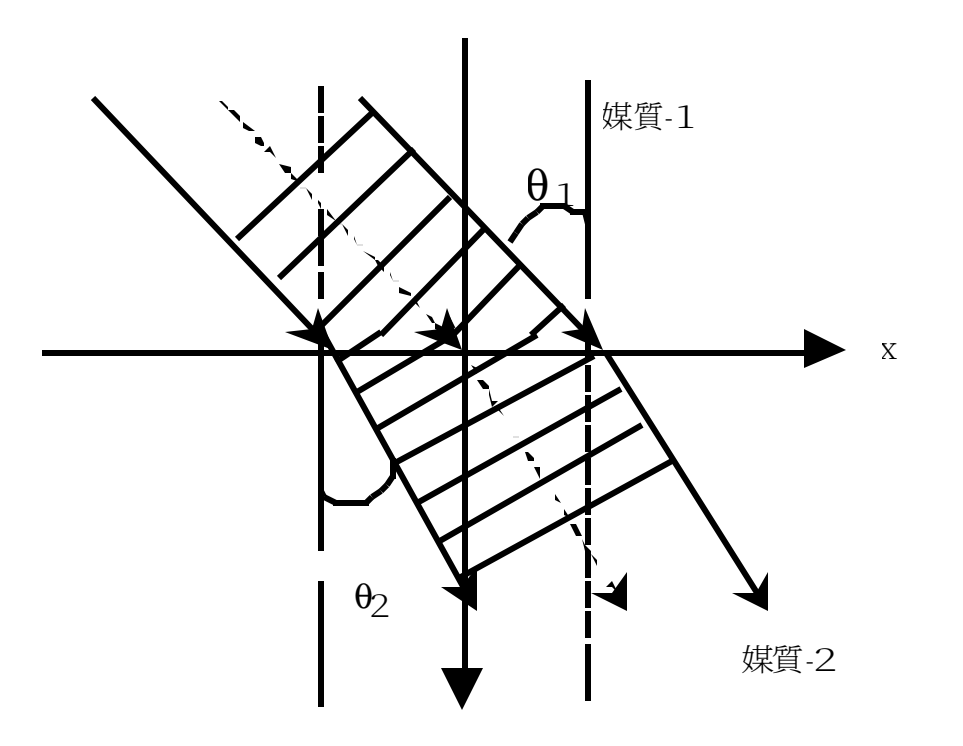
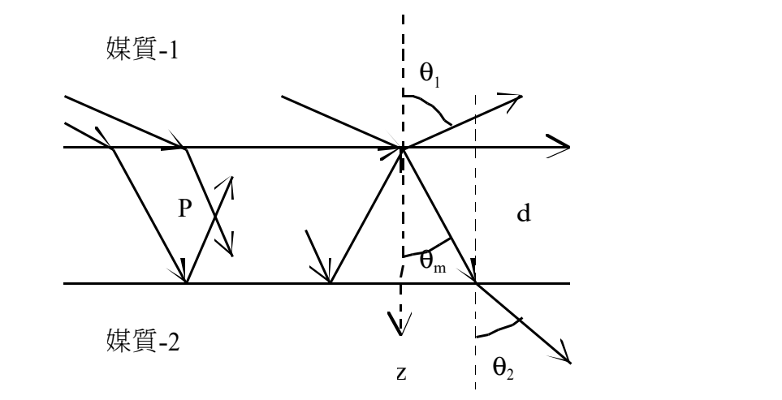
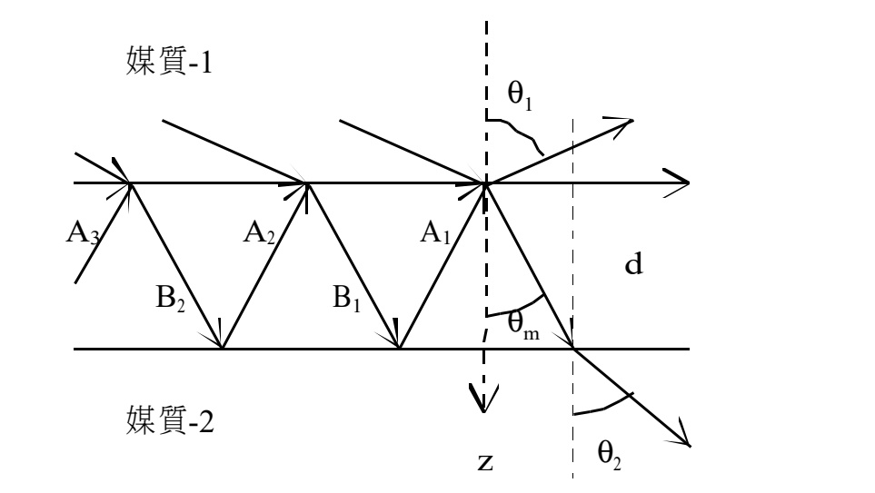
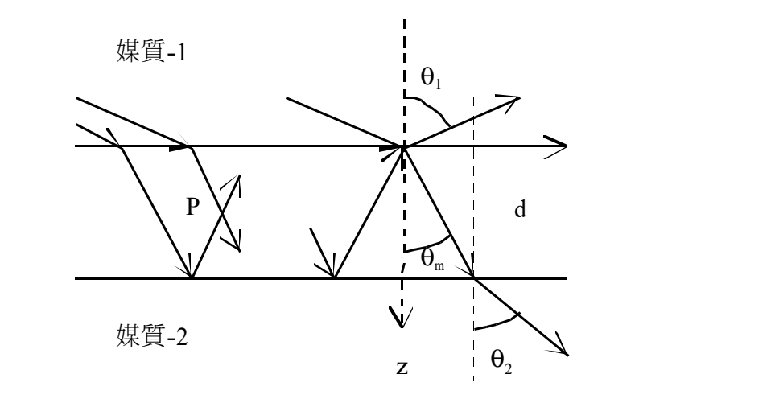
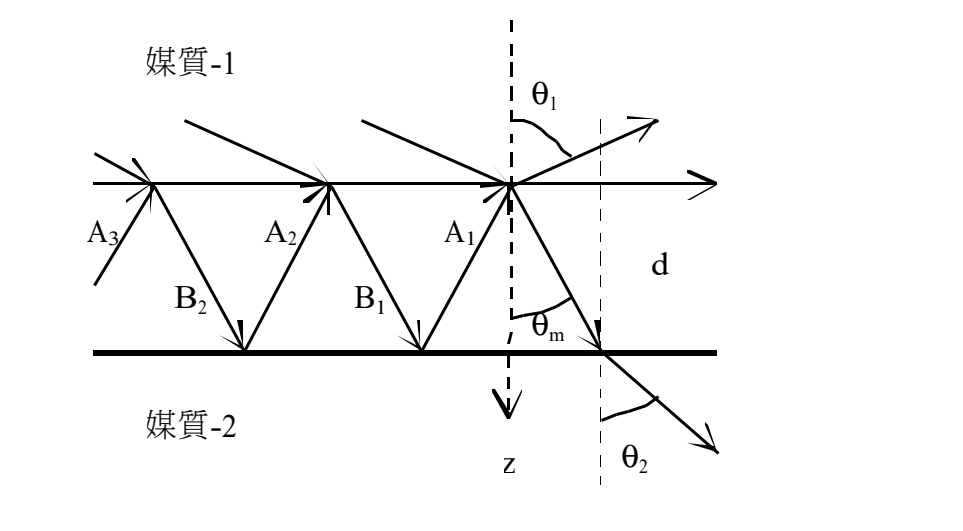

# 2.3 多层膜的和频过程（SFG）：附录集

> 原作：广濑千秋（沿用项目作者归属；本独立底本首页未列署名）  
> 中文翻译：章力
>
> **译校状态（2026-10-19）：** B115—B122完成本独立底本全部12页的本轮译校，含附录A—D、21个唯一编号式、全部无编号关系及六条L系数推导；公式均可编辑，五幅原示意图已保留。原式疑点仍有未决项，不代表原式经独立代数认证。
>
> **底本：** `日语原版/Chapter2/chap2-3.pdf`，12页。与第2.2节附录内容重合，但独立排版、页码及差异逐项核验，不能将2.2的完成状态直接转移。本节A.1—A.12、B.1—B.2、C.1编号仅在本节范围内使用。

## 多层膜的和频过程（SFG）：附录集

本稿将《多层膜的和频过程（SFG）》卷末的附录单独汇集成册。

> **阅读导引（译者编写）：** 附录A给出线性光学、复折射率及菲涅尔因子；附录B区分行波、驻波和实场的复表示；附录C沿单一介质、双介质、夹膜体系追踪光路、相位和内部场；附录D从片内多重反射推导向两侧出射的L系数。可先读B/C理解相位，再按需查A的系数与D的推导。各部分的时间因子及疑点按原约定保留。

## 附录A. 线性光学的主要关系式

频率为 $\omega$ 的平面波，在时刻 $t$、位置 $\boldsymbol r$ 处的电场矢量，可用指数函数表示为：

$$
\boldsymbol E_\omega(\boldsymbol r,t)=\boldsymbol E_\omega^0\exp[i(\omega t-\boldsymbol k\cdot\boldsymbol r)]+\mathrm{c.c.}\tag{A.1}
$$

这里 $\boldsymbol k$ 是波矢，c.c.表示紧邻前项的复共轭。由 $\exp(\pm i\alpha)=\cos\alpha\pm i\sin\alpha$，上式为实数。对于单频平面波，可以用波矢替代麦克斯韦方程中的微分算符 $\boldsymbol\nabla$，由此导出式（A.1）。设波长为 $\lambda$、折射率为 $n$、介电常数为 $\varepsilon$，有：

$$
k=2\pi/\lambda=2n\pi/\lambda_0,\qquad c=\omega/k_0,\qquad\varepsilon=c^2k^2/\omega^2,\qquad n=ck/\omega.\tag{A.2}
$$

下标0表示真空中的值。在具有吸收的介质中，使用：

$$
\begin{aligned}
\varepsilon&=1+4\pi\chi,\qquad\chi=\chi\prime+i\chi\prime\prime,\\
n&=n(1+i\kappa),\qquad n^2(1-\kappa^2)=\mu+4\pi\mu\chi\prime,\\
n^2\kappa&=2\pi\mu\chi\prime\prime.
\end{aligned}\tag{A.3}
$$

$\kappa$：衰减指数、消光指数。

这里的 $\chi$ 是线性极化率，区别于第2.2节SFG正文中的二阶非线性极化率。

金属的折射率有几种不同的表示方式。例如，Born与Wolf的教科书采用 $n(1+i\kappa)$，APS手册采用 $n-i\kappa$；虚部的符号有两种约定。不论采取哪种记法，只要给金属表面赋予复折射率，就可以应用斯涅尔定律。

Born与Wolf的教科书在应用斯涅尔定律时，将折射率 $n_2$ 与折射角 $\theta_2$ 取为复数，并给出以下定义。下标1、2分别表示入射侧与透射侧。设金属表面折射率如下，空气折射率为1：

$$
n_2=n_2(1+i\kappa_2)=n_2+in_2\kappa_2\tag{A.4}
$$
$$
n_2\cos\theta_2=u_2+iv_2\tag{A.5}
$$

其中 $u_2,v_2$ 是下式定义的实数，底本注明 $u_2v_2\leq0$：

$$
u_2^2=\frac12\left\{\left[n_2^2(1-\kappa_2^2)-n_1^2\sin^2\theta_1^{2}\right]+\sqrt{\left[n_2^2(1-\kappa_2^2)-n_1^2\sin^2\theta_1^{2}\right]^2+4n_2^2\kappa_2^2}\right\}\tag{A.6a}
$$
$$
v_2^2=\frac12\left\{-\left[n_2^2(1-\kappa_2^2)-n_1^2\sin^2\theta_1^{2}\right]+\sqrt{\left[n_2^2(1-\kappa_2^2)-n_1^2\sin^2\theta_1^{2}\right]^2+4n_2^2\kappa_2^2}\right\}\tag{A.6b}
$$

> **译校注（Q073，保留原式）：** 本底本式（A.6a、b）的四处角度项均印为 $\sin^2\theta_1^{2}$，即角度符号本身还带上标2；此处保留该字形。额外的2是否为排版遗留未决，候选 $\sin^2\theta_1$ 未采用。第2.2节PDF p35亦有相同字形，已同步修复先前转写漏字；这属于转写修复，不是对原文公式作修正。

> **译校注（关联第2.2节Q053，局部约定）：** 式（A.1）使用 $e^{+i\omega t}$，本节附录B、C.1及双介质原点场采用负时间因子；第2.2节SFG正文也主要使用 $e^{-i\omega t}$；本附录还并列两种复折射率虚部符号。各处照录，不能脱离时间因子、传播方向和衰减条件直接互换。式（A.6）的根号支路与 $u_2v_2\leq0$ 的配合也需复核。

### 反射与折射

讨论界面处的反射与折射时，用斯涅尔定律确定折射角，用菲涅尔因子确定反射与透射。二者都由界面边界条件导出，即：

- $\boldsymbol k,\boldsymbol E,\boldsymbol H$ 的面内分量在界面两侧相等。
- $\boldsymbol D=\varepsilon\boldsymbol E$、$\boldsymbol B=\mu\boldsymbol H$ 的法向分量在界面两侧相等。

在入射侧，应取入射光与反射光的矢量和；在透射侧，只取透射光矢量。若薄膜另一面的反射光与入射光叠加，则还要加入这部分贡献，即膜内多重反射光的电场，再对总场应用边界条件。

> **译校注：** 上述边界条件按底本概括保留。$\boldsymbol k$ 的切向匹配针对各波相位，不能像电场那样将入射、反射波矢相加；电磁场连续条件还隐含无相应自由面电荷、面电流等前提。该适用范围问题归入关联第2.2节Q053。

### 反射系数与透射系数

如另文《菲涅尔因子等》所述，将入射光分为s、p两种偏振，分别求反射光与透射光振幅相对于入射振幅 $E_s^i,E_p^i$ 的比，得到振幅反射系数、透射系数。电场振幅的下标表示偏振，上标 $i,r,t$ 区分入射、反射、透射。系数的上标表示偏振，下标左端表示光入射的介质，右端表示透射到的介质。

反射系数为：

$$
\begin{aligned}
r_{12}^s&=E_r^s/E_i^s=(k_{1z}-k_{2z})/(k_{1z}+k_{2z})\\
&=(n_1\cos\theta_1-n_2\cos\theta_2)/(n_1\cos\theta_1+n_2\cos\theta_2)\\
&=-\sin(\theta_1-\theta_2)/\sin(\theta_1+\theta_2),\\
r_{12}^p&=E_r^p/E_i^p=(\varepsilon_1k_{2z}-\varepsilon_2k_{1z})/(\varepsilon_2k_{1z}+\varepsilon_1k_{2z})\\
&=(n_1\cos\theta_2-n_2\cos\theta_1)/(n_2\cos\theta_1+n_1\cos\theta_2)\\
&=-\tan(\theta_1-\theta_2)/\tan(\theta_1+\theta_2).
\end{aligned}\tag{A.7}
$$

透射系数为：

$$
\begin{aligned}
t_{12}^s&=E_t^s/E_i^s=2k_{1z}/(k_{1z}+k_{2z})\\
&=2n_1\cos\theta_1/(n_1\cos\theta_1+n_2\cos\theta_2)\\
&=2\cos\theta_1\sin\theta_2/\sin(\theta_1+\theta_2),\\
t_{12}^p&=E_t^p/E_i^p=2\varepsilon_1k_{2z}\cos\theta_1/(\varepsilon_2k_{1z}+\varepsilon_1k_{2z})\\
&=2n_1\cos\theta_1/(n_2\cos\theta_1+n_1\cos\theta_2)\\
&=2\cos\theta_1\sin\theta_2/\sin(\theta_1+\theta_2)\cos(\theta_1-\theta_2).
\end{aligned}\tag{A.8}
$$

本稿 $r_{12}^p$ 的符号与Born与Wolf教科书中的表达式相反。这是为了使入射角小于布儒斯特角时，电场面内分量（$x,y$ 分量）的符号相同。用 $\varepsilon$ 和 $k$ 表示的形式，适用于处理吸收介质或金属表面的反射。

对于从介质2反向传播至介质1的光，有：

$$
r_{21}^s=-r_{12}^s,\qquad r_{21}^p=-r_{12}^p\tag{A.9a}
$$
$$
t_{21}^s=(n_2\cos\theta_2/n_1\cos\theta_1)t_{12}^s,\qquad t_{21}^p=(n_2\cos\theta_2/n_1\cos\theta_1)t_{12}^p\tag{A.9b}
$$

以界面向内法线为 $z$ 轴，以s偏振电场方向为 $y$ 轴，取 $x$ 轴正向与光沿界面的传播方向一致。电场坐标分量为：

$$
\begin{aligned}
E_{x,i}&=E_i^p\cos\theta_1,\quad E_{y,i}=E_{ri}^s,\quad E_{z,i}=-E_i^p\sin\theta_1,\\
E_{x,r}&=E_r^p\cos\theta_1,\quad E_{y,r}=E_r^s,\quad E_{z,r}=E_r^p\sin\theta_1,\\
E_{x,t}&=E_t^p\cos\theta_2,\quad E_{y,t}=E_t^s,\quad E_{z,t}=-E_t^p\sin\theta_2.
\end{aligned}
$$

由此得到：

$$
r_{12}^x=r_{12}^p,\quad r_{12}^y=r_{12}^s,\quad r_{12}^z=-r_{12}^p\tag{A.10a}
$$
$$
r_{21}^x=-r_{12}^p,\quad r_{21}^y=-r_{12}^s,\quad r_{21}^z=r_{12}^p\tag{A.10b}
$$
$$
\begin{aligned}
t_{12}^x&=(\cos\theta_2/\cos\theta_1)t_{12}^p,\quad t_{12}^y=t_{12}^s,\\
t_{12}^z&=(\sin\theta_2/\sin\theta_1)t_{12}^p=(n_1/n_2)t_{12}^p
\end{aligned}\tag{A.11a}
$$
$$
t_{21}^x=(n_2/n_1)t_{12}^p,\quad t_{12}^y=t_{12}^s,\quad t_{12}^z=(\cos\theta_2/\cos\theta_1)(n_2/n_1)^2t_{12}^p\tag{A.11b}
$$

> **译校注（关联第2.2节Q072，保留原式）：** 式（A.3、A.4）同用 $n$ 表示复量与实量；轴向分量首行写 $E^s_{ri}$；（A.11b）首项为 $t^x_{21}$，随后两项却为 $t^y_{12},t^z_{12}$。式（A.8）末行采用原有斜线与连乘写法，括号作用范围不作补改。这些记号按原式保留，复数与边界条件约定另见关联第2.2节Q053。

这些表达式满足下列关系；首行对应电场边界条件：

$$
1+r_{12}^x=t_{12}^x,\quad1+r_{12}^y=t_{12}^y,\quad1+r_{12}^z=(n_2/n_1)^2t_{12}^z
$$
$$
\begin{aligned}
1+r_{12}^sr_{21}^s&=1-(r_{12}^s)^2=t_{12}^st_{21}^s,\\
1+r_{12}^pr_{21}^p&=1-(r_{12}^p)^2=t_{12}^pt_{21}^p.
\end{aligned}\tag{A.12}
$$

光强正比于 $nE^2\cos\theta$，因此有 $n_1\cos\theta_1\,r_{12}^2+n_2\cos\theta_2\,t_{12}^2=n_1\cos\theta_1$，体现光强守恒。

> **译校注（关联第2.2节Q053，适用范围）：** 此处平方与守恒关系保留底本形式；一般复振幅需取模平方，且有吸收时须另行计入吸收。不能把本段的无损形式直接用于上文所有复折射率情形。

## 附录B. 波动的复习

波动是波峰、波谷随时间沿一定方向移动的运动，因此同时依赖空间和时间。波峰或波谷的位置位于同一平面时，称为平面波；位于球面时，称为球面波。

**（a）空间变化。** 某一瞬间沿传播方向截取的波形是正弦曲线，位移可用 $\cos(2\pi z/\lambda)=\cos(kz)$ 表示。这里 $\lambda$ 是波长，$k=2\pi/\lambda$ 是波数（底本称“波数矢量”）。

**（b）时间变化。** 固定一点观察，位移也随时间作正弦变化，表示为 $\cos(2\pi t/T)=\cos(\omega t)=\cos(2\pi\nu t)$。$T$ 为周期，$\omega$ 为角频率；底本把频率写作 $\nu=2\pi\omega$。

> **译校注（关联第2.2节Q054，保留原式）：** 底本“$\nu=2\pi\omega$”与同一行的 $\omega t=2\pi\nu t$ 不一致；候选为 $\nu=\omega/(2\pi)$。未经本项目确认，不直接替换原关系。

上面两个函数都是偶函数，单独看它们时，时间或坐标的正负不体现传播方向。现在将时间与空间同时引入。

单写 $\cos(kz)\cos(\omega t)$，不能表达波峰随时间移动的事实。必须让空间和时间同时进入三角函数的自变量，才能规定传播方向，例如

$$
\cos(kz+\omega t),\qquad\cos(kz-\omega t).
$$

对于 $\cos(kz+\omega t)$，$kz+\omega t$ 恒定（例如等于 $2\pi$）的位置，即等相位点，随时间向 $z$ 减小方向移动。对于 $\cos(kz-\omega t)$，等相位点则向 $z$ 增大方向移动。两者波前移动速率均为 $\omega/k$。此外，

$$
\cos(kz)\cos(\omega t)=\tfrac12[\cos(kz-\omega t)+\cos(kz+\omega t)],
$$

所以乘积形式表示驻波。

若沿波传播方向取坐标轴，采用 $\cos(kz-\omega t)$ 较为自然。光电场可以写作 $E_0(\omega)\cos(kz-\omega t)$，也可以写作 $E_0(\omega)\cos(\omega t-kz)$；一旦选定，应前后一致。这里采用前者：

$$
E(\omega,z)=E_0(\omega)\cos(kz-\omega t).\tag{B.1}
$$

常利用指数函数与三角函数的关系进行转换：

$$
e^{i\alpha}=\cos\alpha+i\sin\alpha,\qquad e^{-i\alpha}=\cos\alpha-i\sin\alpha,
$$

$$
\cos\alpha=\frac{e^{i\alpha}+e^{-i\alpha}}2,\qquad
\sin\alpha=-i\frac{e^{i\alpha}-e^{-i\alpha}}2.\tag{B.2}
$$

底本接着给出两种表示法。

**表示法1：**

$$
E_0(\omega)\cos(kz-\omega t)=\tfrac12[\exp(ikz-i\omega t)+\mathrm{c.c.}]
$$

c.c.表示紧邻前项的复共轭。

**表示法2：**

$$
E_0(\omega)\cos(kz-\omega t)=\operatorname{Re}[\exp(ikz-i\omega t)]
$$

$\operatorname{Re}(e^{i\alpha})$、$\operatorname{Im}(e^{i\alpha})$ 分别表示实部和虚部。

> **译校注（关联第2.2节Q055，保留原式）：** 底本两种表示法的左端含 $E_0(\omega)$，右端却未写该振幅因子。若未另行约定单位振幅，两边归一化不一致。这里按底本转写，不静默补因子；原页对照见PDF p4。

采用指数函数时，可以约定以下两种处理方式之一：

1. 对 $Ae^{i\alpha}$，在取可观测量时用 $\tfrac12[Ae^{i\alpha}+A^*e^{-i\alpha}]$ 还原实量；模平方取为该复量与其复共轭之积。
2. 对 $Ae^{i\alpha}$，在取可观测量时只采用实部。可观测量必为实数，且常以平方形式表示。

> **译校注：** 实场的瞬时平方、复振幅的模平方及周期平均强度之间可能有归一化因子；不要仅依据这段简述混用，见关联第2.2节Q055。

## 附录C. 波的传播

设光为平面波；除有必要的情况外，将入射振幅取为1。沿波传播方向取 $z$ 轴，波表示为

$$
\cos(kz-\omega t).\tag{C.1}
$$

### 单一且均匀的介质

“波位于 $(z_0,t_0)$”意指时空点 $(z_0,t_0)$ 的相位 $kz_0-\omega t_0=0$。在同一时刻 $t_0$，点 $z=z_0-\Delta z$ 的相位为 $-k\Delta z$。由 $kz-\omega t=0$，在 $t=t_0+\Delta t$ 时，波前到达 $z=z_0+(\omega/k)\Delta t$。

若沿光路分布着波源，则 $z_0-\Delta z$ 处的波源在 $t_0-\Delta z/(\omega/k)$ 时刻产生的光，传播至 $(z_0,t_0)$ 时，与该点新产生的光完全重合，即相位相同。时空点 $(z_0-\Delta z,t_0-\Delta t)$ 的相位为 $-k\Delta z+\omega\Delta t$。

### 两种介质组成的体系

设界面为平面，光由介质1侧入射到与介质2的界面。坐标轴等定义如下：

| 量 | 定义 |
|---|---|
| 原点 | 光线的入射点；光束有宽度时取其中央 |
| $z$ 轴 | 从介质1指向介质2的界面法线 |
| $x$ 轴 | 光沿界面的传播方向，与波矢 $\boldsymbol{k}$ 在界面上的投影一致 |
| 入射角 $\theta_i$ | 入射光线与外向法线（$-z$ 方向）的夹角，$0<\theta_i<\pi/2$ |
| 反射角 $\theta_r$ | 反射光线与外向法线（$-z$ 方向）的夹角，$0<\theta_r<\pi/2$ |
| 折射角 $\theta_t$ | 透射光线与内向法线（$+z$ 方向）的夹角，$0<\theta_t<\pi/2$ |

设两介质的折射率为 $n_1,n_2$，波矢的长度为 $k_1,k_2$，其中 $k=n\omega/c$。

> **译校注（关联第2.2节Q056，角度约定）：** “入射光线”与外向法线的夹角沿用底本；不要未经说明就将它改解为入射传播矢量与外向法线的夹角。本节的轴向与角度定义各自保留。

由斯涅尔定律，令 $\theta_i=\theta_r=\theta_1$、$\theta_t=\theta_2$，则

$$
n_1\sin\theta_1=n_2\sin\theta_2,\qquad
k_1\sin\theta_1=k_2\sin\theta_2.
$$

对于平面波，垂直于传播方向的平面上各点的光电场同相。沿传播方向，等相位面的间距就是波长，底本写为 $\lambda=2\pi/k=2\pi c/\omega n$。（见后面的示意图。）

> **译校注（斜线排版）：** 底本末项连写为 $2\pi c/\omega n$，未给出分母括号，此处保留这种写法。结合上文 $k=n\omega/c$，候选读法为 $2\pi c/(\omega n)$，未将补括号后的形式冒充原式。底本所指示意图见本小节末，位于PDF p6。

设原点处的电场为 $E_0e^{-i\omega t}$。先追踪通过介质2中 $(x,z)$ 点的光：

| 步骤 | 光路、相位与时间 |
|---|---|
| （1） | 该光入射到界面的位置为 $(x-z\tan\theta_2,0)$。 |
| （1a） | 在同一时刻 $t$，相对于入射到原点的光，它沿光路超前 $(x-z\tan\theta_2)\sin\theta_1$；因此，入射点处的相位比通过原点的光超前 $k_1(x-z\tan\theta_2)\sin\theta_1$。 |
| （1b） | 反过来，与原点相同的相位在 $t$ 之后 $(x-z\tan\theta_2)\sin\theta_1/(\omega/k_1)$ 通过该点。 |
| （2） | 进入介质2后，到达 $(x,z)$ 点的传播距离为 $z/\cos\theta_2$。 |
| （2a） | 与入射界面时的相位相比，$(x,z)$ 点的相位前进 $k_2z/\cos\theta_2$。 |
| （2b） | 从入射界面到达 $(x,z)$ 点所经历的时间，底本连写为 $\omega z/k_2\cos\theta_2$。 |
| （2c） | 结合（1a）及斯涅尔定律，相对于通过原点的光的相位 $-\omega t$，总相位前进 $k_2(x\sin\theta_2+z\cos\theta_2)$。 |

> **译校注（关联第2.2节Q056，保留原式）：** （2b）的底本没有标明斜线后的分母范围。无论将其读为 $(\omega z/k_2)\cos\theta_2$ 或 $\omega z/(k_2\cos\theta_2)$，均需核对其时间量纲；按本段传播距离 $z/\cos\theta_2$ 除以相速度 $\omega/k_2$，候选为 $k_2z/(\omega\cos\theta_2)$。这里保留底本连写，不采用候选式。

再追踪通过介质1侧 $(x,-z)$ 点（$z>0$）的反射光：

| 步骤 | 光路、相位与时间 |
|---|---|
| （3） | 该光入射到界面的位置为 $(x-z\tan\theta_1,0)$。 |
| （3a） | 在同一时刻 $t$，相对于入射到原点的光，它沿光路超前 $(x-z\tan\theta_2)\sin\theta_1$；底本随后给出的相位超前量却是 $k_1(x-z\tan\theta_1)\sin\theta_1$。 |
| （3b） | 与原点相同的相位在 $t$ 之后 $(x-z\tan\theta_1)\sin\theta_1/(\omega/k_1)$ 通过该点。 |
| （4） | 反射后的传播距离为 $z/\cos\theta_1$。 |
| （4a） | 相对于界面反射时，$(x,z)$ 点的相位前进 $k_1z/\cos\theta_1$。 |
| （4b） | 从入射界面到达 $(x,z)$ 点所经历的时间，底本连写为 $\omega z/k_1\cos\theta_1$。 |
| （4c） | 结合（3a），相对于通过原点的光的相位 $-\omega t$，相位前进 $k_1(x\sin\theta_1+z\cos\theta_1)$。 |

> **译校注（Q074，保留原式）：** PDF p5的（3a）在距离项使用 $\theta_2$，相位项却使用 $\theta_1$；（3）与（3b）也使用 $\theta_1$。这里保留两个不同下标，候选将距离项改为 $\theta_1$ 尚未采用。两个不同下标照录，不据相邻式统一。

> **译校注（关联第2.2节Q056，保留原式）：** 本段先写观测点 $(x,-z)$，随后（4a、b）写 $(x,z)$，分别照录。（4b）的时间式没有标明斜线分母范围；按距离除相速度得到的候选为 $k_1z/(\omega\cos\theta_1)$，仅列于此，不替换原连写。

*两介质界面上的光线和等相位面（独立底本PDF p6，原图）。图内“媒質-1”“媒質-2”分别为介质1、介质2；$x$ 为界面方向，$\theta_1,\theta_2$ 为图示角。*

### 两种介质之间夹有薄膜的体系

介质1（入射侧）与介质2之间夹有厚度 $h_m$ 的膜 $m$，两界面均为平面且相互平行。原点与坐标轴沿用上面的定义。

| 记号 | 定义 |
|---|---|
| $1/m$、$m/1$ 界面 | 介质1与膜的界面；分别着眼于介质1侧、薄膜侧 |
| $2/m$、$m/2$ 界面 | 介质2与膜的界面；分别着眼于介质2侧、薄膜侧 |
| $n_1,n_2,n_m$ | 介质1、介质2与薄膜的折射率 |
| $k_1,k_2,k_m$ | 三者内部的波矢 |
| $\theta_1,\theta_2,\theta_m$ | 各介质中光路与法线的夹角 |
| $t_{1m},t_{m1},t_{m2}$ | 电场由介质1透入膜、由膜透入介质1、由膜透入介质2的透射系数 |
| $r_{1m},r_{m1},r_{m2}$ | 分别由介质1入射在 $1/m$ 反射、由膜内入射在 $m/1$ 反射、由膜内入射在 $m/2$ 反射的电场反射系数 |
| 上行（−）光 | 从 $m/2$ 界面向 $m/1$ 界面传播的光 |
| 下行（+）光 | 从 $m/1$ 界面向 $m/2$ 界面传播的光 |

底本说反射与透射系数表达式见“附录B”。

> **译校注（关联第2.2节Q047）：** 本文这些系数列在附录A，附录B为波动复习。“附录B”按底本记录，候选为附录A。

入射光在膜内点P产生的电场如下图；图中 $d=h_m$。

*入射光在膜内点P产生的上下行场示意图（独立底本p7，原图）。*

*图内“媒質-1”“媒質-2”为介质1、介质2；$d$ 为膜厚，$θ_1,θ_m,θ_2$ 表示各介质中的光路角，P为膜内观测点。*

原点反射光所包含的多重反射分量，在膜内沿以下光路传播；图中仍有 $d=h_m$。

*对原点反射场有贡献的多重反射光路（独立底本p7，原图）。*

*图内 $A_1,A_2,A_3$ 与 $B_1,B_2$ 为图示反射光路上的点；“媒質”译为介质。*

#### 反射光

“反射光”除在 $1/m$ 界面直接反射的光外，还包括进入薄膜、多重反射后从 $m/1$ 界面出射的上行（−）光。应对包含这些多重反射分量的总场，在界面两侧应用边界条件。

原点反射光中多重反射分量的性质如下：

| 项目 | 表达式 |
|---|---|
| 入射点 | $(-2h_m\tan\theta_m,0)$，$n=1,2,\ldots$ |
| 入射点处光路差 | $-2nh_m\tan\theta_m\sin\theta_1$ |
| 相对于原点入射光的初始相位差 | $-2nh_mk_1\tan\theta_m\sin\theta_1$ |
| 膜内传播距离 | $2nh_m/\cos\theta_m$ |
| 膜内相位前进量 | $2nh_mk_m/\cos\theta_m$ |
| 与直接反射光的净相位差 | $2nh_mk_m\cos\theta_m$；底本还写成 $2\pi nn_mh_m\cos\theta_m/\lambda$ |
| 透射与反射因子 | $t_{1m}t_{m1}r_{m2}(r_{m2}r_{m1})^{n-1}$ |

> **译校注（Q075，保留原式）：** 独立PDF p7的入射点坐标写作 $(-2h_m\tan\theta_m,0)$，但同列又给出 $n=1,2,\ldots$，后续光程项含 $n$。本处不补写坐标中缺少的 $n$；候选 $(-2nh_m\tan\theta_m,0)$ 仅供核查。

这里使用 $k_1\sin\theta_1=k_m\sin\theta_m$；$n_m$ 为膜折射率，$\lambda$ 为波长。取入射振幅为1，反射场振幅为：

$$
\begin{aligned}
&r_{1m}+t_{1m}t_{m1}r_{m2}\sum_{n=1}^{\infty}(r_{m2}r_{m1})^{n-1}\exp(i2\pi n2n_mh_m\cos\theta_m/\lambda)\\
&=r_{1m}+\frac{t_{1m}t_{m1}r_{m2}\exp\!\left[i2\pi n_m2h_m\cos\theta_m/\lambda\right]}{1-r_{m2}r_{m1}\exp\!\left[i2\pi_m n_m2h_m\cos\theta_m/\lambda\right]}\\
&=\frac{r_{1m}+[-r_{1m}r_{m1}+t_{1m}t_{m1}]r_{m2}\exp\!\left[i2\pi_m n_m2h_m\cos\theta_m/\lambda\right]}{1-r_{m2}r_{m1}\exp\!\left[i2\pi n_m2h_m\cos\theta_m/\lambda\right]}\\
&=\frac{r_{1m}+r_{m2}\exp\!\left[i2\pi n_m2h_m\cos\theta_m/\lambda\right]}{1-r_{m2}r_{m1}\exp\!\left[i2\pi n_m2h_m\cos\theta_m/\lambda\right]}
\end{aligned}\tag{C.2}
$$

> **译校注（Q076，保留原字形）：** 独立PDF p8，式（C.2）第一条闭式的分母和下一行分子中，$\pi$ 另带一个下标 $m$，排为 $\pi_m n_m$。此处按局部放大图保留；候选去除 $\pi$ 的下标 $m$ 未采用。

模平方给出光强，因此会随 $2n_mh_m\cos\theta_m/\lambda$ 出现干涉变化。波数扫描时，条纹间隔为 $\Delta\nu=1/2n_mh_m\cos\theta_m$。

> **译校注（关联第2.2节Q057，保留原式）：** 上表净相位差的第一式与底本随后含 $2\pi$ 的式子，结合 $k_m=2\pi n_m/\lambda$，存在一个因子2的差别。正文与附录中的干涉周期及相位因子宜联查；这里不根据候选结果重写原式。

底本接着再次给出膜内点P的电场图和反射光路图，均保留：

*再次给出的膜内点P电场图（d等于膜厚）（独立底本p8，原图）。*

*再次给出的多重反射光路图（d等于膜厚）（独立底本p8，原图）。*

*两图中的“媒質-1”“媒質-2”分别为介质1、介质2；其余符号与前图相同。*

> **译者注（原文修正 E-2.3-001；暂定文字补读）：** 独立PDF p8第二幅光路图前，原文写作「加重反射光」。根据图中光路及前后多重反射的讨论，中译暂按“多重反射光”处理。此项是项目暂定文字补读，未经作者认可；原文与处理状态同时记入勘误附件。

#### 透射光

“透射光”除直接穿过薄膜的光外，还包括进入膜内、多重反射后从 $m/2$ 界面出射的光。应对包含这些分量的总场，在 $2/m$ 界面应用边界条件。

到达 $(h_m\tan\theta_m,h_m)$ 的多重反射分量具有下列性质：

| 项目 | 表达式 |
|---|---|
| 入射点 | $(-2nh_m\tan\theta_m,0)$，$n=0,1,2,\ldots$；$n=0$ 为直接透射 |
| 入射点处光路差 | $-2nh_m\tan\theta_m\sin\theta_1$ |
| 相对于原点入射光的初始相位差 | $-2nh_mk_1\tan\theta_m\sin\theta_1$ |
| 膜内传播距离 | $(2n+1)h_m/\cos\theta_m$ |
| 膜内相位前进量 | $(2n+1)h_mk_m/\cos\theta_m$ |
| 相对于直接透射光的净相位差 | $2nh_mk_m\cos\theta_m$；底本亦写成 $2\pi nn_mh_m\cos\theta_m/\lambda$，疑点同关联第2.2节Q057 |
| 透射与反射因子 | $t_{1m}t_{m2}(r_{m2}r_{m1})^n$ |

入射光的振幅和时间因子分别为1和 $e^{-i\omega t}$ 时，透射场如下；底本的求和式与闭式位于独立底本p9：

$$
\left[t_{1m}t_{m2}+t_{1m}t_{m2}\sum_{n=1}^{\infty}(r_{m2}r_{m1})^n\exp(in_m2\pi n2h_m\cos\theta_m/\lambda)\right]\exp(i2\pi n_mh_m\cos\theta_m/\lambda)
$$

$$
=\frac{t_{1m}t_{m2}\exp(i2\pi n_mh_m\cos\theta_m/\lambda)}{1-r_{m2}r_{m1}\exp\!\left[i2\pi n_m2h_m\cos\theta_m/\lambda\right]}\tag{C.3}
$$

取模平方得到光强，干涉变化由 $2n_mh_m\cos\theta_m/\lambda$ 控制；波数扫描时的条纹间隔为 $\Delta\nu=1/2n_mh_m\cos\theta_m$。反射光的峰对应透射光的谷。

> **译校注（斜线与干涉量）：** 两处条纹间隔均按底本保留 $\Delta\nu=1/2n_mh_m\cos\theta_m$ 的连写。候选将分母整体读作 $2n_mh_m\cos\theta_m$，不把补括号写成原式。净相位差中的因子2问题沿关联第2.2节Q057保留；不据此自动调整周期或系数。

#### 内部光

“内部光”定义为薄膜内部点P处的光。膜内同时存在下行（+）光和上行（−）光。先考察任意点 $(x,z)$，$0^+<z<h_m^-$。

下行（+）光的光路、相位及净电场如下：

| 项目 | 表达式 |
|---|---|
| 入射位置 | $[x-(2nh_m+z)\tan\theta_m,0]$，$n=0,1,2,\ldots$ |
| 入射点处光路差 | $[x-(2nh_m+z)\tan\theta_m]\sin\theta_1$ |
| 初始相位差 | $k_1[x-(2nh_m+z)\tan\theta_m]\sin\theta_1=k_m[x-(2nh_m+z)\tan\theta_m]\sin\theta_m$ |
| 入射后距离、相位前进量 | $(2nh_m+z)/\cos\theta_m$；$k_m(2nh_m+z)/\cos\theta_m$ |
| 净相位差 | $k_m[x\sin\theta_m+(2nh_m+z)\cos\theta_m]$ |
| 从 $m/2$ 出射的位置（原文） | $[x+(h_m-z)\tan\theta_m,0]$ |
| 至出射点的距离、相位前进量 | $(h_m-z)/\cos\theta_m$；$k_m(h_m-z)/\cos\theta_m$ |

下行净电场为

$$
\frac{t_{1m}\exp[-i\omega t+ik_m(x\sin\theta_m+z\cos\theta_m)]}
{1-r_{m2}r_{m1}\exp(i2k_mh_m\cos\theta_m)}.
$$

上行（−）光的对应结果为：

| 项目 | 表达式 |
|---|---|
| 入射位置 | $[x-(2nh_m-z)\tan\theta_m,0]$，$n=1,2,\ldots$ |
| 入射点处光路差 | $[x-(2nh_m-z)\tan\theta_m]\sin\theta_1$ |
| 初始相位差 | $k_1[x-(2nh_m-z)\tan\theta_m]\sin\theta_1=k_m[x-(2nh_m-z)\tan\theta_m]\sin\theta_m$ |
| 入射后距离、相位前进量 | $(2nh_m-z)/\cos\theta_m$；$k_m(2nh_m-z)/\cos\theta_m$ |
| 净相位差 | $k_m[x\sin\theta_m+(2nh_m-z)\cos\theta_m]$ |
| 从 $m/2$ 出射的位置（原文） | $[x+(h_m+z)\tan\theta_m,0]$ |
| 至出射点的距离、相位前进量（原文） | $(h_m+z)/\cos\theta_m$；$k_m(h_m+z)/\cos\theta_m$ |

上行净电场为

$$
\frac{t_{1m}r_{m2}\exp[-i\omega t+ik_m(x\sin\theta_m+(2h_m-z)\cos\theta_m)]}
{1-r_{m2}r_{m1}\exp(i2k_mh_m\cos\theta_m)}.
$$

> **译校注（关联第2.2节Q058，保留原式）：** 两处“$m/2$ 出射”位置的第二坐标均写作0，而界面位于 $z=h_m$；上行光到背面所列 $h_m+z$ 也应结合先在前界面反射的路径核查。这些原式与位置标签均保留，不以直觉改写。

接着求出从原点向介质1侧出射的光所经过的膜内坐标；这束光若在 $m/1$ 界面反射，就从 $(h_m\tan\theta_m,h_m)$ 向介质2侧出射。在深度 $z$，将上行点记作 $A_0,A_1,A_2,\ldots$，下行点记作 $B_0,B_1,B_2,\ldots$；考察透射光时，B类还包括 $n=-1$。

**A类点：** $x=-(2nh_m+z)\tan\theta_m$，$n=0,1,2,\ldots$。到原点的相位前进量为 $k_m(2nh_m+z)/\cos\theta_m$；到背面出射点的相位前进量为 $k_m[(2n+1)h_m+z]/\cos\theta_m$。

存在入射光时，该处上下行电场为：

**上行（−）光的电场：**

$$
\frac{t_{1m}r_{m2}\exp[-i\omega t+ik_m(x\sin\theta_m+(2h_m-z)\cos\theta_m)]}{1-(r_{m2}r_{m1})\exp(ik_m2h_m\cos\theta_m)}
$$

**下行（+）光的电场：**

$$
\frac{t_{1m}\exp[-i\omega t+ik_m(x\sin\theta_m+z\cos\theta_m)]}{1-(r_{m2}r_{m1})\exp(ik_m2h_m\cos\theta_m)}
$$

**B类点：** 底本本处写为 $x=-[2(n+1)h_m-z]\tan\theta_m$，$n=(-1),0,1,2,\ldots$。到原点与背面出射点的相位前进量，底本均写作 $k_m[2(n+1)h_m-z]/\cos\theta_m$。

存在入射光时，该处上下行电场为：

**上行（−）光的电场：**

$$
\frac{t_{1m}r_{m2}\exp[-i\omega t+ik_m(x\sin\theta_m+(2h_m-z)\cos\theta_m)]}{1-(r_{m2}r_{m1})\exp(ik_m2h_m\cos\theta_m)}
$$

**下行（+）光的电场：**

$$
\frac{t_{1m}\exp[-i\omega t+ik_m(x\sin\theta_m+z\cos\theta_m)]}{1-(r_{m2}r_{m1})\exp(ik_m2h_m\cos\theta_m)}
$$

> **译校注（关联第2.2节Q044、关联第2.2节Q058）：** B点坐标与第2.2节正文部分小节相差一个膜厚；这里两种出射点的传播相位又写成相同表达式。各处照录，留待结合第2.2节图3.1与透射光路统一复核。

## 附录D. 介质之间极化薄片的L系数

底本所称正文的“式（4.29）—（4.32）”，是将极化薄片所产生的SFG光经过无限薄片内多重反射、向两侧介质出射时的电场与极化联系起来的系数。下面从底本所称的片内L系数“式（4.33）—（4.36）”出发加以证明。

若介质1或介质2的厚度有限，必须考虑其中的多重反射，则下述分析还不充分，上述“式（4.29）—（4.32）”严格说来不能直接使用。

> **译校注（关联第2.2节Q047，保留原引用）：** 本独立PDF不含这些正文公式；所引用（4.29）—（4.36）与第2.2节现有正文编号也不匹配。第2.2节界面和片内L系数集中于5.1，式（5.1a）—（5.5c）；这里只提供定位线索，不建立未经验证的一一换号关系。

考虑夹在介质1与介质2之间的极化薄片 $m$。向介质1侧出射的是上行（−）SFG光；计入片内多重反射后，各分量如下。

**s偏振：来自 $P_y$ 的贡献。**

$$
\begin{aligned}
E^{-}_{\mathrm{SF},s}&=\Bigl[L^-_{m/m,y}P_y\frac{1}{1-r_{m1,s}r_{m2,s}}+L^+_{m/m,y}P_y\frac{r_{m2,s}}{1-r_{m1,s}r_{m2,s}}\Bigr]t_{m1,s}\\
&=\frac{P_y}{2n_m\cos\theta_m}\frac{\left(n_1\cos\theta_1+n_m\cos\theta_m\right)\left(n_2\cos\theta_2+n_m\cos\theta_m\right)}{2n_m\cos\theta_m\left(n_1\cos\theta_1+n_2\cos\theta_2\right)}\frac{2n_m\cos\theta_m}{\left(n_2\cos\theta_2+n_m\cos\theta_m\right)}\\
&\quad\times\frac{2n_m\cos\theta_m}{\left(n_1\cos\theta_1+n_m\cos\theta_m\right)}\\
&=\frac{P_y}{\left(n_1\cos\theta_1+n_2\cos\theta_2\right)}=L^{-}_{1/2,y}P_y
\end{aligned}
$$

**p偏振：来自 $P_x$ 的贡献。** 推导跨独立PDF p10—11：

$$
\begin{aligned}
E^{-}_{\mathrm{SF},p}(\text{来自 }P_x)&=\Bigl[L^-_{m/m,x}P_x\frac{1}{1-r_{m1,p}r_{m2,p}}+L^+_{m/m,x}P_x\frac{r_{m2,p}}{1-r_{m1,p}r_{m2,p}}\Bigr]t_{m1,p}\\
&=\frac{\cos\theta_m}{2n_m\cos\theta_m}P_x\frac{\left(n_1\cos\theta_m+n_m\cos\theta_1\right)\left(n_2\cos\theta_m+n_m\cos\theta_2\right)}{2n_m\cos\theta_m\left(n_1\cos\theta_2+n_2\cos\theta_1\right)}\frac{2n_m\cos\theta_m}{\left(n_1\cos\theta_m+n_m\cos\theta_1\right)}\\
&\quad\times\frac{2n_m\cos\theta_2}{\left(n_2\cos\theta_m+n_m\cos\theta_2\right)}\\
&=\frac{\cos\theta_2}{\left(n_1\cos\theta_2+n_2\cos\theta_1\right)}P_x=L^{-}_{1/2,x}P_x
\end{aligned}
$$

**p偏振：来自 $P_z$ 的贡献。**

$$
\begin{aligned}
E^{-}_{\mathrm{SF},p}(\text{来自 }P_z)&=\Bigl[L^-_{m/m,z}P_z\frac{1}{1-r_{m1,p}r_{m2,p}}-L^+_{m/m,z}P_z\frac{r_{m2,p}}{1-r_{m1,p}r_{m2,p}}\Bigr]t_{m1,p}\\
&=\frac{\sin\theta_m}{2n_m\cos\theta_m}P_z\frac{\left(n_1\cos\theta_m+n_m\cos\theta_1\right)\left(n_2\cos\theta_m+n_m\cos\theta_2\right)}{2n_m\cos\theta_m\left(n_1\cos\theta_2+n_2\cos\theta_1\right)}\frac{2n_m\cos\theta_m}{\left(n_1\cos\theta_m+n_m\cos\theta_1\right)}\\
&\quad\times\frac{2n_2\cos\theta_m}{\left(n_2\cos\theta_m+n_m\cos\theta_2\right)}\\
&=\frac{(n_2/n_m)\sin\theta_m}{\left(n_1\cos\theta_2+n_2\cos\theta_1\right)}P_z=\frac{(n_2/n_m)^2\sin\theta_2}{\left(n_1\cos\theta_2+n_2\cos\theta_1\right)}P_z=L^{-}_{1/2,z}P_z
\end{aligned}
$$

另一方面，向介质2侧出射的是下行（+）SFG光。计入片内多重反射，各分量如下。

**s偏振：来自 $P_y$ 的贡献。**

$$
\begin{aligned}
E^{+}_{\mathrm{SF},s}&=\Bigl[L^-_{m/m,y}P_y\frac{r_{m1,s}}{1-r_{m1,s}r_{m2,s}}+L^+_{m/m,y}P_y\frac{1}{1-r_{m1,s}r_{m2,s}}\Bigr]t_{m2,s}\\
&=\frac{P_y}{2n_m\cos\theta_m}\frac{\left(n_1\cos\theta_1+n_m\cos\theta_m\right)\left(n_2\cos\theta_2+n_m\cos\theta_m\right)}{2n_m\cos\theta_m\left(n_1\cos\theta_1+n_2\cos\theta_2\right)}\frac{2n_m\cos\theta_m}{\left(n_2\cos\theta_2+n_m\cos\theta_m\right)}\\
&\quad\times\frac{2n_m\cos\theta_m}{\left(n_1\cos\theta_1+n_m\cos\theta_m\right)}\\
&=\frac{P_y}{\left(n_1\cos\theta_1+n_2\cos\theta_2\right)}=L^{+}_{1/2,y}P_y
\end{aligned}
$$

**p偏振：来自 $P_x$ 的贡献。**

$$
\begin{aligned}
E^{+}_{\mathrm{SF},p}(\text{来自 }P_x)&=\Bigl[L^-_{m/m,x}P_x\frac{r_{m1,p}}{1-r_{m1,p}r_{m2,p}}+L^+_{m/m,x}P_x\frac{1}{1-r_{m1,p}r_{m2,p}}\Bigr]t_{m2,p}\\
&=\frac{\cos\theta_m}{2n_m\cos\theta_m}P_x\frac{\left(n_1\cos\theta_m+n_m\cos\theta_1\right)\left(n_2\cos\theta_m+n_m\cos\theta_2\right)}{2n_m\cos\theta_m\left(n_1\cos\theta_2+n_2\cos\theta_1\right)}\frac{2n_m\cos\theta_1}{\left(n_1\cos\theta_m+n_m\cos\theta_1\right)}\\
&\quad\times\frac{2n_m\cos\theta_m}{\left(n_2\cos\theta_m+n_m\cos\theta_2\right)}\\
&=\frac{\cos\theta_1}{\left(n_1\cos\theta_2+n_2\cos\theta_1\right)}P_x=L^{+}_{1/2,x}P_x
\end{aligned}
$$

**p偏振：来自 $P_z$ 的贡献。** 公式跨独立PDF p11—12：

$$
\begin{aligned}
E^{+}_{\mathrm{SF},p}(\text{来自 }P_z)&=\Bigl[L^-_{m/m,z}P_z\frac{r_{m1,p}}{1-r_{m1,p}r_{m2,p}}+L^+_{m/m,z}P_z\frac{1}{1-r_{m1,p}r_{m2,p}}\Bigr]t_{m2,p}\\
&=\frac{-\sin\theta_m}{2n_m\cos\theta_m}P_z\frac{\left(n_1\cos\theta_m+n_m\cos\theta_1\right)\left(n_2\cos\theta_m+n_m\cos\theta_2\right)}{2n_m\cos\theta_m\left(n_1\cos\theta_2+n_2\cos\theta_1\right)}\frac{2n_1\cos\theta_m}{\left(n_1\cos\theta_m+n_m\cos\theta_1\right)}\\
&\quad\times\frac{2n_m\cos\theta_m}{\left(n_2\cos\theta_m+n_m\cos\theta_2\right)}\\
&=\frac{-(n_1/n_m)\sin\theta_m}{\left(n_1\cos\theta_2+n_2\cos\theta_1\right)}P_z=\frac{-(n_1/n_m)^2\sin\theta_1}{\left(n_1\cos\theta_2+n_2\cos\theta_1\right)}P_z=L^{+}_{1/2,z}P_z
\end{aligned}
$$

证毕。

