# 5.3 从分子固定系到空间固定系的和频张量变换

> 原作：广濑千秋；中文翻译：章力。
> 底本：`日语原版/Chapter5/chap5-3.pdf`，16页。
> **译校状态（2026-10-21）：** B473—B500覆盖全16页；正文与81条完整分量式已整理，本轮中文图式版完成；参考排版验收见管理记录。密集展开式采用保真图式，跨页式已接成同一条公式。
>
> **阅读导引（译者编写）：** 本稿在分子张量前两个指标可互换的条件下，将分子固定系分量变换为空间固定系分量。先读适用范围、坐标与三个取向角，再按c、a、b轴振动查找完整分量式。本节Z轴向内，不能套用法线向外的角度关系。

## 原文目录

| 内容 | 原目录页码 |
|---|---|
| 1. 序论 | 1 |
| 2. 分子固定坐标系与空间固定坐标系 | 1 |
| 3. 振动谱带 | 1 |
| 4. $(XYZ)$系中的张量分量 | 2 |

## 1. 序论

排除可见光处于分子的电子共振区、分子具有手性等特殊情形后，将和频张量在分子固定系中的分量改写为空间固定系中的分量。也就是说，本文给出的和频张量XYZ分量的表达式，适用于分子固定$(abc)$系中交换从左数前两个下标后分量相等的情形，即

$$
\beta_{ijk}=\beta_{jik}.
$$

这一关系——拉曼张量部分为实数且对称——在发生通常的非共振拉曼散射的体系中成立。例外包括：

1. 可见光或和频光处于分子的电子共振区；
2. 处理手性分子；
3. 强外场或邻近分子的场对分子产生显著微扰。

> **适用范围说明（译者）：** 上述条件及例外依原文列出，不能将本稿的表达式直接推广到未经该对称关系核验的体系。$\beta$沿用项目命名，为分子的一阶超极化率，对应二阶场响应；张量前两指标的交换关系与响应阶数分别处理。

## 2. 分子固定坐标系与空间固定坐标系

1. **固定于分子的坐标系：** 记为$(abc)$系。
2. **固定于空间的坐标系：** 记为$(XYZ)$系。
3. **分子取向：** 设分子固定$(xyz)$系经过欧拉角$(\chi,\theta,\phi)$所表示的旋转后，与空间固定$(XYZ)$系重合，由此求$(XYZ)$系中的张量分量。

> **原文疑点（Q221，PDF p1，第2部分第3项）：** 原文前两项定义分子系为abc、空间系为XYZ，但此项写为“分子固定xyz系”；p2的第4部分引言也沿用该写法。本批保留xyz，不静默替换为abc，也不将它自行解释为新增的表面坐标系。两种记号的对应待核。

所用欧拉角$(\chi,\theta,\phi)$说明如下。

### （1）内部旋转角$\phi$

这是ab面相对于表面的扭转角。它也是绕c轴旋转、使ab面与表面垂直所需的旋转角，或者使a轴与$-Z$轴在ab面上的投影重合所需的旋转角。重合方向取为：沿a轴的矢量与沿X轴的矢量的内积为正。

ab面与表面垂直时，$\phi=0$或$\pi$；ab面朝向表面时，$\phi=\pi/2$或$3\pi/2$。对应的欧拉角同样是$\phi$。当分子的内部旋转角随机分布时，$\phi$在$0\sim2\pi$内的任意值具有相同权重。

> **原文疑点（Q222，PDF p1，内部旋转角定义）：** 底本明确写作ab面，并称可绕c轴使该面与表面垂直。对于通常的正交分子坐标，绕c轴旋转并不改变ab面这一平面的方向，因此该面名称与所述几何操作的对应需核验。此处各次ab均保留原称，不自行改成ac或bc面，也不按其他章节改写零角条件。

### （2）倾斜角（tilt角）$\theta_{\mathrm{tilt}}$

按通常的定义，取c轴与向外法线$(-Z)$之间的夹角；绕N轴旋转，使c轴与向外法线重合的方向为正旋转。由于Z轴是向下的法线，对应的欧拉角为

$$
\theta=\pi-\theta_{\mathrm{tilt}}.
$$

> **局部记号说明（译者）：** N轴沿用底本记号；本页未进一步给出其方向，不自行补画或改名。

### （3）面内取向角$\chi_{\mathrm{in\text{-}plane}}$，简记为$\chi_{\mathrm{ip}}$

定义为绕Z轴旋转，使c轴在$(XY)$面上的投影与X轴重合所需的旋转角。按这里Z轴的方向，朝X轴方向观察时，投影位于左侧的情形取正。由于Z轴取向基板内部，对应的欧拉角为

$$
\chi=\frac{\pi}{2}+\chi_{\mathrm{ip}}.
$$

当分子的面内取向随机分布时，$\chi_{\mathrm{ip}}$在$0\sim2\pi$内的任意值具有相同权重。

## 3. 振动谱带

具有和频活性的振动含有沿a、b、c轴的分量，因此下面按这些分量分别分类列示。不过，应注意，根据分子形状及分子轴的选取，一个振动可能同时涉及两个或更多轴方向的分量。

## 4. 空间固定(XYZ)系中的张量分量（PDF p2—16）

设分子固定(xyz)系经欧拉角 $(\chi,\theta,\phi)$ 所表示的旋转后与空间固定(XYZ)系重合，由此求(XYZ)系中的张量分量。

假定分子固定系的非零分量及其相互关系如下：

$$
\begin{aligned}
&\beta_{aac},\quad\beta_{bbc},\quad\beta_{ccc},\quad
\beta_{abc}=\beta_{bac},\quad\beta_{acc}=\beta_{cac},\quad\beta_{bcc}=\beta_{cbc},\\
&\beta_{aaa},\quad\beta_{bba},\quad\beta_{cca},\quad
\beta_{baa}=\beta_{aba},\quad\beta_{caa}=\beta_{aca},\quad\beta_{bca}=\beta_{cba},\\
&\beta_{bbb},\quad\beta_{aab},\quad\beta_{ccb},\quad
\beta_{cbb}=\beta_{bcb},\quad\beta_{cab}=\beta_{acb},\quad\beta_{abb}=\beta_{bab}.
\end{aligned}
$$

> **图式与记号说明（译者）：** 下列81条是原式的清晰保真图，不是由文字提取结果重算的公式。每条标明原PDF页码；跨页式已在同一图中顺序拼接。分组检索序号由译者添加，不是底本式号。β为分子一阶超极化率，对应二阶场响应；χ依底本表示空间分量。倍角与函数幂依原字形位置区分，例如 $\sin3\chi$ 与 $\sin^3\theta$ 不可混读。xyz记号仍按Q221保留。ppp、spp等偏振标签依原式保留，不另行推定频率顺序。

### 4.1 沿c轴的振动

#### c轴组第1式：$\chi_{XXX}$（原PDF p2）

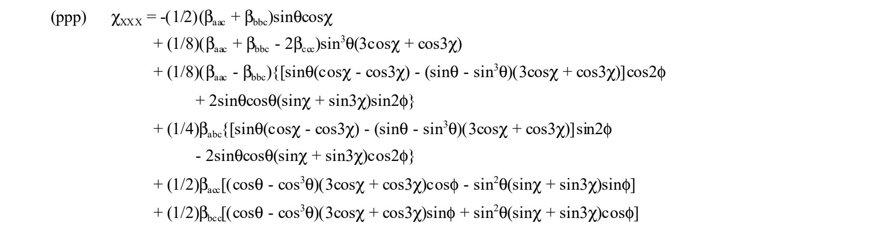

#### c轴组第2式：$\chi_{XZZ}$（原PDF p2）

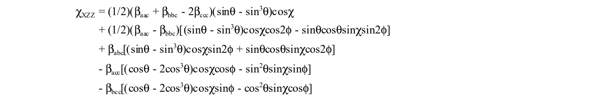

#### c轴组第3式：$\chi_{ZXZ}$（原PDF p2）

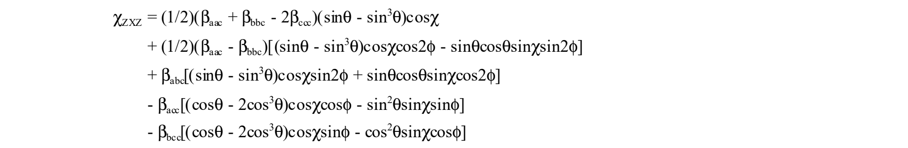

#### c轴组第4式：$\chi_{ZZX}$（原PDF p2）

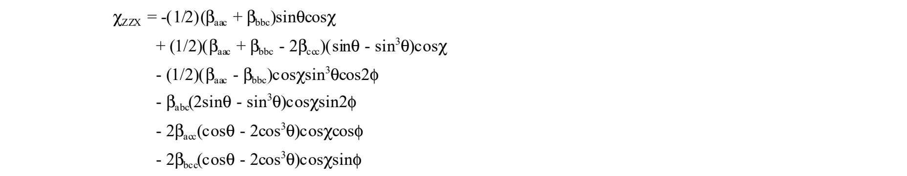

#### c轴组第5式：$\chi_{XZX}$（原PDF p2）

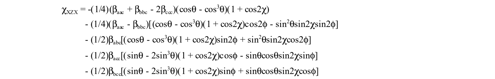

#### c轴组第6式：$\chi_{ZXX}$（原PDF p2、3）

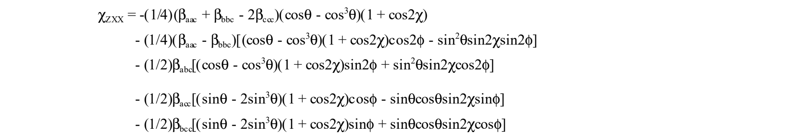

#### c轴组第7式：$\chi_{XXZ}$（原PDF p3）

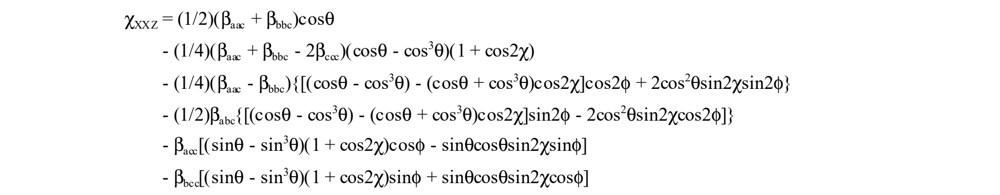

#### c轴组第8式：$\chi_{ZZZ}$（原PDF p3）

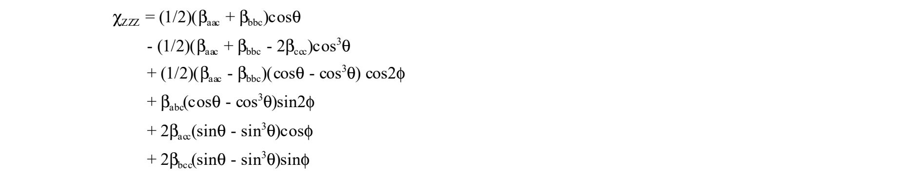

#### c轴组第9式：$\chi_{YXX}$（原PDF p3）

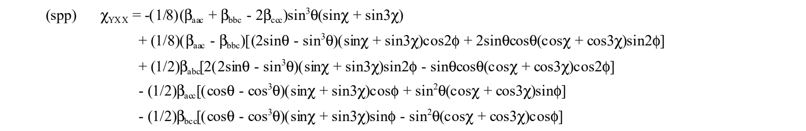

#### c轴组第10式：$\chi_{YZZ}$（原PDF p3）

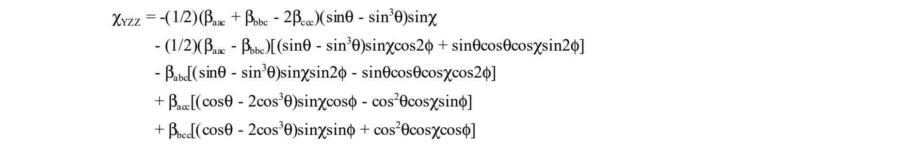

#### c轴组第11式：$\chi_{YZX}$（原PDF p3）

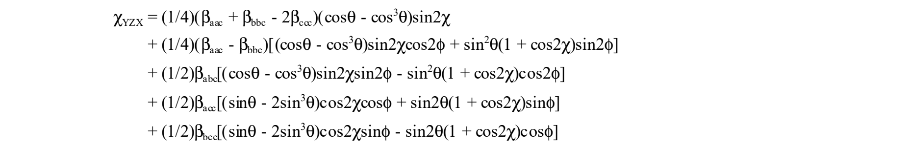

#### c轴组第12式：$\chi_{YXZ}$（原PDF p3）

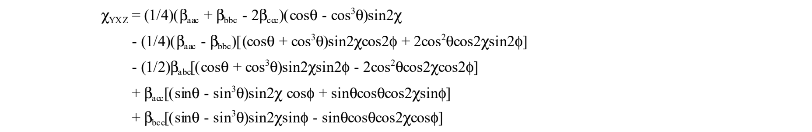

#### c轴组第13式：$\chi_{YYX}$（原PDF p3、4）

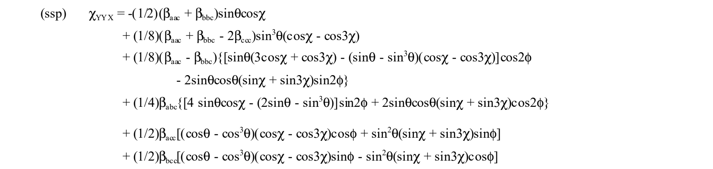

#### c轴组第14式：$\chi_{YYZ}$（原PDF p4）

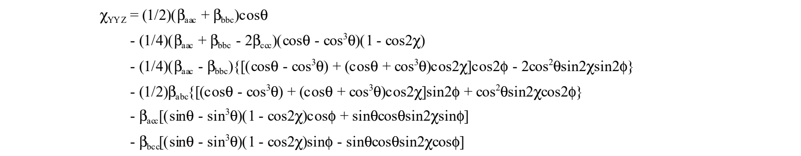

#### c轴组第15式：$\chi_{XYX}$（原PDF p4）

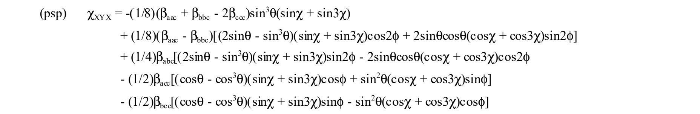

#### c轴组第16式：$\chi_{ZYZ}$（原PDF p4）

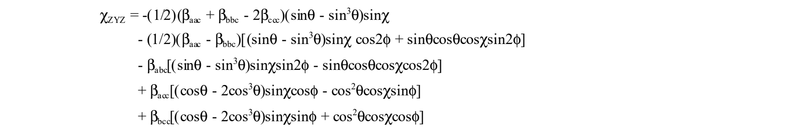

#### c轴组第17式：$\chi_{XYZ}$（原PDF p4）

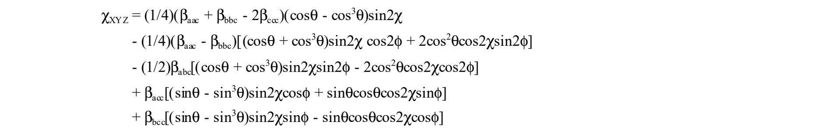

#### c轴组第18式：$\chi_{ZYX}$（原PDF p4）

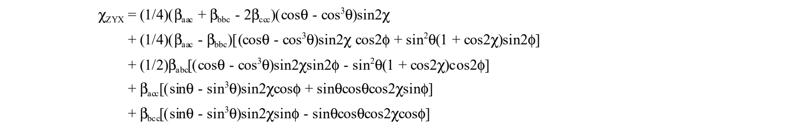

#### c轴组第19式：$\chi_{YXY}$（原PDF p4）

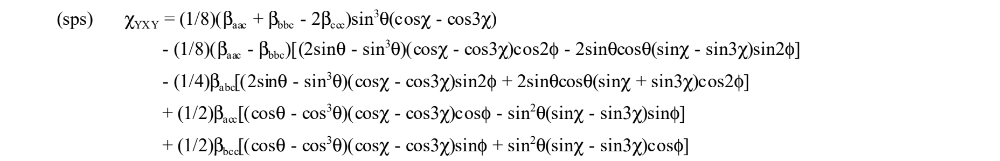

#### c轴组第20式：$\chi_{YZY}$（原PDF p4）

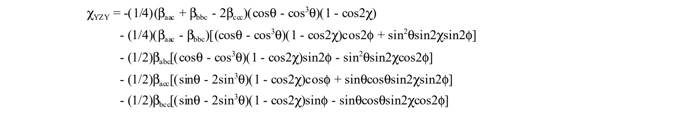

#### c轴组第21式：$\chi_{XXY}$（原PDF p4、5）

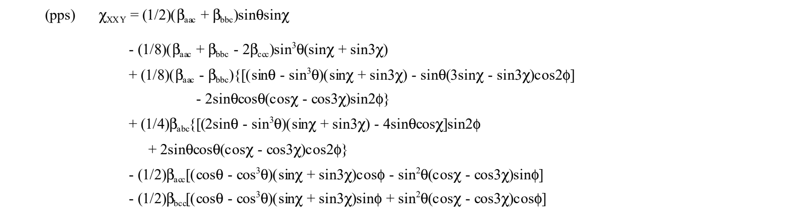

#### c轴组第22式：$\chi_{ZZY}$（原PDF p5）

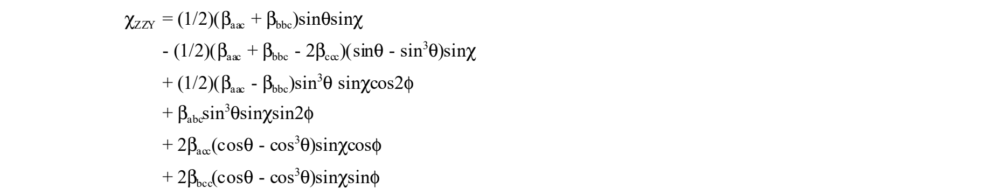

#### c轴组第23式：$\chi_{XZY}$（原PDF p5）

#### c轴组第24式：$\chi_{ZXY}$（原PDF p5）

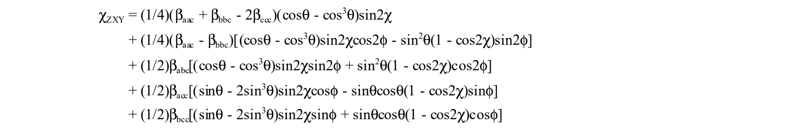

#### c轴组第25式：$\chi_{XYY}$（原PDF p5）

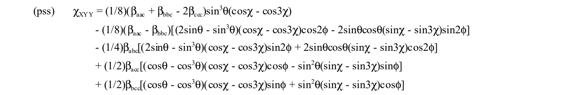

#### c轴组第26式：$\chi_{ZYY}$（原PDF p5）

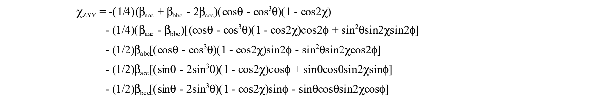

#### c轴组第27式：$\chi_{YYY}$（原PDF p5、6）

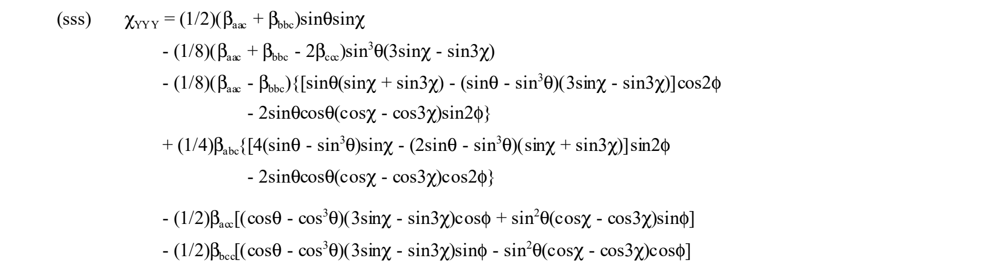

### 4.2 沿a轴的振动

#### a轴组第1式：$\chi_{XXX}$（原PDF p6）

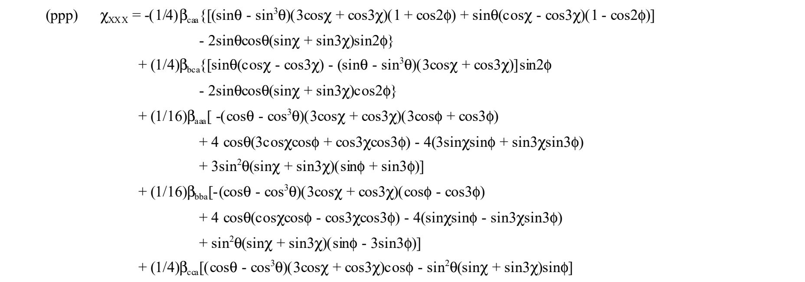

#### a轴组第2式：$\chi_{XZZ}$（原PDF p6）

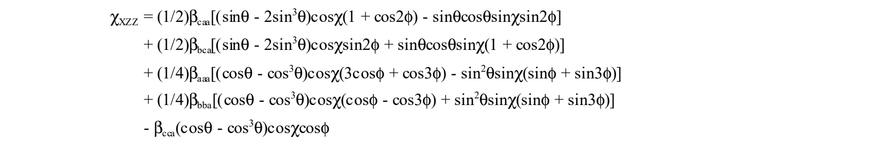

#### a轴组第3式：$\chi_{ZXZ}$（原PDF p6）

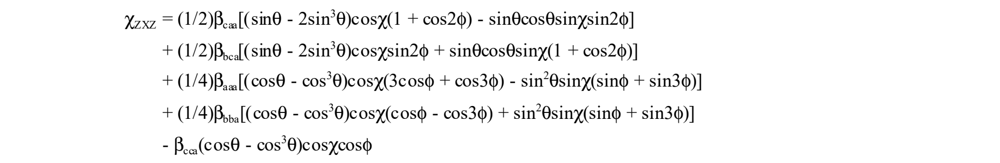

#### a轴组第4式：$\chi_{ZZX}$（原PDF p6）

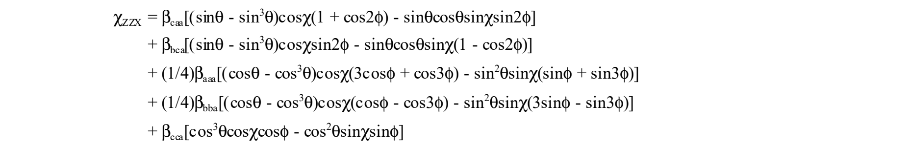

#### a轴组第5式：$\chi_{ZXX}$（原PDF p6）

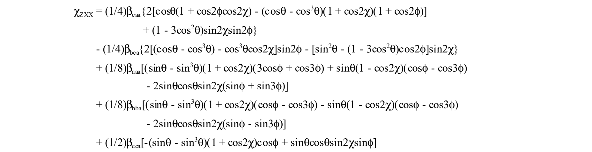

#### a轴组第6式：$\chi_{XZX}$（原PDF p6、7）

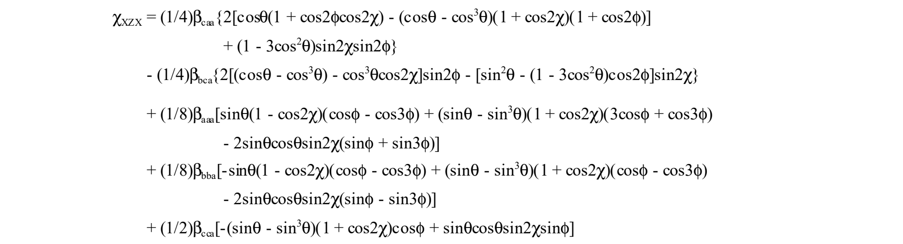

#### a轴组第7式：$\chi_{XXZ}$（原PDF p7）

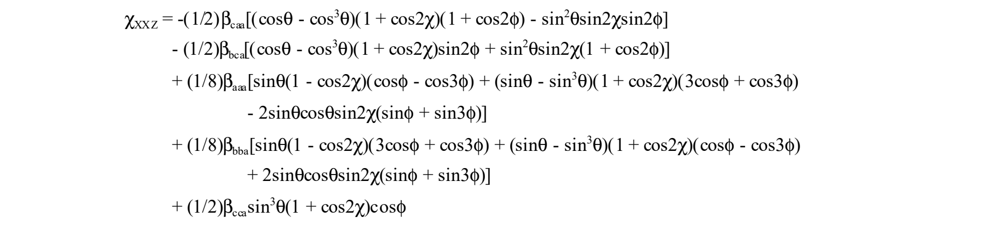

#### a轴组第8式：$\chi_{ZZZ}$（原PDF p7）

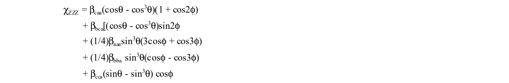

#### a轴组第9式：$\chi_{YXX}$（原PDF p7）

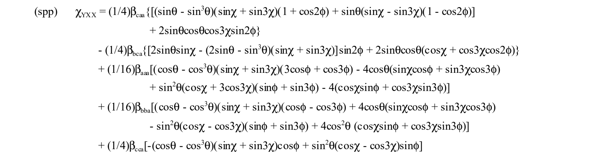

#### a轴组第10式：$\chi_{YZZ}$（原PDF p7）

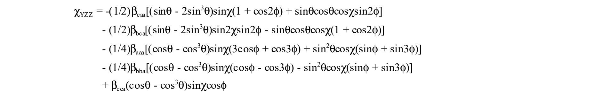

#### a轴组第11式：$\chi_{YZX}$（原PDF p7）

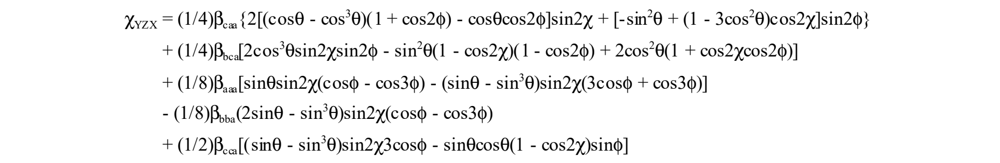

#### a轴组第12式：$\chi_{YXZ}$（原PDF p7、8）

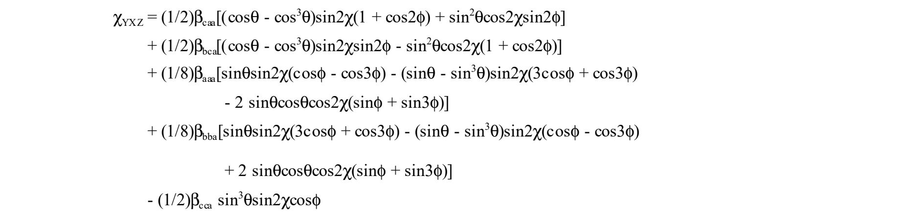

#### a轴组第13式：$\chi_{YYX}$（原PDF p8）

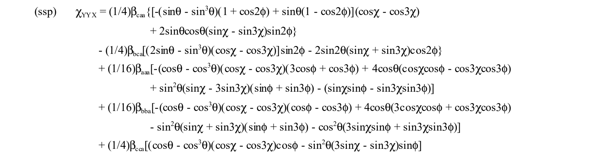

#### a轴组第14式：$\chi_{YYZ}$（原PDF p8）

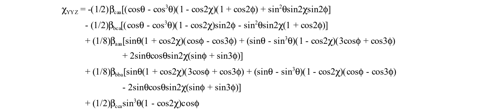

#### a轴组第15式：$\chi_{XYX}$（原PDF p8）

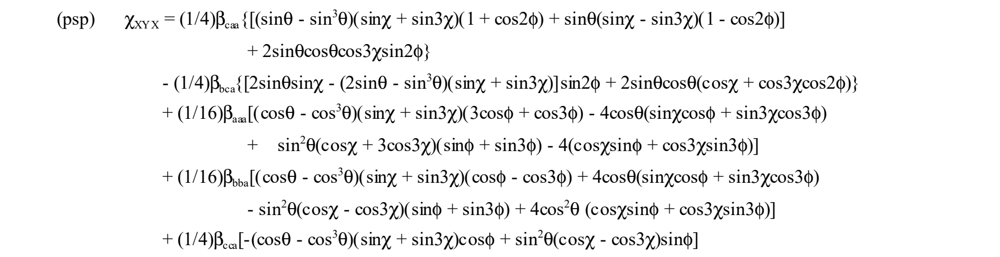

#### a轴组第16式：$\chi_{ZYZ}$（原PDF p8）

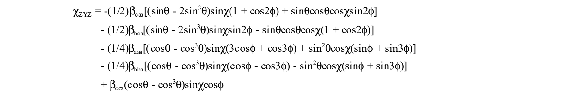

#### a轴组第17式：$\chi_{XYZ}$（原PDF p8）

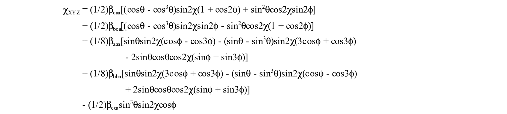

#### a轴组第18式：$\chi_{ZYX}$（原PDF p8、9）

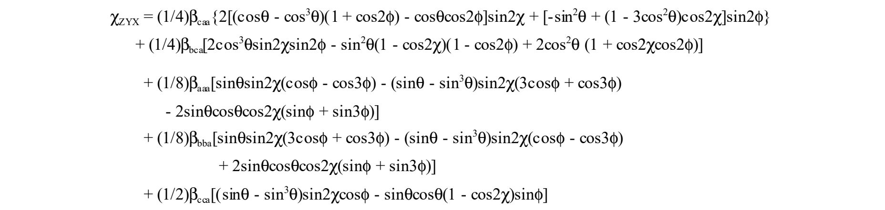

#### a轴组第19式：$\chi_{YXY}$（原PDF p9）

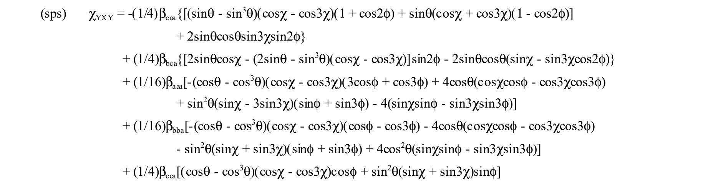

#### a轴组第20式：$\chi_{YZY}$（原PDF p9）

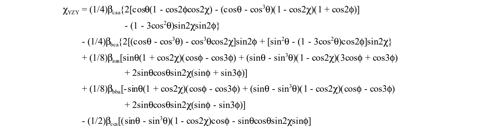

#### a轴组第21式：$\chi_{XXY}$（原PDF p9）

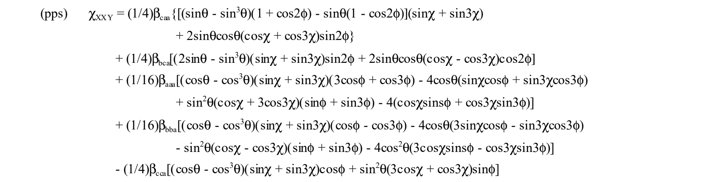

#### a轴组第22式：$\chi_{ZZY}$（原PDF p9）

#### a轴组第23式：$\chi_{ZXY}$（原PDF p9、10）

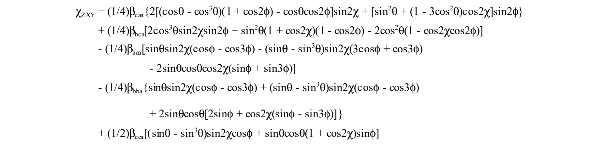

#### a轴组第24式：$\chi_{XZY}$（原PDF p10）

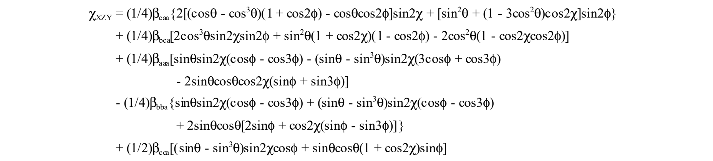

#### a轴组第25式：$\chi_{XYY}$（原PDF p10）

#### a轴组第26式：$\chi_{ZYY}$（原PDF p10）

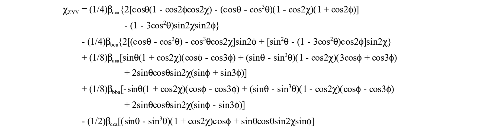

#### a轴组第27式：$\chi_{YYY}$（原PDF p10）

### 4.3 沿b轴的振动（译者按分量分组）

> **编排说明（译者）：** 底本p10在a轴组末式之后直接开始含βcbb等分量的ppp式，没有另印“沿b轴的振动”标题。此处依首页的三轴分类和该组分量增加阅读标题；原公式及其先后次序未改。

#### b轴组第1式：$\chi_{XXX}$（原PDF p10、11）

#### b轴组第2式：$\chi_{XZZ}$（原PDF p11）

#### b轴组第3式：$\chi_{ZXZ}$（原PDF p11）

#### b轴组第4式：$\chi_{ZZX}$（原PDF p11）

#### b轴组第5式：$\chi_{ZXX}$（原PDF p11）

#### b轴组第6式：$\chi_{XZX}$（原PDF p11、12）

#### b轴组第7式：$\chi_{XXZ}$（原PDF p12）

#### b轴组第8式：$\chi_{ZZZ}$（原PDF p12）

#### b轴组第9式：$\chi_{YXX}$（原PDF p12）

#### b轴组第10式：$\chi_{YZZ}$（原PDF p12）

#### b轴组第11式：$\chi_{YZX}$（原PDF p12、13）

#### b轴组第12式：$\chi_{YXZ}$（原PDF p13）

#### b轴组第13式：$\chi_{YYX}$（原PDF p13）

#### b轴组第14式：$\chi_{YYZ}$（原PDF p13）

#### b轴组第15式：$\chi_{XYX}$（原PDF p13、14）

#### b轴组第16式：$\chi_{ZYZ}$（原PDF p14）

#### b轴组第17式：$\chi_{XYZ}$（原PDF p14）

#### b轴组第18式：$\chi_{ZYX}$（原PDF p14）

#### b轴组第19式：$\chi_{YXY}$（原PDF p14）

#### b轴组第20式：$\chi_{YZY}$（原PDF p14、15）

#### b轴组第21式：$\chi_{XXY}$（原PDF p15）

#### b轴组第22式：$\chi_{ZZY}$（原PDF p15）

#### b轴组第23式：$\chi_{ZXY}$（原PDF p15）

#### b轴组第24式：$\chi_{XZY}$（原PDF p15）

#### b轴组第25式：$\chi_{XYY}$（原PDF p15、16）

#### b轴组第26式：$\chi_{ZYY}$（原PDF p16）

#### b轴组第27式：$\chi_{YYY}$（原PDF p16）

> **全节保留说明（译者）：** 对公式中可能存在的括号不配对、重复项或相邻分量差异，均保留底本，不以对称性推测作替换。以上完成的是译文与底本内容、排版的对照，不声称已独立验证81条展开式的物理及代数正确性。
