# 5.4 旋转群的基底张量

原作：广濑千秋；中文翻译：章力。底本：`日语原版/Chapter5/chap5-4.pdf`，15页。

本轮状态（2026-10-21）：全15页中文图式版完成，批次B501—B514。

> **阅读导引（译者）：** 本节把笛卡尔张量分量组合成旋转群的基底，先说明上标、下标与星号，再列出指标数为1—4的基底，最后讨论反演和镜映下的奇偶性。沿用5.1的局部定义：“指标数”对应原文“次元”，“不可约角动量阶数”对应原文“階数”，不可把两者或矩阵维数混为一谈。大型系数表保留为原表图，中文标题、表注及读表说明列在图外。

## 1. 要点与记号（PDF p1）

把张量分量分成若干组线性组合，使其构成定义该张量的体系所属对称群的基底，就能得到彼此独立的组合。点群及其推广——置换反演群——的对称操作，可用坐标旋转，或旋转与反演的乘积表示。球对称群（以任意坐标旋转为对称操作的群）的基底，也可用作点群的基底。不过，一般点群中的对称操作只是特定的旋转，因此前者的基底可能不再独立。也就是说，结合另一文件给出的变换矩阵，球对称群的基底有助于导出一般点群的基底及其变换性质（不可约表示）。

下面给出指标数为1—4的张量中，球对称群（对任意旋转对称的群）的基底与笛卡尔坐标分量之间的关系。

基底记作 $T^{(n)}_{mb}$、$T^{(n)}_{ma}$ 或 $T^{(n)}_0$，右上角括号中的数字表示不可约角动量阶数。左上角加星号者，表示对于xz面镜映，其 $(T^{(n)}_{mb},T^{(n)}_{ma},T^{(n)}_0)$ 的变换与 $(x,y,z)$ 的变换相差一个负号。后面将具体说明：在包含反演、镜映或旋转反射的体系中，有些基底在旋转下的变换性质与通常的矢量相对应，而在反演、镜映或旋转反射下却相差一个负号，即变换系数反号。

用数学语言来说，带星号张量的变换矩阵，与同一不可约角动量阶数、但不带星号的张量——两者的指标数相差1——的变换矩阵，彼此是对方的余因子矩阵的转置。也就是逆矩阵的转置再乘以行列式；原文称，因为矩阵是酉矩阵，行列式为 $\pm1$。

> **原文疑点（Q223）：** 本段“余因子矩阵的转置”及“酉矩阵所以行列式为±1”的措辞依底本保留。余因子矩阵与伴随矩阵的定义需区分；±1需结合此处实正交变换的语境理解，不能推广到任意酉矩阵。本译不据此改写作者公式。

右下角的数字和字母含义如下。在欧拉角 $(\chi,\theta,\phi)$ 所表示的坐标旋转下，张量分量之间的变换矩阵，其对角元包含 $\cos(n\theta)\cos(m\chi)\cos(m\phi)$ 或 $\cos(n\theta)\sin(m\chi)\sin(m\phi)$；其中 $n$ 为右上角所示阶数，$m=0,1,\ldots,n$。下标数字表示这个 $m$：前一种情形加字母b，后一种加字母a。按照Landau量子力学教材群论部分的做法，若取

$$
T^{(n)}_{mb}\pm iT^{(n)}_{ma}
$$

为基底，则绕z轴转过 $\chi$ 时，变换矩阵成为对角矩阵，其矩阵元为 $\exp(\pm im\chi)$。

只含 $\cos(n\theta)$ 的对角元仅有一个，此时 $m=0$，不加a、b下标。不过，下文仅考虑如下张量：零指标张量对应标量，单指标张量对应坐标矢量（极矢量），更高指标数的张量由这样的单指标张量作张量积构成。（也存在协变张量、逆变张量，但详细内容已经忘记，因此不太清楚它们与这里所述内容的关系。）

所有基底都属于一个对称种的一个不可约表示。

在不可约表示至多具有二重简并的对称种中，若以 $(x,y)$ 为简并表示的基底，则 $T^{(n)}_0$ 属于无简并的一维表示。又如绕z轴有n重旋转对称，当 $m$ 是该n的整数倍时，$T^{(n)}_{mb}$、$T^{(n)}_{ma}$、${}^{*}T^{(n)}_{mb}$ 和 ${}^{*}T^{(n)}_{ma}$ 为一维表示的基底；除此之外，$(T^{(n)}_{mb},T^{(n)}_{ma})$ 与 $({}^{*}T^{(n)}_{mb},{}^{*}T^{(n)}_{ma})$ 为二重简并表示的基底。

> **记号说明（译者）：** 原文在上段同时用n表示不可约角动量阶数和旋转轴的重数，依原文保留；使用时应从语境区分。本节“基底属于不可约表示”的陈述应连同成组分量阅读，不能把高维表示中的每个分量都当作独立的一维表示。

## 2. 单指标张量：仅含1阶（PDF p2）

$$
V_{1b}=V_x,\qquad V_{1a}=V_y,\qquad V_0=V_z.
$$

写成矩阵形式：

原PDF p2，第1表；行列与系数均依底本。

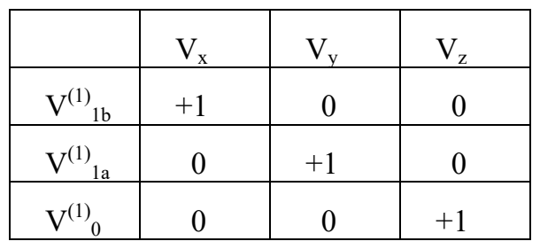

## 3. 双指标张量：0、1、2阶（PDF p2）

$$
D^{(0)}_0=\frac{D_{xx}+D_{yy}+D_{zz}}{\sqrt3}.
$$

$$
\begin{aligned}
{}^{*}D^{(1)}_{1b}&=\frac{D_{yz}-D_{zy}}{\sqrt2},&
{}^{*}D^{(1)}_{1a}&=\frac{D_{zx}-D_{xz}}{\sqrt2},&
{}^{*}D^{(1)}_0&=\frac{D_{yz}-D_{zy}}{\sqrt2},\\
D^{(2)}_{2b}&=\frac{D_{xx}-D_{yy}}{\sqrt2},&
D^{(2)}_{2a}&=\frac{D_{xy}+D_{yx}}{\sqrt2},\\
D^{(2)}_{1b}&=\frac{D_{zx}+D_{xz}}{\sqrt2},&
D^{(2)}_{1a}&=\frac{D_{yz}+D_{zy}}{\sqrt2},\\
D^{(2)}_0&=\frac{-D_{xx}-D_{yy}+2D_{zz}}{\sqrt6}.
\end{aligned}
$$

> **原文疑点（Q224）：** 原页第三个反对称组合 ${}^{*}D^{(1)}_0$ 再次写作 $(D_{yz}-D_{zy})/\sqrt2$，与第一个相同；通常轴向z分量的候选是 $(D_{xy}-D_{yx})/\sqrt2$，本译仍保留原式。下方第一张系数表的 $D^{(2)}_{2b}$ 行、$D_{yy}$ 列又印作正的 $1/\sqrt2$，与上面差组合中的负号不一致；表图亦保留原值。两处均未采用修正。

写成矩阵形式：

原PDF p2，第2表；行列与系数均依底本。

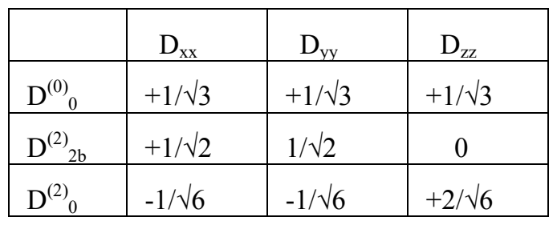

原PDF p2，第3表；行列与系数均依底本。

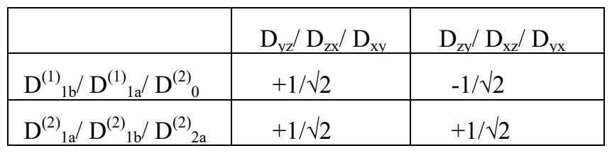

> **读表说明（译者）：** 斜线连接的行、列标按原来的对应顺序分别读取，不能把斜线当作分量相除。原表部分行标与上方公式的星号、阶数记法不完全一致，均保留图中所印形式。

## 4. 三指标张量：0、1、2、3阶（PDF p3—4）

以下用表格列出作线性组合时相互混合的四个子组。

### 4.1 第1组与第2组（PDF p3）

原PDF p3，第1表；行列与系数均依底本。

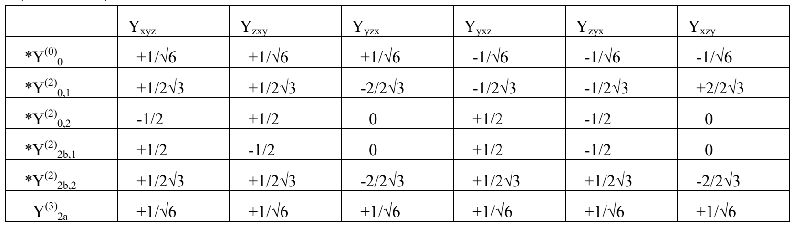

原PDF p3，第2表；行列与系数均依底本。

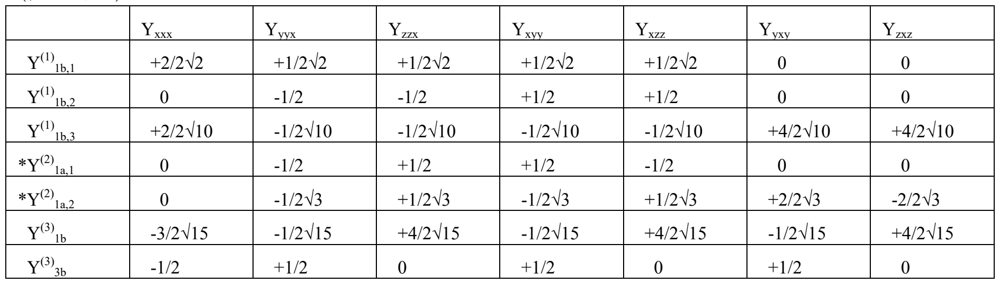

### 4.2 第3组与第4组（PDF p4）

原PDF p4，第1表；行列与系数均依底本。

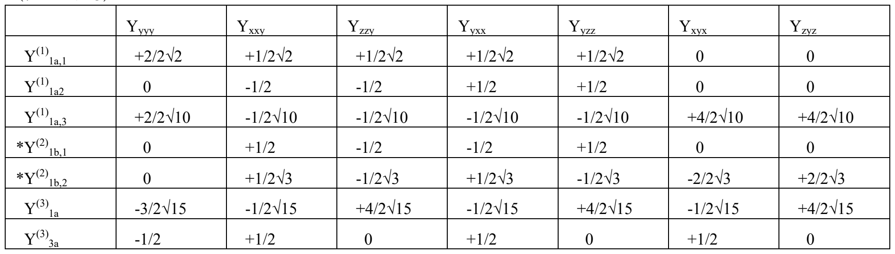

原PDF p4，第2表；行列与系数均依底本。

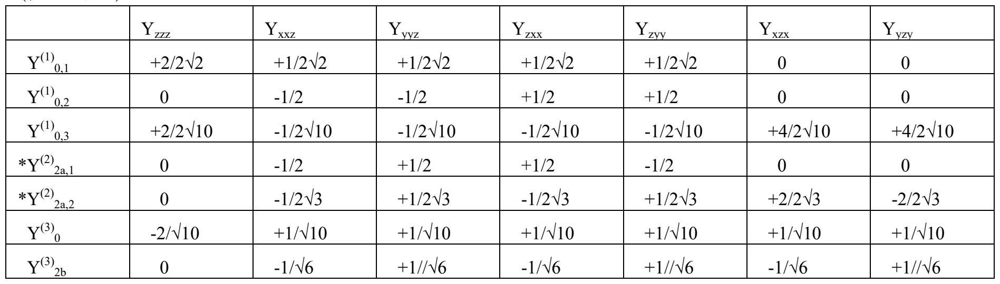

作为球对称群的基底，具有相同变换性质的组可以有多套，因此右下角增加的数字是给这些子组编的编号。编号相同的基底共同组成球对称群一个不可约表示的基底组。

## 5. 四指标张量：0、1、2、3、4阶（PDF p5—12）

右下角的记号除包含前页所述信息外，还考虑各基底由哪些基底组构成，例如 $T^{(1)}T^{(1)}$ 等。

### 5.1 第1-1组（PDF p5）

原PDF p5，第1表；行列与系数均依底本。

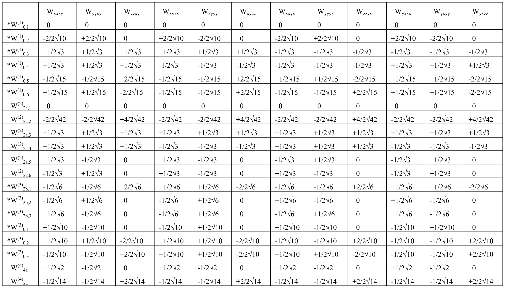

### 5.2 第1-2组（PDF p6）

原PDF p6，第1表；行列与系数均依底本。

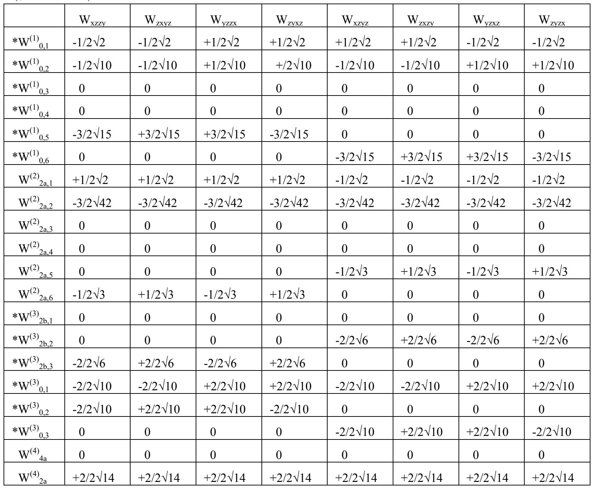

### 5.3 第2-1组（PDF p7）

原PDF p7，第1表；行列与系数均依底本。

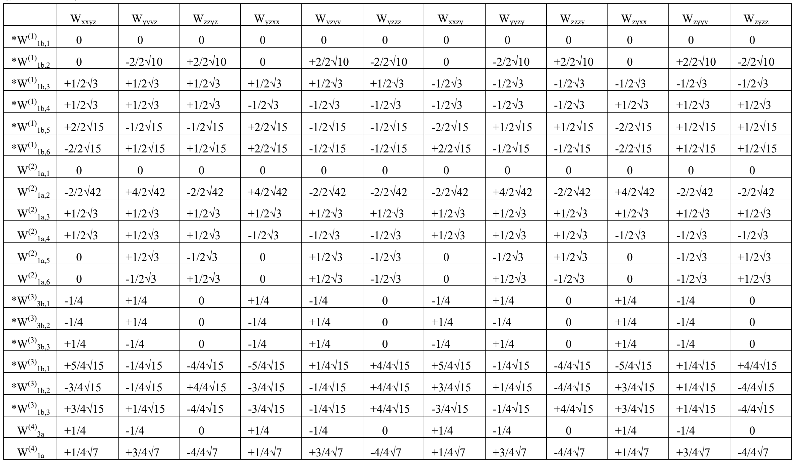

### 5.4 第2-2组（PDF p8）

原PDF p8，第1表；行列与系数均依底本。

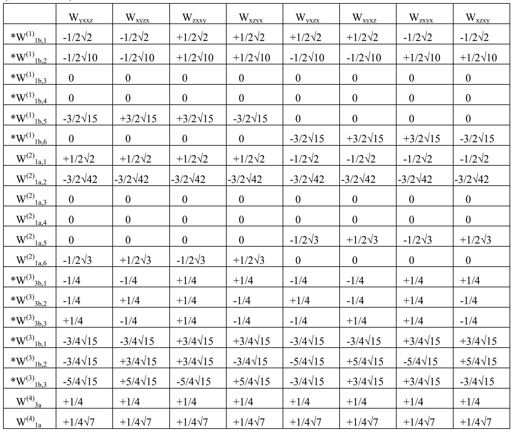

### 5.5 第3-1组（PDF p9）

原PDF p9，第1表；行列与系数均依底本。

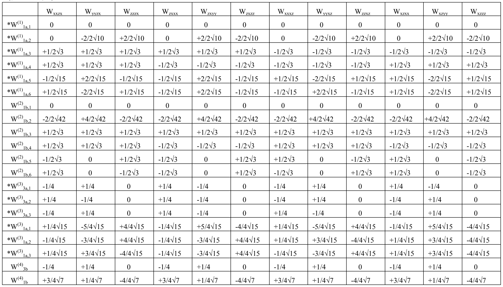

### 5.6 第3-2组（PDF p10）

原PDF p10，第1表；行列与系数均依底本。

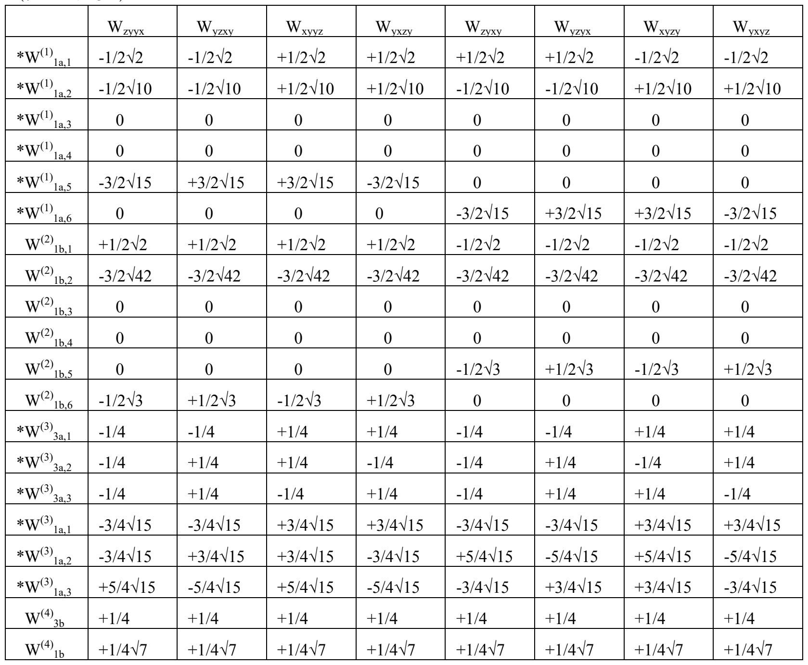

### 5.7 第4-1组（PDF p11）

原PDF p11，第1表；行列与系数均依底本。

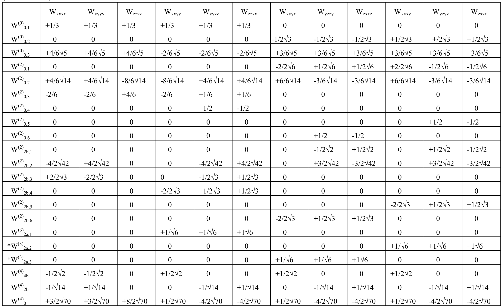

### 5.8 第4-2组（PDF p12）

原PDF p12，第1表；行列与系数均依底本。

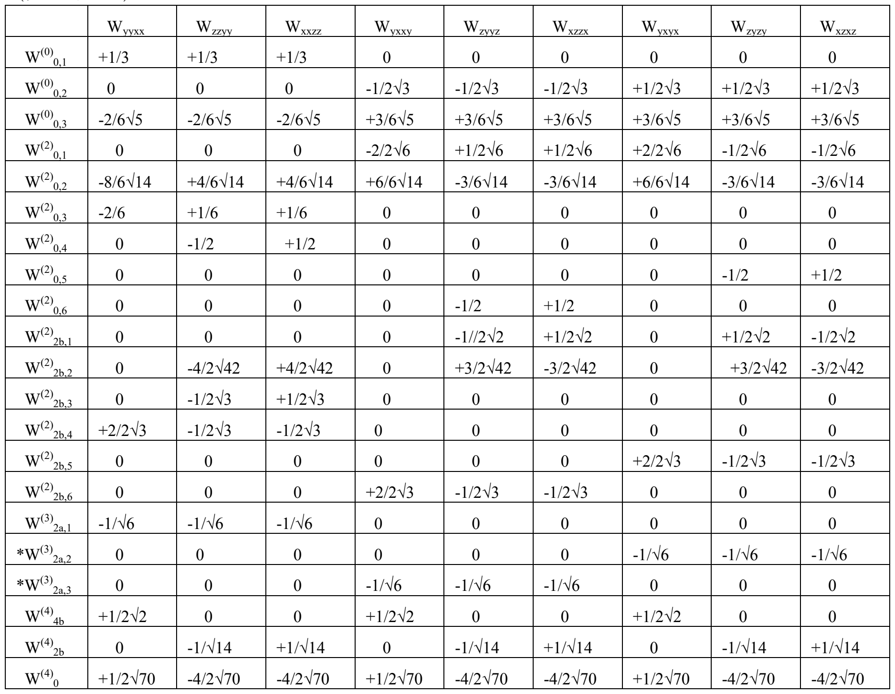

> **表式保留说明（译者）：** 系数表中的星号、重复编号、双斜线等均保留底本字形。例如p12第4-2组部分行标星号和p11对应表不一致，不据对称性猜测补齐。图中每一行是对列标分量的线性组合，零值与空白依原表区分。

## 6. 附录：基底的奇偶性（PDF p13—14）

对于仅由旋转操作构成的点群，$(T^{(n)}_{1b},T^{(n)}_{1a},T^{(n)}_0)$ 与 $({}^{*}T^{(n)}_{1b},{}^{*}T^{(n)}_{1a},{}^{*}T^{(n)}_0)$ 的行为都与 $(x,y,z)$ 相同。（把单指标张量看作矢量时，前者是极矢量，后者是轴矢量。）另外，对于绕z轴转过 $\chi$ 的旋转，$(T^{(n)}_{mb},T^{(n)}_{ma})$ 与 $({}^{*}T^{(n)}_{mb},{}^{*}T^{(n)}_{ma})$ 均与转角为 $m\chi$ 时的 $(x,y)$ 具有相同的变换性质。

但是，对于包含反演、镜映或旋转反射的对称种，在这些对称操作及其与旋转的乘积下，$(T^{(n)}_{mb},T^{(n)}_{ma},T^{(n)}_0)$ 按照通常旋转所对应的方式变换，而 $({}^{*}T^{(n)}_{mb},{}^{*}T^{(n)}_{ma},{}^{*}T^{(n)}_0)$ 的变换矩阵元——因而也包括特征标——与前者反号。例如，$({}^{*}T^{(n)}_{1b},{}^{*}T^{(n)}_{1a},{}^{*}T^{(n)}_0)$ 与轴矢量旋转角动量的x、y、z分量具有相同的变换性质。

以xz面镜映为例：

$$
\begin{aligned}
(T^{(n)}_{1b},T^{(n)}_{1a},T^{(n)}_0)&\longmapsto
(T^{(n)}_{1b},-T^{(n)}_{1a},T^{(n)}_0),\\
({}^{*}T^{(n)}_{1b},{}^{*}T^{(n)}_{1a},{}^{*}T^{(n)}_0)&\longmapsto
(-{}^{*}T^{(n)}_{1b},{}^{*}T^{(n)}_{1a},-{}^{*}T^{(n)}_0).
\end{aligned}
$$

带星号分量的变换矩阵和特征标，相当于把对应的不带星号分量的变换矩阵 $D$ 乘以 $\varepsilon$，其中 $\varepsilon=|D|$。

星号的有无在对称操作包含反演、镜映或旋转反射时才有意义。在包含 $\sigma_v$ 的体系中——$\sigma_v$ 是经过最高重数旋转对称轴（通常取z轴）的平面的镜映——若存在简并，取xz面还是yz面为其中一个镜面，会影响哪一组基底带星号。因此，当存在奇数重旋转轴时，这一区别更为重要。

对于阶数为n的基底，$T^{(n)}_0$ 是否加星号不受上述选择影响：指标数与阶数之和为奇数者加星号。对于 $m\ne0$ 的 $T^{(n)}_{mb}$、$T^{(n)}_{ma}$，若把xz面纳入 $\sigma_v$，则指标数与n之和为偶数时采用带星号的组；若取yz面为一个 $\sigma_v$ 面，则在指标数与阶数n之和上再加下标m，所得为偶数者采用带星号的组。本稿取前一种约定。

下表以 $(x,y,z)$ 和 $(x,y)$ 的变换方式为基准，列出代表性对称操作下，如何区分 $(T^{(n)}_{1b},T^{(n)}_{1a},T^{(n)}_0)$ 组及 $(T^{(n)}_{mb},T^{(n)}_{ma})$ 组中带星号与不带星号的基底。单、双、三、四指标张量分别记作V、D、Y、W。

原PDF p14，第1表；行列与系数均依底本。

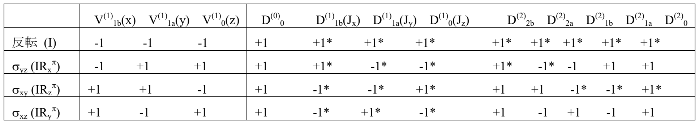

原PDF p14，第2表；行列与系数均依底本。

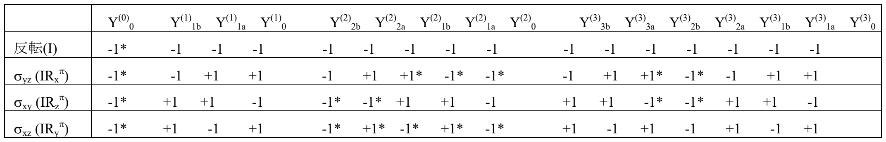

原PDF p14，第3表；行列与系数均依底本。

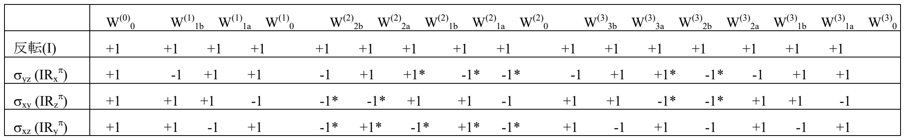

原PDF p14，第4表；行列与系数均依底本。

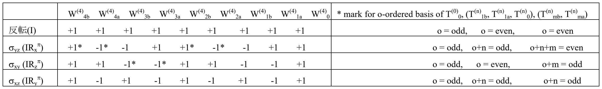

**图内文字对照：** “反転(I)”为“反演(I)”；odd为“奇数”，even为“偶数”。右下表中的o表示指标数；标题意为“o指标基底的星号判据”。其三列依次对应 $T^{(0)}_0$、$(T^{(n)}_{1b},T^{(n)}_{1a},T^{(n)}_0)$ 和 $(T^{(n)}_{mb},T^{(n)}_{ma})$：

| 操作 | 第一列加星号条件 | 第二列加星号条件 | 第三列加星号条件 |
|---|---|---|---|
| 反演I | o为奇数 | o为偶数 | o为偶数 |
| yz面镜映 | o为奇数 | o+n为奇数 | o+n+m为偶数 |
| xy面镜映 | o为奇数 | o为偶数 | o+m为奇数 |
| xz面镜映 | o为奇数 | o+n为奇数 | o+n为奇数 |

> **底本页数说明（译者）：** PDF p15只有“旋转群的基底张量—15”的页脚，没有正文、表格或附注，故不另设正文。
