# 5.5 坐标变换中的张量分量变换矩阵（基底）

原作：广濑千秋；中文翻译：章力。底本：`日语原版/Chapter5/chap5-5.pdf`，13页。

本轮状态（2026-10-21）：全13页中文图式版完成，批次B515—B527。

> **阅读导引（译者）：** 本节接续5.4，以不可约基底表示变换矩阵。先解释行列式因子与极矢量、轴矢量的区别，再列0—4阶矩阵，最后给出欧拉角形式。这里“阶”沿用不可约角动量阶数，“指标数”对应原文“次元数”。大型矩阵保留原表图；图外给出完整中文说明。原表中的疑误、缺字方框保留，不以推导结果覆盖。

## 1. 坐标变换与行列式因子（PDF p1）

坐标变换时张量分量之间的变换关系，可以用按不可约角动量阶数定义的变换矩阵整理，而不依赖指标数。下面用位置矢量的变换矩阵D来说明。令 $\varepsilon=|D|$ 为D的行列式；对于镜映、旋转反射等非正常旋转（原文：pseudo rotation），$\varepsilon=-1$。哪些基底需要考虑这个因子，取决于对称操作所包含的非正常旋转；在另一文件《张量的基底》中，这些基底带有星号。

写作

$$
T=T^{(0)}+T^{(1)}+T^{(2)}+T^{(3)}+T^{(4)}+\cdots,
$$

变换后的张量分量记作 $T'$。

在点群——由不移动原点的对称操作构成的群——中，所有对称操作都可以定义为坐标旋转，或坐标旋转与反演的乘积。就坐标系旋转和镜映操作而言，xy面镜映可用先绕x轴旋转180°（记作 $R_x(\pi)$），随后反演来表示。这个180°旋转与欧拉角有如下对应关系；这里第二次旋转取为绕y轴旋转：

$$
R_x(\pi):\quad \chi=0,\quad\theta=\pi,\quad\phi=\pi.
$$

> **原文疑点（Q225）：** 上段原文写“xy面镜映—绕x轴旋转”，而本页后文又将xy面镜映对应到 $R_z(\pi)$。对于通常三维坐标，反演与绕x轴旋转的乘积对应yz面镜映。此处保留原句及角度式，不自行把xy改为yz；后文亦保留。

同样，垂直于xy面且与x轴夹角为 $\alpha$ 的平面的镜映，对应于绕xy面内与x轴夹角为 $\alpha$ 的轴旋转180°（记作 $R_\alpha(\pi)$），再与反演相乘。此时

$$
R_\alpha(\pi):\quad\chi=0,\quad\theta=\pi,\quad\phi=\pi-2\alpha.
$$

如此，镜映和旋转反射操作都是旋转与反演的乘积。反演使所有坐标反号。例如，xy、xz、yz面镜映分别对应 $R_z(\pi)$、$R_y(\pi)$、$R_x(\pi)$。$C_{2v}$ 对称中的 $C_{2,b}$、$\sigma_{ab}$、$\sigma_{bc}$ 分别对应 $R_b(\pi)$、$R_c(\pi)$、$R_a(\pi)$。$C_{3v}$ 的 $2C_3$ 和 $3\sigma_v$ 分别是 $R_z(2\pi/3)$ 和 $R_y(\pi)$。通过这种方式，所有点群以及更一般的置换反演群的对称操作，都可以与旋转操作对应。因此，下面这些变换矩阵很有用。

本稿给出的变换矩阵是酉矩阵。因此，转置矩阵等于逆矩阵，可以用于逆变换。

> **适用语境说明（译者）：** “转置等于逆”按本节实正交矩阵的语境读取；若换成复基底，一般应区分转置和共轭转置。镜映与旋转的上述对应也须连同行列式因子读取。

## 2. 轴矢量与赝标量（PDF p2）

如上，将坐标矢量——作为张量时，是单指标张量的1阶分量——的变换矩阵记作D。由坐标的二次乘积构成的双指标张量，其1阶分量（角动量矢量）的变换矩阵 $\mathit D$ 如下。

原PDF p2，第1表；行列与系数均依底本。

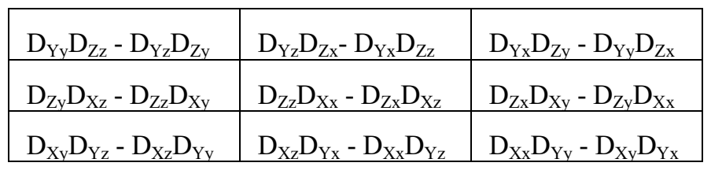

> **记号说明（译者）：** 底本用不同字形的D区分两个矩阵。为避免中文正文中丢失区别，本节用D及 $\mathit D$ 分别指坐标矢量和角动量矢量的矩阵；上方图式保留原字形，未改动矩阵元。

这个矩阵的元素是D对应元素的 $\varepsilon$ 倍，可从以下两点看出。

1. 将D的转置矩阵与 $\mathit D$ 相乘，可知对角元为 $\varepsilon$，非对角元为零。也就是说，D的转置是 $\mathit D$ 的逆矩阵的常数倍。
2. 按矩阵教材的说法，$\mathit D_{i,j}$ 是D的余因子矩阵的(j,i)分量，而余因子矩阵是D的逆矩阵乘以行列式。因此，原文称 $\mathit D$ 是D的逆矩阵的转置。

变换矩阵D是酉矩阵，其转置等于逆矩阵。因此，$\mathit D$ 是D的 $\varepsilon$ 倍。

> **原文疑点（Q226）：** 第2点对余因子、转置以及行列式因子的叙述存在含混，尤其末句未写 $\varepsilon$。本译按原句保留，未补成推导式；作者随后给出的“$\mathit D$ 是D的 $\varepsilon$ 倍”结论也照录。不得把译文对照通过视为这段推导已独立验证。

0阶张量的变换系数，在指标数为偶数时为1，其分量是标量。指标数为奇数时，由于D的变换与 $\mathit D$ 的变换叠加，变换系数为 $\varepsilon$；对于某些对称操作，它会变为−1倍，因而是赝标量，不再全对称。

双指标及更高指标数张量的变换性质，可以通过将其构造成单指标张量的逐次张量积来导出。以下变换矩阵就是根据这些考虑整理的。

## 3. 0、1、2阶变换矩阵（PDF p3）

### 3.1 0阶

$$
T'^{(0)}_0=T^{(0)}_0.
$$

对于指标数为3、5、7……的张量，还须乘 $\varepsilon$；其中 $\varepsilon=|D|$。

### 3.2 1阶

原PDF p3，第1表；行列与系数均依底本。

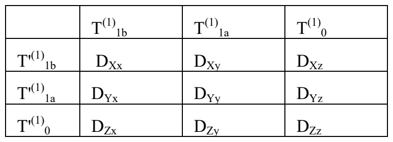

对于指标数为2、4、6……的张量，还须乘 $\varepsilon$。

### 3.3 2阶

原PDF p3，第2表；行列与系数均依底本。

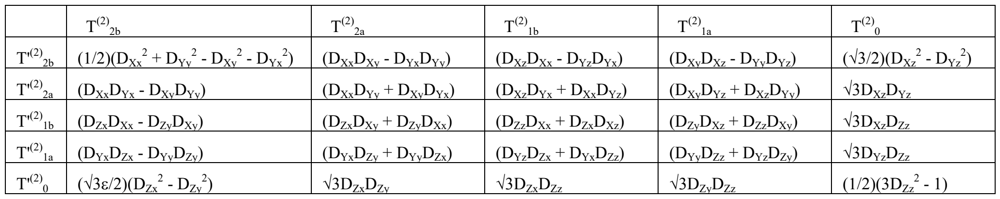

对于指标数为3、5、7……的张量，还须乘 $\varepsilon$。

## 4. 用坐标变换元素表示的3、4阶矩阵（PDF p4—7）

为简化3、4阶张量的变换矩阵，将上面 $T^{(2)}$ 的变换矩阵简记如下。

原PDF p4，第1表；行列与系数均依底本。

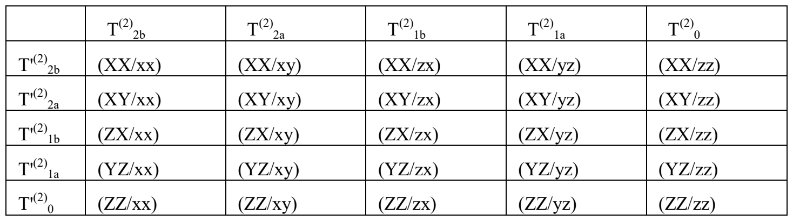

### 4.1 3阶，第1部分（PDF p4）

对于指标数为4、6……的张量，须乘 $\varepsilon$。

原PDF p4，第2表；行列与系数均依底本。

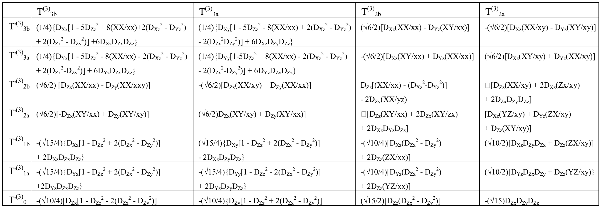

> **原文显示疑点（Q227）：** 本表部分矩阵元在底本中显示方框，例如 $T'^{(3)}_{2b}$ 行、$T^{(3)}_{2a}$ 列的式首。方框按原图保留，不能据相邻元素猜填正负号。p5—7等处的括号和排字异常同样依原图保留；未确认符号不转录成猜测的LaTeX。

### 4.2 3阶，第2部分（PDF p5）

对于指标数为4、6……的张量，须乘 $\varepsilon$。

原PDF p5，第1表；行列与系数均依底本。

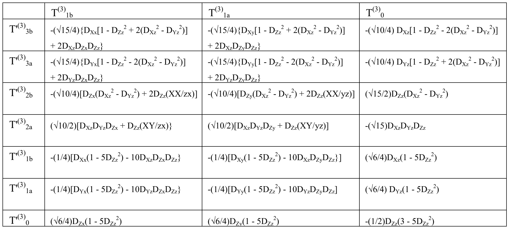

### 4.3 4阶，第1部分（PDF p6）

对于指标数为5、7、9……的张量，须乘 $\varepsilon$。

原PDF p6，第1表；行列与系数均依底本。

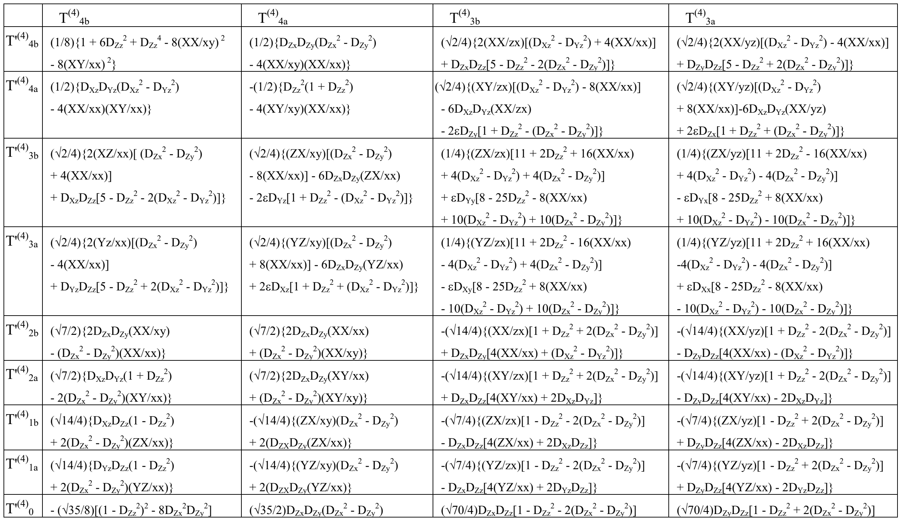

### 4.4 4阶，第2部分（PDF p7）

对于指标数为5、7、9……的张量，须乘 $\varepsilon$。

原PDF p7，第1表；行列与系数均依底本。

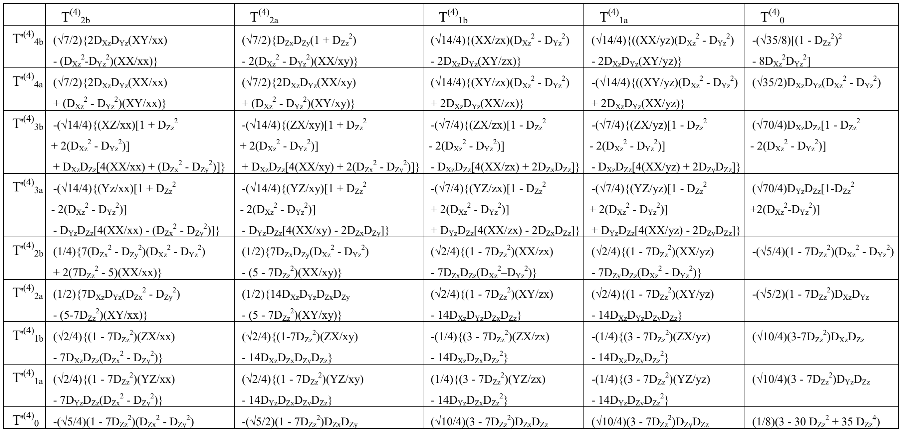

本页式下的缩写定义为：

$$
\begin{aligned}
(AB/cd)&=D_{Ac}D_{Bd}+D_{Ad}D_{Bc},\\
(AB/xx)&=D_{Ax}D_{Bx}-D_{Ay}D_{By},\\
(XX/ab)&=D_{Xa}D_{Xb}-D_{Ya}D_{Yb},\\
(XX/xx)&=\tfrac12(D_{Xx}^{2}+D_{Yy}^{2}-D_{Xy}^{2}-D_{Yx}^{2}).
\end{aligned}
$$

> **读表说明（译者）：** 上式保留原来的四条定义；斜线是作者对变换系数的记号，不是普通除号。不要把第一条不加区分地代入后面几条特殊缩写。

## 5. 欧拉角形式（PDF p8—13）

坐标旋转用欧拉角表示时，变换矩阵为

$$
D=R_Z(\chi)R_y(\theta)R_z(\phi).
$$

原文大小写轴标照录；具体变换方向以矩阵元素为准。

### 5.1 1阶（PDF p8）

原PDF p8，第1表；行列与系数均依底本。

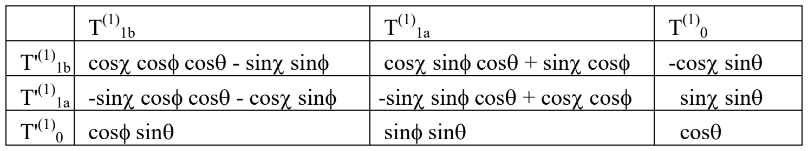

### 5.2 2阶（PDF p8）

原PDF p8，第2表；行列与系数均依底本。

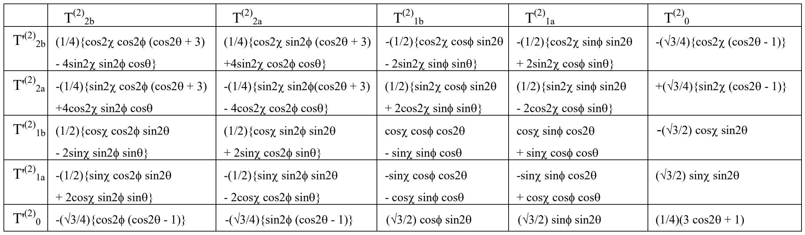

### 5.3 3阶，第1/2部分（PDF p9）

原PDF p9，第1表；行列与系数均依底本。

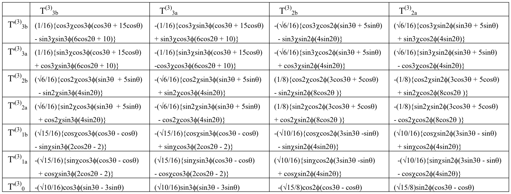

### 5.4 3阶，第2/2部分（PDF p10）

原PDF p10，第1表；行列与系数均依底本。

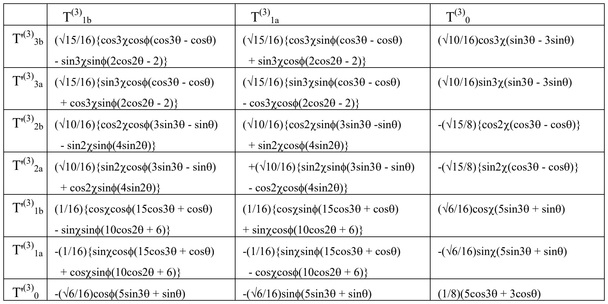

### 5.5 4阶，第1/3部分（PDF p11）

原PDF p11，第1表；行列与系数均依底本。

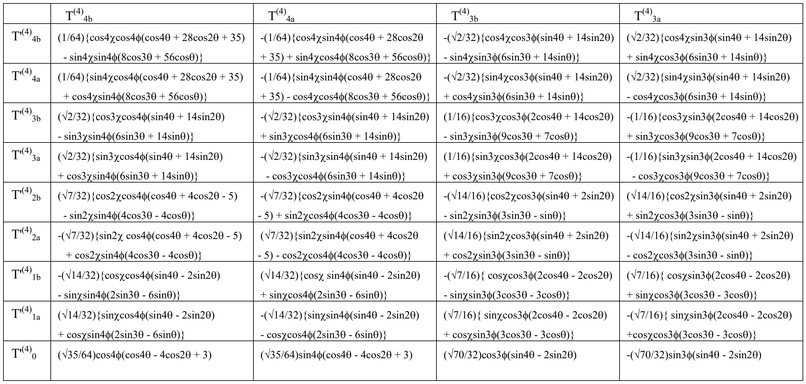

### 5.6 4阶，第2/3部分（PDF p12）

原PDF p12，第1表；行列与系数均依底本。

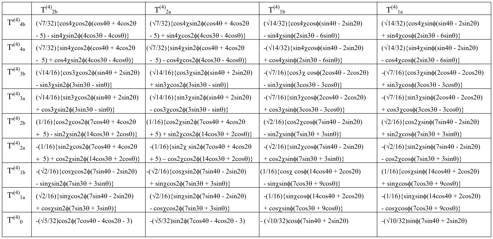

### 5.7 4阶，第3/3部分（PDF p13）

原PDF p13，第1表；行列与系数均依底本。

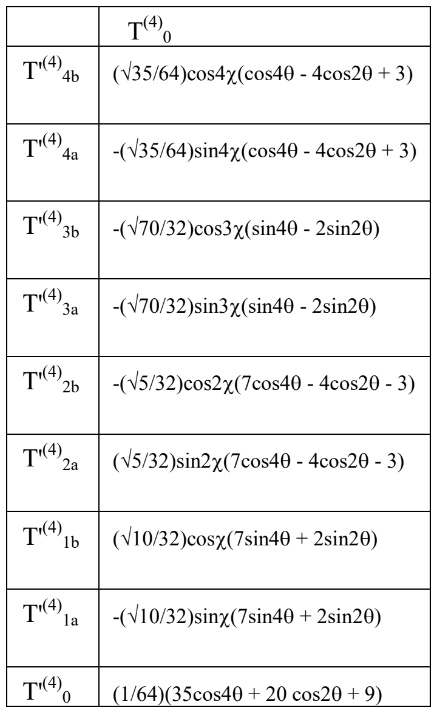

> **读表说明（译者）：** 行标为变换后带撇分量，列标为变换前分量；跨页表是同一矩阵的列分块，不是依次相乘的矩阵。保留原表的全部行列、符号及重复内容；未另行验证每个系数的理论正确性。
