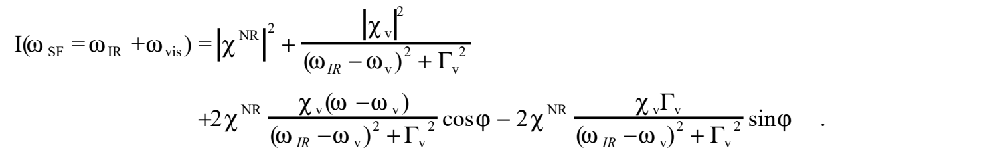
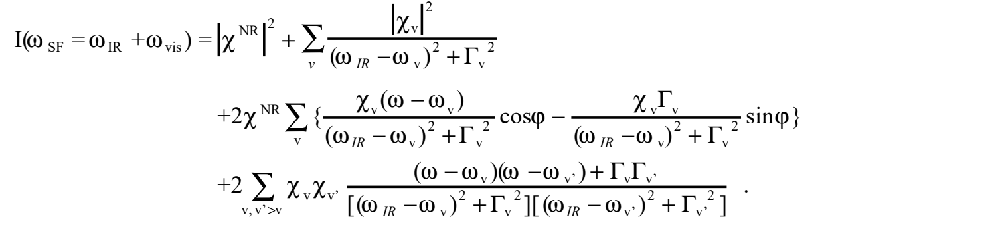
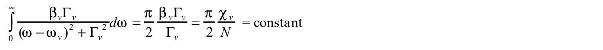

<!-- B649：PDF p1,2；谱形模拟与说明。 -->

# 8.2 和频光谱分析便览

原题：SFG スペクトルの解析便覧。底本：`日语原版/Chapter8/chap8-2.pdf`，2页。译校日期：2026-10-22。本页底本未另署作者姓名；保留其独立便览结构，不用8.1的不同表述覆盖。

## 光谱模拟

参数包括振动频率 $\omega_v$、半高半宽 $\Gamma_v$、振动共振响应系数 $\chi_v$、非共振二阶非线性极化率 $\chi^{\mathrm{NR}}$，以及共振极化与非共振极化之间的相位因子 $\phi$。

**只有一条振动谱带时：**

**多个振动谱带相互接近时：**

> **原文记号疑点（Q315，p1单谱带及多谱带式）：** 两组展开均混用 $\omega_{\mathrm{IR}}$ 与未另定义的 $\omega$，尤其单谱带式的交叉项分子与分母、多谱带式的首行与后两行不统一。保留原印，未直接全换成红外频率。此处用等号写强度，没有显示入射场及比例常数，宜与8.1关于省略电场的说明对读。

> **本轮复核（B675，Q315/Q316）：** 原页频率标签混用及强度比例因子的省略已确认，保留原图；分子数积分与谱宽问题沿用B667的条件性复核，不据此静默改写本节。

### 说明

**1.** 和频光谱正比于和频张量的模平方：

$$I^{\mathrm{SFG}}(\omega)\propto|\chi^{\mathrm{SFG}}(\omega)|^2.$$

**2.** 一般而言，和频张量由振动非共振项和振动共振项组成：

$$\chi^{\mathrm{SFG}}(\omega)=\chi^{\mathrm{NR}}e^{i\varphi}+\sum_v\frac{\chi_v}{\omega-\omega_v+i\Gamma_v}.$$

存在振动非共振项时，强度展开右边第二行第一项在 $\omega_{\mathrm{IR}}=\omega_v$ 两侧反号，使谱形不对称或出现凹陷。

在电偶极近似下，当表面态与可见光或和频光共振时，振动非共振项产生的电场非零，可认为它与振动共振电场具有相位差。原文指出，$\omega_{\mathrm{IR}}$ 位于共振极大处时，$\phi=\pm\pi/2$；远离共振、但矩阵元较大且与 $\chi_v$ 反号时，$\phi=\pm\pi$。不过，初步分析若得到非共振相位接近0或 $\pm\pi$，把 $\phi$ 继续作为拟合参数，在统计处理上并不理想，因为本应归结为 $\chi_v$ 与 $\chi^{\mathrm{NR}}$ 的符号问题。

**3.** 邻近多谱带式的第一至第三项分别给出各谱带的和频信号；第四项在带翼重叠时，即使无非共振背景也存在。在两峰之间，$\chi_v\chi_{v'}>0$ 时电场互相抵消形成凹陷，$\chi_v\chi_{v'}<0$ 时电场互相增强，有时产生表观峰。因此，不作模拟便无法确定正确的频率和谱宽。第三、第四项还说明，$\chi_v\Gamma_v$ 与 $\Gamma_v\Gamma_{v'}$ 的符号对谱形有重要意义。

**4.** 若谱宽来自吸附位点差异造成的频率偏移，即非均匀展宽，应修正上述响应表达式及模拟方法。

<!-- B650：PDF p2；分子数变化与峰强、宽度、面积。 -->

## 从和频光谱估算分子数变化

原则上，应模拟观测光谱，由参数 $\chi_v$、$\Gamma_v$ 中的 $\chi_v$ 估算分子数 $N$。

如果峰没有明显不对称，而且谱宽没有差别，原文认为，大体可以把“峰强度除以线宽的平方”视为正比于分子数平方。

### 说明

若单分子一阶超极化率的相关系数 $\beta_v$ 不随覆盖度改变，则

$$\chi_v=N\beta_v.$$

当 $\Gamma_v$ 为均匀宽度时，对单分子响应的虚部在峰的展宽范围积分，得到恒定值（线性吸收的积分强度）。即使存在非均匀展宽，只要 $\beta_v$ 不变，也可近似使用。因此

也就是说，**$\chi_v$ 是正比于分子数的量**。它不是峰高 $\chi_v^2/\Gamma_v^2$ 与半高宽 $\Gamma_v$ 的乘积，而是峰高平方根与半高宽 $\Gamma_v$ 的乘积。

> **原文疑点（Q316，p2分子数段）：** 前文“峰强除以线宽平方”与本页所给峰高 $\chi_v^2/\Gamma_v^2$ 不一致；若要恢复 $\chi_v^2$，候选为乘以宽度平方。宽度不变时两种处理都只差常因子，但不能据此用于宽度变化的比较。积分从0到无穷却写 $\pi/2$，也缺中心频率或积分近似条件。本页积分分子含 $\beta_v\Gamma_v$，与8.1 p2不含 $\Gamma_v$ 的积分及“$\chi_v/\Gamma_v$ 正比于分子数”的结论不同（Q302）；保留两节原式，尚未统一采用修正。

> **跨节核查提示（B667，Q316/Q302）：** 已对照8.1 p2，确认两节积分分子相差Γᵥ。对孤立、无背景且光学比例因子固定的均匀洛伦兹强度峰，恢复共振系数模平方需将峰高乘以半高半宽的平方；宽度不变时乘除只差常因子，不能据此推广到变线宽比较。原文“除以”仍保留。0至无穷的移位积分也不能一般地只用π/2；原作者意图尚未确认。

**认为积分强度正比于分子数是错误的。** 无非共振项时，积分强度对应峰高 $\chi_v^2/\Gamma_v^2$ 与半高宽 $\Gamma_v$ 的乘积。

无论谱带相邻还是孤立，只要存在不随分子数改变的背景，积分强度便同时包含正比于分子数平方的纯共振项，以及正比于分子数的共振—非共振交叉项。若不考虑交叉项的符号，并计入积分强度与线宽成反比，就不能把积分强度直接用于分子数估算。

> **译校状态：** 本节2页全部译校完成；复杂无编号式保留原式图。Q315、Q316仍待核。
