<!-- B651：PDF p1；最小二乘原理与条件分类。 -->

# 8.3 拟合概述

原题：フィッティング概説。底本：`日语原版/Chapter8/chap8-3.pdf`，9页；译校日期：2026-10-22。底本本页未另署姓名，文中保留“作者”自称。

## 最小二乘法

用和频谱强度分布的表达式优化参数，使其重现实验谱。假设初始参数已接近正确值，对实测强度与计算值之差作泰勒展开，保留一阶项，以线性近似求解联立方程，得到参数修正量。各测量点的一阶偏导数组成雅可比矩阵。（原文说概略见附录B，详细讨论见专著。）

拟合时，反复“修正参数—重新计算”，直到修正量小到可忽略，即逐次近似。作者所写MathCad程序通过复制、粘贴指定的程序块，按所需次数堆叠，执行这一过程。

本稿针对分子谱线展宽与红外激发光展宽的若干条件，列出雅可比矩阵元素。MathCad程序分别处理1—4条振动谱带；两条谱带时，还考虑把二者均匀宽度设为相同的情形，原文以费米共振引起的谱带为例。

### 振动谱带的条件

- **A：** 仅有均匀宽度。
- **B：** 同时含均匀与非均匀宽度，后者假设为高斯分布。
- **B1：** 固定非均匀宽度，优化其他参数。
- **B2：** 非均匀宽度也作为待优化参数。

### 红外激发光的条件

- **a：** 红外谱宽相对于振动谱带可忽略。
- **b：** 红外谱宽与振动谱带相当或更大。
- **b1：** 同一脉冲内不同波数成分完全相干。
- **b2：** 同一脉冲内不同波数成分不相干。

下面给出九类实验条件的解析式。原文说相应MathCad程序放在不同文件夹中。每个文件夹又分别包含：对观测到1—4条谱带、偏振相同且波长采样间隔相同的1—4份数据同时分析的程序；以及对两份不同偏振数据同时分析的程序。

文件夹名开头表示上述条件的组合，末尾表示强度的计算次序：对红外宽度先积分电场再平方，记为 `sqr(Integ)`；先平方电场再积分，记为 `Integ(sqr)`。振动谱带含非均匀宽度时，原文用 `Voight` 函数计算，固定非均匀宽度的方式记为 `Voightx`，将其作为参数的方式记为 `Voight`。

> **译者说明：** `MathCad`、`Voight`、`Voightx` 及下文 `Integrn` 均按底本拼法保留，便于对照原程序名。原稿这里只介绍程序位置，没有随本PDF给出那些程序代码，译文不补造代码或声称已经运行。后文使用的分子宽度和红外强度宽度须分别辨认。

<!-- B652：PDF p2；九类程序与收敛经验。 -->

## 九种实验条件与程序名称

### (1) Aa SFG_fit

原文称，这是“不考虑谱宽和红外线宽”的最简单拟合式。

### (2) Ab1 SFG fit_sqr(Integrn)

红外脉冲有谱宽，内部不同波数成分相干；先对各和频电场振幅积分，再取平方，得到强度。

### (3) Ab2 SFG fit_Integrn(sqr)

红外脉冲有谱宽，内部不同波数成分不相干；对各成分的电场振幅平方积分，得到强度。

### (4) B1a SFG_fit(Voightx)

在(1)基础上，加入高斯型非均匀展宽，固定高斯宽度。原文说其拟合式与(2)相同，只是线宽变成 $\sqrt2$ 倍。

### (5) B1b1 sqr(Integrn)Voightx

在(2)基础上，加入高斯型非均匀展宽，固定高斯宽度。

### (6) B1b2 Integrn(sqr)Voightx

在(3)基础上，加入高斯型非均匀展宽，固定高斯宽度。

### (7) B2a SFG_fit(Voight)

在(1)基础上，加入高斯型非均匀展宽，并将高斯宽度纳入拟合参数。

### (8) B2b1 sqr(Integrn)Voight

在(2)基础上，加入高斯型非均匀展宽，并将高斯宽度纳入拟合参数。

### (9) B2b2 Integrn(sqr)Voight

在(3)基础上，加入高斯型非均匀展宽，并将高斯宽度纳入拟合参数。

> **原文交叉引用与条件疑点（Q317，p1—2）：** p1原指“附录B”，但本稿末尾是附录1—3，最小二乘推导在附录3，未自行改号。(1)文字称不考虑谱宽，后续式却保留 $\Gamma_v$，只能按上下文理解为不另加某类展宽而非所有宽度为零；(4)“与(2)相同、宽度变为 $\sqrt2$ 倍”的条件与比较对象未明确。保留原表述，不能把这一宽度倍数当作任意Voigt响应的通则。

(2)、(3)、(5)、(6)、(8)、(9)引入的红外宽度，为直接与实测量比较，设置和输出均采用红外**光强**谱宽 $\Delta_{ir}$。

作者根据扫描法测得的“資源研”（原文简称）数据分析经验，指出(1)—(6)收敛较好；(7)—(9)若初值不够合适，且不在迭代中减小修正步长等，就容易发散，原文称此时“统计上不能使用”。

以下列出各情形的强度和雅可比矩阵元素。

<!-- B653：PDF p2,3；基本响应与参数偏导。 -->

## 各条件下的强度与雅可比矩阵

### (1) SFG_fit

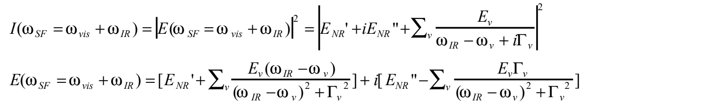

下文省略部分频率自变量，将和频电场记为

$$E(\omega_{SF}=\omega_{vis}+\omega_{IR})\equiv E_{SF}(\omega_{IR}).$$

雅可比矩阵为

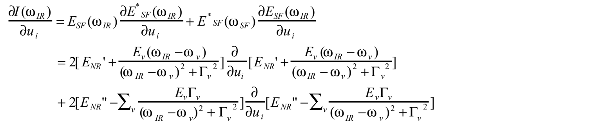

$u_i$ 表示参数 $E_v,\omega_v,\Gamma_v,E'_{NR},E''_{NR}$；具体电场偏导为

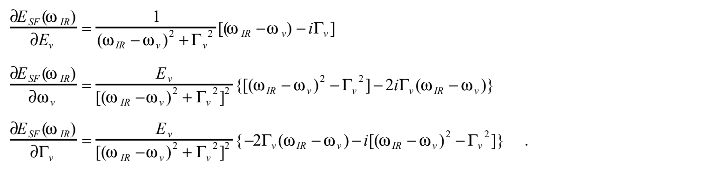

> **原文记号疑点（Q318，p3基本雅可比）：** 首行第二个电场偏导的分母原印为 $\partial u_{SF}$，而其他处为 $\partial u_i$；实部展开的两个括号未写振动求和，虚部却写了求和。保留原图，不按单谱带或多谱带任一解释补齐。$E'_{NR},E''_{NR}$ 为复背景的实、虚分量，撇号不表示导数。

> **雅可比使用条件（B675，Q317/Q318）：** 对实参数应按2Re(E*∂E/∂u)计算强度导数；原页三条单带电场偏导可由共振分母直接求得。原图的uSF、漏求和及前述宽度比较仍保留疑点，不据校验示例补改原图。

<!-- B654：PDF p3；条件2红外频率相干。 -->

### (2) SFG fit_sqr(Integrn)

如附录所述，假设红外脉冲谱形为高斯分布，实测光强的半峰全宽为 $\Delta_{ir}$，电场振幅为光强的平方根。本条件在电场层面积分，使用归一化函数 $g_{ir}(\delta_{ir})$。实验测得的宽度记为 $\Delta_{ir}$，积分公式中的偏移变量记为 $\delta_{ir}$（原文也称后者为“线宽”）。

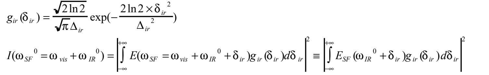

（假设红外不同波数成分相干，和频电场便是各波数分量电场的积分；忽略谱宽内的相位差。）

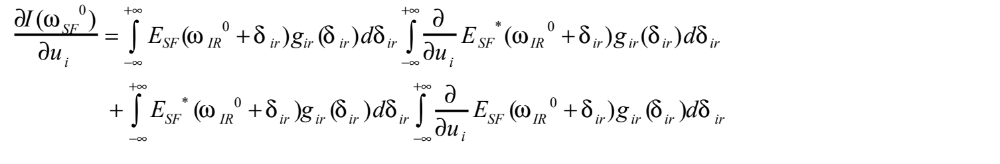

MathCad程序与(1)一样，分实部和虚部计算，再分别乘2，以下同。程序的积分区间为 $-3\Delta_{ir}/\sqrt{2\ln2}$ 至 $+3\Delta_{ir}/\sqrt{2\ln2}$。（原文称，扩大积分范围会使变分值的第五位发生变化，但收敛点似乎不变。）

<!-- B655：PDF p4；条件3红外频率不相干。 -->

### (3) SFG fit_Integrn(sqr)

假设红外脉冲谱形为高斯分布，光强半峰全宽为 $\Delta_{ir}$。本条件对电场平方积分。原文说，此时采用 $\sqrt{2g_{ir}(\delta_{ir})}$ 作归一化函数，因为需使 $g_{ir}(\delta_{ir})$ 的平方归一化，所以带 $\sqrt2$ 因子。

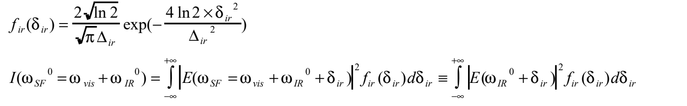

> **原文归一化疑点（Q319，p4条件3及p8附录1）：** B675放大确认条件3文字原印为 $\sqrt{2g_{ir}(\delta_{ir})}$，已修复旧译把g移出根号的转写错误；旧注不应据此称原文写了 $f_{ir}=\sqrt2g_{ir}$。所列f、g的指数分别为 $-4\ln2\,\delta_{ir}^2/\Delta_{ir}^2$ 和 $-2\ln2\,\delta_{ir}^2/\Delta_{ir}^2$；两者各自面积归一，关系须按平方后重新归一计算，仍与该原句不一致。文本关于平方归一化的说明还涉及带量纲的前因子；面积归一电场权重的平方不直接等于面积归一光强权重。保留原文字与两套函数，不混用其常数。

（红外不同波数成分之间若无相干性，和频强度便是各波数强度的累计。）

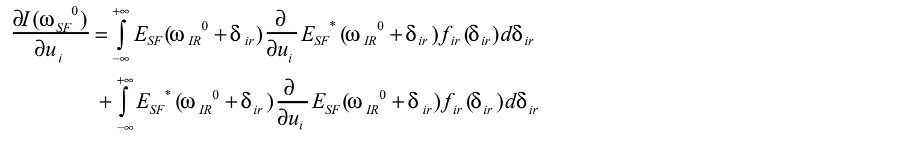

MathCad程序积分区间为 $-3\Delta_{ir}/\sqrt{2\ln2}$ 至 $+3\Delta_{ir}/\sqrt{2\ln2}$。

<!-- B656：PDF p4；条件4固定非均匀宽度。 -->

### (4) SFG_fitVoightx

如附录所述，用高斯函数表示振动谱带的非均匀展宽，以半峰全宽 $\Delta_g$ 定义，采用归一化函数 $f_{inh}(\delta_g)$。

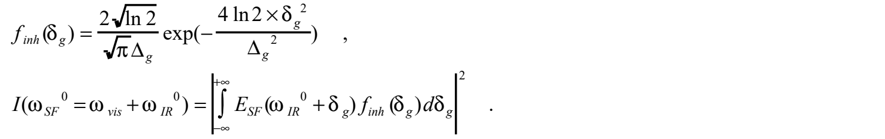

（由于红外光单色，原文认为中心波数不同的分子产生的和频电场相干。）

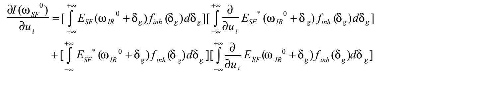

非均匀宽度固定为常数，因而不需要对该宽度求偏导。MathCad程序的积分范围，原文写为 $-3\Delta_{ir}/\sqrt{2\ln2}$ 至 $+3\Delta_{ir}/\sqrt{2\ln2}$。

> **原文积分变量疑点（Q320，p4条件4、p6条件7及p7）：** 条件4、7只有分子非均匀变量 $\delta_g$ 的积分，原文给出的截断范围却使用红外宽度 $\Delta_{ir}$，候选为相应 $\Delta_g$。双重积分情形也只给一套 $\Delta_{ir}$ 范围，未分别注明内外区间。保留原范围，不把红外宽度代作分子宽度。

> **截断与求导提示（B675，Q319/Q320）：** 两套高斯函数分别面积归一，光强权重等于电场权重平方后再归一。单变量与双变量积分须各自指定宽度和区间；若数值截断端点随拟合参数移动，求导还须检查边界项。本稿未附原程序，不能把条件性雅可比示例视为作者实现已通过测试。

<!-- B657：PDF p4,5；条件5固定宽度与相干红外。 -->

### (5) sqr(Integrn)Voightx

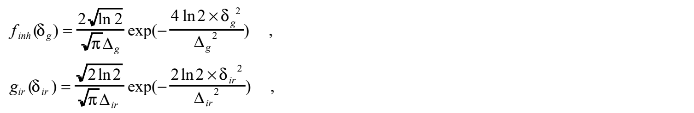

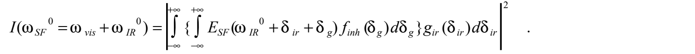

（先在指定红外波数 $\omega^0_{IR}+\delta_{ir}$ 下求不同中心波数分子的贡献，再考虑红外光的频率宽度。）

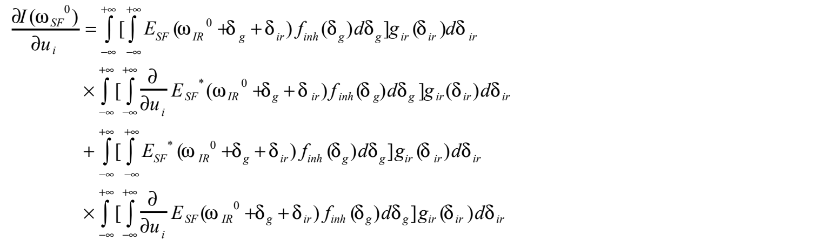

<!-- B658：PDF p5；条件6固定宽度与不相干红外。 -->

### (6) Integrn(sqr)Voightx

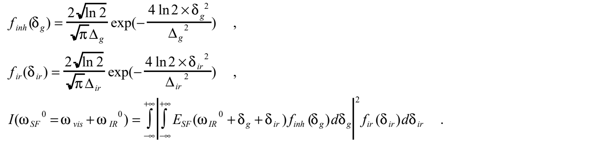

（对每个红外波数，先将非均匀分子群的贡献作为电场相干累计，再把其平方在红外谱宽内按红外光强加权积分。）

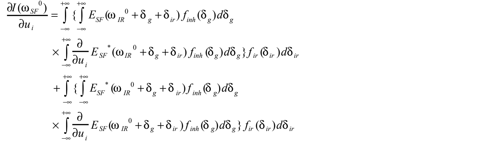

<!-- B659：PDF p5,6；条件7非均匀宽度可调。 -->

### (7) SFG_fitVoight

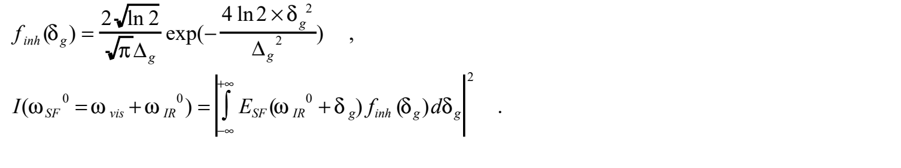

（红外光单色，所以对和频电场先求和，再取平方成为光强。）

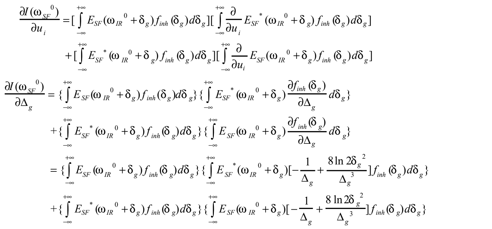

MathCad程序积分范围原文仍为 $-3\Delta_{ir}/\sqrt{2\ln2}$ 至 $+3\Delta_{ir}/\sqrt{2\ln2}$，变量疑点见Q320。

<!-- B660：PDF p6,7；条件8可调宽度与相干红外。 -->

### (8) sqr(Integrn)Voight

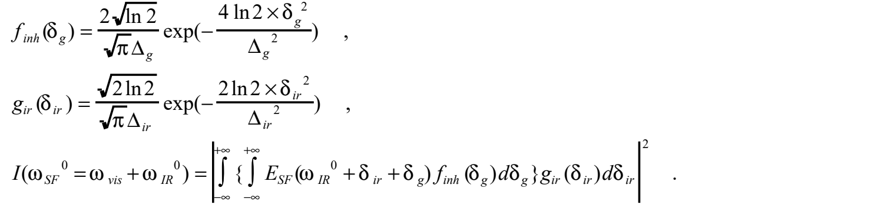

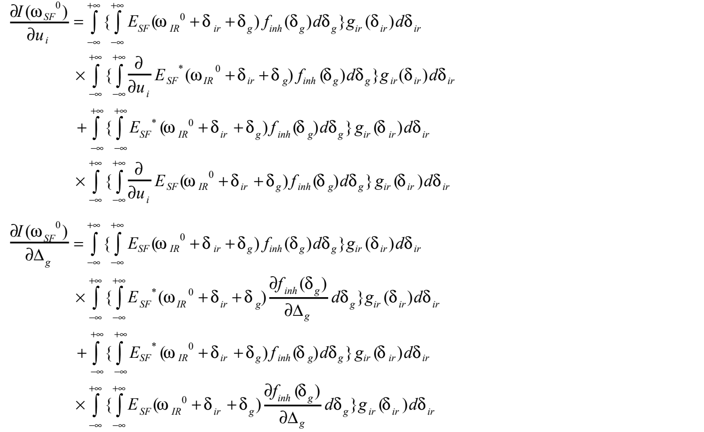

对 $\Delta_g$ 的导数在下一页继续展开为

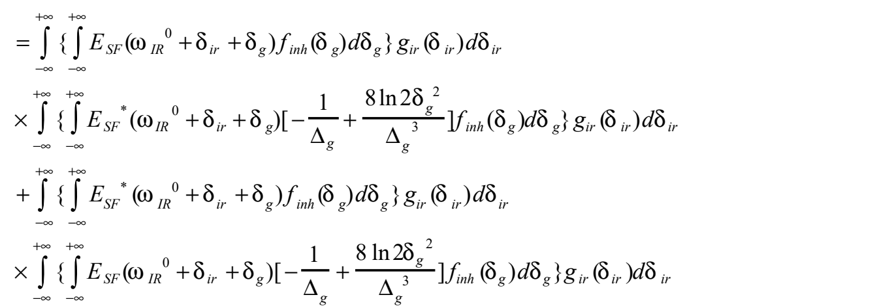

MathCad程序积分范围为 $-3\Delta_{ir}/\sqrt{2\ln2}$ 至 $+3\Delta_{ir}/\sqrt{2\ln2}$；原文未分别列出双重积分的两个截断范围，见Q320。

<!-- B661：PDF p7；条件9可调宽度与不相干红外。 -->

### (9) Integrn(sqr)Voight

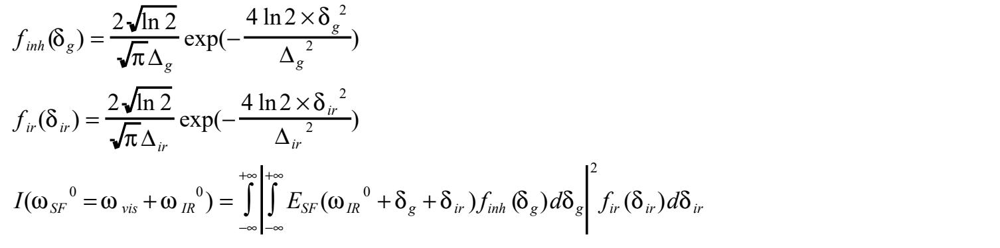

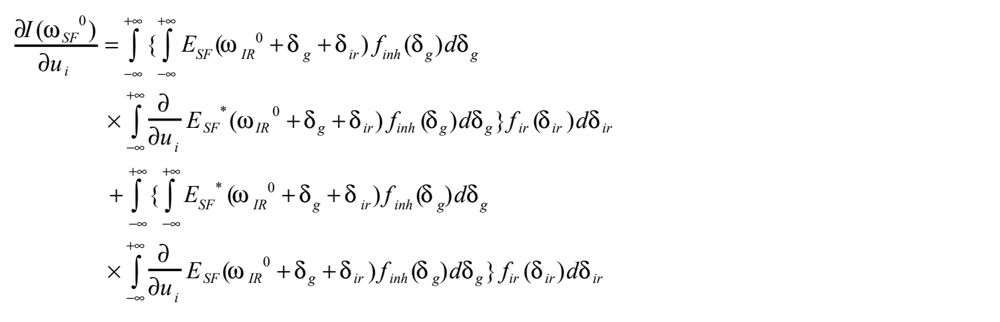

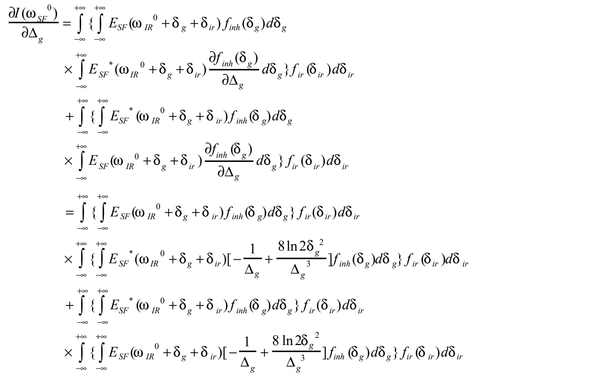

MathCad程序积分范围为 $-3\Delta_{ir}/\sqrt{2\ln2}$ 至 $+3\Delta_{ir}/\sqrt{2\ln2}$。同样须辨认红外与分子积分变量，不能把原文的一套截断范围视为两者已有统一宽度。

<!-- B662：PDF p8；附录1红外光强与电场线形。 -->

## 附录1 表示红外脉冲谱宽的函数

**用于光强的归一化线形函数 $f_{ir}(\delta_{ir})$：** 假设红外脉冲频谱为高斯分布，与中心波数偏离 $\delta_{ir}$ 的分量强度，以半峰全宽 $\Delta_{ir}$ 表示如下：

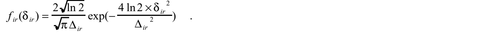

**用于电场的归一化线形函数 $g_{ir}(\delta_{ir})$：** 电场振幅正比于光强平方根。因此，如果 $\Delta_{ir}$ 始终是针对光强定义的半峰全宽，电场线形为

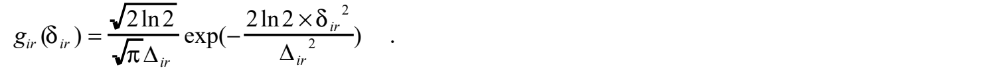

> **译者提示：** 两函数具有各自的归一化前因子；“振幅正比于强度平方根”不意味着这两个已面积归一函数可直接互相平方。相关原句疑点见Q319。

<!-- B663：PDF p8；附录2非均匀高斯宽度及导数。 -->

## 附录2 表示非均匀展宽谱宽的函数

非均匀展宽指分子环境导致其谱线位置不同，在观测区域所有分子的响应叠加后，谱线变宽。气体中围绕平均分子谱位的分布可用高斯函数表示；假设固体表面分子也适用，则用半峰全宽 $\Delta_g$ 定义非均匀展宽，归一化函数为

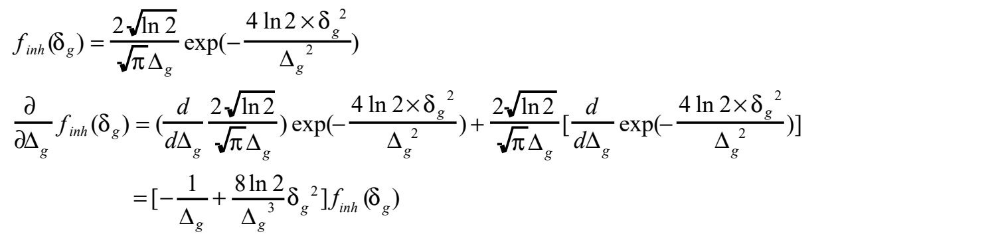

这里应注意：以线性光谱——红外吸收、拉曼散射——的宽度定义展宽，比直接使用和频振动谱带宽度更方便。这样，$f_{inh}(\delta_g)$ 的加权在电场振幅层面进行；背景很小时，它的平方反映在和频振动信号中。

原文说：“线性谱的1/2宽度在SFG中成为1/4宽度，SFG的1/2宽度成为IRAS的 $1/\sqrt2$ 宽度”，即和频振动谱带宽度比IRAS窄至 $1/\sqrt2$。

> **原文宽度用语疑点（Q321，p8附录2）：** 原句“1/2宽度”“1/4宽度”没有明确区分半高处的宽度与相对峰值1/4处的宽度；高斯函数平方确会改变这些相对高度，但不能简单把半高宽数值除以2。本段保留原句及末尾 $1/\sqrt2$ 比例，不把二者静默改成同一宽度定义。与8.1 p7原写 $\sqrt2$ 倍的差异另见Q308。

> **宽度关系补充（B675，Q321）：** 对纯高斯函数，原函数半高处在其平方中成为四分之一高度，而平方函数的半峰全宽缩为原来的1/√2。高度比例与宽度比例需区分；含均匀展宽或背景时不能直接照搬。

此外，计入非均匀宽度时，须在每个给定红外波数下汇总不同峰位分子的贡献，因此在电场振幅层面求和，而不是将各电场平方求和。

<!-- B664：PDF p8,9；附录3最小二乘推导与停止条件。 -->

## 附录3 本稿采用的最小二乘计算方法

在各波数处共有 $n$ 个实测强度，以 $m$ 个参数计算相应强度，定义由实测减计算所得的 $n$ 维列向量 $\boldsymbol{vx}$：

$$\boldsymbol{vx}=\boldsymbol I(\mathrm{obs})-\boldsymbol I(\mathrm{calc}).$$

每个测量波数处，对所有参数求偏导，组成 $m$ 维行向量 $\boldsymbol F_i$；将所有测量点排列成 $n\times m$ 矩阵 $\boldsymbol F$，即雅可比矩阵。

参数若接近真值，可用泰勒展开的一阶项近似实测与计算之差。以 $m$ 维列向量 $\boldsymbol d$ 表示各参数修正量，则

$$ (\boldsymbol{vx})_i=\sum_jF_{ij}d_j,\qquad\boldsymbol{vx}=\boldsymbol F\boldsymbol d.$$

根据实测值和当前参数，可计算 $\boldsymbol{vx}$ 与 $\boldsymbol F$；但 $\boldsymbol F$ 非方阵，不能直接求逆得到 $\boldsymbol d$。因而作变换

$$\boldsymbol F^T\boldsymbol{vx}=(\boldsymbol F^T\boldsymbol F)\boldsymbol d,$$

其中 $\boldsymbol F^T$ 为转置。$\boldsymbol F^T\boldsymbol F$ 是 $m\times m$ 方阵，原文称通常可以求逆；但若参数不独立，行列式为零，逆矩阵便无定义。于是

$$\boldsymbol d=(\boldsymbol F^T\boldsymbol F)^{-1}(\boldsymbol F^T\boldsymbol{vx}).$$

原文随后说，在用于计算的参数值“$\boldsymbol{vx}$”上加 $\boldsymbol d$，会得到更小的差向量。

> **原文记号及收敛条件疑点（Q322，p9附录3）：** $\boldsymbol{vx}$ 前面明确定义为 $n$ 维残差，最后一句却称其为参数值，与 $m$ 维修正量相加存在维数与角色冲突；候选应为参数向量，但原文未另给符号。本节的线性近似、矩阵可逆及全步更新并不保证每次非线性残差下降；原文p2也记录了发散。保留原句，不把这里的迭代下降写成无条件保证。

> **迭代边界补充（B675，Q322）：** 正规方程给出的是线性化的最小二乘步；即使雅可比满列秩，非线性全步更新仍可使残差增大。vx的维数冲突及原文停止条件保留，不据此宣布拟合已达到全局最优。

反复修正后，原文以差向量不再改变作为判断。具体采用“实测与计算之差的平方和收敛到固定值”为停止标准，并在此结束计算。

> **译校状态：** 本稿9页全部正文、九类强度与雅可比公式、附录1—3均已覆盖。原程序未运行，未独立验证所有数值算法；疑点保留待核。
