# 6.1 偶极间相互作用

原作：广濑千秋、狩野觉合作；中文翻译：章力。底本：`日语原版/Chapter6/chap6-1.pdf`，55页。原题《关于偶极—偶极相互作用》。

> **译校状态（B565—B608，2026-10-22）：** 底本55页的原目录、正文1—4及附录A—F已完成本轮中文译校。一般公式采用LaTeX，18个编号公式组及部分复杂无编号式采用原式图，另保留9幅原图，共31个图像资源；未全部转成可编辑公式。Q229—Q273待核，未将疑点静默改为修正式。
>
> **阅读导引（译者）：** 第1部分比较经典与量子线性响应、旋波近似，以及吸收与辐射强度；第2部分由两个振子走向晶格、覆盖度和CPA；第3部分建立三频局域场下的和频响应，3.3—3.5仍是原作提纲；第4部分汇总公式。附录A—D用于核对偶极场、镜像和多层边界，E—F供公式与术语查阅。局部符号、时间因子和单位制依原文分别保留。详见[本章阅读导航](阅读导航.md)。

## 原文目录（PDF p1）

以下保留原文内部编号；目录页码均指本份PDF的页码。

| 原编号 | 内容 | 页码 |
|---|---|---|
| 1 | 引言 | 2 |
| 1.1 | 经典力学模型 | 2 |
| 1.2 | 线性极化率 | 4 |
| 1.3 | 吸收与发光（线性情形） | 10 |
| 1.4 | 吸收与发光（非线性情形） | 13 |
| 2 | 偶极—偶极相互作用 | 14 |
| 2.1 | 带电粒子的运动方程 | 16 |
| 2.1.a | 外电场诱导的单个经典偶极子的运动方程 | 16 |
| 2.1.b | 外电场诱导的两个经典偶极子之间的相互作用（运动方程） | 18 |
| 2.1.c | 电场诱导的两个经典偶极子的相互作用（偶极子之间的“传接球”） | 20 |
| 2.1.d | 具有偶极相互作用的体系的简正振动模式 | 24 |
| 2.1.e | 极多偶极子在直线上等间距分布的情形 | 24 |
| 2.1.f | 失去有序性的情形 | 25 |
| 2.2 | Scheffler的思路 | 25 |
| 2.3 | Person与Ryberg的处理方法之一：同一吸附物种的覆盖度依赖性 | 27 |
| 2.4 | Person与Ryberg的处理方法之二：同位素混合物的吸附；Coherent Potential Approximation | 31 |
| 2.5 | 向同一吸附物种、振动激发态的推广 | 33 |
| 2.6 | 与自身镜像（own image）的相互作用 | 33 |
| 2.7 | 小结 | 35 |
| 3 | 和频光谱中的偶极—偶极相互作用 | 35 |
| 3.1 | 与IRAS的区别 | 35 |
| 3.2 | 同一物种的情形 | 36 |
| 3.3 | 同位素混合物的情形（提纲） | 40 |
| 3.4 | 同一物种、振动激发态的情形（提纲） | 40 |
| 3.5 | 与自身镜像（Own Image）的相互作用（提纲） | 40 |
| 3.6 | 小结 | 40 |
| 4 | 要点 | 40 |
| 附录A | 电偶极矩产生的电场 | 42 |
| 附录B | 镜像电荷（image charge）与镜像偶极子（image dipole） | 44 |
| 附录C | 一个偶极子及其镜像偶极子组成的偶极子对的响应 | 47 |
| 附录D | 三层体系中的镜像电荷 | 49 |
| 附录E | 数学公式 | 53 |
| 附录F | 术语说明 | 54 |

> **目录译名说明（译者）：** Person按本页实印拼法保留；未据常见人名拼写替换。Coherent Potential Approximation保留底本英文，相关中文译名待正文核验。自身镜像、镜像电荷和镜像偶极子为此处目录暂用译名，具体边界条件待相应正文确认。“提纲”对应原文レジメ，不据目录补写作者未展开的推导。

## 1. 引言（PDF p2）

在进入正题之前，先复习光谱与极化之间的关系。从吸收光谱、发光光谱，到和频光谱等非线性光谱，光谱与光电场在样品中产生的极化具有一一对应的关系。这种极化与样品的极化率成正比；极化率中出现的本征能量与光频率之间的关系，可以通过求解分子与光的相互作用得到。因此，将化学中熟悉的吸光系数、荧光量子产率的波长依赖性与分子极化率联系起来，往往能够加深理解。

导出极化率的方法包括经典力学的阻尼振子模型和从电磁学出发的方法；采用量子理论时，一般使用密度矩阵法。不过，由于计算所用近似不同，所得表达式之间会出现差异，在对照阅读论文时有时令人困惑。这里也将较详细地说明这些差异的内容。

### 1.1 经典力学模型（PDF p2—3）

质量为 $m$ 的粒子，在受到与位移 $x(t)$ 成正比的回复力 $-\kappa x$、与速度成正比的阻力 $-\beta\,dx/dt$ 及外力 $F(t)$ 时，牛顿运动定律给出

$$
m\frac{d^2x}{dt^2}=-\kappa x-\beta\frac{dx}{dt}+F(t).
\tag{1.1a}
$$

令

$$
\frac{\kappa}{m}=\omega_0^2,\qquad
\frac{\beta}{m}=2\gamma,\qquad
\frac{F(t)}{m}=f(t),
$$

则可写成

$$
\frac{d^2x}{dt^2}+2\gamma\frac{dx}{dt}+\omega_0^2x=f(t).
\tag{1.1b}
$$

> **局部符号说明（译者）：** $\kappa$ 为回复力系数，$\beta$ 为阻力系数，$\gamma=\beta/(2m)$。本段β、γ均不是分子超极化率；$f(t)$ 是外力除以质量，不与 $F(t)$ 混同。这里先按一维粒子模型读取 $x$、$q$、$m$，下面再给出分子振动的解释。

若外力是振荡电场 $E\cos(\omega t)$ 对粒子所带电荷 $q$ 施加的电力，则有

$$
f(t)=\frac{qE}{m}\cos\omega t
=\frac{qE}{m}\cdot\frac{\exp(i\omega t)+\exp(-i\omega t)}{2}.
$$

将其代入式(1.1b)，求得位移 $x(t)$：

$$
\begin{aligned}
x(t)&=\frac{qE}{2m}\left[
\frac{\exp(i\omega t)}{\omega_o^2-\omega^2+2i\gamma\omega}
+\frac{\exp(-i\omega t)}{\omega_o^2-\omega^2-2i\gamma\omega}
\right]\\
&=-\frac{qE}{m}\frac{1}{(\omega^2-\omega_0^2)^2+(2\gamma\omega)^2}
\left[(\omega^2-\omega_0^2)\cos\omega t-(2\gamma\omega)\sin\omega t\right].
\end{aligned}
$$

> **原文记号疑点（Q231，PDF p2—3）：** 上式指数形式的频率下标在底本印为字母o（$\omega_o$），而式(1.1b)和随后实数式用数字0（$\omega_0$）；式(1.2a)亦沿用o。此处分别保留，未静默改成同一字形。两者是否仅为排字差异待核，不能据本译另引入第二个固有频率。

极化可以表示为电荷与位移之积，因此，对于这里考虑的体系，可得下式。更准确地说，中性分子受到电场作用后，内部电荷发生偏移，形成相当于电荷 $+q$ 与 $-q$ 相距 $x$ 的状态。此时，电荷 $q$ 与距离 $x$ 的乘积 $qx$ 就是分子的极化；其矢量方向由 $-q$ 所在处指向 $+q$ 所在处。

> **物理量说明（译者）：** 原文称此 $qx$ 为“分极”；在这个单分子模型中，它是诱导电偶极矩 $p(t)$，不直接等同于单位体积的宏观电极化强度。

$$
p(t)=qx(t)=\frac{q^2E}{2m}\left[
\frac{\exp(i\omega t)}{\omega_o^2-\omega^2+2i\gamma\omega}
+\frac{\exp(-i\omega t)}{\omega_o^2-\omega^2-2i\gamma\omega}
\right].
\tag{1.2a}
$$

$$
=\frac{q^2E}{m}\frac{1}{(\omega^2-\omega_0^2)^2+(2\gamma\omega)^2}
\left[(\omega^2-\omega_0^2)\cos\omega t-(2\gamma\omega)\sin\omega t\right].
\tag{1.2b}
$$

> **原文疑点（Q229，PDF p2位移式、p3式(1.2b)及脚注）：** p2中位移的实数式前有整体负号，而p3式(1.2b)没有。由原文 $p=qx$ 的定义直接相乘，候选式应保留该整体负号；本译仍照录式(1.2b)的正号。页末脚注给出的实部又带整体负号，却称其与式(1.2b)一致，这一差异亦保留，未采用候选修正。

若把 $x(t)$ 看作分子振动坐标，$q$ 看作伴随振动出现的电荷，$m$ 看作振动的约化质量，那么对于由 $N$ 个分子组成的体系，上式乘以 $N$ 就成为体系的极化率。

> **原文疑点（Q230，PDF p3式(1.2b)后）：** 末句原词为“分极率”，依项目用语译为“极化率”。但上式表示 $p(t)$，直接乘 $N$ 与极化率的定义之间还涉及电场幅度及N的计数或密度约定。本批保留作者原称，不自行改为宏观极化，也不添除 $E$ 或体积因子；后文引入响应系数时需重新核对。

#### $\exp(+i\omega t)$ 与 $\exp(-i\omega t)$

式(1.2a)右侧方括号内的两项互为复共轭。$\cos(\omega t)$ 和 $\sin(\omega t)$ 可用复指数函数 $\exp(+i\omega t)$ 与 $\exp(-i\omega t)$ 的和来表示。当电场按 $\cos(\omega t)$ 简谐振荡时，利用这一点改写 $x(t)$ 的表达式，就能导出式(1.2)。如式(1.2b)所示，电场作简谐振荡时，诱导的极化也是作简谐振荡的实数。

把三角函数关系

$$
A\cos\omega t-B\sin\omega t
=\sqrt{A^2+B^2}\cos(\omega t+\delta),\qquad
\tan\delta=\frac BA
$$

用于式(1.2b)，可知极化振荡的相位相对于电场振荡偏移了

$$
\delta=\tan^{-1}\!\left[\frac{2\gamma\omega}{\omega^2-\omega_0^2}\right]
$$

弧度。$\delta$ 称为相位滞后角。

> **相位说明（译者）：** 此处保留原文的反正切表达式及“滞后角”称呼。跨共振比较相位时，不能脱离完整复响应来选择反正切的分支；Q229的整体符号差异也会影响相位解释。本批不另定分支或改写角度。

式(1.2a)右侧方括号中的两项，分别来自电场表示中的 $+\omega$ 与 $-\omega$ 分量。在计算电场及其产生的极化等实数量时，通常约定“最后取实部”，只对 $+\omega$、$-\omega$ 中的一个频率分量计算。见本页脚注。只要响应是线性的，即使包含多个频率分量，也可以分别计算每个频率的正、负分量之一，最后与相应的复共轭量相加，使结果成为实数。

此时，选用 $\exp(+i\omega t)$ 还是 $\exp(-i\omega t)$ 是任意的；但一旦选定，就必须在计算中始终采用同一约定，否则会发生混乱。尤其是在量子化矢势、构造产生和湮灭算符时，表示时间变化的部分会出现 $\exp(+i\omega t)$ 与 $\exp(-i\omega t)$。必须明确规定哪一个对应产生算符、哪一个对应湮灭算符，否则就会出问题。（电气工程人员不喜欢 $-i\omega t$，甚至不喜欢i而把它写成j；物理学家则不喜欢 $+i\omega t$。物理学家经常把按 $\exp(-i\omega t)$ 随时间变化的算符取作产生算符，但也有并非如此的情形，因此需要注意。）

> **约定说明（译者）：** 括号内关于算符及学科习惯的说法按作者原文保留，不能据此替代具体文献的产生、湮灭算符定义。原文在“取实部”与“加复共轭”之间切换表述；幅度归一化仍须依相应公式读取，脚注明确给出取实部的 $1/2$ 关系。

#### 原页脚注：取实部的例子（PDF p3）

将上述方法用于式(1.2a)，有

$$
\frac{\exp(i\omega t)}{\omega_0^2-\omega^2+2i\gamma\omega}
=\frac{[\cos(\omega t)+i\sin(\omega t)]
[(\omega_0^2-\omega^2)-2i\gamma\omega]}
{(\omega_0^2-\omega^2)^2+4\gamma^2\omega^2}.
$$

因此，实部为

$$
\frac{-[(\omega^2-\omega_0^2)\cos(\omega t)-2\gamma\omega\sin(\omega t)]}
{(\omega_0^2-\omega^2)^2+4\gamma^2\omega^2}.
$$

这样，就与把 $-\omega$ 分量也纳入后得到的式(1.2b)一致。另外，令 $a=a'+ia''$ 时，应回忆起

$$
a^*=a'-ia'',\qquad
\frac12(a+a^*)=a',\qquad
\operatorname{Re}(a)=a'.
$$

> **脚注对照说明（译者）：** “与式(1.2b)一致”为原文判断，符号差异见Q229。本脚注没有另乘式(1.2a)的前因子，复数实部本身与整条响应的幅度不可混淆。

### 1.2 线性极化率（PDF p4—10）

#### 量子论给出的极化率公式

上面采用经典阻尼振子模型导出了极化率的式(1.2)。分子受到频率为 $\omega$ 的光照射时，会产生与光同频振荡的极化。入射光电场幅度与极化幅度之间的比例系数就是极化率（线性极化率）；用量子力学计算可得

$$
\begin{aligned}
\chi^{(1)}_{ij}(\omega)
&=P^{(1)}_i(\omega)/E_j(\omega)\\
&=N\frac{e^2}{h}\sum_{gn}\left[
\frac{(r_i)_{ng}(r_j)_{gn}}{\omega+\omega_{ng}+i\Gamma_{ng}}
-\frac{(r_j)_{ng}(r_i)_{gn}}{\omega-\omega_{ng}+i\Gamma_{ng}}
\right]\rho_g^{(0)}.
\end{aligned}
\tag{1.3}
$$

原文所引文献：Y. R. Shen, *The Principles of Nonlinear Optics*（Wiley, 1984），第2.2节。

Shen的教材用“$(\omega)$”指定 $\chi^{(1)}_{ij}(\omega)$ 的频率时，将 $\chi^{(1)}_{ij}(\omega)$ 作为按 $\exp(-i\omega t)$ 随时间变化的部分的幅度来计算。因此，最终仍须取实部。$h\omega_{ng}$ 是分子的能级g与能级n之间的能量差 $E_n-E_g$。

> **原文记号疑点（Q232，PDF p4式(1.3)及其后）：** 底本前因子印为 $e^2/h$，能量差亦印为 $h\omega_{ng}$，字形为普通h，并非带横杠的ħ。本译保留h，不自动替换为 $\hbar$，也不增补 $2\pi$ 因子。它在本稿中的常数约定需结合后文核验。
>
> **局部量与频率说明（译者）：** 本处按用户已确定的命名称 $\chi^{(1)}$ 为线性极化率。$P^{(1)}_i/E_j$、求和下标gn、$\rho_g^{(0)}$ 及N均依原式保留；本段未补出N的计数或密度定义及 $\rho_g^{(0)}$ 的归一化条件。作者选择的是 $\exp(-i\omega t)$ 部分；这与前页同时保留两种时间因子的写法需区别读取，不能漏掉先前的幅度约定。

#### 经典论公式与量子论公式的对应关系

式(1.3)是 $\exp(-i\omega t)$ 的系数，因此对应经典力学式(1.2a)方括号中的第二项。于是考察式(1.3)中的

$$
\left[
\frac{(r_i)_{ng}(r_j)_{gn}}{\omega+\omega_{ng}+i\Gamma_{ng}}
-\frac{(r_j)_{ng}(r_i)_{gn}}{\omega-\omega_{ng}+i\Gamma_{ng}}
\right].
$$

这两个分数的分子，即矩阵元的乘积，在量子论中采用彼此不同的表示，互为复共轭；而在经典论中，两者都是同一个 $q^2$。因此，若把量子论中出现的r看作与经典论中的q具有相同的内容，就可以作如下计算：

$$
\begin{aligned}
&\frac{1}{(\omega+\omega_{ng})+i\Gamma_{ng}}
-\frac{1}{(\omega-\omega_{ng})+i\Gamma_{ng}}\\
&\qquad=\frac{-2\omega_{ng}}
{(\omega+i\Gamma_{ng})^2-(\omega_{ng})^2}\\
&\qquad=\frac{-2\omega_{ng}}
{\omega^2-(\omega_{ng}^2+\Gamma_{ng}^2)+2i\omega\Gamma_{ng}}.
\end{aligned}
\tag{1.4}
$$

> **原文对应关系疑点（Q233，PDF p4式(1.4)前）：** 原文把量子论的r与经典论的q视为“相同内容”，但未在此给出矩阵元乘积与经典 $q^2$ 的定量替换规则。式(1.3)还另有 $e^2/h$、$\rho_g^{(0)}$ 等前因子，故本译保留作者的形式比较，不据此令r=q、删除矩阵元或改动量纲。式(1.4)本身只合并所列两个分母对应的分式。

这个形式与经典论式(1.2a)中的

$$
\left[
\frac{\exp(i\omega t)}{\omega_o^2-\omega^2+2i\gamma\omega}
+\frac{\exp(-i\omega t)}{\omega_o^2-\omega^2-2i\gamma\omega}
\right]
$$

的第二项，也就是 $\exp(-i\omega t)$ 的系数，有很好的对应关系。

> **对应范围说明（译者）：** 这里照录作者“对应”的表述，未把它提升为两种响应连同全部前因子均已相等的结论。小写γ仍是1.1的经典阻尼参数，大写 $\Gamma_{ng}$ 依本式保留；两者的关系将在后文随原推导核对。原式 $\omega_o$ 继续按Q231保留。

#### 量子论与经典论结果的差异（PDF p4后段起；本批至p6“广濑笔记”末）

比较式(1.2a)右侧第二项与式(1.4)，首先会注意到，使分母达到最小的 $\omega$，也就是共振频率，两者并不相同。不过，若令

$$
\omega_0^2=\Gamma_{ng}^2+\omega_{ng}^2,
\tag{1.5}
$$

则式(1.4)与式(1.2a)的分母实部一致。下面考察这一替换意味着什么。（以下四页的讨论也许过于专门，可以跳过。）

> **原文疑点（Q234，PDF p4式(1.5)后）：** 原文称两分母的实部“一致”。但按式(1.5)作形式替换，式(1.4)末分母的实部为 $\omega^2-\omega_0^2$；式(1.2a)第二项则写为 $\omega_o^2-\omega^2$，还涉及Q231的o/0字形。若将这两个频率符号对应起来，两实部反号。正文保留“一致”，不擅改为“互为相反数”，也不据此丢掉式(1.4)分子的负号。

首先确认下面这一点。导出式(1.4)所依据的式(1.3)时，出发点是如下基本方程，即密度矩阵的运动方程：

$$
\frac{d\rho}{dt}=\frac{1}{ih}[H,\rho]
-\frac12(\Gamma\rho+\rho\Gamma).
\tag{1.6}
$$

> **符号承接说明（译者）：** $h$ 继续按底本的普通h保留，见Q232。此处用 $\rho$ 表示密度矩阵；$\Gamma\rho+\rho\Gamma$ 的乘积次序按原式保留，不提前与后文逐矩阵元定义的弛豫项混同。

接着，对式(1.6)作傅里叶—泰勒级数展开，求一阶近似的线性响应，就得到式(1.3)。除了忽略高阶项、从而排除非线性现象之外，并没有引入其他近似（我认为）。据此，来考察量子论与经典论结果的差异，是否源于在本应具有非线性响应的体系中忽略了高阶项。

为简单起见，讨论没有外电场时的响应，再引入后面将说明的旋波近似，考虑所谓自由感应弛豫（FID）。也就是说，假定原先受外界相干振荡电场驱动而作受迫振动的振子，其极化在外电场消失的瞬间起开始自由运动，并追踪外场消失后极化随时间的变化。此时，布洛赫矢量的y分量

$$
v=i(\rho_{ng}-\rho_{gn})
\tag{1.7}
$$

满足运动方程

$$
\ddot v+2\Gamma_{ng}\dot v
+(\omega_{ng}^2+\Gamma_{ng}^2)v=0,
\tag{1.8}
$$

其时间演化具有

$$
e^{-\Gamma_{ng}t}\cos(\omega_{ng}t)
\tag{1.9}
$$

的形式。

> **术语说明（译者）：** “自由感应弛豫”沿原文“自由誘導緩和（FID）”暂译；底本此处仅给出缩写FID。旋波近似对应“回転波近似”，布洛赫矢量对应“ブロッホベクトル”。这些中文用法暂入术语表，未改变作者在本段给出的模型或近似条件。

这里引入的近似只有旋波近似。量子力学基本方程所说明的是：“就体系的振动频率 $\omega_{ng}$ 而言，不论有无弛豫，它都由两个能级的能量差决定。”量子论是从本来不能描述弛豫的薛定谔方程出发的理论，因此，这似乎也是理所当然的。

##### 广濑笔记（原文；PDF p5—6）

关于密度矩阵、旋波近似及布洛赫矢量，霜田光一著《激光物理入门》（原题《レーザー物理入門》）第7.3—7.5节有简明的说明。将其中的表述与上面的讨论相对应，可以发现，上述运动方程是在取 $\Gamma_{ng}=\Gamma_{gn}$ 时得到的。另外，与现象论引入的纵向弛豫常数 $\gamma$ 的对应关系为 $\gamma=2\Gamma_{ng}$。

> **局部符号说明（译者）：** 这里“纵向弛豫常数γ”及其因子2按笔记原文保留。1.1的γ由经典阻力系数定义为 $\beta/(2m)$，不能只凭同一字母便认定两处是同一参数。后续经典/量子阻尼的对应关系需连同上下文核对。

Bloembergen的教材 *Nonlinear Optics*（Benjamin Press）第2.1—2.2节，以及C. P. Slichter的教材 *Principles of Magnetic Resonance*（Springer-Verlag，第2版，1978）第5.4—5.8节，说明了怎样用薛定谔方程的语言解释密度矩阵和弛豫常数。这些内容也可作为刘维尔空间（Liouville空间）的入门，因此，对于理解纵向弛豫、横向弛豫等与随机微扰的哪些分量相关，虽说只涉及其中一个侧面，仍会有所帮助。

另外，如Y. R. Shen教材第2.1节所示，对于随机微扰，密度矩阵的矩阵元还可定义为

$$
\left(\frac{\partial\rho_{n,n'}}{\partial t}\right)_{\mathrm{relax}}
=-\Gamma_{n,n'}\rho_{n,n'}.
$$

应注意，它不是通常算符乘积所对应的矩阵元

$$
\sum_{n''}\Gamma_{n,n''}\rho_{n'',n}.
$$

（这个 $\Gamma\rho$ 与本稿所用的表达式 $\frac12(\Gamma\rho+\Gamma\rho)$ 在物理上完全相同。）

> **原文下标疑点（Q235，PDF p6笔记首行）：** 这里普通算符乘积的最后一个下标实印为n，而前页逐矩阵元的弛豫式使用n、n′。若该乘积原意是与同一(n,n′)矩阵元比较，末项可候选为 $\rho_{n'',n'}$；本译仍保留 $\rho_{n'',n}$，未采用候选替换。
>
> **原文乘积次序疑点（Q236，PDF p6笔记括注）：** 底本括注重复写成 $\frac12(\Gamma\rho+\Gamma\rho)$；式(1.6)则是 $\frac12(\Gamma\rho+\rho\Gamma)$。此处照录两个 $\Gamma\rho$，不静默调换第二项次序。“物理上完全相同”也是作者原文的判断；逐矩阵元的弛豫系数与普通算符矩阵乘积的定义区别仍须保留。

另一方面，在存在弛豫的经典论中，将式(1.1b)的驱动项（即右侧）置零并求解，就能得到简谐振动位移的时间行为。其时间依赖部分具有如下形式：

$$
e^{-\gamma t}\cos\!\left(\sqrt{\omega_0^2-\gamma^2}\,\cdot t\right).
\tag{1.10}
$$

以式(1.9)与式(1.10)应当描述同一现象为前提，考察经典论与量子论的对应关系，可以发现，对于稳态响应与瞬态响应，两者之间均有

$$
\gamma\leftrightarrow\Gamma_{ng}
\tag{1.11}
$$

以及

$$
\omega_0^2\leftrightarrow\Gamma_{ng}^2+\omega_{ng}^2
\tag{1.12}
$$

这样的对应关系。

> **符号对应说明（译者）：** 式(1.11)—(1.12)保留作者的双向箭头，表示这里比较经典与量子响应所用的参数对应；不改写为对所有情形成立的恒等式。此处γ是式(1.1b)中的经典阻尼参数，前一段广濑笔记所称“纵向弛豫常数γ”及 $\gamma=2\Gamma_{ng}$ 另按其局部语境保留，不因同名而把式(1.11)改出因子2。式(1.10)根号覆盖 $\omega_0^2-\gamma^2$，时间t在根号外。

接下来考察存在弛豫时的共振频率，即给出最大振幅的频率。量子论式(1.4)的分母之模在

$$
\omega^2=(\omega_{ng}^2+\Gamma_{ng}^2)-2\Gamma_{ng}^2
\tag{1.13}
$$

时达到最小。相应地，经典论得到的频率响应为

$$
\left[\frac{1}{\omega_o^2-\omega^2-2i\gamma\omega}\right].
\tag{1.14}
$$

使这个函数的模达到最大的 $\omega$ 满足

$$
\omega^2=\omega_0^2-2\gamma^2.
\tag{1.15}
$$

在这里同样，例如对式(1.15)采用式(1.11)、式(1.12)的参数替换，两者就变得相同。也就是说，不论量子论还是经典论，最大振幅的位置都会相对于无弛豫时的跃迁频率或固有频率向低频侧偏移。

另外，在后面将介绍的“近共振近似，即 $\omega\approx\omega_0$，将 $\omega+\omega_0$ 替换为 $2\omega_0$”下，把响应函数写成

$$
\frac{1}{(\omega-\omega_0)-i\gamma}
$$

或其复共轭的形式。此时，分母虚部不再包含变量 $\omega$，所以“最大振幅的位置”，即共振频率，就是使分母成为纯虚数的位置，也就是 $\omega=\omega_0$。

> **读式说明（译者）：** 本段“共振频率”按原文括注明确指最大振幅的位置；不与前面自由演化式中的振动频率直接混同。式(1.14)的字母o下标依Q231保留，其余数字0照原式。近共振式及“或其复共轭”均按底本照录，未补归一化前因子，也未把它改写为与式(1.14)严格相等的表达式。p6页末与p7首段在这里合成完整段落。

<!-- 本轮连续译校起点 -->
<!-- 原文定位：PDF p7总结段至“出发点的极化率公式”前 -->

概括起来，经典论与量子论的差异，似乎在于：存在弛豫时，是否仍要保持由无扰动哈密顿量的能量差决定的共振频率，也就是共振分母的实部保持为 $\omega^2-\omega_0^2$，还是变成 $\omega^2-(\omega_{ng}^2+\Gamma_{ng}^2)$。［广濑备忘：没有外电场这一强迫振动时，经典论的振动频率为 $\sqrt{\omega_0^2-\gamma^2}$，而量子论中仍为 $\omega_{ng}^2$。这里的讨论或许混淆了这件事。］先令 $\gamma\to\Gamma_{ng}$，再令 $\omega_0\to\sqrt{\omega_{ng}^2+\Gamma_{ng}^2}$，则量子论和经典论在时间行为与频率轴上的响应两方面都一致。通常只考虑弛豫时间的倒数远小于中心频率的情况，因此不去计较也不失为一种办法。本稿从量子论公式返回经典论公式时，将记住并使用这一关系。

> **原文疑点（Q237，译者）：** 方括号备忘把经典频率的平方根与量子论的 $\omega_{ng}^2$ 并列；这与前面的式(1.9)及量纲不一致。这里照录原文，候选为 $\omega_{ng}$，尚未采用修正。

另一个值得注意的地方，是量子论与经典论的衰减常数表面上似乎不同——不过结论其实是没有差别。经典运动方程中的衰减常数，按二阶微分方程(1.1b)，定义为速度 $dx/dt$ 的系数 $2\gamma$。另一方面，如［广濑备忘］所述，量子运动方程中的衰减常数 $\Gamma_{ng}$，出现在密度矩阵的演化方程（刘维尔方程）

$$
\frac{d\rho}{dt}=\frac{1}{ih}[H,\rho]-\frac12(\Gamma\rho+\rho\Gamma)
$$

的矩阵元方程中，即关于密度算符矩阵元 $\rho_{ng}$ 的一阶联立微分方程中，作为 $\rho_{ng}$ 的系数出现。与经典力学位移相对应的量子物理量是 $\operatorname{Tr}[\rho x]$。前者的时间行为为 $e^{-\gamma t}\cos(\sqrt{\omega_0^2-\gamma^2}\,t)$，显示其衰减常数为 $\gamma$；后者的衰减常数则为 $\Gamma_{ng}$。比较两者，实际上应该可以认为 $\gamma\cong\Gamma_{ng}$。

<!-- 原文定位：PDF p7出发点公式至p8式(1.17)说明末 -->

#### 作为出发点的极化率公式

如上所述，经典论与量子论的公式没有很大的差别。因此，作为以下讨论的出发点，把分子极化率（分子极化与电场强度之比，即响应，也就是每个分子的电极化率）写为

$$
\alpha(\omega)=\alpha_e+\alpha_v\frac{-2\omega_{ng}}{\omega^2-\omega_{ng}^2-\Gamma_{ng}^2+2i\omega\Gamma_{ng}}.
\tag{1.16}
$$

导出此式时，先按式(1.4)进行计算，再完成式(1.3)的求和。其中，随入射光频率 $\omega$ 扫描而几乎不变的项，合并为常数项。我们关心的是红外光响应（极化率）的共振，即与振动跃迁的共振，因此给常数项和共振项分别加上下标“e”和“v”（e指电子项，v指振动项；这一分类标准后面还会讨论）。与经典论对应时，作替换 $\sqrt{\omega_{ng}^2+\Gamma_{ng}^2}\to\omega_0$、$\Gamma_{ng}\to\gamma$。

继续变形式(1.16)，有

$$
\begin{aligned}
\alpha(\omega)&=\alpha_e+\alpha_V\frac{-2\omega_{ng}}{\omega^2-\omega_0^2+2i\omega\gamma}
=\alpha_e+\alpha_V\frac{2\omega_{ng}}{\omega_0^2-\omega^2-2i\omega\gamma}\\
&=\alpha_e+\frac{\alpha_V\times2\omega_{ng}}{\omega_0^2[1-(\omega/\omega_0)^2-2i(\omega/\omega_0)(\gamma/\omega_0)]}\\
&=\alpha_e+\frac{\alpha_V\times2\omega_{ng}/\omega_0^2}{[1-(\omega/\omega_0)^2-2i(\omega/\omega_0)(\gamma/\omega_0)]}\\
&=\alpha_e+\frac{\alpha_V\times2\omega_{ng}/\omega_0^2}{1-(\omega/\omega_0)^2-2i(\omega/\omega_0)(\gamma/\omega_0)}\\
&=\alpha_e+\frac{\widetilde\alpha_V}{1-(\omega/\omega_0)^2-i\widetilde\gamma(\omega/\omega_0)}.
\end{aligned}
\tag{1.17}
$$

需要注意，最后一式已作了 $\alpha_v\times2\omega_{ng}/\omega_0^2\to\widetilde\alpha_v$ 和 $2\gamma/\omega_0\to\widetilde\gamma$ 的替换；各频率已用共振频率归一化，弛豫常数则包含位移振幅衰减常数的两倍。文献中有时使用这种替换后的形式。

> **记号说明（译者）：** 原文在式(1.16)及说明中用小写下标v，在式(1.17)主体用大写V；这里分别保留，不据此另设物理量。$\widetilde\gamma$ 是归一化后的参数，不能直接与有频率量纲的 $\gamma$ 等同。

<!-- 原文定位：PDF p8共振/非共振项至p9式(1.18)说明末 -->

#### 共振项与非共振项

从式(1.3)求和得到式(1.16)时，我们把式(1.3)求和中第二项里随 $\omega$ 改变、对特定 $g,n$ 组合发生“共振”的项，与其余不共振的项（包括第一项和第二项中的其他项）区分开来。与入射电磁波共振，即 $\omega-\omega_{ng}$ 趋于零的项，称为“共振项”；其余合称“非共振项”。不过，如果某跃迁的 $\Gamma$ 很大，也会在谱线翼部感受到共振。讨论以振动态间跃迁共振为主的红外吸收时，可见或紫外区的电子跃迁通常是非共振的。有时将非共振项简称为“电子项”，此时指的是“极化率中电子跃迁所贡献的部分”。须注意，光谱学中的“电子项”这一术语，也用于涉及电子态或其能量本征态的项。

所谓“只关注共振项”，有时是只讨论式(1.2a)右边或式(1.3)右边的第二项，有时却是把第一、第二项相加，写成式(1.2b)或式(1.4)后再讨论。两者的近似程度不同，不了解作者采用哪一种就可能感到困惑。式(1.2a)和式(1.3)右边的第一项，只有频率取负值时分母才可能为零；第二项则会在改变频率时与某个分子跃迁共振，因此两者具有本质区别。本稿说“只关注共振项”时，意味着“忽略第一项”，并且只从第二项中取出在频率上实际可能共振的部分；其他项留待“它们共振时再考虑”，暂并入非共振项。原文接着指出，式(1.2a)表示的经典表达式不存在这样的区分。

> **原文疑点（Q238，译者）：** 本段前面已对式(1.2a)区分第一、第二项，末句却说经典式中不存在“这样的区分”。可能指多能级求和中不同跃迁的分类，而非正、负频率项本身；暂保留作者表述，不替作者确定其范围。

#### 只取共振项的近似精度

共振项是式(1.3)右边那些分母实部为入射电磁波频率与跃迁频率之差、且在所考虑条件下该差值接近零的项。两频率接近时，共振项占绝对优势。红外至可见光的频率为 $10^{14}$—$10^{15}\,\mathrm{Hz}$；即使共振项的频差（偏离共振的程度）为 $100\,\mathrm{cm}^{-1}=100\times30\times10^9\,\mathrm{Hz}=3\times10^{12}\,\mathrm{Hz}$，共振项也比非共振项大两个数量级以上。因此，大多数情况下只取共振项就足够了。（电子跃迁的跃迁概率远大于振动跃迁，因此非共振项通常以涉及电子跃迁的部分为主。）

> **原文疑点（Q239，译者）：** “两个数量级以上”是作者给出的估算；频率范围、频差及各项分子不同，不能仅据这几个数普遍保证该倍数。原文数字照录，未改为新的定量结论。

#### 只取共振项的近似意味着什么

要理解上述近似（旋波近似）忽略了什么现象，可以考察量子论的导出过程。式(1.3)从描述体系与相干光相互作用的运动方程出发（称为主方程、Maxwell–Schroedinger方程），求体系处于特定能态的概率及电磁波诱导的偶极矩。这些量的时间变化由以 $\omega-\omega_0$ 和 $\omega+\omega_0$ 振荡的分量组成。后者正负交替极快，在前者的一个周期内取平均，几乎变为零。这类似于在高速旋转的圆盘上观察物体：随盘运动的观察者看到物体缓慢运动、得到突出，周围景物则变得模糊。只保留近共振时贡献大的 $\omega-\omega_0$ 振荡项，称为旋波近似，也就是这里仅取共振项的近似。

#### 用旋波近似突出 $\omega-\omega_0$ 的作用

作近似 $1-\omega/\omega_0\approx0$ 后，只突出那些随 $\omega$ 改变、分母接近零时取大值，并在 $\omega_0$ 两侧改变符号的共振项：

$$
\omega/\omega_0\approx1,\qquad
1-(\omega/\omega_0)^2=(1+\omega/\omega_0)(1-\omega/\omega_0)\approx2(1-\omega/\omega_0).
$$

将其用于式(1.17)，有

$$
\alpha(\omega)\approx\alpha_e+\frac{\widetilde\alpha_V/2}{1-(\omega/\omega_0)-i\widetilde\gamma/2}
=\alpha_e+\frac{\omega_0\widetilde\alpha_V/2}{\omega_0-\omega-\omega_0 i\gamma/2}.
$$

回想 $\alpha_V\times2\omega_{ng}/\omega_0^2\to\widetilde\alpha_V$、$2\gamma/\omega_0\to\widetilde\gamma$ 的替换，再取 $\omega_{ng}\approx\omega_0$，把带波浪号的记号还原，得

$$
\alpha(\omega)\approx\alpha_e+\frac{\alpha_V}{(\omega_0-\omega)-i\gamma}.
\tag{1.18}
$$

这是常见的表达式，恰好就是从式(1.3)中只取第二项来表示振动共振的形式。

> **原文疑点（Q240，译者）：** 式(1.18)前一无编号式，右端分母原印 $\omega_0i\gamma/2$，按归一化替换关系候选应为 $\omega_0i\widetilde\gamma/2$。正文保留原式，未采用修正。

<!-- 原文定位：PDF p9线性/非线性响应至p10的1.3标题前 -->

#### 线性体系的响应与非线性体系的响应

如果假定体系对外力的响应是线性的（通常的反射光谱或吸收光谱用这一假定就足够），采用式(1.2a)所表示的经典谐振子模型即可。若要讨论非线性响应，则需要从一开始作量子论推导，或从式(1.2a)出发，以唯象方式引入非线性势。

例如，N. Bloembergen的历史性教材 *Nonlinear Optics*（Benjamin，第3版，1977）第1章，首先考虑电荷为 $e$、质量为 $m$ 的粒子位于距原点 $x$ 处，在服从胡克定律的力作用下以共振频率 $\omega_0$ 振动。随后在运动方程中加入产生非线性响应的力 $+Vx^2$，讨论施加频率分别为 $\omega_1$ 和 $\omega_2$ 的电场所引起的受迫运动。用于式(1.1b)，有

$$
\frac{d^2x}{dt^2}+2\Gamma\frac{dx}{dt}+\omega_0^2x+Vx^2
=\frac{2e}{m}\operatorname{Re}\!\left[E_1e^{i(k_1z-\omega_1t)}+E_2e^{i(k_2z-\omega_2t)}\right].
\tag{1.19}
$$

Y. R. Shen的 *The Principles of Nonlinear Optics*（John Wiley & Sons，1984）第1.3节也展开了同样的讨论。在经典运动方程中引入非线性项并用傅里叶—泰勒展开求解，与对量子二能级体系作同类展开，两条路径有很好的对应。其结果在最低阶的一次近似范围内，对共振效应给出等价的表达。（二能级量子体系的运动方程是相互“嵌套”的联立方程，因而本质上会产生非线性现象。实际上，多能级体系只要不是谐振体系，应该也会如此。）

应当注意，量子力学处理的二能级体系，本身就包含非线性响应，因而能够产生非线性光学效应。可以这样理解：线性响应体系（例如服从胡克定律的体系）的势函数是抛物线，其薛定谔方程具有无穷多个能量等间隔的本征态，因此是多能级体系。不过，把本征态按权重叠加为相干态，可以构造出原文所说“入射光扰动的矩阵元只有对角项”的状态。就响应而言，这一状态仅包含对光电场的线性项。与跃迁共振的光入射后，跃迁像上楼梯一样从低能级逐级向上发生，较高能级具有更大振幅，整体平均表现为服从胡克定律的“伸长”。相比之下，二能级体系只能在两个能级间跃迁，无论入射光多强，也只是提高高能级的布居。因此，二能级主方程（或Maxwell–Schrödinger方程）内含非线性响应。换言之，扰动哈密顿量只具有两个能级间的非对角元，故能量本征值中的扰动项与电场的二次及以上幂成正比。这使非线性光学基本方程的处理带有微妙之处。

> **原文疑点（Q241，译者）：** “相干态使入射光扰动矩阵元只有对角项”及其与响应线性的联系，需要明确所用基底和算符，不能直接作为一般结论；正文保留作者论述。式(1.19)仍按原印把 $+Vx^2$ 放在左端，不据前面的“力 $+Vx^2$”自行改号。

#### 仅取共振项的旋波近似舍去了什么

在线性光谱中，旋波近似排除的部分只影响谱线翼部的形状，因此通常不必过分在意。但是，在和频过程这种二阶非线性光谱中，它也会对和频谱线中心产生显著影响，某些情形下可能很重要。不过，作者认为这一点似乎尚未得到十分认真的讨论。

<!-- 原文定位：PDF p10的1.3至p13的1.4前 -->

### 1.3 吸收与发光（线性情形，PDF p10—13）

光通过物质时，若因吸收或放大而改变强度（这里不考虑散射），在物质的光学厚度足够小时，变化量与极化率的虚部成正比。另一方面，由光电场在物质中诱导的极化所辐射的光（原文称对应于自发辐射），其发光强度与极化率的平方成正比。讨论光强变化及发光强度与极化的关系时，稳妥的途径是先讨论单一频率，再按需要引入频率展宽。

#### 吸收、放大的大小与极化（振荡偶极子）的虚部成正比

用物理语言表述：按经典力学，外力对物体作的功，是力矢量与位移矢量的内积。

在这里，带电粒子受到电荷与电场之积所表示的外力而受迫振动，电场造成的电荷分布偏移形成偶极子。设 $E(t)=E_0\cos\omega t$，电荷位移与电场同相，$x(t)=x_0\cos\omega t$。考察电场朝正方向、因而对正电荷的外力也为正的半周期，即 $-\pi/2<\omega t<\pi/2$。从 $-\pi/2$ 到0，位移随时间增大，运动与外力同向，外力作正功；从0到 $+\pi/2$，运动反向，外力作负功（粒子对外作功）。所以这一半周期的净功为零，下一半周期也相同。

再设电场与位移相差90度，原文写作 $x(t)=x_0\cos(\omega t+\pi/2)=x_0\sin\omega t$。此时，在外力为正的整个半周期内，位移增大、运动朝正方向，净功为正；下一半周期外力和运动都朝负方向，净功仍为正。

> **原文疑点（Q242，译者）：** 上式原印加号，但 $\cos(\theta+\pi/2)=-\sin\theta$。后文关于正功的说明与 $+\sin\omega t$ 相符，候选是将相位改为 $-\pi/2$；这里保留原式，不采用修正。

一般地，若 $x(t)=x_c\cos\omega t+x_s\sin\omega t$，净功只来自 $x_s\sin\omega t$。采用复数表示，把实位移写成 $x(t)=\operatorname{Re}[A_0e^{-i\omega t}]$，令 $A_0=x_c+ix_s$，则

$$
x(t)=\operatorname{Re}\{(x_c+ix_s)[\cos\omega t-i\sin\omega t]\}
=x_c\cos\omega t+x_s\sin\omega t.
$$

所以只有 $A_0$ 的虚部 $x_s$，在整个周期内仍对应非零净功，即与净能量交换相关。

归纳起来，电场 $E$ 与电荷 $q$ 的积是作用力，力与移动距离的积 $Eqx$ 给出电场作的功。（严格地说，运动随时变化，须对各微小时间内的功作时间积分。）由于 $qx$ 是极化（电偶极矩），用复数表示时可说：“振荡电场所作的功与极化的虚部成正比。”

#### 更严格的表述（Bloembergen教材第1.3、3.1节）

按电磁学，光电场 $E$ 在物质中产生极化 $P$ 时，为建立极化所作的功（时间平均、每单位体积）为

$$
W=\frac1T\int_0^T\left[E(t)\frac{\partial P(t)}{\partial t}\right]dt.
\tag{1.20}
$$

将电场和极化按频率分解为傅里叶分量。计算时必须始终统一采用 $e^{+i\omega t}$ 还是 $e^{-i\omega t}$；本稿在式(1.3)、(1.16)处已选后者。写成

$$
\begin{aligned}
E(\omega;t)&=E^0(\omega)[e^{-i\omega t}+e^{+i\omega t}],\\
P(\omega;t)&=P^0(\omega)e^{-i\omega t}+P^0(\omega)^*e^{+i\omega t}\\
&=[P^0(\omega)+P^0(\omega)^*]\cos\omega t+i[P^0(\omega)-P^0(\omega)^*]\sin\omega t.
\end{aligned}
\tag{1.21}
$$

$E(\omega;t)$、$E^0(\omega)$ 和 $P(\omega;t)$ 是实数。为使可测量的 $P(\omega;t)$ 为实数，$P^0(\omega)$ 与 $P^0(\omega)^*$ 须互为复共轭。共振时，极化率的相位随共振频率与入射频率的大小关系而超前或滞后，只有复数 $P^0(\omega)$ 才能表示这一效应。“超前、滞后”指极化变化相对于电场变化先行或后随。

> **原文疑点（Q243，译者）：** 式(1.21)最后一行的正弦项原印 $+i(P^0-P^{0*})\sin\omega t$；从同式上一行展开所得候选为负号。正文照录，尚未修正。

由于

$$
\frac{\partial P(\omega;t)}{\partial t}=-i\omega[P^0(\omega)e^{-i\omega t}-P^0(\omega)^*e^{+i\omega t}],
$$

对电荷作的功为

$$
W=-i\omega E^0(\omega)\frac1T\int_0^Tdt\{P^0(\omega)[e^{-2i\omega t}+1\}-P^0(\omega)^*[e^{+2i\omega t}+1)].
$$

取一周期平均，非零部分为

$$
\begin{aligned}
W&=-i\omega E^0(\omega)[P^0(\omega)-P^0(\omega)^*]
=\omega E^0(\omega)\operatorname{Im}[P^0(\omega)]\\
&=\omega\operatorname{Im}[\alpha(\omega)]|E^0(\omega)|^2
=\omega\operatorname{Im}[\alpha(\omega)]I^0(\omega).
\end{aligned}
\tag{1.22}
$$

> **原文疑点（Q244，译者）：** 按通常 $\operatorname{Im}z=(z-z^*)/(2i)$ 的定义，式(1.22)首个等号变形涉及因子2；$E^0$ 又是双指数各自的幅度。原文归一化未交代清楚，故保留原系数，不擅自修改。上一无编号积分式原排印的花括号、方括号、圆括号闭合混杂，此处亦照录，未配平为修正式。

由式(1.22)，介质对光的吸收与极化率虚部成正比。复平面上实、虚部方向相差90度，这表示只有相对电场 $E$ 超前或滞后90度的 $P$ 分量贡献吸收或放出。

日常所谓“光被吸收”，对应原文所说光所作功在近乎无限时间上的平均为负；这一说法包含“物质吸收并储存的光能进一步以热的形式弛豫，已不能相干地回收”的状态。没有弛豫时，原文认为 $\alpha(\omega)$ 不含虚部，暂时被物质吸收的光又相干地放出，并把这种吸收与放出的重复循环称为拉比频率。

> **原文疑点（Q245，译者）：** 此处功的负号与式(1.20)按物质受功的定义如何对应，以及“无弛豫则无虚部”“重复循环称为频率”等说法的适用条件，原文未展开。这里保留叙述，不将它推广为含共振极限等情形的普遍断言。

#### 发光强度与极化率的平方成正比

天线中流过振荡电流会产生电磁波，因为载流带电粒子作简谐运动，它们产生的电场也随之振荡。电磁波强度因而应与带电粒子的机械能成正比。动能为 $mv^2/2$，势能为 $kx^2/2$，由此可以说明辐射强度为什么与振幅平方或速度平方成正比。

用电磁学表述，观察样品发光就是检测“以频率 $\omega$ 振荡的极化在观测点产生的电场能量”。电场振幅与极化大小成正比，可观测光能又与电场平方成正比，所以观测量与极化平方、进而与极化率平方成正比。

#### 共振光谱的中心

吸收谱线的峰位是 $\operatorname{Im}[P^0(\omega)]$ 取极大（或极小）的位置；发光谱线的峰位则是 $|P^0(\omega)|^2$ 取极大的位置。发光峰会受非共振背景项和邻近峰影响，因此其峰位频率不一定与吸收峰一致。

> **读式说明（译者）：** 本节标题中的“平方”沿原文措辞；涉及复幅度的可测强度时，以作者给出的模平方表达为准。“诱导极化的辐射”与开头“自发辐射”的对应仍是作者的表述，本译文未另行作量子辐射机制的等同判断。

<!-- 原文定位：PDF p13的1.4至p14的2标题前 -->

### 1.4 吸收与发光（非线性情形，PDF p13—14）

非线性极化的频率通常不同于入射光频率（特殊入射光组合，以及单束光引起的四波、六波混频等例外除外）。也就是说，不存在与该极化同频振荡的外电场。因此不能直接使用式(1.22)，但场与介质间的能量交换并没有消失。例如在和频过程中，介质吸收红外光和可见光，放出偏向紫外的光；其逆过程——参量过程——则吸收偏紫外光而放出红外和可见光。在 $\mathrm{IR}+\mathrm{VIS}\Rightarrow\mathrm{UV}$ 转换中，物质的相干激发以虚过程发生，原文称不发生实际跃迁；这是相干非线性光学过程的共同点，也与发生实际分子跃迁的线性过程具有根本差异。Bloembergen教材给出两种处理：第1章采用自由能函数，第2章量子化电磁场。只述结论即：“入射光因产生非线性极化而损失的能量，与非线性极化率的虚部成正比；非线性效应所生成、从介质向场放出的光能，与极化率的平方成正比。”

不过，放出光的能量仍由入射光供给，这与通常的线性过程相同。无论线性还是非线性过程，光与物质相互作用的本质，都是光电场的相干能量在保持相干性的同时转为物质体系内的能量形式；若没有弛豫，紧接着又相干地辐射出来。

我们观测的和频光谱，首先是以和频极化为源的辐射，因此

$$
I^{\mathrm{SFG}}(\omega_{\mathrm{SF}})\propto|\beta^{\mathrm{SFG}}(\omega_{\mathrm{SF}})|^2.
\tag{1.23}
$$

和频极化继承了原来可见光和红外光的相干性，在时间和空间上相干，放出的和频光也相应相干。将其与另一束相干光在探测器（或另一种 $\chi^{(2)}$ 物质）上混合，两束频率不同时可以外差检测，频率相同时可以零差检测。设两者电场幅度分别为 $E_S$ 和 $E_L$，检测光强正比于

$$
|E_S+E_L|^2=I_{\mathrm{SFG}}+I_L+(E_SE_L^*+\mathrm{c.c.}).
$$

若 $E_L$ 恒定且足够强，交叉项给出由本振 $E_L$ 放大的和频幅度。若能把 $E_L$ 与 $E_S$ 的相对相位固定在适当值，或许还能分别提取和频极化的实部和虚部。非共振背景和频与共振和频共存时，即使未控制相对相位，也可以说进行了零差检测。反过来，作者认为也可能选取消除非共振背景的相位来观察信号。

最后，考虑在产生和频极化的位置入射 $E_L$，其是否会因相对相位而被吸收或放大。极化辐射的 $E_S$ 与入射的 $E_L$ 干涉，如果在 $E_L$ 的同一模式中得到比原入射光更大的幅度，就“表观上”发生了放大；幅度减小则“表观上”发生吸收。不过，和频极化不是由 $E_L$ 产生的，因此作者对这种说法有所保留。这里应注意，若线性响应的共振翼部延伸到和频极化的频率（至少 $\alpha_e$ 是如此），和频极化辐射的光会通过线性极化率 $\alpha_e(\omega_{\mathrm{SFG}})$ 产生线性极化。这与和频极化如何影响偶极相互作用密切相关。

> **适用范围说明（译者）：** 本段关于“无实际跃迁”的说法按作者讨论相干转换的语境保留，不替作者扩展到所有共振、耗散或布居动力学条件；式(1.23)的β按本稿分子一阶超极化率的记号理解。

<!-- 原文定位：PDF p14的2至p16的2.1前 -->

## 2. 偶极—偶极相互作用（PDF p14起）

第1部分说明了分子或介质极化对解释吸收、发光光谱的重要性。但是，在分子彼此接近的凝聚体系，尤其是表面吸附物种中，周围分子的极化以及自身镜像偶极子产生的电场所引起的极化，也不可忽略。谱峰位置和谱形会不同于孤立分子。表面吸附物种振动谱的覆盖度依赖性，不少正是这种效应的显著表现。相关基本思路见R. A. Hammaker等，*Spectrochim. Acta* **21**, 1295 (1965)；Crossley与King，*Surf. Sci.* **68**, 528 (1977)；Scheffler，*Surf. Sci.* **81**, 562 (1979)。对单晶表面吸附分子的光谱作系统、一般性理论发展的，是Persson与Ryberg从 *Phys. Rev. B* **24**, 6954 (1981) 开始的一系列研究。附录A介绍偶极子产生的电场，附录B—D讨论镜像电荷和镜像偶极子，正文沿Persson与Ryberg的方法展开。附录E、F分别汇集有助于阅读的数学公式和术语。

先整理主要概念。

#### 表示分子内部电荷偏移的量：偶极子

电中性分子内部的电荷偏移，可以按逐次提高的近似，用电偶极、电四极、电八极……的叠加，即多极展开来表示。（这些多极的形状与氢原子的p、d、f……轨道相同，分别有3、5、7……个分量。）只取第一项就是偶极近似：把分子内的电荷分布近似为等量的正、负点电荷分处两侧。CO、H₂O等本来就有偶极子的分子，称为具有永久偶极矩；H₂、CO₂、CH₄则在外电场作用下才产生偶极矩。

#### 镜像偶极子

镜像电荷、镜像偶极子的概念，用于方便地描述在金属或介电质表面放置电荷、偶极子后，金属电荷或介电质极化造成的屏蔽效应。须注意，它们是虚构的，原则上针对平面界面有效。不过原文指出，金属的球面、椭球面、抛物面等起镜面作用的曲面也可应用（原引“附录2”）。

金属基底内的电荷可自由移动。表面吸附分子中若有电荷偏移，正电荷下方会聚集负电荷，负电荷下方会聚集正电荷。因此基底内也出现电荷偏移，看起来像是分子的电荷分布（这里视为偶极子）在基底内形成镜像。以一个偶极子代表这种基底内电荷分布，就是镜像偶极子。介电质表面放置偶极子时，基底分子受到其电场而极化；虽有许多分子在不同位置产生不同极化，但对于平面界面，总效应仍可证明等价于在基底内放一个偶极子。（点电荷的证明见J. D. Jackson，*Classical Electrodynamics*，John Wiley & Sons，第2版，1975，第4.4节。）

偶极子垂直界面时，其镜像也垂直；如果原偶极子的正极靠近界面，镜像的负极便靠近界面，两者异号极相对。考虑到这是移动电荷的屏蔽作用，这一点并不意外。偶极子平行界面时，镜像也平行，仍是异号电荷隔界面相对。偶极矢量由负极指向正极，所以垂直取向的原偶极与镜像同向，平行取向时则反向。（如同铁钉靠近条形磁铁时的磁化。）

镜像模型表示的屏蔽效应会减弱电场的“紧张程度”，反映自然规律。镜像越接近完全，体系能量越低；产生镜像的吸附分子因这一电稳定化能而更难从界面脱附。

光电场诱导偶极矩时，电荷分布受到极快的驱动。即使金属中有自由电荷，也不保证能完全跟上光场振荡；跟不上而滞后，称为相位滞后。镜像也是由电荷运动形成的，因此实际金属的镜像振荡可能落后于原偶极振荡。相对于入射光的相位滞后，可以在分子极化、随后基底形成镜像两个阶段发生。

单靠计算，很难预测镜像在界面下多深、滞后多少、又有多模糊。不如通过实验确定具体表面上“真实偶极与镜像偶极整体”的响应。

#### 偶极—偶极相互作用

邻近偶极子之间有电力，产生这种力的物理现象就是偶极—偶极相互作用。偶极子位于金属或介电质表面时受到的力，也可解释为它与镜像偶极子的相互作用。因此，“考虑基底屏蔽”“考虑吸附分子辐射在基底反射后对自身的影响”，可以改写为“考虑镜像偶极子对原分子施加的电场”。这里的反射光正是屏蔽效应的产物。（此处说的是自由电子造成的反射；折射率不同的介电质界面反射，情况有所不同。）

基底上有许多吸附物种时，须考虑邻近分子偶极子之间的作用。通常讨论凝聚体系或介电质表面吸附物种的光谱时，偶极相互作用就是指这一类。若这种“面内偶极子之间的相互作用”较强，峰位、谱形和吸收强度都会复杂变化，不能轻易按单个分子的观点解释。

从简单现象逐步建立一般理论是可能的；但要预测具体样品的谱形，因为依赖偶极子的空间排列，仍须针对每个体系采用适当近似计算。为加深对基本思路的理解，下面从具体近似方法讲起。

> **范围与引文说明（译者）：** 本段镜像取向针对作者所讨论的屏蔽情形，介电质的一般符号还需结合附录边界条件；不把“同向/反向”推广到任意介电常数。原引“附录2”按原称保留，相关内容见本稿附录B。

<!-- 原文定位：PDF p16的2.1至p18首脚注末 -->

### 2.1 带电粒子的运动方程

#### 2.1.a 外电场诱导的单个经典偶极子的运动方程（PDF p16—18）

沿用第1部分开头的谐振子模型。质量 $m$、弹簧常数 $\kappa$、摩擦系数 $\beta$ 的振子受到外力 $F(t)$ 时，运动方程为

$$m\frac{d^2x}{dt^2}=-\kappa x-\beta\frac{dx}{dt}+F(t).\tag{2.1.1}$$

令 $\kappa/m=\omega_0^2$、$\beta/m=2\gamma$、$F(t)/m=f(t)$。若外力来自作用于电荷 $q$ 的电场 $E\cos\omega t$，则

$$f(t)=\frac{qE}{m}\cos\omega t=\frac{qE}{m}\frac{e^{i\omega t}+e^{-i\omega t}}2,\tag{2.1.2}$$

故作为出发点的方程是

$$\frac{d^2x}{dt^2}+2\gamma\frac{dx}{dt}+\omega_0^2x=f(t).\tag{2.1.3}$$

诱导极化是电荷与位移之积，如式(1.2a)、(1.2b)：

$$p(t)=qx(t)=\frac{q^2E}{2m}\left[\frac{e^{i\omega t}}{\omega_o^2-\omega^2+2i\gamma\omega}+\frac{e^{-i\omega t}}{\omega_o^2-\omega^2-2i\gamma\omega}\right],\tag{2.1.4}$$

$$=\frac{q^2E}{m}\frac{(\omega^2-\omega_0^2)\cos\omega t-(2\gamma\omega)\sin\omega t}{(\omega^2-\omega_0^2)^2+(2\gamma\omega)^2}.\tag{2.1.5}$$

只取 $p(t)$ 中对应 $e^{-i\omega t}$ 的部分作复数表示，并回想谐振子式对应量子结果中取出一个共振项，再把其余非共振项都看成常数 $\alpha_e$ 加回去，得

$$p(t)=\alpha(\omega)Ee^{-i\omega t},\tag{2.1.6}$$

$$\alpha(\omega)\approx\alpha_e+\frac{\widehat\alpha_V\omega_0^2}{\omega_0^2-\omega^2-i\omega\omega_0\widehat\gamma}
=\alpha_e+\frac{\widehat\alpha_V}{1-(\omega/\omega_0)(\omega/\omega_0+i\widehat\gamma)}.\tag{2.1.7}$$

这里作了 $2\gamma\to\widehat\gamma\omega_0$、$q^2/(2m)\to\widehat\alpha_V\omega_0^2$ 的记号替换。进一步作 $\omega\sim\omega_0$ 的旋波近似，得

$$\alpha(\omega)\approx\alpha_e+\frac{\widehat\alpha_V\omega_0}{2(\omega_0-\omega)-i\omega_0\widehat\gamma}
=\alpha_e+\frac{\widehat\alpha_V\omega_0/2}{(\omega_0-\omega)-i\omega_0\widehat\gamma/2},\tag{2.1.8}$$

$$\equiv\alpha_e+\frac{\alpha_V}{(\omega_0-\omega)-i\gamma},\tag{2.1.9}$$

$$\alpha_V\equiv\widehat\alpha_V\omega_0/2=q^2/(4m\omega_0).\tag{2.1.10}$$

原文指出，式(2.1.9)与式(1.17)相同，而其中的 $\gamma$ 与式(2.1.3)相同。

> **原文疑点（Q246，译者）：** 本段跨引原写(1.17)，形式上更接近(1.18)，暂不改引号；式(2.1.4)—(2.1.5)也重复Q229所述实式符号问题，沿原式保留。上文归一化在本段改用帽号，不与前段波浪号自动混用。

下面列举共振项（除去 $\alpha_e$ 的部分）的重要性质，后面仍会用到。

1. 谐振子受周期外力驱动时，以外力频率振动。
2. 振子的共振频率本身不因外力振幅改变。
3. 位移与外力的相位差随共振频率和驱动频率的大小关系变化。外力频率较高时，原文称滞后 $\pi$；两者相等时滞后 $\pi/2$；外力频率较低时，原文称没有滞后。

这些结论可从式(2.1.9)读出，尤其第3点，是改变分母中的 $\omega$ 时读取复极化率相位所得，是理解P & R论文的有用准备。

> **广濑原注：相位“滞后、超前”是什么意思？** 外部周期作用引起的振动，若过一定时间才跟随，称相位滞后；反之称超前。例如外力 $F_0\cos\omega t$ 最大（$\omega t=0,2\pi,\ldots$）时位移为零，外力到零（$\omega t=\pi/2,3\pi/2,\ldots$）时位移达到极值，则 $x(t)=x_0\sin\omega t=x_0\cos(\omega t-\pi/2)$，称位移滞后 $\pi/2$。若外力最大、最小时位移分别最小、最大，则 $x(t)=-x_0\cos\omega t=x_0\cos(\omega t-\pi)$，称滞后 $\pi$。一般可写 $x(t)=x_0\cos(\omega t-\delta)$，$\delta$ 就是滞后相位。
>
> 不过，(3a)—(3c)中“滞后π、滞后π/2、无滞后”往往用得较宽松：外力和位移的极值时刻大致相同，若极大、极小关系不变（外力正时位移也正），便称无滞后；若极值关系反转，称滞后π。外力达极值时位移接近拐点，若外力最大时位移在增加，称滞后π/2；若在减小，称超前π/2。

> **译者提示：** 原注已说明“π/0”是宽松说法，不将有限阻尼下的整个高频、低频区间视为严格恒定相位。

<!-- 原文定位：PDF p18的2.1.b至p20的2.1.c前 -->

#### 2.1.b 外电场诱导的两个经典偶极子之间的相互作用：运动方程（PDF p18—20）

考虑两个平行、相距 $d$ 的偶极子。产生第一个偶极矩 $p_1=q_1x_1$ 的位移满足

$$m\frac{d^2x_1}{dt^2}=-\kappa_1x_1-\beta_1\frac{dx_1}{dt}+F_1(t)+C_{12}x_2.\tag{2.1.11}$$

与式(2.1.1)相比，右边增加偶极相互作用力，即第二个偶极矩 $p_2=q_2x_2$ 所产生的电场乘以 $q_1$。按附录A，两偶极子处于同一平面并相互平行时，原文写 $\vec E=-\vec p_2/d^3$，继而写 $C_{12}x_2=-q_1E=-q_1q_2x_2/d^3$，故 $C_{12}=-q_1q_2/d^3$。显然 $C_{12}=C_{21}=-C$，并取 $C>0$。

> **原文疑点（Q247，译者）：** 上述链式中，矢量场的负号与随后 $-q_1E$ 的用法不易一致；后续采用的作用力为 $-Cx_2$。这里各式均照录，未改场或力的符号。

用语言说，偶极子电力线从正电荷出发、终止于负电荷。垂直基底的偶极子在另一个偶极子位置产生向下穿过基底的电场，所以 $x_2>0$ 时，作用于 $x_1$ 的电场为负，对其正电荷的力也为负。

> **广濑原注：电力线与电场矢量。** 电力线定义为切线方向与电场一致、线密度表示场强的一族曲线，从正电荷出发、在负电荷终止，彼此不相交。（只有一种符号的电荷时，可想象以该电荷为中心、半径无限大的球面上均匀分布反号电荷。）电力线与等势面正交。

为简单起见，设两个振子的 $m,\kappa,\beta$ 相同，外场在两处的强度和相位也相同，则

$$m\ddot x_1=-\kappa x_1-\beta\dot x_1+F(t)-Cx_2,\tag{2.1.12}$$
$$m\ddot x_2=-\kappa x_2-\beta\dot x_2+F(t)-Cx_1.\tag{2.1.13}$$

两式是同时包含 $x_1,x_2$ 的联立微分方程。像分析三原子分子简正振动一样，取 $x_+=x_1+x_2$、$x_-=x_1-x_2$，分别作和、差，得

$$m\ddot x_+=-(\kappa+C)x_+-\beta\dot x_++2F(t),\tag{2.1.14}$$
$$m\ddot x_-=-(\kappa-C)x_--\beta\dot x_-.\tag{2.1.15}$$

这说明：

1. 两偶极子同向同步运动与反向同步运动，各形成一个简谐模式，可类比CO₂的CO对称、反对称伸缩。
2. 忽略弛豫造成的小频移，共振频率分别为 $\sqrt{(\kappa+C)/m}$、$\sqrt{(\kappa-C)/m}$。
3. 单个振子的频率是 $\omega_0=\sqrt{\kappa/m}$；当表征相互作用的 $\sqrt{C/m}$ 足够小时，频率差约为 $\omega_0(C/\kappa)$ 的量级。$C$ 依赖间距 $d$，不包含偶极矩本身的大小（诱导偶极矩与电场成正比），因此外场强度改变不改变简正模式频率。虽然这是偶极间作用，频移主要只由两者距离决定。
4. 较高频率的 $x_+$ 模式好像受到两倍外场驱动；较低频率的 $x_-$ 模式则好像没有外场。
5. 只有 $x_+$ 表现外部光照的效应。因此吸收谱上只有一个峰，全部吸收强度集中在比无相互作用的 $\omega_0$ 高约 $(\omega_0/2)C/\kappa$ 的位置。

第4、5点的原因是，$x_+$ 中两个振子同相，外场耦合以同号相加；$x_-$ 中两者反相，外场耦合异号相消。

若两振动偶极子不等价，结论改变为：仍有两个简正模式；没有弛豫时，

$$\omega_{0,\pm}^2=\frac{m_1+m_2}{2m_1m_2}\kappa\ \pm\frac12\sqrt{\left(\frac{m_1-m_2}{m_1m_2}\kappa\right)^2+\left(\frac{2C}{\sqrt{m_1m_2}}\right)^2}.\tag{2.1.16}$$

限于垂直偶极子的面内相互作用，高频模式为同相、低频模式为反相。高频模式中，原本频率较高的振子贡献较大，另一个较小；低频模式相反。与高频模式共振的外场激发同相振动，响应及吸收比低频模式更大；但因两振子贡献不等，低频模式也具有一定吸收强度。

<!-- 原文定位：PDF p20的2.1.c至p21的2.1.24说明末 -->

#### 2.1.c 电场诱导的两个经典偶极子的相互作用：偶极子间的“传接球”（PDF p20—23）

设关注的A分子位于位点 $i$。外加电场（没有吸附物时表面产生的场）在该处为 $E_i$。实际感受的场，还包括位于 $j$ 的B分子偶极矩 $p_j$ 在 $i$ 产生的场 $-U_{ij}p_j$，因此

$$p_i=\alpha_A[E_i-U_{ij}p_j].\tag{2.1.17a}$$

$\alpha_A$ 是A物种的分子极化率，$U_{ij}=1/|\boldsymbol r_i-\boldsymbol r_j|^3=1/d^3$。负号表示，位点 $j$ 向上垂直界面的偶极子，在界面其他位置产生向下的场。B分子同样受到A的极化影响，故

$$p_j=\alpha_B[E_j-U_{ji}p_i].\tag{2.1.17b}$$

由于 $U_{ij}=U_{ji}$，以下记为 $u$。消去 $p_j$：

$$p_i=\alpha_A[E_i-u\alpha_B(E_j-up_i)]
=\alpha_AE_i-\alpha_A\alpha_BuE_j+\alpha_A\alpha_Bu^2p_i.\tag{2.1.18}$$

故

$$p_i=(\alpha_AE_i-\alpha_A\alpha_BuE_j)(1-\alpha_A\alpha_Bu^2)^{-1}.\tag{2.1.19}$$

若两位点外场完全相同，只保留 $E_i$，则

$$\begin{aligned}p_i&=(\alpha_A-\alpha_A\alpha_Bu)E_i(1-\alpha_A\alpha_Bu^2)^{-1}\\
&=\alpha_AE_i(1-\alpha_Bu)(1-\alpha_A\alpha_Bu^2)^{-1}.\end{aligned}\tag{2.1.20}$$

若两个分子物种及响应相同，令 $\alpha_A=\alpha_B$，则

$$p_i=\alpha_AE_i(1-\alpha_Au)(1-\alpha_A^2u^2)^{-1}
=\alpha_AE_i(1+\alpha_Au)^{-1}.\tag{2.1.21}$$

物种不同时，两个偶极矩的和为

$$\begin{aligned}P=p_1+p_2&=[\alpha_A(1-\alpha_Bu)+\alpha_B(1-\alpha_Au)](1-\alpha_A\alpha_Bu^2)^{-1}E_i\\
&=[(\alpha_A+\alpha_B)-2\alpha_A\alpha_Bu](1-\alpha_A\alpha_Bu^2)^{-1}E_i.\end{aligned}\tag{2.1.22}$$

相同物种时则为

$$\begin{aligned}P=p_1+p_2&=[\alpha_A(1-\alpha_Au)+\alpha_A(1-\alpha_Au)](1-\alpha_A^2u^2)^{-1}E_i\\
&=2\alpha_A(1-\alpha_Au)](1-\alpha_A^2u^2)^{-1}E_i\\
&=2\alpha_A(1+\alpha_Au)^{-1}E_i.\end{aligned}\tag{2.1.23}$$

式(2.1.23)表明，相互作用使每个分子对入射场的有效响应从 $\alpha_A$ 变为

$$\alpha_0=\frac{\alpha_A}{1+\alpha_Au}.\tag{2.1.24}$$

（后面的自洽场SCF模型也会出现外形几乎一样的式子。但作者强调，这里两偶极子的讨论，在物理内容上与后面SCF及CPA——原印 *Coherent Potenshal Approximation*，一种平均场近似——的处理没有关系。）

> **排印说明（Q248，译者）：** 式(2.1.23)中间行原有孤立右方括号，照录；不作为新的乘法因子。CPA英文原拼法在此保留，后文按 *coherent potential approximation* 暂译“相干势近似”。

<!-- 原文定位：PDF p21末对应段至p23末，2.1.c结束 -->

将上述结果与2.1.a、2.1.b对应。2.1.a中，频率 $\omega$ 的光诱导的极化为

$$p(t)=qx(t)=\frac{q^2E}{2m}\left[\frac{e^{-i\omega t}}{\omega_A^2-\omega^2-2i\gamma\omega}\right].\tag{2.1.25}$$

所以分子响应为

$$\alpha_A=\frac{q^2}{2m}\left[\frac1{\omega_A^2-\omega^2-2i\gamma\omega}\right]
=\frac{\widetilde\alpha_V}{1-(\omega/\omega_A)^2-i\widetilde\gamma(\omega/\omega_A)},\tag{2.1.26}$$
$$\widetilde\alpha_V=\frac{q^2}{2m\omega_A^2}.\tag{2.127}$$

2.1.b把偶极相互作用纳入运动方程，原文把对方产生的场写为 $E=q_2x_2/d^3=-C_{12}x_2/q_1=Cx_2/q_1$，即 $E=C(q_2x_2)/(q_2q_1)=Cp_2/(q_1q_2)=up_2$。本节与那里的对应为 $i\leftrightarrow1$、$j\leftrightarrow2$。若 $q_1=q_2=q$，则 $u=C/q^2$，故

$$\widetilde\alpha_V=\frac{q^2}{2m\omega_A^2}=\frac{C/u}{2m\omega_A^2}=\frac{C/u}{2\kappa}.\tag{2.1.28}$$

P & R论文指出，有效极化率写为式(2.1.24)时，频移后的共振频率近似为

$$\Omega^2=\omega_A^2(1+\widetilde\alpha_Vu).\tag{2.1.29}$$

这里仅考虑两个偶极子，$u$ 是实空间相互作用强度，与P & R的物理内容完全不同。不过只借用形式，把式(2.1.28)代入得

$$\Omega^2=\omega_A^2(1+\widetilde\alpha_Vu)=\omega_A^2\left(1+\frac{C}{2\kappa}\right).\tag{2.1.30}$$

因此原文认为，它与2.1.b的结果只相差一个数值因子。

> **原文疑点（Q249，译者）：** 本页电场正号是作者用于对应的写法，与2.1.b/2.1.c的负场约定应区分。式(2.127)照原编号保留，通常可理解为2.1.27。两种两偶极子处理所得频移因子2的差异也照录，不当作已证明的等价；需结合单指数半幅度与外场定义进一步核验。

上述特殊例子是“自己（第一偶极子）与周围（第二偶极子）最终取相同值”。有许多偶极子时，重要的是怎样纳入周围对每一个偶极子的影响。可设周围所有偶极子都取同一平均值，而中心偶极在它们作用下最终也取该值，这是一种SCF近似。用于只有两个偶极子的情形，可在式(2.1.17a)处直接写成

$$p=\alpha_A[E_i-up].\tag{2.1.17c}$$

两边的 $p$ 相同，故 $p+\alpha_Aup=(1+\alpha_Au)p=\alpha_AE_i$，最终仍得

$$\alpha_0=\frac{\alpha_A}{1+\alpha_Au}.$$

其形式与式(2.1.24)完全一致，因此也称为式(2.1.24)。有许多偶极子时，只要能把左右两边写成同一个 $p$，也可应用这一思路。规则排列的吸附分子体系可以分解为简正振动（声子模式），为这些模式建立关系式，确会得到同样形式；但仅是形式同于式(2.1.17c)，意义并不相同。

同位素混合物等化学性质相似的混合吸附物，采用的方法是：(1)假设具有平均响应的虚拟分子均匀分布，形成CPA环境；(2)区分置于中央的具体物种。此时周围为平均、均一环境，中心偶极却不同，无法一开始就让两边是同一个量，要利用对应多重散射的展开。两个偶极子的展开原式如下：

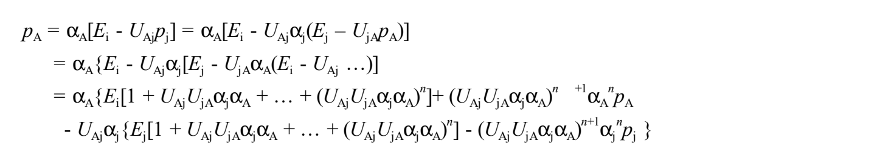

每个分子被入射光极化后，其他分子的极化所产生的场改变自己的极化；自己的场又改变对方，变化再返回自身，像在两分子间“传接球”，散射阶数不断上升。右端最后代表对方（或自己）最终状态的 $p_j$，经过多次散射被乘以 $(U_{Aj}U_{jA}\alpha_j\alpha_A)^{n+1}\alpha_j^n$，逐渐“消失在人群中”。因此适当截断可能成立；忽略最后项并作无穷级数，当 $|U_{Aj}U_{jA}\alpha_j\alpha_A|<1$ 时收敛。因 $U_{Aj}=U_{jA}$，得

$$p_A=\left[\frac{\alpha_A}{1-U_{Aj}^2\alpha_j\alpha_A}\right](E_i-U_{Aj}\alpha_jE_j),\tag{2.131a}$$

同理，

$$p_j=\left[\frac{\alpha_j}{1-U_{Aj}^2\alpha_j\alpha_A}\right](E_j-U_{Aj}\alpha_AE_i).\tag{2.1.31b}$$

出现 $U_{Aj}^2\alpha_j\alpha_A$，是因为按一个来回写式；若以中心偶极到其他偶极的单程作用为基础，作者指出会得到式(2.1.24)。

> **原文疑点（Q250，译者）：** 多重散射展开中终端余项的额外 $\alpha^n$ 及末句“单程即得(2.1.24)”的适用范围需核验。为避免把候选推导替换原式，复杂展开用原页公式图完整保留；(2.131a)沿实印编号。无原式修正。

<!-- 原文定位：PDF p24的2.1.d至p25的2.2前 -->

#### 2.1.d 具有偶极相互作用的体系的简正振动模式（PDF p24）

多原子分子振动分析中，常把多个振子相连，求体系简正模式，也就是把总能量或哈密顿量对角化。用于本题，吸附分子若独立振动，总能量是

$$H=\sum_{r=1,f}\left[\frac12m\dot x_r^2+\frac12kx_r^2+(qx_r)E\right].\tag{2.1.32}$$

这是各个 $x_r$ 的能量之和，即哈密顿量已对角化。加入偶极相互作用时，还增加

$$H_{dd}=\frac12\sum_{r,s}(qx_r)(qx_s)\frac1{|\boldsymbol r_r-\boldsymbol r_s|^3}.\tag{2.1.33}$$

这是使 $x_r,x_s$ 相互依赖的交叉项，是以两者为变量的二次型。原文指出，规则排列时可写成坐标夹住对称矩阵的形式（交换 $r,s$ 不改变项值），因此应能像多原子分子一样对角化。

> **原文疑点（Q251，译者）：** 式(2.1.32)保留原用拉丁 $k$ 及正号场能；(2.1.33)求和未明写排除 $r=s$，其自作用项有奇异性，暂按原式保留。原文称“规则排列”时矩阵对称，不据此反推无序排列一定不能对角化。

> **原文补充：最近邻近似。** 可只考虑最近邻偶极子。单个相互作用随距离三次方倒数衰减，距离增倍即降为1/8；平面分布中距中心 $d$ 附近的偶极子数与 $d$ 成正比，故该圈总作用按距离平方倒数衰减，上例降为1/4。因此粗略近似下只计相邻偶极子可能足够；间距相同，原引式(2.31)的分母总为固定 $d^3$。这与声子的紧束缚模型（激发只跳到邻位点）的近似相同。

#### 2.1.e 极多偶极子在直线上等间距分布（PDF p24—25）

紧束缚版本假定只有最近邻间存在显著作用。将势能写为坐标矢量夹住矩阵时，只有对角元及紧邻两侧的矩阵元非零。考虑 $N$ 个同种偶极子等间距成一维链，只能沿垂直链的方向位移，便可容易地计算简正模式，结果概述如下。

设链两端固定，第 $j$ 个模式中，从端点数第 $n$ 个偶极子的位移与 $\sin(jn\pi/N)$ 成正比，$j=1,\ldots,N$。$j=1$ 频率最高，各处同向运动（振幅因位置不同），与外场耦合最强。$j=2$ 频率次高，前后半链反相，净耦合为零。$j=3$ 时，2/3偶极子贡献正耦合，1/3贡献负耦合，净相当于1/3的偶极子与外场耦合。按频率由高至低，原印耦合序列为 $1,0,1/3,0.1/5,0,1/7,\ldots$；特点是隔一个为零，非零者逐渐减小。

> **原文疑点（Q252，译者）：** 固定端条件下 $\sin(jn\pi/N)$ 的端点计数、印成“0.1/5”的分隔及后述 $\sin^{-1}(\omega-\omega_+)$ 状态密度的含义，均需核验。保留原记法；不把 $\sin^{-1}$ 擅定为反正弦或倒数。

吸收谱还取决于各模式的共振能量。在此模型中，作者把态密度写为 $\sin^{-1}(\omega-\omega_+)$。结合耦合大小，预计得到下图的吸收谱。横轴为频率，原点取无相互作用的共振频率；交替出现的零强度模式省略。

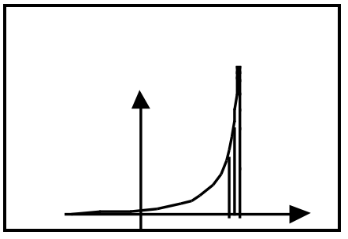

#### 2.1.f 失去有序性的情形（PDF p25）

并非所有吸附位点都被占据时，严格处理不容易；如果可以用处处取平均值的近似，就可应用平均场理论。尤其是CPA（coherent potential approximation，相干势近似），能够处理规则位点全部由两种吸附物种之一占据、但各位点物种随机的情形。把其中一个物种的极化率置零，便可计算未饱和覆盖的吸附状态。

<!-- 原文定位：PDF p25的2.2至p27的2.3前 -->

### 2.2 Scheffler的思路：形成直观图像（PDF p25—27）

如果读者对2.1感到不易接受，或觉得后文难以入手，这里从稍不同的角度介绍概念。本节是广濑按自己的理解对M. Scheffler，*Surf. Sci.* **81**, 562 (1975)的概述。

> **原文疑点（Q253，译者）：** 这里年份原印1975，而p14相同卷页记1979。分别保留，待核原参考文献，不视为两篇不同论文。

设分子垂直立于固体表面，位置为 $\boldsymbol R_i$，光频率为 $\omega$。受光照时的偶极矩写为

$$p(\boldsymbol R_i,\omega,t)=p_{\mathrm{st}}+\alpha(\omega)E^{\mathrm{local}}(\boldsymbol R_i,\omega,t).\tag{2.2.1}$$

$p_{\mathrm{st}}$ 为没有基底屏蔽时单分子的静态偶极矩，$\alpha(\omega)$ 为分子极化率（二原子分子沿分子轴的分量一般大于垂直分量），局域场 $E^{\mathrm{local}}$ 是作用于位点 $i$ 分子的微观电场，排除分子自身偶极矩产生的场。入射场为

$$E(\boldsymbol r,\omega,t)=E^0e^{i(\omega t-\boldsymbol k\cdot\boldsymbol r)},\qquad k=2\pi/\lambda.$$

**与第1部分不同，本节关注 $e^{+i\omega t}$ 的系数。** 对单分子层，局域场为入射外场与周围偶极矩在该分子位置产生的场之矢量和。入射侧，各振荡偶极辐射与基底反射叠加形成反射光；透射侧，偶极辐射与裸基底透射场叠加形成实际透射光。原文继而写振荡偶极辐射向“入射侧与反射侧”发出，这里保留其称谓。

基底反射场与入射场构成表面场。将中心分子实际感受的场分为：表面场 $E_i$，自身镜像场 $E_i^{\mathrm{own\ image}}$，其他偶极场 $E_i^{\mathrm{other\ dipole}}$ 及其他镜像场 $E_i^{\mathrm{other\ image}}$，则

$$E_i^{\mathrm{local}}=E_i+E_i^{\mathrm{own\ image}}+E_i^{\mathrm{other\ dipole}}+E_i^{\mathrm{other\ image}}.\tag{2.2.2}$$

假定偶极垂直表面（P & R也用此近似，倾斜情形仍可探讨），利用附录A简化场分量。再作长波长近似：分子间距远小于波长，各分子的外场相位差可忽略，所有偶极等幅同相。由式(2.2.1)得

$$\begin{aligned}
p(\boldsymbol R_i,\omega,t)&=\frac{p_{\mathrm{st}}}{1+\alpha(\omega)[S(\theta)-1/(4d^3)]}\\
&\quad+\frac{\alpha(\omega)E_j(\boldsymbol R_i,\omega,t)}{1+\alpha(\omega)[S(\theta)-1/(4d^3)]},
\end{aligned}\tag{2.2.3}$$
$$S(\theta)=\sum_{k\ne i}\left[\frac1{|\boldsymbol R_k-\boldsymbol R_i|^3}
+\frac1{(|\boldsymbol R_k-\boldsymbol R_i|^2+4d^2)^{3/2}}
-\frac{12d^2}{(|\boldsymbol R_k-\boldsymbol R_i|^2+4d^2)^{5/2}}\right].\tag{2.2.4}$$

第一项表示静态偶极矩改变，可说等价于表面功函数变化；第二项与入射场同频振荡，改变光谱，可写为

$$p(\omega)=\frac{E_j^0(\omega)\alpha(\omega)}{[1+\alpha(\omega)(S(\theta)-1/(4d^3))}.\tag{2.2.5}$$

IRAS（这里也包括一般反射红外光谱）观测的是反射红外强度，即表面直接反射场与偶极及其镜像的远场辐射矢量和的强度。因此极化引起的强度变化 $\Delta R$ 如下，保留原式的实部作用范围和末项记号：

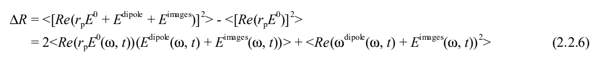

尖括号表示时间平均，$r_pE^0$ 是裸表面的反射场。偶极矩 $p(\boldsymbol R_i,\omega,t)$ 及其镜像在观测点 $\boldsymbol r$ 产生的场，原式为

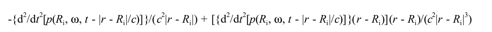

式(2.2.6)第一项占绝对优势，故

$$\Delta R\sim n\omega^2\{\operatorname{Re}[p(\omega)]\operatorname{Re}(r_p)-\operatorname{Im}[p(\omega)]\operatorname{Im}(r_p)\}.$$

掠入射角附近，$\operatorname{Re}(r_p)\sim0$，于是

$$\Delta R\sim-n\omega^2\operatorname{Im}[p(\omega)]\operatorname{Im}(r_p)\propto\operatorname{Im}[p(\omega)].\tag{2.2.7}$$

（式(2.2.5)之后至此，按Scheffler论文的论证。）把分子极化率分为振动非共振项与用洛伦兹函数表示的振动共振项：

$$\alpha(\omega)=\alpha_e+\frac{\alpha_v}{\omega-\omega_{ng}+i\Gamma}.\tag{2.2.8}$$

后面会指出，经典阻尼振子解与此有微妙差异。决定极化的量及其变形，原式如下：

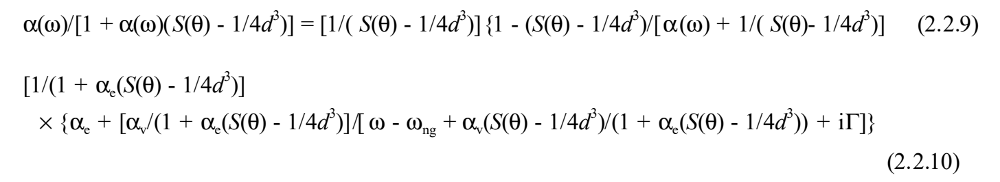

孤立分子的式(2.2.8)，只看虚部在原文所写 $\omega=\omega_n$ 处有极值；模平方的极大位置则受 $\alpha_e$ 影响而偏离。相互作用后的式(2.2.9)，连虚部极值位置也从 $\omega_n$ 偏移 $\alpha_v[S(\theta)-1/(4d^3)]/\{1+\alpha_e[S(\theta)-1/(4d^3)]\}$。这就是单一吸附物IRAS峰的偶极相互作用频移，覆盖度通过 $S(\theta)$ 进入。和频谱中振动峰的位置则是和频极化平方最大的频率。

> **原文疑点（Q254，译者）：** 式(2.2.3)右端 $E_j$ 的下标、(2.2.5)未闭合方括号、(2.2.6)末项印成 $\omega^{\mathrm{dipole}}$，以及(2.2.9)代数恒等变形和(2.2.10)分母内的 $\alpha_V$，均按原印保留；对应的括号、场记号与代数分子应进一步核验。式(2.2.8)与解释段的 $\omega_{ng}/\omega_n$ 也不静默统一。原图公式未替换成候选修正式。

<!-- 原文定位：PDF p27的2.3至p29的2.3.6说明末 -->

### 2.3 Persson与Ryberg的方法之一：同一物种的覆盖度依赖性（PDF p27—31）

Persson与Ryberg对规则排列吸附分子的表面，建立了偶极相互作用影响吸收谱的理论（B. N. J. Persson与R. Ryberg，*Phys. Rev. B* **24**, 6954 (1981)）。理论也处理混合物，并可稍作变通用于不足100%的覆盖度：将两种物种之一的极化率设为零，在偶极相互作用意义上就等价于空位。2.3—2.5介绍其要点，2.6讨论作者认为可能遗漏的问题。

模型假定：(1)单分子孤立吸附或多个分子覆盖表面时，每个分子固有的分子极化率不变；极化的变化只因分子位置增加了周围分子的电场。(2)完全覆盖表面中，把周围分子均视为具有相同平均有效极化；中心分子的诱导极化最终应与周围相同，逐频率迭代求满足此条件的值，即SCF思路。

不过，单个孤立吸附分子被极化时也必有自身镜像，本应把真实偶极与镜像成对考虑，P & R对此却不明确。按论文的晶格结构、晶格常数及分子到镜像面的距离重算，要得到与其 $U(q)$ 相同的数值，需要不计中心分子正下方的镜像、却计其他分子的镜像。这提示可能忽略了自身镜像，但是否合理，尚不能立即判断。

P & R的要点是利用倒易空间，把分散的许多偶极子处理得像一个偶极子，对自洽计算有利；但只在具有平移对称性的规则分布中有效。随机分布须用多重散射和逐次近似完成自洽关系。其概述如下。

中心位点 $i$ 的极化为 $p_i$，周围位点 $j$ 的极化为 $p_j$，类比原引式(2.17a)，

$$p_i=\alpha_A\left[E_i-\sum_{j\ne i}U_{ij}p_j\right].\tag{2.3.1}$$

下标A、B表示物种；$U_{ij}$ 表示 $j$ 的偶极 $p_j$ 与镜像 $p_j^*$ 合在一起对 $i$ 的电场作用。吸附分子等高，位置差平行表面。原文给出垂直与平行分量的场分别为

$$-\frac{p_{i,z}}{|\boldsymbol r_i-\boldsymbol r_j|^3},\qquad+\frac{2p_{i,r}}{|\boldsymbol r_i-\boldsymbol r_j|^3}.\tag{2.3.2}$$

对镜像而言，连接矢量倾斜于表面，除非吸附高度远小于间距，否则不能用如此简单的表达。然而包括P & R在内的许多论文忽略这一倾斜，把 $U_{ij}$ 取为标量，把原偶极及镜像在 $\boldsymbol r_i$ 产生的场合写为 $-U_{ij}p_j$。

把极化和电场投影到倒易空间（$q$ 空间），展开为傅里叶级数：

$$p_i=\sum_qp_qe^{i\boldsymbol q\cdot\boldsymbol r_i-i\omega t},\qquad E_i=\sum_qE_qe^{i\boldsymbol q\cdot\boldsymbol r_i-i\omega t}.\tag{2.3.3}$$

公共时间因子 $e^{-i\omega t}$ 以下略去，位置引起的相位差则保留。$\boldsymbol q$ 有长度倒数的量纲，所以也称波数空间；乘以普朗克常数即有动量量纲，因而也称动量空间，相应将通常空间称为实空间。变换原文所引基本式“(2.32)”，只保留空间部分，原式如下，随后代入式(2.3.1)：

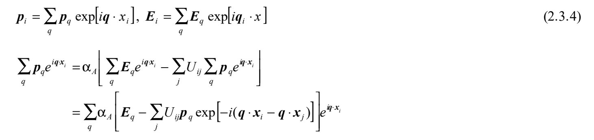

同样对 $U_{ij}$ 作傅里叶变换，其分量为

$$\widetilde U(\boldsymbol q)=\sum_jU_{ij}e^{-i(\boldsymbol q\cdot\boldsymbol x_i-\boldsymbol q\cdot\boldsymbol x_j)}
=\sum_jU_{ij}e^{-i\boldsymbol q\cdot(\boldsymbol x_i-\boldsymbol x_j)}.\tag{2.3.5}$$

代回并比较 $e^{i\boldsymbol q\cdot\boldsymbol x_i}$ 的系数，得

$$p_q=\alpha_A[E_q-\widetilde U(\boldsymbol q)p_q].\tag{2.3.6}$$

形式上与两个等大偶极子的作用相同；但这已经不是实空间的叙述，不意味着存在两个可以在空间上分开的偶极子。

> **原文疑点（Q255，译者）：** (2.3.4)的场指数原印 $q_i\cdot x$，代入第一行相互作用项原印位置 $x_i$，下一行又用 $x_j$；保留原式图，不代改。原引(2.17a)、(2.32)、2.3.e的编号也照录；本段重新使用负时间因子，与2.2的正时间因子分别标明。此处镜像星号表示镜像，不一概当作复共轭。

<!-- 原文定位：PDF p30全页至p31的2.4前 -->

式(2.3.6)的含义是：(1)波数分量 $q$ 的电磁场诱导同一波数分布的偶极矩；(2)这种空间相干的偶极子群只产生相同波数 $q$ 的场，其电场与偶极方向相反。因此相互作用只在同一个 $q$ 分量内闭合。原文特别指出，把这件事称为SCF并不正确。

解出 $p_q$，

$$p_q=\frac{\alpha_A}{1+\alpha_A\widetilde U(\boldsymbol q)}E_q\equiv\alpha_0(\boldsymbol q,\omega)E_q.\tag{2.3.7}$$

只要式(2.3.5)的 $U(q)$ 仅依赖 $q$，波数空间的讨论一般成立。若结果依赖选取哪个位点 $i,j$，$U(q)$ 就不再只是 $q$ 的函数。因此没有平移对称性时，不能直接应用上述讨论。同一种分子未饱和、不规则占位，或饱和时异种分子随机排列，均须注意这一点。

回到有平移对称性的体系。光波长远大于晶格间距，可以认为相当大区域内外场同相，光谱的主要傅里叶分量为 $q=0$，只需计算 $U(0)$。设垂直偶极子分布在平面上，单分子极化率含非共振及振动共振项（见2.1.a）：

$$\alpha(\omega)\approx\alpha_e+\frac{\widehat\alpha_V\omega_0^2}{\omega_0^2-\omega^2-i\omega\omega_0\widehat\gamma}
=\alpha_e+\frac{\widehat\alpha_V}{1-(\omega/\omega_0)(\omega/\omega_0+i\widehat\gamma)}.$$

计算偶极相互作用对吸收谱的影响，具有以下特点。

1. 极化率、因而反射和吸收谱的峰位按下式移动：

$$\begin{aligned}
\omega_A&\to\omega_A\sqrt{1+\frac{\alpha_V\widetilde U(0)}{1+\alpha_e\widetilde U(0)}}\\
&\approx\omega_A\left[1+\frac12\frac{\alpha_V\widetilde U(0)}{1+\alpha_e\widetilde U(0)}\right]
\approx\omega_A[1+\tfrac12\alpha_V\widetilde U(0)].
\end{aligned}\tag{2.3.8}$$

第一步近似以 $\alpha_V\widetilde U(0)\ll1$ 为条件，第二步再取 $\alpha_e\widetilde U(0)\ll1$。2.1仅借数学形式相似引用此结果。

2. 谱宽也相应改变。
3. 积分强度按 $\alpha_vU/(1+\alpha_eU)^2$ 改变。$U$ 依赖覆盖度，分析单物种表面谱时，关键是估计 $U$，实际可参考电子能谱、程序升温脱附（TPD）等结果计算。熟知的Clausius–Mossoti关系，则是体相极化率的偶极相互作用修正关系。

> **读式说明（译者）：** 式(2.3.8)沿原用无帽号 $\alpha_V$，不自动用前式 $\widehat\alpha_V$ 替换；近似条件按原列出。积分强度中的 $U$ 因子亦保留，未从别处重推后改式。

<!-- 原文定位：PDF p31的2.4至p32数值计算小标题前 -->

### 2.4 Persson与Ryberg的方法之二：同位素混合物与相干势近似（PDF p31—33）

前面说过，P & R理论的特点是：对规则排列的相同分子，利用沿任意晶格矢量平移后体系性质不变的平移不变性，转入倒易空间；红外实验光子动量极小，又只需取 $q=0$ 分量。这在规则占位时严格适用，但不能直接用于少量异种分子随机混入的同位素混合物，或覆盖度不足1的表面。同位素是“化学性质相同、共振频率略异的异物”，与晶体缺陷也稍有区别。

这里介绍P & R的处理：把2.1.c的偶极场“传接球”推广为多重散射。两个偶极子相互修正，对方场改变自己的极化，修正后的自己又改变对方，形成无穷级数。许多分子时，除两者往返之外，还可经第三个、第四个分子再返回，路径形成各类多边形。这也方便采用为合金行为计算而提出的CPA；作者将其起源年代写作“1950年代？”。

先明确CPA假定：(1)中心位点 $i$ 的分子有自身极化率 $\alpha_i$；空位为零，同位素则共振位置不同。(2)周围吸附是随机的，同位素位点及空位分布纯粹由统计决定。

P & R的表面CPA模型如下。

1. 在中心 $\boldsymbol r_i$ 依次放不同物种。周围位点规则排列相同的、有效且虚拟的“平均分子”（某种可极化体），把环境替换为保持平移不变性、即势具有周期性的表面。
2. 周围的平均分子极化率，不论中心是A或B都取共同值，通过自洽计算决定。先分别计算中心为A和B时、包含偶极相互作用的极化。中心分子只具有自身共振的极化率，周围平均分子的极化率却同时含两物种的共振。因此扫频时，中心分子的极化谱也会出现另一物种的共振——须区分“极化率”与“极化”。
3. 按浓度 $c_A:c_B$（$c_A+c_B=1$）平均两种结果，逐渐改变平均极化率，反复计算，直到所得平均极化与周围一致，前后值达到满意的一致程度才结束。实际采用适当初值并迭代收敛。P & R给出了“两分子的极化率仅共振频率不同”的模型结果。

这样得到的是“CPA光谱”。若中心A、B的最终极化为 $p_A,p_B$，条件是 $c_Ap_A+c_Bp_B=p$，其中 $p$ 是把平均可极化体放在 $\boldsymbol r_i$ 所得极化。因此这是一种平均场近似；$p_A,p_B$ 都已包含与周围平均可极化体多次往返的结果。

该计算半定量说明了邻近振动带混合吸附表面的实验特征：(1)两条谱线的位置随混合比变化，各自物种浓度降低时都向低波数移动；变化非线性，中间浓度附近最大。高波数物种浓度趋零时，两峰看似趋向同一点。(2)强度比大幅偏离浓度比，高波数峰显著较强。例如¹²CO/¹³CO混合吸附于Pd(110)，¹²CO约30%时，两峰才等高。这些实验特征可见M. W. Urban，*Vibrational Spectroscopy of Molecules and Macromolecules on Surfaces*，John Wiley & Sons，1993，第2.4节的图。

<!-- 原文定位：PDF p32数值计算小标题至p33的2.5前 -->

#### $q$ 空间偶极相互作用的数值计算、近似公式及布里渊区积分

具体计算的关键之一是 $Q$。P & R对 $c(2\times2)$ CO/Cu(100)，采用 $U(q)=U_0[1+A(q/q_0)+B(q/q_0)^2]$ 近似。代入最近邻CO间距等数据，得到

$$Q=\frac1\alpha\left\{1-\frac\xi{1.2}\left[\ln\left(\frac{\xi-0.2}{\xi+1}\right)+\frac1\xi\ln\left(\frac{\zeta-1}{\zeta+1}\right)\right]\right\},\tag{2.4.1}$$
$$\xi=\frac1{\alpha U_0},\qquad\zeta=\sqrt{\frac{0.2-\xi}{1.2}}.\tag{2.4.2}$$

须注意这是针对该特定体系计算的，更一般的式子为

$$Q=\frac1\alpha\left\{1-\frac\xi B\left[\ln\left(\frac{\xi+1+A+B}{\xi+1}\right)-\frac A{2B}\frac1\xi\ln\left(\frac{(\zeta-1-A/(2B))(\zeta+A/(2B))}{(\zeta+1+A/(2B))(\zeta-A/(2B))}\right)\right]\right\},\tag{2.4.3}$$
$$\xi=\frac1{\alpha U_0},\qquad\zeta=\sqrt{\frac1B\left(\frac{A^2}{4B}-1-\xi\right)}.\tag{2.4.4}$$

式(2.4.1)、(2.4.2)来自把该体系数值计算的 $U_0=0.3\,\text{Å}^{-3}$、$A=-2.4$、$B=1.2$ 代入一般式。对 $q$ 积分时，把由最近邻距离 $a=3.6\,\text{Å}$ 确定的正方形换成等面积圆，$\pi q_0^2=(2\pi/a)^2$，并取 $d=0.8\,\text{Å}$。对不同体系，应先检查这些参数的适用值。

我们（由狩野计算）也从Ni(111)结构常数重新计算。结果看，把布里渊区边界换成圆、把 $U(q)$ 换成二次函数，近似并不很差；进一步加高次项，似乎也不大改变最终和频谱形。

补记P & R计算步骤：(1)把边长 $2\pi/a$ 的Cu(100)倒易胞正方形替换为半径 $q_0$ 的圆；(2)计算 $q=(1,0)$、$(1,1)$ 的 $U(q)$，求 $U_0,A,B$；(3)将这些值代入 $U/(1+\alpha U)$ 对 $q$ 积分的一般式，$\xi,\zeta$ 也在积分时定义。

> **原文疑点（Q256，译者）：** 将 $A=-2.4,B=1.2$ 代入式(2.4.3)的对数系数，是否确实得到式(2.4.1)中 $1/\xi$，需复核；复对数和平方根的分支也未明示。各式保持原系数，不据计算习惯补定分支。

<!-- 原文定位：PDF p33的2.5全段 -->

### 2.5 向同一物种的振动激发体系推广（PDF p33）

即使表面只吸附一种分子，振动激发后也因热带吸收而改变共振频率；此外，与吸收相反的受激发射，发生在从基态吸收的同一位置。因此激发分子的极化率含两个共振项：产生热带的吸收项，以及位于基态吸收频率、符号相反的受激发射项。原文还指出，根据细致平衡（detailed balance，参见物理学词典），激发分子数被限制在总数的一半以下。

基本上仍可用2.4的混合物吸附思路，但激发物种的极化率必须加入受激发射这一特殊项。A代表基态分子，只有吸收处一个共振；B代表振动激发分子，既有热带频率的吸收，又有与A吸收同频的发射共振。

作者称，尚无实验系统考察吸附物振动激发浓度如何改变热带（通常低于基频）的强度和峰位，但依P & R理论预作预测是重要的。若热带行为同于同位素混合物的低波数带，可能要到很高的激发浓度才能看见谱线。受激发射项与吸收项反号，会使基频峰高低于仅按基态浓度估计的值；热带的强度借用（intensity borrowing）与受激发射的强度抑制（intensity suppression）如何竞争，值得研究。

> **适用条件说明（Q257，译者）：** 激发比例不超过一半的结论需要相应的驱动、能级及稳态条件，不能单凭“细致平衡”推广到任意泵浦体系。“尚无实验”的陈述属于原稿写作时的判断，译文未将其更新为当前文献状况。

<!-- 原文定位：PDF p33的2.6至p35的3标题前 -->

### 2.6 与自身镜像的相互作用：真实偶极与镜像的“传接球”（PDF p33—35）

P & R未明确说明极化产生后与自身镜像如何相互作用。如下所示，计算可能得到物理上不合理的结论，或许这一思考方式本身有问题；但即使没有周围分子也存在该效应，所以值得考察。

镜像虽是虚构的，却总随真实偶极产生；它没有独立的极化率，因此不能直接套用2.1的两个真实偶极模型。设 $p_A$ 的镜像为 $kp_A$，在原位置 $\boldsymbol r_i$ 产生场 $Xkp_A$。孤立偶极含镜像作用时，

$$p_A=\alpha_A\{E_i[1+Xk\alpha_A+\cdots+(Xk\alpha_A)^n]+(Xk\alpha_A)^{n+1}p_A\}.\tag{2.6.1}$$

当 $|Xk\alpha_A|<1$，

$$p_A=\frac{\alpha_A}{1-Xk\alpha_A}E_i.\tag{2.6.2}$$

理想金属表面（见附录A），垂直极化有 $k=1,X=1/(4d^3)$，平行极化有 $k=-1,X=-1/(8d^3)$，故

$$p_{A,z}=\frac{\alpha_A}{1-\alpha_A/(4d^3)}E_i,\qquad p_{A,r}=\frac{\alpha_A}{1-\alpha_A/(8d^3)}E_i.$$

介电质界面，垂直分量 $k=-(\varepsilon_1-\varepsilon_2)/(\varepsilon_1+\varepsilon_2)$、$X=1/(4d^3)$；平行分量 $k=(\varepsilon_1-\varepsilon_2)/(\varepsilon_1+\varepsilon_2)$、$X=-1/(8d^3)$。

令 $\alpha_A=\alpha_e+\alpha_v/(\omega-\omega_A+i\gamma)$，原文对式(2.6.2)变形得到

$$p_A(\omega)=\frac1{1-kX\alpha_e}\left\{\alpha_e+
\frac{\alpha_v/(1-kX\alpha_e)}{\omega-\omega_A-kX\alpha_e/(1-kX\alpha_e)+i\gamma}\right\}E_i.\tag{2.6.3}$$

由此作者指出：(1)即使只有一个孤立吸附分子，峰位也移动 $kX\alpha_e/(1-kX\alpha_e)$；(2)振动倾斜时，平行分量（在RAS因选择定则不可见，在介电质表面应可见）的频移为垂直分量的一半，强度变化也不同，原文写其正比于 $kX\alpha_e/(1-kX\alpha_e)^2$。这似乎意味着玻璃表面倾斜分子的反射谱会展宽或分裂，但作者对此也感到可疑。

> **原文疑点（Q258，译者）：** 式(2.6.3)频移项及随后强度因子原用 $\alpha_e$；直接代数变形的候选涉及 $\alpha_v$，量纲亦须检查。保留原式和作者的疑虑，未采用候选修正；“平行频移为一半”也不脱离其近似单独推广。式(2.6.1)终端余项外的 $\alpha_A$ 按原印保留。

再考虑许多吸附分子时自身镜像的作用。式(2.3.1)的 $U_{ij}$ 按字面是 $j$ 的偶极及其镜像对 $i$ 的总场。等高真实偶极的位置差平行表面，按附录A，垂直、平行分量分别产生 $-p_{i,z}/|\boldsymbol r_i-\boldsymbol r_j|^3$、$+2p_{i,r}/|\boldsymbol r_i-\boldsymbol r_j|^3$。但镜像与原分子的连接矢量倾斜，若高度不能相对间距忽略，场就不这样简单。P & R仍假定 $p_j$ 及镜像在 $\boldsymbol r_i$ 的合场平行 $p_j$、即 $E_j$，把 $U_{ij}$ 当作标量，以 $-U_{ij}p_j$ 统写。当位点间距远大于吸附高度时这才是允许的近似；作者补充镜像到真实偶极的距离约为最近邻间距的1/10，值得记住。

处理此问题，须先把自己和镜像作为孤立于其他偶极子对的一对；然后决定是把每一对作为整体引入对与对的作用，还是拆开其他对（排除自身镜像），逐个计算相互作用。

### 2.7 小结（PDF p35）

以上说明偶极相互作用在金属和介电质表面都存在，并导出基本公式。其特征是：同一晶体不同表面、不同覆盖度的峰位与强度会变；混合物的峰位和强度不简单正比于混合比，而是复杂变化；出现振动激发后，热带和基频带的变化可能更加复杂。

<!-- 原文定位：PDF p35的3至p36的3.2前 -->

## 3. 和频光谱中的偶极—偶极相互作用

### 3.1 与IRAS的区别（PDF p35—36）

IRAS及通常反射谱考察入射光诱导极化的虚部，包括其极值频率和半极值频率。和频光谱则考察须有可见光、红外光共同作用才产生的非线性极化，关注极化平方的极大位置与半峰宽。

两束入射光的局域场，各因线性极化的偶极相互作用而不同于裸表面场。和频极化一经产生，也受到线性偶极相互作用。因此表面存在三个频率的极化，但各自的作用有不同侧面。

1. 实验中可见光频率固定，其极化率和极化也固定。若分子及基底没有电子跃迁吸收，可见光极化率为实数。不过，金属有电导率，折射率与介电质不同而为复数（原文称理想金属、完全导体为纯虚数）；短波长区实部也不可忽略。因此反射场相对入射场有相位差，两者构成的表面场所诱导极化，也以复数表示相位。
2. 红外极化仍须像IRAS一样计入振动共振，但红外场只参与和频极化的生成，不能单看其虚部就判断峰位、谱宽。关键是红外局域场在振动共振附近的振幅和相位变化（实、虚部的大小与符号）如何传递到和频光电场。
3. 和频极化的特点：(a)没有外部入射的同频光，因此之前 $p_i=\alpha_i(E_i-U_{ij}p_j)$ 的外场项不存在。和频极化来自可见、红外电场之积，不含由同频外场直接诱导的那一项。(b)与红外线性极化率相似，和频响应也含振动共振项，所以偶极之间往返作用仍可能改变峰位、强度和谱宽。

> **记号提示（译者）：** 第3点并非说没有和频极化源；后文式(3.4)明确以 $\beta_3E_{i,1}E_{i,2}$ 为非线性源。本段“理想金属折射率纯虚”及“相位为复数”沿原文，复数幅度与相位角不应混为一物。

<!-- 原文定位：PDF p36的3.2至该页末傅里叶展开 -->

### 3.2 同一物种的情形（PDF p36—40）

入射光频率为 $\omega_1,\omega_2$，外场为 $E_1^{\mathrm{ext}},E_2^{\mathrm{ext}}$。下标1、2对应两入射频率，下标3对应 $\omega_3=\omega_1+\omega_2$。中心位点 $i$ 吸附A物种，通常省略A下标；需要明确时写作 $\alpha_{A,1}$ 等。由前面的线性计算，

$$p_{i,1}=\alpha_1\left[E_{i,1}-\sum_jU_{ij,1}p_{j,1}\right],\tag{3.1a}$$
$$p_{i,2}=\alpha_2\left[E_{i,2}-\sum_jU_{ij,2}p_{j,2}\right].\tag{3.1b}$$

相互作用修正后的有效场为

$$E_{i,1}=E_{i,1}^{\mathrm{ext}}-\sum_jU_{ij,1}p_{j,1},\tag{3.2a}$$
$$E_{i,2}=E_{i,2}^{\mathrm{ext}}-\sum_kU_{ik,2}p_{k,2}.\tag{3.2b}$$

和频场只来自周围的和频极化：

$$E_{i,3}=-\sum_lU_{il,3}p_{l,3}.\tag{3.3}$$

位点 $i$ 的和频极化（以 $\omega_1+\omega_2$ 振荡）由局域入射场之积产生的非线性极化，以及周围和频极化所产生电场诱导的线性极化共同组成：

$$p_{i,3}=\beta_3E_{i,1}E_{i,2}+\alpha_3E_{i,3}.\tag{3.4}$$

代入得

$$\begin{aligned}p_{i,3}&=\beta_3\left(E_{i,1}^{\mathrm{ext}}-\sum_jU_{ij,1}p_{j,1}\right)
\left(E_{i,2}^{\mathrm{ext}}-\sum_kU_{ik,2}p_{k,2}\right)\\
&\quad+\alpha_3\left(-\sum_lU_{il,3}p_{l,3}\right).\end{aligned}\tag{3.5}$$

以二维倒易空间傅里叶分量表示，

$$p_{i,n}=\sum_qp_{q,n}e^{i(\boldsymbol q\cdot\boldsymbol r_i-\omega t)},\qquad n=1,2,3,$$
$$E_{i,m}^{\mathrm{ext}}=\sum_{q'}E_{q',m}^{\mathrm{ext}}e^{i(\boldsymbol q'\cdot\boldsymbol r_i-\omega t)},\qquad m=1,2.$$

> **原文疑点（Q259，译者）：** (3.1)中 $E_{i,n}$ 未标ext，(3.2)又把它定义为修正后的有效场，场符号有歧义；正文按各处原印保留。页末傅里叶式的时间频率未加 $n,m$ 下标，下一页才明确写 $\omega_1,\omega_2,\omega_3$，不先行静默替换。

<!-- 原文定位：PDF p37全页，式3.6—3.10及解释 -->

把上述傅里叶展开代入式(3.5)，得到

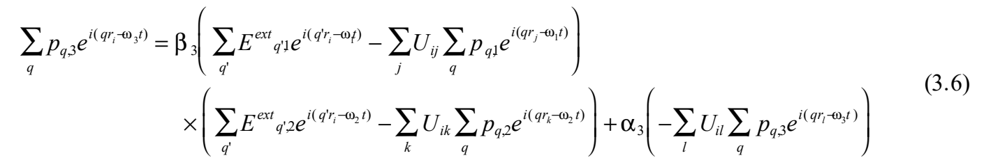

再用偶极相互作用的傅里叶分量 $U_q=\sum_jU_{ij}e^{-i(\boldsymbol q\cdot\boldsymbol r_i-\boldsymbol q\cdot\boldsymbol r_j)}$ 变形。这正是前面的 $\widetilde U(q)$；作者认为它不依赖电磁波频率，故不再附频率下标 $n$。适当交换 $j,q$ 的求和次序，得

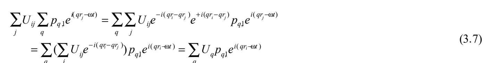

考虑此关系，并注意单独的 $q'$ 求和可以改名为 $q$ 求和，得

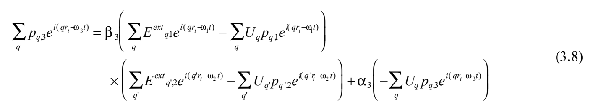

因 $\omega_1+\omega_2=\omega_3$，除去公共时间因子，

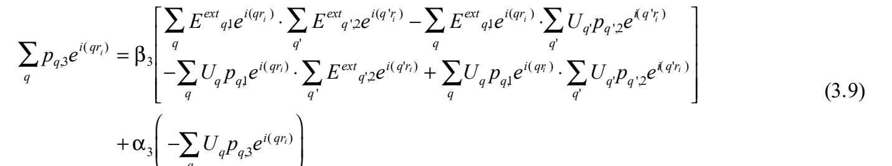

比较两边 $e^{i\boldsymbol q\cdot\boldsymbol r_i}$ 的系数，即同一空间波数分量的幅度，原文得到

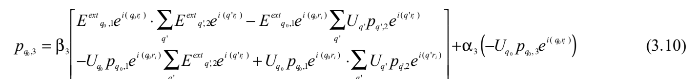

原文解释：不同频率的振荡分量相互正交，在两边乘以 $e^{-i\boldsymbol q_0\cdot\boldsymbol r_i}$ 后求和，相当于在有限基底中使用有限版δ函数积分，只有指数的自变量为零时留下非零值。

> **原文疑点（Q260，译者）：** 一般两个空间傅里叶级数相乘须形成波数卷积；式(3.10)的单分量提取仍保留指数和其他求和，其正交化说明也混用频率、波数及求和变量。保留完整原式图和作者解释，未用候选卷积公式代替。后文 $q\approx0$ 的特例与本页一般式的有效性分开记录。

<!-- 原文定位：PDF p38全页及p39首承接句 -->

一般式到此为止，转向实际情形。入射电磁波空间波数近乎零，取 $e^{i\boldsymbol q_0\cdot\boldsymbol r_i}\approx e^{i\boldsymbol q'\cdot\boldsymbol r_i}\approx1$，得

$$\begin{aligned}p_{0,3}=\beta_3[&E_{0,1}^{\mathrm{ext}}E_{0,2}^{\mathrm{ext}}-E_{0,1}^{\mathrm{ext}}U_0p_{0,2}
-U_0p_{0,1}E_{0,2}^{\mathrm{ext}}+U_0p_{0,1}U_0p_{0,2}]\\
&+\alpha_3(-U_0p_{0,3}).\end{aligned}\tag{3.11}$$

省略场和极化的空间波数下标0，整理得

$$\begin{aligned}p_3+\alpha_3U_0p_3&=(1+\alpha_3U_0)p_3\\
&=\beta_3[E_1^{\mathrm{ext}}E_2^{\mathrm{ext}}-E_1^{\mathrm{ext}}U_0p_2-U_0p_1E_2^{\mathrm{ext}}+U_0p_1U_0p_2].\end{aligned}\tag{3.12}$$

线性极化率由式(2.1.23)、(2.1.24)近似为

$$p_n=\alpha_{0,n}E_n^{\mathrm{ext}},\qquad\alpha_{0,n}=\frac{\alpha_n}{1+\alpha_nU_0},\quad n=1,2.\tag{3.13}$$

代入和频极化后的全部通分、相消步骤为

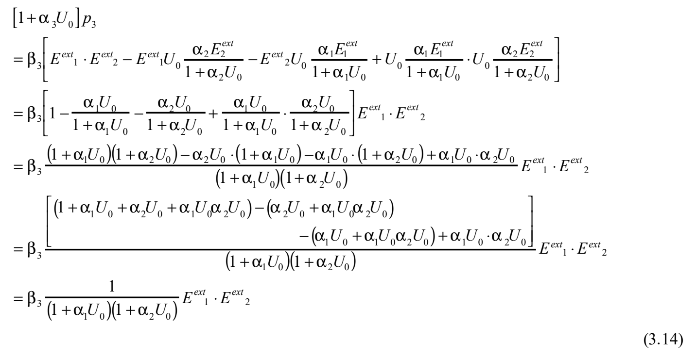

所以

$$p_3=\frac{\beta_3E_1^{\mathrm{ext}}E_2^{\mathrm{ext}}}{(1+\alpha_1U_0)(1+\alpha_2U_0)(1+\alpha_3U_0)}.\tag{3.15}$$

其物理图像是：分子感受的红外、可见场分别为 $E_n^{\mathrm{ext}}/(1+\alpha_nU_0)$；非线性源为这两个局域场的乘积乘以 $\beta_3$。各分子的和频非线性偶极又在和频频率相互屏蔽或增强，其效应为 $1/(1+\alpha_3U_0)$。Shen教材式(2.52)给出体相中的对应结论，虽然不是表面吸附物公式，就偶极相互作用修正而言是等价的。

<!-- 原文定位：PDF p39具体谱形段至p40的3.3前 -->

具体考察实验室关心的红外共振和频谱：频率 $\omega_1$ 的可见光 $E_1$、频率 $\omega_2$ 的红外光 $E_2$ 入射，产生频率 $\omega_3$ 的和频场 $E_3$。作如下假设。

1. 可见区无共振结构，电子极化率主要为实数，$\alpha_1=\alpha_e(\omega_1)$。
2. 和频区也无共振，$\alpha_3=\alpha_e(\omega_3)$。$\omega_3$ 通常更接近紫外电子吸收，所以 $\alpha_3$ 可能大于 $\alpha_1$；有时和频光进入吸收区，还须考虑 $\alpha_3$ 的虚部。
3. 红外响应仅有一个振动共振带，

$$\alpha_2\equiv\alpha_e(\omega_2)+\frac{\alpha_V}{(\omega_A-\omega_2)-i\gamma}.\tag{3.16}$$

于是对非线性响应假设

$$\beta_3=\beta_{\mathrm{background}}+\frac{\beta_A}{(\omega_A-\omega_2)-i\gamma}.\tag{3.17}$$

和频极化变为

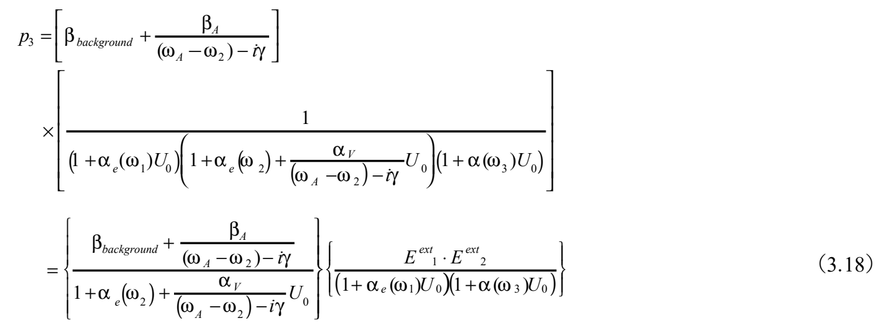

只要和频频率没有共振，决定红外扫频信号变化、即谱形的是右端第一个因子。

忽略 $\beta_{\mathrm{background}}$、即没有非共振背景时，非线性偶极的频率变化与红外吸收相同，分析 $|p_3|^2$ 即可得到和频谱。此时偶极相互作用造成的和频峰移，与红外吸收应观察到的峰移相同；但取模平方可能使宽度、峰高出现与红外吸收不同的变化。若非共振背景不能忽略（原文此处另用 $\beta_e(3)$ 记号），则须适当数值计算 $|p_3|^2$。

补充：若忠实套用P & R的“传接球”方法，除线性极化传播，还须纳入产生非线性极化的位点，以及从那里开始的线性极化传播路径，推导会异常复杂。作者在中途放弃，但确定它不能像纯线性情形那样顺利处理。

> **原文疑点（Q261，译者）：** 式(3.18)上半行未写 $E_1^{\mathrm{ext}}E_2^{\mathrm{ext}}$，中间分母的括号与 $U_0$ 作用范围也不清楚；保留原式图，不用式(3.15)的预期形式替换。关于“相同峰移”的结论保留无背景、无和频共振等前提，不外推为任意和频谱均与IRAS同峰。

<!-- 原文定位：PDF p40的3.3—3.6 -->

### 3.3 同位素混合物的情形（PDF p40；原文提纲）

作者认为，上面的物理图像也许可推广到原引式“(5.7)”。可见、红外场可以采用2.4线性极化计算所得的局域场；对与两局域场之积成正比的和频极化，也许能用原文所称“2c节”的方法处理偶极相互作用。

### 3.4 同一物种、振动激发的情形（PDF p40；原文提纲）

若3.3的推理成立，这里应可同样处理，因而可转用2.5的方法。不过，须指出受激发射项也存在于和频张量的振动共振项中。

### 3.5 与自身镜像的相互作用（PDF p40；原文提纲）

可见、红外局域场可按2.6求得，和频极化或许也可同样考虑。但狩野对2.6本身的看法是：“有点像负熵体系（negative entropy system），令人觉得可疑。”

### 3.6 小结（PDF p40）

省略。（参见卷首。）

> **原文状态说明（Q262，译者）：** 3.3—3.5是作者尚未完整推导的提纲，保留“也许”“若成立”等限定，不补写为完成的CPA和频理论。原引(5.7)、2c照录，尚未确认对应式号；“负熵体系”是原作者的疑虑表达，不代表译者作了热力学判定。

<!-- 原文定位：PDF p40的4至p41屏蔽效应段末 -->

## 4. 要点（PDF p40—42）

#### 孤立分子A的线性极化率与和频一阶超极化率

$$\alpha_A(\omega)=\alpha_e-\frac{\alpha_v}{\omega-\omega_v+i\Gamma_v}
=\alpha_e+\frac{\alpha_v}{\omega_v-\omega-i\Gamma_v},$$
$$\beta_A(\omega)=\beta_e-\frac{\beta_v}{\omega-\omega_v+i\Gamma_v}
=\beta_e+\frac{\beta_v}{\omega_v-\omega-i\Gamma_v}.$$

若有多个振动带，各式第二项须对振动带求和。

#### 屏蔽效应

表面上单个分子与自身镜像作为一对时，响应如下；各自第二行用于只有一个振动带的情形。

$$\begin{aligned}\alpha_{A0}(\omega)&=(1+k)\alpha_A\\
&=(1+k)\left[\alpha_{Ae}+\frac{\alpha_{Av}}{\omega_0-\omega-i\gamma_V}\right].\end{aligned}$$

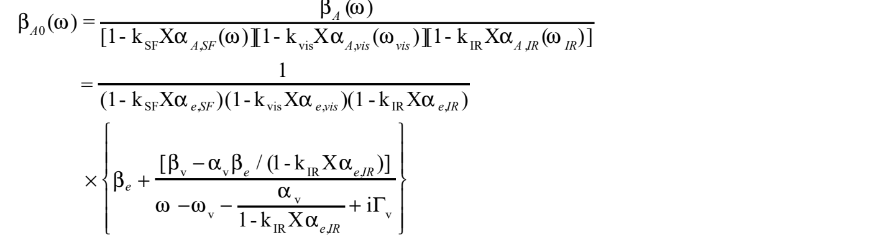

垂直界面极化，$k=-(\varepsilon_1-\varepsilon_2)/(\varepsilon_1+\varepsilon_2)$；平行极化，$k=(\varepsilon_1-\varepsilon_2)/(\varepsilon_1+\varepsilon_2)$。$\varepsilon_2$ 对理想金属为很大的纯虚数（故垂直 $k=+1$、平行 $k=-1$），对实际金属及吸收介电质为复数，对透明介电质为实数，与折射率平方成正比。理想金属表面的垂直偶极使表观分子响应加倍，线性和和频极化均增强；平行偶极的镜像反平行，表观响应因屏蔽为零。

一般介电质界面，原文称偶极相对法线倾斜 $\phi$，原偶极与镜像的总偶极分量为

$$p_\parallel=p(1-k)\cos\phi,\qquad p_\perp=|p|(1+k)\sin\phi.$$

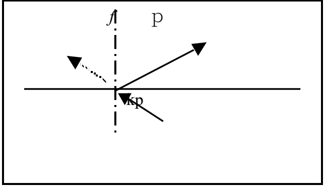

> **原文疑点（Q263，译者）：** 本要点中自身镜像和频式的频率下标、共振分母系数及场因子须与正文核验，原式图保持不动。若φ按文字从法线量起，上式正弦、余弦与通常分解相反；保留文字、原式及图，不自行统一角度定义。要点的线性式与附录C含反馈分母的式(C.6)也不是同一表达，暂不合并。

<!-- 原文定位：PDF p41偶极相互作用要点至p42附录A前 -->

#### 偶极相互作用

同一物种覆盖整个表面时，周围分子也受同一光照而极化，表观分子极化率进一步变为以下原式：

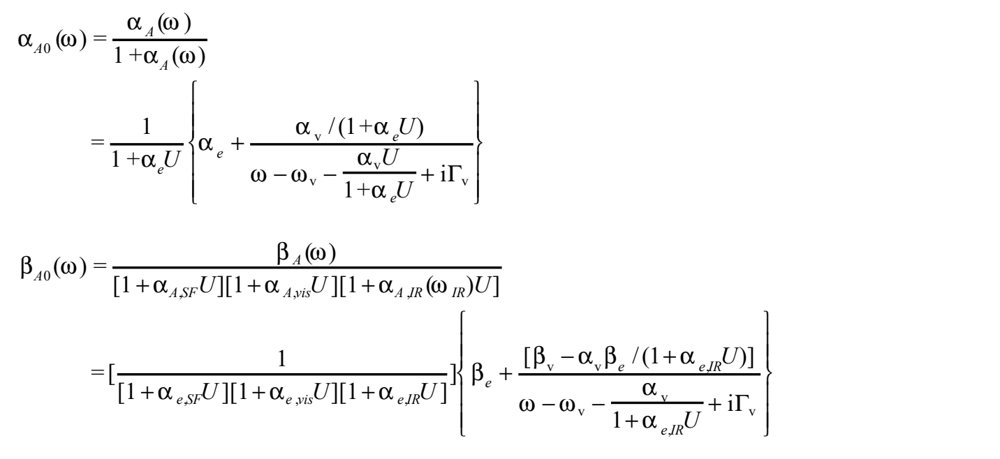

其中依赖覆盖度的量是 $U$。由函数形式可见，峰位和强度随覆盖度非线性变化；下述技术正是为此类计算发展。多振动带时，各式第二行大括号内的第二项须对振动带求和。

> **原文疑点（Q264，译者）：** 图中首式分母原为 $1+\alpha_A(\omega)$，未写 $U$；后续线性、非线性共振分母及频移项也有系数差异。原式图完整保留，候选须与式(2.3.7)、(3.15)及所用共振记号一起核验，不直接补齐为“预期公式”。

#### A、B分子随机混合吸附的表面

设分子极化率分别为 $\alpha_A(\omega),\alpha_B(\omega)$。有效极化率 $\alpha(\omega)$ 满足

$$\alpha(\omega)=\frac{c_A\alpha_A(\omega)}{1+[\alpha_A(\omega)-\alpha(\omega)]Q}
+\frac{c_B\alpha_B(\omega)}{1+([\alpha_B(\omega)-\alpha(\omega)]Q},$$
$$Q=\frac U{1+\alpha(\omega)U}.$$

用逐次近似确定两边出现的 $\alpha(\omega)$；$Q$ 可另行计算。有效套用的表达式又有

$$\alpha_0(\omega)=\frac{\alpha(\omega)}{1+\alpha(\omega)U}
=\frac{c_A\alpha_A(\omega)}{1+\alpha_A(\omega)U}
+\frac{c_B\alpha_B(\omega)}{1+\alpha_B(\omega)U}.$$

相对浓度会显著改变峰位、相对强度和整体谱形。对应的和频响应公式尚未导出（虽已做类推计算……）。和频谱低波数带的强度抑制，可能比IRAS更强。若比较的不是同位素，而是相同分子在不同位点、离表面高度可明显不同的情形，还需重查 $U$ 的形式，包括等高时依靠矢量内积得到的简化是否仍适用。

> **原文疑点（Q265，译者）：** CPA关系第二项原有不匹配左圆括号，照录；$Q$ 在这里未明确写出波数平均/积分，需与2.4定义衔接。两种“有效极化率”式不自动视为对任意U严格等价。

#### 混有振动激发态时

形式上可用同位素混合物的公式。但激发物种的极化率须同时含热带吸收型共振与基频受激发射型共振。

<!-- 原文定位：PDF p42附录A至p43末 -->

## 附录A：电偶极矩产生的电场（PDF p42—44）

1. 位于 $\boldsymbol r'$ 的电偶极矩 $\boldsymbol p(\boldsymbol r')$ 在 $\boldsymbol r$ 产生的场：

$$\boldsymbol E(\boldsymbol r;\boldsymbol p(\boldsymbol r'))=-\frac{\boldsymbol p(\boldsymbol r')}{|\boldsymbol r-\boldsymbol r'|^3}
+\frac{3(\boldsymbol r-\boldsymbol r')[\boldsymbol p(\boldsymbol r')\cdot(\boldsymbol r-\boldsymbol r')]}{|\boldsymbol r-\boldsymbol r'|^5}.\tag{A.1a}$$

2. 位于 $\boldsymbol r$ 的偶极矩在 $\boldsymbol r'$ 产生的场：

$$\boldsymbol E(\boldsymbol r';\boldsymbol p(\boldsymbol r))=-\frac{\boldsymbol p(\boldsymbol r)}{|\boldsymbol r-\boldsymbol r'|^3}
+\frac{3(\boldsymbol r-\boldsymbol r')[\boldsymbol p(\boldsymbol r)\cdot(\boldsymbol r-\boldsymbol r')]}{|\boldsymbol r-\boldsymbol r'|^5}.\tag{A.1b}$$

3. 位于 $\boldsymbol r$ 的偶极矩在原点产生的场：

$$\boldsymbol E(0;\boldsymbol p(\boldsymbol r))=-\frac{\boldsymbol p(\boldsymbol r)}{r^3}
+\frac{3\boldsymbol r[\boldsymbol p(\boldsymbol r)\cdot\boldsymbol r]}{r^5}.\tag{A.1c}$$

可从静电学推导：以偶极位置为中心放置相距 $d$ 的 $+q,-q$，在求场处放单位电荷，求它受到的合力。利用偶极矩为 $qd$、单位电荷受力即电场，在观测距离远大于 $|d|$ 时用 $qd$ 表示场。

偶极随时间变化，场也变化。界面偶极的场须加上镜像场（见附录B）。在表面坐标 $(x,y,z)$ 中，$z$ 为向外法线，中心偶极 $p$ 位于 $(0,0,d)$；它感受自身镜像 $p^*$、其他偶极 $p'$ 及其镜像 $p'^*$ 的场。把各偶极分为面内、法向分量 $\boldsymbol p=\boldsymbol p_\rho+\boldsymbol p_z$，且面内只有 $x$ 分量，即偶极在 $xz$ 平面内。各位置、分量如下（式A.2）：

| 对象 | 位置 | 面内分量 | 垂直分量 |
|---|---|---|---|
| 中心偶极 | $(0,0,d)$ | $(p_\rho,0,0)$ | $(0,0,p_z)$ |
| 自身镜像 | $(0,0,-d)$ | $(p_\rho^*,0,0)$ | $(0,0,p_z^*)$ |
| 其他偶极 | $(\rho\cos\phi,\rho\sin\phi,d)$ | $(p'_\rho,0,0)$ | $(0,0,p'_z)$ |
| 其他镜像 | $(\rho\cos\phi,\rho\sin\phi,-d)$ | $(p_\rho'^*,0,0)$ | $(0,0,p_z'^*)$ |

理想金属表面，原文写

$$p_\rho^*=p_\rho,\qquad p_z^*=-p_z.$$

对于实际金属和介电质，原文列出介电质表面的关系：当 $p_\rho,p_z>0$ 时，

$$0<p_z^*<p_z,\qquad-p_\rho<p_\rho^*<0.$$

> **原文疑点（Q266，译者）：** 上述理想金属镜像符号与正文及附录C相反；此处保留原式。介电质不等式也仅能在相应实参数范围解释，不推广到一般复数镜像系数。

各场为

$$\boldsymbol E_{\mathrm{own\ image}}=\frac{\boldsymbol p_z^*}{4d^3}-\frac{\boldsymbol p_\rho^*}{8d^3};\quad
\text{理想金属： }\boldsymbol E_{\mathrm{own\ im}}=\frac{\boldsymbol p_z}{4d^3}+\frac{\boldsymbol p_\rho}{8d^3}.\tag{A.3}$$

$$\boldsymbol E_{\mathrm{other\ dipole}}=-\frac{\boldsymbol p'_z+\boldsymbol p'_\rho}{\rho^3}
+\frac{3p'_\rho\boldsymbol e_r\cos\phi}{\rho^3},\tag{A.4}$$

其中 $\boldsymbol e_r=(\cos\phi,\sin\phi,0)$ 是从 $(0,0,d)$ 指向 $p'$ 的单位矢量。

<!-- 原文定位：PDF p44首至附录B前 -->

其他镜像产生的场为

$$\boldsymbol E_{\mathrm{other\ image}}=-\frac{\boldsymbol p_z'^*+\boldsymbol p_\rho'^*}{(\rho^2+4d^2)^{3/2}}
+\frac{(-6dp_z'^*+3\rho p_\rho'^*\cos\phi)\boldsymbol e'_r}{(\rho^2+4d^2)^3}.\tag{A.5}$$

原文定义 $\boldsymbol e'_r=(\rho\cos\phi,\rho\sin\phi,2d)/\sqrt{\rho^2+4d^2}$，称它为从 $(0,0,d)$ 指向 $p'^*$ 的单位矢量。理想金属时，

$$\boldsymbol E_{\mathrm{other\ image}}=-\frac{\boldsymbol p'_z-\boldsymbol p'_\rho}{(\rho^2+4d^2)^{3/2}}
+\frac{(-6dp'_z-3\rho p'_\rho\cos\phi)\boldsymbol e'_r}{(\rho^2+4d^2)^3}.$$

当其他偶极子绕 $z$ 轴的分布具有 $C_3$ 或更高对称性时，作者指出，对 $z$ 轴上的场只需考虑式(A.4)第一项，因为含 $\cos\phi,\sin\phi$ 的等价贡献相加为零。

偶极 $p_1$ 的场对 $p_2$ 施力，两者的相互作用能原写为

$$V=-\frac{\boldsymbol p_1\cdot\boldsymbol p_2}{r^3}+3\frac{(\boldsymbol p_1\cdot\boldsymbol r)(\boldsymbol p_2\cdot\boldsymbol r)}{r^5}.$$

如下图，$\theta_1,\theta_2$ 分别是 $p_1,p_2$ 与 $\boldsymbol r$ 的夹角，$\phi$ 是 $p_2$ 偏离 $p_1$ 与 $\boldsymbol r$ 所在平面的角度，则

$$V=\frac{|\boldsymbol p_1||\boldsymbol p_2|}{r^3}(2\cos\theta_1\cos\theta_2-\sin\theta_1\sin\theta_2\cos\phi).$$

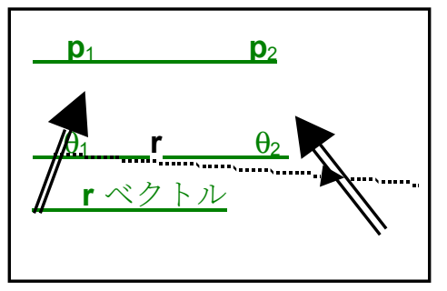

> **原文疑点（Q267，译者）：** 式(A.5)第二项分母原为三次幂，其与单位矢量形式的量纲及 $\boldsymbol e'_r$ 的方向定义须核验；不改幂次或z符号。式(A.4)对称性消项需要分量取向的相应条件；能量V的整体号又与通常 $-\boldsymbol p_2\cdot\boldsymbol E_1$ 的能量约定相反。原式、作者判断均保留，暂不采用修正。

<!-- 原文定位：PDF p44附录B至p45末 -->

## 附录B：镜像电荷与镜像偶极子（PDF p44—47）

以J. D. Jackson，*Classical Electrodynamics*，John Wiley and Sons，纽约，第2版，1975，第1—4章为基础。

介电质（包括真空）内的点电荷 $q$ 周围产生电场，并使介质极化；原文称该场与介电常数“成正比”。极化本身也产生场。因此，若介质中存在另一种介电质，其内部的极化不同，原介质的场也不同于没有异物时。若异物为金属，其表面为等势面，场同样改变。严格求解须用麦克斯韦方程及微分方程；但对有无限延伸表面的情形（介电质限于平面），可假设虚拟点电荷，即镜像电荷，得到同样的严格解。

原文列出的边界条件是：(1)金属表面的电场矢量及“电矢量”垂直表面；(2)介电质两侧，切向电场相等，法向电位移大小相等而方向相反。这些与光的反射、折射边界条件相同。作者又把金属条件归为第一类边值问题，即狄利克雷条件，把介电质条件归为第二类，即诺伊曼条件。若虚拟电荷场满足相同条件，根据唯一性，便与严格解相同，可以采用计算较简单的方法。

镜像电荷大小用 $\varepsilon$ 表示，金属和介电质虽有不同边界条件，可用相同公式。无吸收介电质的 $\varepsilon$ 为实数，有吸收时为复数；金属为复数，原文把理想金属视作纯虚数。

设介质1的 $\varepsilon_1$ 中有点电荷 $q$，距平面界面 $d$，另一侧介质2的常数为 $\varepsilon_2$。在镜像位置、界面下深 $d$ 处放虚拟 $q'$，介质1中任意点的场，等于假设整个空间都为 $\varepsilon_1$，把真实 $q$ 与虚拟 $q'$ 的场相加。计算介质2的场，则在真实电荷位置换为 $q''$，假设全空间为 $\varepsilon_2$（Jackson第4.4节）：

$$q'=\frac{\varepsilon_1-\varepsilon_2}{\varepsilon_1+\varepsilon_2}q,\tag{B.1a}$$
$$q''=\frac{2\varepsilon_2}{\varepsilon_1+\varepsilon_2}q.\tag{B.1b}$$

两式在cgs esu与MKSA单位制中形式相同。

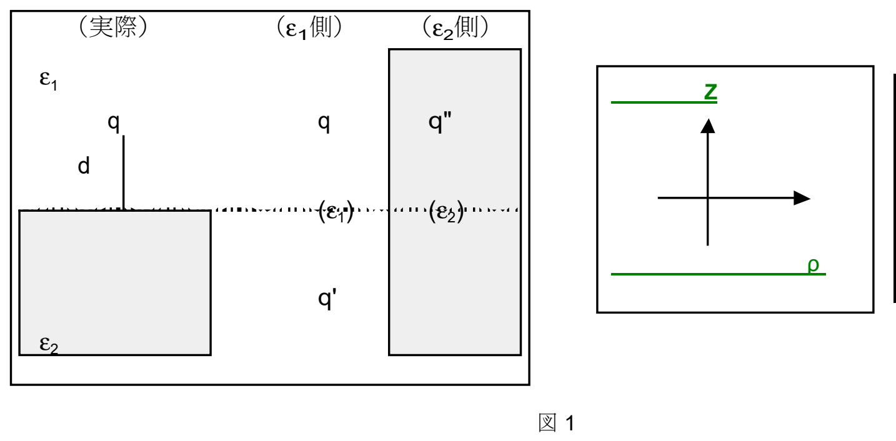

图中左、中、右分别表示实际体系、计算ε₁侧场的等效体系、计算ε₂侧场的等效体系；$z$ 为法向坐标，$\rho$ 为面内径向坐标。

理想金属内部不产生电场，所以式(B.1b)不再具有原来的意义；$\varepsilon_2$ 远大于 $\varepsilon_1$，故 $q'=-q$，回到等量反号的通常镜像电荷。电力线可参看Jackson教材p149。

> **原文疑点（Q268，译者）：** “电场与介电常数成正比”、两侧法向矢量“反向”的法线约定，以及把一般介电质界面直接归为纯诺伊曼条件，均需与后文公式和具体边值设定核验。这里保留原说法；同一固定坐标法线的分量连续与两侧各自外法线分量反号应区分。

<!-- 原文定位：PDF p46首至p47附录C前 -->

更详细地用电磁学说明。介电常数 $\varepsilon$ 的介质内，点电荷 $q$ 距离 $R$ 处的静电势为 $\Phi$，电场为 $\boldsymbol E$，电位移为 $\boldsymbol D$。cgs esu中，

$$\Phi=\frac q{\varepsilon R},\quad\boldsymbol E=-\nabla\Phi,\quad\boldsymbol D=\varepsilon\boldsymbol E=\boldsymbol E+4\pi\boldsymbol P;$$

MKSA中，

$$\Phi=\frac q{4\pi\varepsilon R},\quad\boldsymbol E=-\nabla\Phi,\quad\boldsymbol D=\varepsilon\boldsymbol E=\varepsilon_0\boldsymbol E+\boldsymbol P.$$

两侧场记为 $E_1,E_2$，面内下标 $\rho$，法向下标 $z$，原边界式为

$$\varepsilon_1E_{1z}=-\varepsilon_2E_{2z},\quad(D_{1z}=-D_{2z}=D_z),\tag{B.2a}$$
$$E_{1\rho}=E_{2\rho}=E_\rho.\tag{B.2b}$$

极化为 $\boldsymbol P=[(\varepsilon-1)/(4\pi)]\boldsymbol E$（cgs esu），或 $\boldsymbol P=(\varepsilon-\varepsilon_0)\boldsymbol E$（MKSA）。界面处 $\varepsilon$ 不连续，极化跳变，故 $-\nabla\cdot\boldsymbol P\ne0$。cgs esu中，

$$P_{1z}=\frac{\varepsilon_1-1}{4\pi}\frac{D_z}{\varepsilon_1},\qquad P_{2z}=-\frac{\varepsilon_2-1}{4\pi}\frac{D_z}{\varepsilon_2},\tag{B.3a}$$
$$P_{1\rho}=\frac{\varepsilon_1-1}{4\pi}\frac{E_\rho}{\varepsilon_1},\qquad P_{2\rho}=\frac{\varepsilon_2-1}{4\pi}\frac{E_\rho}{\varepsilon_2}.\tag{B.3b}$$

原文称MKSA中在这些式子“左边”按 $1\to\varepsilon_0$、$4\pi\to1$ 换读。

> **原文疑点（Q269，译者）：** 式(B.3b)由前述P—E关系代入时出现额外的 $1/\varepsilon$，以及“左边”的换读位置均可疑。保留原式；(B.2a)负号仍按Q268记录，未统一改为同一坐标系的法向条件。

介电质中 $\nabla\cdot\boldsymbol D=4\pi\rho$、$\boldsymbol D=\boldsymbol E+4\pi\boldsymbol P$，与真空方程比较得 $\nabla\cdot\boldsymbol E=4\pi(\rho-\nabla\cdot\boldsymbol P)$。所以除真实电荷密度 $\rho$ 外，$-\nabla\cdot\boldsymbol P$ 是表观电荷。极化跳变等价于界面存在极化面电荷密度

$$\sigma_{\mathrm{pol}}=-(\boldsymbol P_1-\boldsymbol P_2)\cdot\boldsymbol n_{21}.\tag{B.4}$$

$\boldsymbol n_{21}$ 从介质2指向介质1。极化矢量沿产生极化的电荷位移方向，其大小为穿过垂直于该方向的单位面积的极化电荷量。

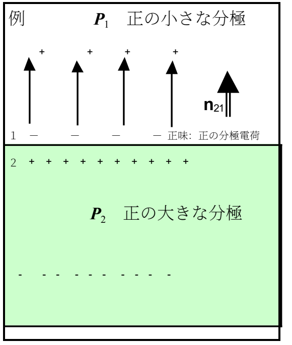

图示：上侧介质1有较小的正向极化 $P_1$，下侧介质2有较大的正向极化 $P_2$；界面留下净正极化电荷，$n_{21}$ 向上。

介质1中的 $q$ 所诱导的 $\sigma_{\mathrm{pol}}$，在两侧产生势与场；介质1内总场是 $q$ 与面电荷贡献之和。

#### 镜像电荷的概念

求两侧的势与场，归结为求满足边界条件的解。将镜像放在对称位置，调节电荷大小以满足条件。最简单的是点电荷 $q$ 离平金属面 $d$，在另一侧 $-d$ 放 $-q$，对称性保证中间金属面电场垂直，因此取其为镜像。作者指出金属球面、抛物面也可使用镜像法；求带边界条件的波动、扩散方程时也可用镜像源。

数学上，有真电荷时求泊松方程，无真电荷时求拉普拉斯方程；也可看成组合点电荷格林函数以消去边界。点电荷、点光源、点热源便于用直观作半定量判断，故尝试用点源代替难以把握的分布式边界源。但镜像法不是总能用；虚拟电荷只是像“镜中世界”般赋予直观形象。复杂边界通常须改用有限元、边界元等数值法。

本问题的极化面电荷密度，cgs esu中为

$$\sigma_{\mathrm{pol}}=-\frac q{2\pi}\frac{\varepsilon_2-\varepsilon_1}{\varepsilon_1(\varepsilon_2+\varepsilon_1)}\frac d{(\rho^2+d^2)^{3/2}},\tag{B.5a}$$

MKSA中为

$$\sigma_{\mathrm{pol}}=-\frac q{2\pi}\frac{\varepsilon_2-\varepsilon_1}{(\varepsilon_1/\varepsilon_0)(\varepsilon_2+\varepsilon_1)}\frac d{(\rho^2+d^2)^{3/2}}.\tag{B.5b}$$

反过来求此面电荷产生的场，可证明它既满足边界条件，又等价于介质1侧采用全空间 $\varepsilon_1$ 的 $q,q'$ 体系、介质2侧采用全空间 $\varepsilon_2$ 的替换电荷 $q''$ 体系。

<!-- 原文定位：PDF p47附录C至p48末 -->

## 附录C：单个偶极子与自身镜像组成的偶极子对的响应（PDF p47—49）

外场对理想金属表面吸附物的影响分两方面。(1)裸表面反射必然存在，它是金属屏蔽的表现，金属内部不受电场侵入正是因此。作用于吸附物的外场是入射、反射干涉后的表面场，依赖偏振、入射角以及具体金属和实验条件。(2)吸附物响应外场后，其响应也受屏蔽：诱导偶极在金属产生面极化电荷，面电荷又在分子位置产生场，改变分子偶极，如此连续反馈。包含全部效应后的真实偶极记为 $p_1$，其净场E、D须满足边界条件。最终面电荷分布可由镜像偶极 $p_2$ 代替，形成 $p_1+p_2$ 的一对；在远大于吸附高度的距离观察，这一矢量和可视为表面上的一个偶极子。

我们用镜像替代面电荷计算屏蔽，真实偶极与镜像成对响应外场就足够了；界面屏蔽或反射已包含在镜像中，不能再另外加一次。按实际过程说，吸附物先受外场极化，产生的偶极再诱导界面电荷，形成屏蔽，故最终响应不同于无表面时。

先设孤立于无界面的真空时，分子受局域场有 $\boldsymbol p_1=\alpha_A\boldsymbol E_{1i}^{\mathrm{local}}$。将矢量分为平行、垂直分量，$\boldsymbol p_1=\boldsymbol p_{1,\parallel}+\boldsymbol p_{1,\perp}$；镜像分量为 $\boldsymbol p_{2,\parallel}=-k\boldsymbol p_{1,\parallel}$、$\boldsymbol p_{2,\perp}=+k\boldsymbol p_{1,\perp}$，其中

$$k=-\frac{\varepsilon_1-\varepsilon_2}{\varepsilon_1+\varepsilon_2}=\frac{\varepsilon_2-\varepsilon_1}{\varepsilon_2+\varepsilon_1}.\tag{C.1}$$

设真实偶极离界面 $d$，位置取分子电荷分布的重心。图示如下。

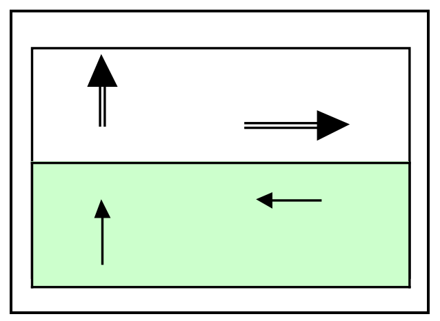

由式(A.1)求镜像在真实偶极位置的场，逐行结果为

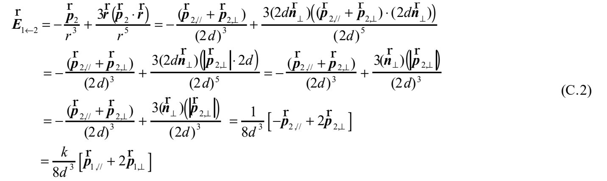

局域场关系 $\boldsymbol p_1=\alpha_A(\boldsymbol E^{\mathrm{ext}}+\boldsymbol E_{1\leftarrow2})$，写成

$$\boldsymbol p_{1,\parallel}+\boldsymbol p_{1,\perp}
=\alpha_A\left[\boldsymbol E^{\mathrm{ext}}+\frac k{8d^3}(\boldsymbol p_{1,\parallel}+2\boldsymbol p_{1,\perp})\right].\tag{C.3}$$

整理得

$$\left(1-\frac{k\alpha_A}{8d^3}\right)\boldsymbol p_{1,\parallel}
+\left(1-\frac{k\alpha_A}{4d^3}\right)\boldsymbol p_{1,\perp}
=\alpha_A(\boldsymbol E_\parallel^{\mathrm{ext}}+\boldsymbol E_\perp^{\mathrm{ext}}).\tag{C.4}$$

这似乎等价于界面使表观分子极化率具有各向异性：

$$\alpha_{A,\parallel}=\frac{\alpha_A}{1-k\alpha_A/(8d^3)},\qquad
\alpha_{A,\perp}=\frac{\alpha_A}{1-k\alpha_A/(4d^3)}.\tag{C.5}$$

> **读式说明（译者）：** 本附录的k是以垂直镜像分量定义的同一参数，平行分量另带负号；不与第4部分按分量各定义一次的k直接混用。式(C.2)原图中单位法向、矢量与标量的排印保留，最终分量关系按原式展示。

<!-- 原文定位：PDF p49首至附录D前 -->

远处观察吸附物的诱导偶极，看到的是包括镜像的合偶极：

$$\begin{aligned}\boldsymbol P&=\boldsymbol p_1+\boldsymbol p_2=(1-k)\boldsymbol p_{1,\parallel}+(1+k)\boldsymbol p_{1,\perp}\\
&=\frac{(1-k)\alpha_A}{1-k\alpha_A/(8d^3)}\boldsymbol E_\parallel^{\mathrm{ext}}
+\frac{(1+k)\alpha_A}{1-k\alpha_A/(4d^3)}\boldsymbol E_\perp^{\mathrm{ext}}.\end{aligned}\tag{C.6}$$

金属界面取 $\varepsilon_2\to i\infty$，$k\to+1$，于是

$$\boldsymbol P=\boldsymbol p_1+\boldsymbol p_2=2\boldsymbol p_{1,\perp}
=\frac{2\alpha_A}{1-\alpha_A/(4d^3)}\boldsymbol E_\perp^{\mathrm{ext}}.\tag{C.7}$$

换言之，对s偏振入射，“任何情况下都不形成有效总偶极”。作者认为这一点一时难以确信，也不排除模型或计算错误：只有外场垂直分量产生包含自身与镜像的表观偶极。通常理想金属表面的边界条件使平行表面场消失，故不激发平行极化；这里则是即使假设存在平行场，把镜像合计后的偶极也不响应。两者同样源于屏蔽。

平行总响应为零，可理解为等量电荷反相运动、彼此抵消；但偶极阶完全屏蔽，不代表四极及更高阶也完全屏蔽，后者须吸附高度为零才可能完全消除。垂直响应分子出现 $2\alpha_A$，则因真实偶极与同向镜像上下叠加：真实电荷与极化电荷等量，外部看起来像两倍电荷在运动。

分母表示面极化电荷场增强局域场。$\alpha_A/(4d^3)$ 可能接近1，分母为零时形式上发散；若分母为负，作者戏称会出现类似“反极化”而不是反磁性，但未听说过这种情形。这源于镜像场进一步增强本体极化；在这种情况下，上述求解是否合理可疑，因此作者保留结论。

若能实验测量孤立吸附物在吸附态的极化率，应看到它与镜像成对后的净响应。但吸附也会改变电子结构，分子极化率又取决于电子组态，所以通常无法仅从实测值分离镜像贡献。

> **适用范围说明（译者）：** 此处的远处合偶极近似、理想金属极限以及分母接近零时作者自身的保留意见，均为结论的一部分。未把形式上的发散或负分母当作已经确认的物理不稳定性。

<!-- 原文定位：PDF p49附录D至p51式D.1b -->

## 附录D：三层体系中的镜像电荷（PDF p49—53）

与单个界面分隔两种介质相比，夹有有限厚度介质的多层体系更复杂。像在两面半透镜之间看自己的像，镜像电荷会无限延续。但其基本思路与光的反射、折射很好地对应，可用Born与Wolf光学教材中的矩阵法。

这里讨论介质1、2间夹厚度 $h$、介电常数 $\varepsilon^*$ 的薄膜。分别考虑点电荷在介质1和薄膜内，以便用于光在膜内生成的和频过程。

因为有两个界面，一个界面面极化所对应的镜像，其用于膜内的部分又在另一界面产生面极化；后者在膜及外侧介质再产生镜像，膜内镜像又返回影响另一界面。这是在薄膜两面间不断“传接球”。介质1/膜记界面1，膜/介质2记界面2。

#### 三层体系之一：点电荷在介质1中，距薄膜 $d$

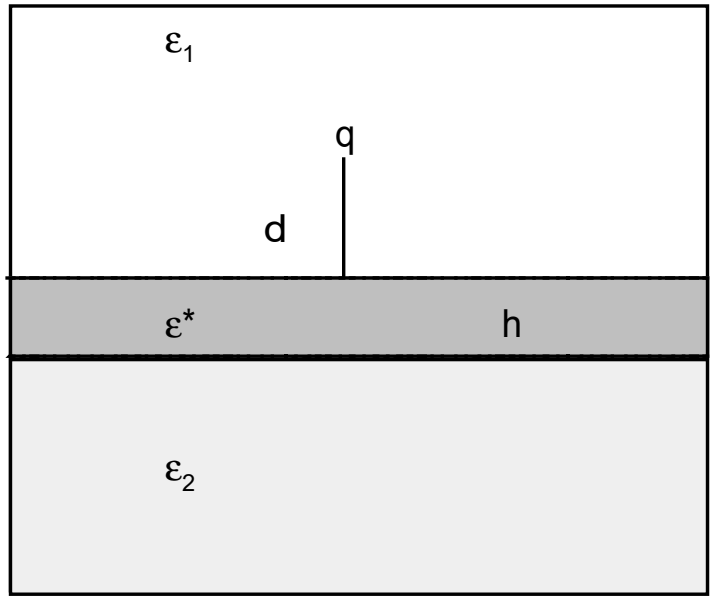

1. $q$ 在界面1产生面极化 $\sigma_{\mathrm{pol}}(1)$，其等效镜像对介质1为 $q'$，对膜为 $q''$。
2. $q''$ 在界面2产生 $\sigma_{\mathrm{pol}}(2)$，其等效电荷对膜为 $q_1^*$，对介质2为 $q_1^{**}$。
3. $q_1^*$ 又在界面1产生 $\sigma'_{\mathrm{pol}}(1)$，对应膜内的 $q_2'$ 和介质1的 $q_2''$。
4. $q_2'$ 在界面2再产生 $\sigma'_{\mathrm{pol}}(2)$，对应膜内的 $q_3^*$ 和介质2的 $q_3^{**}$。

如此无限继续。$z$ 轴垂直界面，以界面1为 $z=0$；定义

$$\alpha_{12}=\frac{\varepsilon_1-\varepsilon^*}{\varepsilon_1+\varepsilon^*},\qquad
\alpha_{21}=\frac{\varepsilon^*-\varepsilon_1}{\varepsilon_1+\varepsilon^*},\qquad
\alpha_{23}=\frac{\varepsilon^*-\varepsilon_2}{\varepsilon_2+\varepsilon^*},\tag{D.1a}$$
$$\beta_{12}=\frac{2\varepsilon^*}{\varepsilon_1+\varepsilon^*},\qquad
\beta_{21}=\frac{2\varepsilon_1}{\varepsilon_1+\varepsilon^*},\qquad
\beta_{23}=\frac{2\varepsilon_2}{\varepsilon_2+\varepsilon^*}.\tag{D.1b}$$

> **局部记号说明（译者）：** 本附录α、β是界面电荷反射/透射的代数系数，不是分子极化率、超极化率。$\varepsilon^*$ 是薄膜介电常数的名称，星号在此不表示复共轭；电荷上的单星、双星、撇号也只是不同镜像序列的标签。

<!-- 原文定位：PDF p51式D.2a至p52式D.4b -->

下面将电荷的 $z$ 坐标写在括号内，列出真实及逐次诱导镜像电荷的大小。为保留全部撇号、下标和幂次，序列采用原式图。

**用于计算介质1（$\varepsilon_1$）内静电势与场的电荷：**

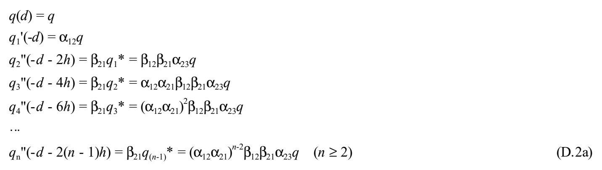

当 $h\to0$、即膜厚为零时，镜像电荷总和回到无薄膜时的式子：

$$q^*(-d)=\frac{\varepsilon_1-\varepsilon_2}{\varepsilon_1+\varepsilon_2}q.\tag{D.2b}$$

**用于计算介质2（$\varepsilon_2$）内静电势与场的电荷：**

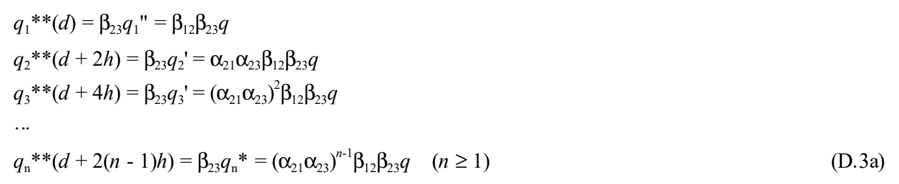

当 $h\to0$，镜像总和也回到无薄膜时：

$$q^*(d)=\frac{2\varepsilon_2}{\varepsilon_1+\varepsilon_2}q.\tag{D.3b}$$

**用于计算薄膜（$\varepsilon^*$）内部静电势与场的电荷：**

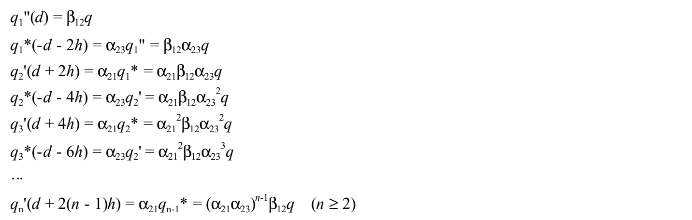
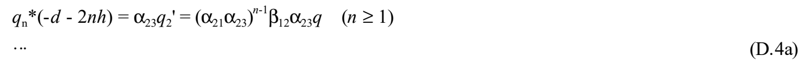

当 $h\to0$，总和在界面上下等距离处给出大小不同的镜像电荷：

$$q^*(+d)=\frac{2(\varepsilon^*+\varepsilon_2)}{\varepsilon_1+\varepsilon_2}q,\qquad
q^*(-d)=\frac{2(\varepsilon^*-\varepsilon_2)}{\varepsilon_1+\varepsilon_2}q.\tag{D.4b}$$

> **原文疑点（Q270，译者）：** (D.2a)反复乘积原印 $\alpha_{12}\alpha_{21}$，与膜内往返所用的 $\alpha_{21}\alpha_{23}$ 不同；(D.3a)通项中的星号、(D.4a)若干下标亦需核验。原式图及零厚度极限照录，不以极限结果反推修改序列。

<!-- 原文定位：PDF p52三层体系之二至p53附录E前 -->

#### 三层体系之二：点电荷在膜内，距界面1为 $d$

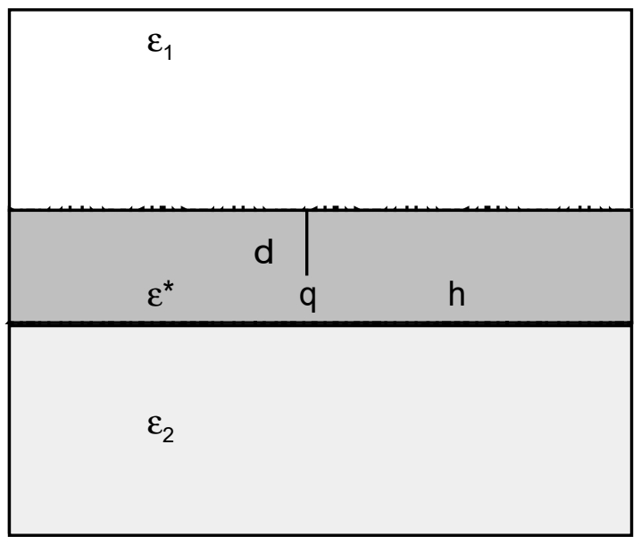

分别对 $q$ 在两个界面产生的面极化作同样展开，虽更复杂，思考步骤不变，故只列结果。

**决定介质1内势与场的镜像电荷：**

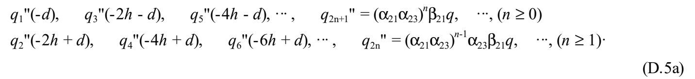

$h\to0$ 时，界面上下等距离处的镜像总和为

$$q^*(+d)=\frac{2\varepsilon_1(\varepsilon^*-\varepsilon_2)}{\varepsilon^*(\varepsilon_1+\varepsilon_2)}q,\qquad
q^*(-d)=\frac{2\varepsilon_1(\varepsilon^*+\varepsilon_2)}{\varepsilon^*(\varepsilon_1+\varepsilon_2)}q.\tag{D.5b}$$

**决定介质2内势与场的镜像电荷：**

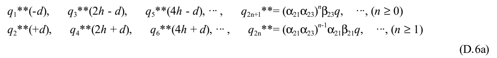

$h\to0$ 时，界面上下等距离处的总和为

$$q^*(+d)=\frac{2\varepsilon_2(\varepsilon^*-\varepsilon_1)}{\varepsilon^*(\varepsilon_1+\varepsilon_2)}q,\qquad
q^*(-d)=\frac{2\varepsilon_2(\varepsilon^*+\varepsilon_2)}{\varepsilon^*(\varepsilon_1+\varepsilon_2)}q.\tag{D.6b}$$

**决定薄膜内势与场的镜像电荷：**

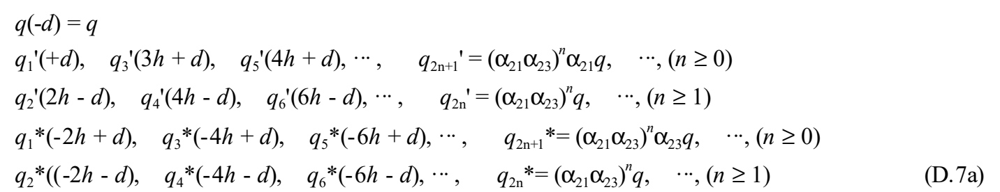

$h\to0$ 时，界面上下等距离处的总和为

$$q^*(+d)=\frac{2[(\varepsilon^*)^2-\varepsilon_1\varepsilon_2]}{\varepsilon^*(\varepsilon_1+\varepsilon_2)}q,\qquad
q^*(-d)=\frac{2(\varepsilon^*-\varepsilon_1)(\varepsilon^*-\varepsilon_2)}{\varepsilon^*(\varepsilon_1+\varepsilon_2)}q.\tag{D.7b}$$

> **原文疑点（Q271，译者）：** (D.6a)偶数列通项原印 $\beta_{21}$，(D.6b)第二式原用 $\varepsilon^*+\varepsilon_2$；(D.7a)位置序列原有 $3h+d$，星号和双星也有混用。保留原式图及原极限式，未据对称性改下标。固定 $d$ 的膜内电荷同时令 $h\to0$ 的极限路径，原文也未说明，不能当成已验证的几何极限。

<!-- 原文定位：PDF p53附录E至p54首级数和 -->

## 附录E：数学公式（PDF p53—54）

### δ函数

$$\delta(ax)=\frac{\delta(x)}{|a|},$$
$$\delta(x^2-a^2)=\frac{\delta(x-a)+\delta(x+a)}{2|a|},$$
$$\delta(x)=\lim_{\alpha\to0}\left\{\frac1\pi\frac\alpha{\alpha^2+x^2}\right\},$$
$$\delta(-x)=\delta(x),\qquad x\delta(x)=0.$$

定义

$$\delta_+(x)=\delta_-^*(x)=\frac1{2i\pi}\lim_{\alpha\to0}\left\{\frac1{x-i\alpha}\right\},$$

则

$$\delta_+(x)+\delta_-(x)=\delta(x),$$
$$\delta_+(x)-\delta_-(x)=\frac1{i\pi}\lim_{\alpha\to0}\frac x{\alpha^2+x^2},$$
$$\int\delta(x)\,dx=1,\qquad\int F(x)\delta(x-a)\,dx=F(a).$$

> **适用条件说明（Q272，译者）：** 原式未注明 $a\ne0$、极限从 $\alpha>0$ 侧取、积分区间及主值/分布意义。这些是使用公式时须核对的条件；正文依原式保留，未给原式补上未确认的假定。此处星号在作者定义中是复共轭，与附录D标签含义不同。

### 级数求和

$$1+r+r^2+\cdots+r^n=\frac{1-r^{n+1}}{1-r}.$$

> **读式说明（译者）：** 此有限等比和式按原文列出，使用时须排除 $r=1$ 的分母形式；该情形直接为 $n+1$。这只是适用条件提示，未修改原式。

<!-- 原文定位：PDF p54附录F至Clausius关系标题前 -->

## 附录F：术语说明（PDF p54—55）

原文注明：摘自培风馆《物理学辞典》。以下保留其词条内容。

### 自洽场：SCF（self-consistent field）

这是相互作用多粒子体系理论中的概念。存在粒子间相互作用时，理论处理通常十分困难。最简单、常用的近似，是用单粒子势表示相互作用的效果，再自洽地确定此势；这样得到的势称自洽场。这一方法用于许多遇到多体问题的领域。

求自洽场的迭代并不保证收敛，是否收敛与初始状态有关。即使同一初值，与其直接使用前次结果，不如适当混合前次与前前次结果，有时能让原本不收敛的计算收敛；不同混合方式还会显著改变收敛速度。

### 平均场近似：MFA（mean field approximation），亦称分子场近似（molecular field approximation）

求多体问题最简单的近似方法：将问题转为粒子在平均势中运动的单体问题，并自洽确定该势（参见自洽场）。

### 相干势近似：CPA

原英文标题为 *coherent field approximation*。

这是P. Soven于1967年为研究置换型固溶体电子结构而引入的平均场理论，简称CPA。不仅适用于电子，也可用于无序体系的声子、弗伦克尔激子、自旋波等元激发。其思路与磁性等协同现象中的分子场近似相同。考虑二元合金 $A_xB_{1-x}$，$x$ 为A的归一化浓度。

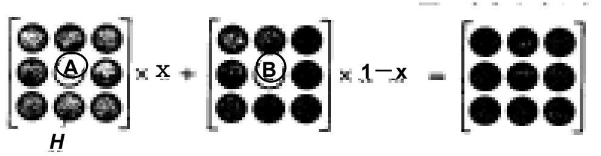

关注一个晶格点，把周围视为有效哈密顿量 $H$ 描述的均匀有效介质。中心由A或B占据时，电子受 $H$ 与该原子势的差而散射。令A的散射幅度乘浓度 $x$，加上B的散射幅度乘浓度 $1-x$，总和为零，由此自洽确定 $H$。CPA相较刚性能带模型有更明确的理论基础，被用于许多体系，推动了无序体系物理的发展。

> **原文疑点（Q273，译者）：** 原词条英文标题写 *coherent field approximation*，而正文及通常的CPA展开为 *coherent potential approximation*；这里保留原标题拼写并注明差异，中文暂用“相干势近似”。词条的1967年与正文“1950年代？”也分别保留，不替原作者改写史述。

<!-- 原文定位：PDF p54末Clausius标题至p55全稿末 -->

### 克劳修斯—莫索蒂关系（Clausius–Mosotti’s relation）

若局域场 $F$ 满足洛伦兹式 $F=E+P/(3\varepsilon_0)$，其中 $E$ 是介电质中的宏观场、$P$ 为电极化，则物质介电常数 $\varepsilon$ 与分子极化率 $\alpha$ 有

$$\frac{\varepsilon-1}{\varepsilon+2}=\frac1{3\varepsilon_0}N\alpha.$$

$N$ 是单位体积的分子数，此式称克劳修斯—莫索蒂关系。若 $\varepsilon$ 为光学介电常数（光频范围的介电常数），两边乘 $M/\rho$，得

$$\frac{n^2-1}{n^2+2}\frac M\rho=\frac1{3\varepsilon_0}N_A\alpha\equiv R_0.$$

$n,M,\rho$ 分别为折射率、分子量、密度，$N_A$ 为阿伏伽德罗常数。此式称洛伦兹—洛伦茨关系，$R_0$ 称摩尔折射度。

> **单位提示（译者）：** 本词条左端的ε须结合相对介电常数理解，右端保留真空介电常数ε₀；不把它与附录B采用绝对介电常数的MKSA公式无说明地混用。

### 局域场（local field）

均匀极化介电质内，作用于原子的场 $\boldsymbol F$ 称局域场，通常不同于由介电质外部电荷产生的外场 $\boldsymbol E_0$。它是外场与介电质极化场之和；后者再分为三个场：

$$\boldsymbol F=\boldsymbol E_0+\boldsymbol E_1+\boldsymbol E_2+\boldsymbol E_3.$$

$\boldsymbol E_1$ 为介电质外表面极化电荷产生的退极化场，$E_{1i}=-N_iP_i/\varepsilon_0$（$i=x,y,z$；$N_i$ 为退极化因子，$P$ 为电极化，ε₀为真空介电常数）。$\boldsymbol E_2$ 为以所考察原子为中心挖球形空腔时，内表面极化电荷产生的场，$\boldsymbol E_2=\boldsymbol P/(3\varepsilon_0)$。$\boldsymbol E_3$ 为没有挖空时，该球形区域内各原子偶极矩的场。同向偶极位于简单立方晶格，或各向同性分布时，$\boldsymbol E_3=0$。

介电质内部宏观场既不同于外场也不同于局域场，定义为

$$\boldsymbol E=\boldsymbol E_0+\boldsymbol E_1,$$

因此

$$\boldsymbol F=\boldsymbol E+\boldsymbol E_2+\boldsymbol E_3.$$

各向同性或简单立方晶体（$\boldsymbol E_3=0$）中，

$$\boldsymbol F=\boldsymbol E+\frac{\boldsymbol P}{3\varepsilon_0},$$

称为洛伦兹公式。一般晶体写为

$$\boldsymbol F=\boldsymbol E+\gamma\boldsymbol P,$$

$\gamma$ 称局域场因子。宏观场 $\boldsymbol E$ 包含退极化场 $\boldsymbol E_1$，所以 $\boldsymbol F$ 依赖样品形状。

> **符号说明（译者）：** 此末式γ是局域场因子，不是本稿前面的阻尼率，也不是分子二阶超极化率；本词条ρ是密度，不是密度矩阵。原文英文人名拼法随词条保留。

<!-- 6.1底本PDF p55正文与附录全部译出；原文未决项保留，核查状态见翻译管理。 -->
