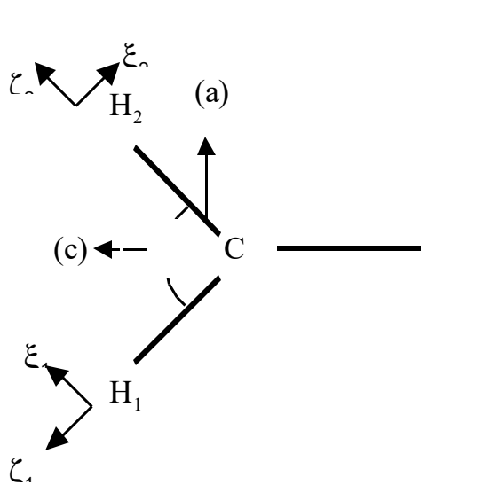

# 4.1 CH、CH₂、CH₃基团CH伸缩振动的和频极化率

> 原作：广瀬千秋（广濑千秋）
> 中文翻译：章力；本轮校订日期：2026-10-20。
> 底本：`日语原版/Chapter4/chap4-1.pdf`，共33页。B249—B276完成全部33页的本轮译校与公式、表格转写；原文疑点Q122—Q137保留原式并就地说明，未采用原文公式修正。

## 原文目录

| 内容 | 原目录页码 |
|---|---|
| 要点 | 1 |
| 1. 振动偶极矩、拉曼张量、和频张量 | 4 |
| 第1部分：振动偶极矩 | 6 |
| 第1部分：拉曼张量 | 7 |
| 第1部分：和频张量 | 13 |
| 2. 振动坐标的矩阵元 | 14 |
| 3. 近似的检验之一：振动频率及光谱强度 | 16 |
| 4. 近似的检验之二：拉曼光谱强度与退偏比 | 18 |
| 附录1：谐振子与矩阵元 | 22 |
| 附录2：内部正交坐标、内坐标、对称坐标、简正坐标 | 24 |
| 附录3：GF矩阵法 | 28 |
| 附录4：CH₃基团的C₃ᵥ对称性破缺时的处理 | 31 |

> **译者注（目录定位）：** 原目录附录4页码保留为31；实际标题从PDF p30下部开始。以上为原目录的翻译及页面定位，后续正文尚须分批对照，不能据目录将整节视为已核验。

## 阅读导引

1. 要点（p1—4前部）：列CH、CH₂、CH₃的伸缩响应、质量因子、跃迁矩阵元、强度比，以及各基团的相对张量分量；先注意所采用的两项近似。
2. 第1部分（p4—14前部）：建立质量调整简正坐标，推导振动偶极矩，再分别以投影和矩阵变换求拉曼张量，最后连接和频张量。各处原符号、正负号及归一化差异须连同译者注阅读。
3. 第2部分（p14—16前部）：区分非简并与二重简并模式，说明l态加权及吸收/拉曼与单个和频张量分量的不同计数，列同位素质量及G数值。
4. 第3部分（p16—18前部）：以力常数、频率和红外相对强度检验相同局部键近似，说明模式混合的局限。
5. 第4部分（p18—22前部）：由拉曼不变量求强度与退偏比，再用参数表和实验数据讨论r的估计；原表数值和公式未必完全一致，疑点保留。
6. 附录1（p22—24前部）：谐振子、无量纲坐标、跃迁矩阵元与非谐耦合。
7. 附录2（p24—28前部）：依次区分实验室系、质心系、分子固定直角系、内坐标、对称坐标及简正坐标，并说明Eckart约束。
8. 附录3（p28—30前部）：G/F矩阵的动能、势能与特征值关系，以及内坐标元素和经验力场。
9. 附录4（p30—33）：表面作用使CH₃对称性降低时的模式混合、矩阵展开和L变换。

建议先确认局部坐标、模式、质量归一化及张量分量，再比较强度。全节译校完成不表示原文的定义冲突、公式和数据疑点已解决；Q122—Q137均有就地说明。

## 要点

考虑CH键的伸缩振动，取CH键轴为$c$轴。CH键的偶极矩只有$c$轴分量$\mu_c$；分子极化率张量$\alpha$除$c$轴分量$\alpha_{cc}$外，还具有$a$轴和$b$轴分量，即垂直于CH键轴的分量，并有$\alpha_{aa}=\alpha_{bb}$。设可写成$\alpha_{aa}=r\alpha_{cc}$，将$\mu_c$、$\alpha_{cc}$和$\alpha_{aa}$对CH键的伸缩振动坐标$r_{\mathrm{CH}}$作泰勒展开，并将其一阶导数系数的乘积定义为：

$$
\beta_0=
\left(\frac{\partial\alpha_{cc}}{\partial r_{\mathrm{CH}}}\right)_0
\left(\frac{\partial\mu_c}{\partial r_{\mathrm{CH}}}\right)_0
\tag{0.1a}
$$

$$
r\beta_0=
\left(\frac{\partial\alpha_{aa}}{\partial r_{\mathrm{CH}}}\right)_0
\left(\frac{\partial\mu_c}{\partial r_{\mathrm{CH}}}\right)_0
\tag{0.1b}
$$

将CH₂基和CH₃基视为若干CH键在一点相连，并采用下列假设：（1）作为简正振动的CH伸缩模式不包含HCH弯曲等其他内振动坐标，即高频隔离（high-frequency isolation）是良好近似；（2）在一点相连也不会使CH键周围的电子云产生显著畸变。在这些条件下，各基团CH伸缩模式的和频张量满足下列关系。（正文也给出了在考虑成键使CH键周围轴对称性破缺时仍可适用的推导。）

以下表达式对振动采用算符形式。

### CH基（取CH键轴为$c$轴）

$$
\begin{aligned}
\beta_{ccc}&=G_{\mathrm{CH}}\beta_0(Q_{\mathrm{CH}}^2)_{v+1,v},\\
\beta_{aac}=\beta_{bbc}&=G_{\mathrm{CH}}r\beta_0(Q_{\mathrm{CH}}^2)_{v+1,v}.
\end{aligned}
\tag{0.2}
$$

$$
G_{\mathrm{CH}}=\frac{1}{m_C}+\frac{1}{m_H}
=\frac{m_C+m_H}{m_Cm_H}
$$

$$
(Q_{\mathrm{CH}}^2)_{v+1,v}
\equiv[\langle v+1|Q_{\mathrm{CH}}|v\rangle]^2
=\frac{h}{2\pi c\omega_{\mathrm{CH}}}\frac{v+1}{2}
$$

$$
r=\alpha_{aa}/\alpha_{cc},\qquad
\left(\text{参见退偏比：}\quad
\rho=\frac{3}{4}\frac{1}{1+\frac{5}{4}\left(\frac{1+2r}{1-r}\right)^2}\right)
$$

像vinyl-CH那样，CH基相对于分子轴倾斜时，需要作相应的坐标变换。

> **译者注（局部符号）：** $\alpha$在这里为分子极化率（线性场响应），$\beta$为一阶超极化率（二阶场响应），不是拉丁字母$b$。$\beta_0$按作者的导数乘积定义保留，不补入其他章节的频率分母或归一化因子。$r$是分子极化率分量比，$r_{\mathrm{CH}}$是伸缩坐标，二者不可混同。$(Q_{\mathrm{CH}}^2)_{v+1,v}$在本页明确指跃迁矩阵元的平方，不擅自改读为平方算符$Q_{\mathrm{CH}}^2$的非对角矩阵元。$\omega_{\mathrm{CH}}$与$c$的原组合保留，具体频率单位约定待后文定义核验。

### CH₂基

沿HCH夹角的角平分线，从C原子指向两个H原子中点的方向取$c$轴，在HCH平面内取$a$轴。（$c$轴垂直于HCH平面。）

> **译者注（原文疑点Q122，PDF p2）：** 原文先将$c$轴定义为HCH夹角的角平分线，随后又称$c$轴垂直于HCH平面，二者不一致。此处均按原文保留；候选为末句的$c$应为$b$，须结合后续坐标变换和张量定义核验，尚未采用。旧译另行混淆了$a$、$c$方向，现已恢复底本的两句描述，不将候选写为确定约定。

设HCH夹角为$\alpha$。

#### 对称伸缩振动：$a_1$模式

$$
\begin{aligned}
\beta_{ccc}
&=2G_{a1}\left[\frac{(1+r)+(1-r)\cos\alpha}{2}\cos(\alpha/2)\right]
\beta_0(Q_{a1}^2)_{v+1,v},\\
\beta_{aac}
&=2G_{a1}\left[\frac{(1+r)-(1-r)\cos\alpha}{2}\cos(\alpha/2)\right]
\beta_0(Q_{a1}^2)_{v+1,v},\\
\beta_{bbc}
&=2G_{a1}[r\cos(\alpha/2)]\beta_0(Q_{a1}^2)_{v+1,v}.
\end{aligned}
\tag{0.3}
$$

$$
G_{a1}=\frac{1+\cos\alpha}{m_C}+\frac{1}{m_H}
=\frac{m_C+m_H(1+\cos\alpha)}{m_Cm_H}
$$

对于亚甲基（$\alpha=109.5^\circ$）：

$$
G_{a1}=(3m_C+2m_H)/(3m_Cm_H)
=\frac{1}{m_H}+\frac{2}{3}\frac{1}{m_C}
$$

对于乙烯基CH₂（$\alpha=120^\circ$）：

$$
G_{a1}=(2m_C+m_H)/(2m_Cm_H)
=\frac{1}{m_H}+\frac{1}{2}\frac{1}{m_C}
$$

$$
(Q_{a1}^2)_{v+1,v}
\equiv[\langle v+1|Q_{a1}|v\rangle]^2
=\frac{h}{2\pi c\omega_{a1}}(v+1)
$$

参见退偏比：

$$
\rho=\frac{3}{4}\frac{1}{1+\frac{15}{2}\left(\frac{1+2r}{1-r}\right)^2}
$$

> **译者注（记号与转录）：** 本段$\alpha$表示HCH夹角，须与前文带分量下标的分子极化率张量$\alpha$区分；$a_1$是模式标记。式(0.3)的前因子按底本为$2G_{a1}$，旧译的$\sqrt{2}$和空分母已修复，$\beta$也恢复为希腊字母。退偏比中的分量比按底本为$r$，旧译误作$\rho$已修复；$15/2$与前面CH基的$5/4$分别保留。矩阵元平方表达式也按本模式原式保留，不用CH基式中的$1/2$统一替换。原文角度值及等号照录，$109.5^\circ$为所列亚甲基角度的近似值。

#### 反对称伸缩振动：$b_1$模式
$$
\begin{aligned}
\beta_{caa}&=-2G_{b1}\left[\frac{1-r}{2}\sin\alpha\sin(\alpha/2)\right]\beta_0(Q_{b1}^2)_{v+1,v},\\
\beta_{aca}&=-2G_{b1}\left[\frac{1-r}{2}\sin\alpha\sin(\alpha/2)\right]\beta_0(Q_{b1}^2)_{v+1,v}.
\end{aligned}\tag{0.4}
$$

$$
G_{b1}=\frac{1-\cos\alpha}{m_C}+\frac1{m_H}=\frac{m_C+m_H(1-\cos\alpha)}{m_Cm_H}\,w
$$

对于亚甲基（$\alpha=109.5^\circ$）：

$$
G_{b1}=(3m_C+4m_H)/(3m_Cm_H)=\frac1{m_H}+\frac43\frac1{m_C}
$$

对于乙烯基CH₂（$\alpha=120^\circ$）：

$$
G_{b1}=(2m_C+3m_H)/(2m_Cm_H)=\frac1{m_H}+\frac32\frac1{m_C}
$$

$$
(Q_{b1}^2)_{v+1,v}\equiv[\langle v+1|Q_{b1}|v\rangle]^2=\frac{h}{2\pi c\omega_{b1}}(v+1)
$$

红外光谱强度比：

$$
(d\mu_{a1}/dr_{\mathrm{CH}})^2/(d\mu_{b1}/dr_{\mathrm{CH}})^2\approx G_{a1}\cos^2(\alpha/2)/G_{b1}\sin^2(\alpha/2)\approx0.475
$$

拉曼光谱强度比：

$$
I_{a1}/I_{b1}\approx G_{a1}[30(1+2r)^2+7(1-r)^2]/[14G_{b1}(1-r)^2]\approx0.475+2.063(1+2r)^2/(1-r)^2
$$

> **译者注（原文疑点）：** Q123：p2的G通式末尾有孤立的w字形，原样保留，未定义；候选为排版杂字，未删除。强度比原斜线串保留，需结合上下文读分组。

### CH₃基

沿C₃轴从C指向H₃取$c$轴，在三个HCX平面中的任一个平面上取$a$轴；$b$轴位于平分其余两个HCX平面的平面上。设HCX角为$\tau$。

#### 全对称伸缩振动：$a_1$模式

$$
\begin{aligned}
\beta_{ccc}&=3G_{\mathrm{sym}}\left[\frac{r+(1-r)\cos^2\tau}{2}\cos\tau\right]\beta_0(Q_{a1}^2)_{v+1,v},\\
\beta_{aac}=\beta_{bbc}&=3G_{\mathrm{sym}}\left[\frac{2r+(1-r)\sin^2\tau}{2}\cos\tau\right]\beta_0(Q_{a1}^2)_{v+1,v}.
\end{aligned}\tag{0.5}
$$

$$
G_{\mathrm{sym}}=\frac{1+2\cos\tau}{m_C}+\frac1{m_H}=\frac{m_C+m_H(1+2\cos\tau)}{m_Cm_H}=\frac1{m_H}+\frac13\frac1{m_C}
$$

$$
\begin{aligned}(Q_{\mathrm{sym}}^2)_{v+1,v}&\equiv[\langle v+1|Q_{\mathrm{sym}}|v\rangle]^2\\
&=(Q_{\mathrm{sym}}^2)_{v,v+1}\equiv[\langle v|Q_{\mathrm{sym}}|v+1\rangle]^2=\frac h{2\pi c\omega_{\mathrm{sym}}}(v+1).
\end{aligned}
$$

参见退偏比：

$$
\rho=\frac34\frac1{1+\frac{45}{4}\left(\frac{1+2r}{1-r}\right)^2}
$$

#### 简并伸缩振动：$e$模式

$$
\begin{aligned}
\beta_{caa}=\beta_{cbb}=\beta_{aca}=\beta_{bcb}
&=-3G_{\mathrm{deg}}\left[\frac{1-r}{2}\sin^2\tau\cos\tau\right]\beta_0(Q_{\mathrm{deg}}^2)_{v+1,v},\\
\beta_{aaa}=-\beta_{bba}=-\beta_{abb}=-\beta_{bab}
&=\frac32G_{\mathrm{deg}}\left[\frac{1-r}{2}\sin^3\tau\right]\beta_0(Q_{\mathrm{deg}}^2)_{v+1,v}.
\end{aligned}\tag{0.6}
$$

$$
G_{\mathrm{deg}}=\frac{1-\cos\tau}{m_C}+\frac1{m_H}=\frac{m_C+m_H(1-\cos\tau)}{m_Cm_H}=\frac1{m_H}+\frac43\frac1{m_C}
$$

$$
\begin{aligned}(Q_{\mathrm{deg}}^2)_{v+1,v}&\equiv[\langle v+1|Q_{\mathrm{deg}}|v\rangle]^2=\frac h{2\pi c\omega_{\mathrm{deg}}}(v+1)(v+2),\\
(Q_{\mathrm{deg}}^2)_{v-1,v}&\equiv[\langle v-1|Q_{\mathrm{deg}}|v\rangle]^2=\frac h{2\pi c\omega_{\mathrm{deg}}}v(v+1).
\end{aligned}
$$

以上乘入了初态$l$型二重项分裂数$v+1$作为权重。（二重简并模式$v$态的基函数由$v=1$的基函数取$v$次幂而成，有$v+1$个独立基函数，例如$E^2=A_1+E$（$v=2$）、$E^3=2E$（$v=3$）。

红外光谱强度比：

$$
(d\mu_{\mathrm{sym}}/dr_{\mathrm{CH}})^2/(d\mu_{\mathrm{deg}}/dr_{\mathrm{CH}})^2\approx G_{\mathrm{sym}}\cos^2\tau/G_{\mathrm{deg}}\sin^2\tau\approx0.913
$$

拉曼带强度比：

$$
\begin{aligned}I_{\mathrm{sym}}/I_{\mathrm{deg}}&\approx\frac{G_{\mathrm{sym}}[15(1+2r)^2+(21/4)(1-r)^2(1-3\cos^2\tau)^2]}{(63/2)G_{\mathrm{deg}}(1-r)^2\sin^2\tau(1+3\cos^2\tau)}\\&\approx0.119+0.762(1+2r)^2/(1-r)^2.
\end{aligned}
$$

> **译者注（原文疑点）：** Q123：本页τ称HCX角，后文p5又将τ称HCH角，各处保留，不统一。0.5的Q下标a1原样保留。关于简并基函数的E³=2E及矩阵元权重原叙述保留，模式计数/归一化须结合第2部分；不能把两模式权重合并到单个张量分量。

对于烷基链的基频（$v=1-0$），以甲基全对称振动为基准比较$\eta_{\mathrm{vib}}=\beta_0(Q_{\mathrm{vib}}^2)_{1,0}$，得到：

$$
\begin{aligned}\eta_{\mathrm{sym}}&=\beta_0(Q_{\mathrm{sym}}^2)_{1,0},\\
\eta_{\mathrm{deg}}&=\beta_0(Q_{\mathrm{deg}}^2)_{1,0}=2\omega_{\mathrm{sym}}/\omega_{\mathrm{deg}}\approx1.95\eta_{\mathrm{sym}},\\
\eta_{a1}&=\beta_0(Q_{a1}^2)_{1,0}=2\omega_{\mathrm{sym}}/\omega_{a1}\approx1.01\eta_{\mathrm{sym}},\\
\eta_{b1}&=\beta_0(Q_{b1}^2)_{1,0}=2\omega_{\mathrm{sym}}/\omega_{b1}\approx0.98\eta_{\mathrm{sym}}.
\end{aligned}
$$

据此可得到甲基与亚甲基的和频张量分量关系。以甲基$\beta_{aac}$为基准，记为$\beta_{aac}^*$；以下分别在各基团固定的局部坐标系中表示。

| 分量 | CH₃ | CH₂ |
|---|---|---|
| $\beta_{aac}$ | $\beta_{aac}^*$ | $-1.80\beta_{aac}^*$ |
| $\beta_{ccc}$ | $0.25\beta_{aac}^*$ | $-0.90\beta_{aac}^*$ |
| $\beta_{aaa}$ | $1.49\beta_{aac}^*$ | $-1.84\beta_{aac}^*$ |
| $\beta_{caa}$ | $-1.05\beta_{aac}^*$ | $-1.84\beta_{aac}^*$ |

类似地，对乙烯基的=CH₂与乙炔基的≡CH，以CH₂的$\beta_{aac}$（记为$\beta_{aac}^+$）为基准比较，得到下列结果。两种基团均取C=C键为$c$轴、分子平面内取$a$轴。

| =CH₂ | ≡CH |
|---|---|
| $\beta_{aac}=\beta_{aac}^+$ | $\beta_{aac}=-0.51\beta_{aac}^+$ |
| $\beta_{ccc}=0.33\beta_{aac}^+$ | $\beta_{acc}=\beta_{cac}=\beta_{cca}=-0.30\beta_{aac}^+$ |
| $\beta_{aaa}=\beta_{caa}=1.04\beta_{aac}^+$ | $\beta_{ccc}=-0.17\beta_{aac}^+$ |
|  | $\beta_{aaa}=-0.89\beta_{aac}^+$ |
|  | $\beta_{aca}=\beta_{caa}=-0.51\beta_{aac}^+$ |

> **译者注（原文疑点）：** Q123：ηdeg/ηa1/ηb1的等号链将有量纲量与频率比相连，候选为在频率比后补ηsym或视作比值定义，未采用；末尾已写的ηsym照录。≡CH处仍写取C=C键，原层次/键名保留，候选为相应分子轴待核。星号和加号在此是基准标记，不解释为共轭或传播方向。

## 1. 振动偶极矩、拉曼张量、和频张量
CH键伸缩引起的偶极矩和光散射张量变化分别写为$(d\mu/dr)_0\Delta r=\mu_{\mathrm{CH}}\Delta r$和$(d\alpha/dr)_0\Delta r=\alpha_0\Delta r$，其中$r$表示CH键伸缩。为统一处理甲基、亚甲基和次甲基，使用附录2c的质量调整（mass adjusted）坐标较方便。再假设不与弯曲等振动耦合。（即使在谐振子近似内，原则上仍有耦合。尤其HCH弯曲、HCC弯曲、CC伸缩、CO伸缩等频率接近的模式会强烈混合，论文的归属通常只标贡献最大的振动模式，可通过计算势能分布（potential energy distribution，原缩写PES）估计。）

在这些近似下，CH伸缩独立于其他振动构成简正坐标，CH₃、CH₂和CH的局部对称坐标与简正坐标一致。因此CH可按双原子分子处理，其质量调整简正坐标为：

由经典力学可知，一组谐振子的总能量可写成$\sum[(dQ/dt)^2+\lambda Q^2]$。

$$
Q_{\mathrm{CH}} = \frac{1}{G_{\mathrm{CH}}} \Delta r_{\mathrm{CH}} \tag{1.1}
$$

其中$G_{\mathrm{CH}}$如下定义；对双原子分子它是约化质量的倒数。

$$
G_{\mathrm{CH}} = (m_C + m_H)/m_C m_H = 1/m_H + 1/m_C \tag{1.2}
$$

以$K$为弹簧常数，势能为：

$$
2V = K(\Delta r)^2 = K G_{\mathrm{CH}} Q_{\mathrm{CH}}^2 \tag{1.3}
$$

令$F_{\mathrm{CH}}=K$，则$\lambda_{\mathrm{CH}}=F_{\mathrm{CH}}G_{\mathrm{CH}}$，由$\nu\ (\mathrm{cm}^{-1})=\sqrt{\lambda_{\mathrm{CH}}}/(2\pi c)$可知其正比于固有振动频率的平方。

CH₂的两个CH伸缩位移为$\Delta r_1$、$\Delta r_2$，其对称和反对称模式为：

$$
Q_{a1} = \frac{\Delta r_1 + \Delta r_2}{\sqrt{2}}\frac{1}{\sqrt{G_{a1}}} \tag{1.4a}
$$

$$
Q_{b1} = \frac{\Delta r_1 - \Delta r_2}{\sqrt{2}}\frac{1}{\sqrt{G_{b1}}} \tag{1.4b}
$$

HCH角为$\alpha$时：

$$
G_{a1} = [m_C + m_H(1 + \cos\alpha)]/m_C m_H = 1/m_H + (1 + \cos\alpha)/m_C \tag{1.5a}
$$

$$
G_{b1} = [m_C + m_H(1 - \cos\alpha)]/m_C m_H = 1/m_H + (1 - \cos\alpha)/m_C \tag{1.5b}
$$

势能如下，使用正四面体角的$\cos\alpha=-1/3$：

$$
2V = K[(\Delta r_1)^2 + (\Delta r_2)^2] + 2K'\Delta r_1\Delta r_2 = (K + K' + 4F/3)G_{a1}Q_{a1}^2 + (K - K' - 0.2F/3)G_{b1}Q_{b1}^2 \tag{1.6}
$$

这里$F$是所谓Shimanouti field中引入的H···H排斥项力常数，取$F^{\prime\prime}=-0.1F$，并使用正四面体角。因此：

$$
\lambda_{a1}=(K+K^{\prime}+4F/3)G_{a1},\qquad\lambda_{b1}=(K-K^{\prime}-0.2F/3)G_{b1}
$$

CH₃的三个CH伸缩位移为$\Delta r_1,\Delta r_2,\Delta r_3$，全对称模式与两个简并模式如下。选取$ac$平面包含H₁原子。

$$
Q_{\mathrm{sym}} = \frac{\Delta r_1 + \Delta r_2 + \Delta r_3}{\sqrt{3}}\frac{1}{\sqrt{G_{\mathrm{sym}}}} \tag{1.7a}
$$

$$
Q_{\mathrm{deg},a} = \frac{2\Delta r_1 - \Delta r_2 - \Delta r_3}{\sqrt{6}}\frac{1}{\sqrt{G_{\mathrm{deg}}}} \tag{1.7b}
$$

$$
Q_{\mathrm{deg},b} = \frac{\Delta r_2 - \Delta r_3}{\sqrt{2}}\frac{1}{\sqrt{G_{\mathrm{deg}}}} \tag{1.7c}
$$

$$
G_{\mathrm{sym}} = [m_C + m_H(1 + 2\cos\tau)]/m_C m_H = 1/m_H + (1 + 2\cos\tau)/m_C \tag{1.8a}
$$

$$
G_{\mathrm{deg}} = [m_C + m_H(1 - \cos\tau)]/m_C m_H = 1/m_H + (1 - \cos\tau)/m_C \tag{1.8b}
$$

这里$\tau$为HCH键角，因此正四面体角下$\cos\tau=-1/3$。势能为：

$$
\begin{aligned}
2V &= K[(\Delta r_1)^2 + (\Delta r_2)^2 + (\Delta r_3)^2] + 2K'[\Delta r_1\Delta r_2 + \Delta r_2\Delta r_3 + \Delta r_1\Delta r_3] \\
   &= (K + 2K' + 2.03F)G_{\mathrm{sym}}Q_{\mathrm{sym}}^2 + (K - K' - 0.07F)G_{\mathrm{deg}}Q_{\mathrm{deg}}^2 
\end{aligned}
\tag{1.9}
$$

$$
\lambda_{\mathrm{sym}}=(K+2K^{\prime}+2.03F)G_{\mathrm{sym}},\quad\lambda_{\mathrm{deg}}=(K-K^{\prime}-0.07F)G_{\mathrm{deg}}
$$

> **译者注（原文疑点）：** Q124：1.1原分母为GCH，而p7重引该式时写√GCH；两处分别保留，候选1.1补根号未采用。总能量式原未列1/2。1.6、1.9首个势能式未显式列后式排斥项而等号连接，原样保留，未补项。τ在此按HCH角定义，关联Q123。

### 振动偶极矩

即使像CH₂、CH₃那样有多个CH键从同一C原子伸出，也近似认为伸缩诱导的偶极矩由沿各CH键的分量构成，其大小与方向不因其他CH基存在而改变。再考虑键角，计算沿简正振动方向的分量。为便于比较各基团，使用具有$[h/(4\pi^2c\omega)]^{1/2}$量纲的$Q$坐标。

$$
\mu_{\mathrm{vib}} = (d\mu_{\mathrm{CH}}/dr)_0(\Delta r) = (d\mu_{\mathrm{CH}}/dr)_0 \sqrt{G_{\mathrm{CH}}}\, Q_{\mathrm{CH}} \tag{1.10}
$$

CH₂的位移矢量在直角坐标系中的分量为：

$$
[\Delta r_1\sin(\alpha/2),0,\Delta r_1\cos(\alpha/2)],\quad[-\Delta r_2\sin(\alpha/2),0,\Delta r_2\cos(\alpha/2)]
$$

考虑$Q_{a1}$沿$c$轴、$Q_{b1}$沿$a$轴振动，以$\mathbf e_a,\mathbf e_c$为对应单位矢量，得到：

$$
\begin{aligned}
\boldsymbol{\mu}_{\mathrm{vib}} &= (d\mu_{\mathrm{CH}}/dr)_0(\Delta\mathbf{r}_1 + \Delta\mathbf{r}_2) \\
&= (d\mu_{\mathrm{CH}}/dr)_0[\mathbf{e}_a(\Delta r_1 - \Delta r_2)\sin(\alpha/2) + \mathbf{e}_c(\Delta r_1 + \Delta r_2)\cos(\alpha/2)] \\
&= (d\mu_{\mathrm{CH}}/dr)_0[\sqrt{2G_{a1}}\cos(\alpha/2)\,Q_{a1} + \sqrt{2G_{b1}}\sin(\alpha/2)\,Q_{b1}] 
\end{aligned}
\tag{1.11}
$$

即：

$$
\partial\mu/\partial Q_{b1} = (d\mu_{\mathrm{CH}}/dr)_0 \sqrt{2G_{b1}}\sin(\alpha/2) \tag{1.12}
$$

亚甲基有$\cos(\alpha/2)=\sqrt{1/3}$、$\sin(\alpha/2)=\sqrt{2/3}$；乙烯基CH₂有$\cos(\alpha/2)=-1/2$、$\sin(\alpha/2)=\sqrt3/2$。

同理CH₃有：

$$
\begin{aligned}
\boldsymbol{\mu}_{\mathrm{vib}} &= (d\mu_{\mathrm{CH}}/dr)_0(\Delta\mathbf{r}_1 + \Delta\mathbf{r}_2 + \Delta\mathbf{r}_3) \\
&= (d\mu_{\mathrm{CH}}/dr)_0[\mathbf{e}_a(2\Delta r_1 - \Delta r_2 - \Delta r_3)\sin\tau + \mathbf{e}_b(\Delta r_2 - \Delta r_3)\sin\tau + \mathbf{e}_c(\Delta r_1 + \Delta r_2 + \Delta r_3)\cos\tau] \\
&= (d\mu_{\mathrm{CH}}/dr)_0[\sqrt{3G_{\mathrm{sym}}}\cos\tau\,Q_{\mathrm{sym}} + \sqrt{6G_{\mathrm{edeg}}}/2\sin\tau\,[Q_{\mathrm{deg},a} + Q_{\mathrm{deg},b}]\bigr\}
\end{aligned}
\tag{1.13}
$$

$$
\partial\mu/\partial Q_{\mathrm{deg}} = (d\mu_{\mathrm{CH}}/dr)_0 \sqrt{6G_{\mathrm{edeg}}}/2\sin\tau \tag{1.14}
$$

其中$\cos\tau=-1/3$、$\sin\tau=\sqrt8/3$。

> **译者注（原文疑点）：** Q125：乙烯基半角余弦原为−1/2，与前文120°不符，候选+1/2未采用。1.11最后一行未显式保留单位矢量，1.13的系数及Gedeg记号、括号形状保留原差异；原质量调整尺度与第2部分各定义亦须分别阅读，不静默统一。

### 拉曼张量

将沿CH键方向及垂直方向的拉曼张量与光散射张量对键长变化的导数联系起来。沿C到H取$\zeta$轴，垂直方向取$\xi$与$\eta$轴；将先前的$(d\alpha/dr)_0\Delta r=\alpha_0\Delta r$分为平行和垂直分量：

$$
(d\alpha_{\xi\xi}/dr)_0 \Delta r = (d\alpha_{\eta\eta}/dr)_0 \Delta r = r\alpha_0 \Delta r \tag{1.15}
$$

用直角坐标表示的张量分量可通过另文中的坐标变换矩阵相联系。但拉曼张量本身含振动坐标，而由内坐标定义的振动坐标并不总与直角坐标等价。这里从分子受光电场极化、其中相对入射光偏移一个分子振动频率的极化由拉曼张量表示的观点出发，给出两种方法。

关键在于，同一电场—极化关系既可在CH键固定的$(\xi,\eta,\zeta)$系表示，也可在分子固定的$(a,b,c)$系表示。第一种方法依次为：（1）将分子系电场各分量表示为键轴平行、垂直分量；（2）求键系极化；（3）反向投影回分子轴，先求$P_a$对$E_a$的表达；（4）将暂留作系数的$\Delta r_i$换为局部对称坐标、进而简正坐标，得到各振动模式的拉曼张量$\alpha_{aa}$。第二种方法以矩阵运算整理相同步骤。先介绍第一种。
\nCH基沿C到H取$c$轴，垂直方向取$a,b$轴，则两坐标系重合。平行电场$E_c$及垂直电场$E_a,E_b$诱导的拉曼极化（频率相对入射光偏移CH振动频率）为：

$$
\begin{aligned}P_c&=(d\alpha_{\zeta\zeta}/dr)_0\Delta r E_c=\alpha_0E_c\Delta r=\alpha_0\sqrt{G_{\mathrm{CH}}}Q_{\mathrm{CH}}E_c,\\P_a&=(d\alpha_{\xi\xi}/dr)_0\Delta r E_a=r\alpha_0E_a\Delta r=r\alpha_0\sqrt{G_{\mathrm{CH}}}Q_{\mathrm{CH}}E_a,\\P_b&=(d\alpha_{\eta\eta}/dr)_0\Delta r E_b=r\alpha_0E_b\Delta r=r\alpha_0\sqrt{G_{\mathrm{CH}}}Q_{\mathrm{CH}}E_b,\\\alpha_0&=(d\alpha_{\zeta\zeta}/dr)_0.
\end{aligned}
$$

这里使用重引的式(1.1)：$Q_{\mathrm{CH}}=(1/\sqrt{G_{\mathrm{CH}}})\Delta r$。拉曼光谱分析用的张量是内对称坐标、进而简正坐标的系数，因此得到：

$$
\alpha_{aa} = \alpha_{bb} = r\alpha_0 \sqrt{G_{\mathrm{CH}}}\, Q_{\mathrm{CH}} \tag{1.16}
$$

> **译者注（原文疑点）：** 本段恢复键系ξ、η、ζ原符号；p7重引1.1的根号与p4不同，见Q124。原图的坐标轴另保留于本段，不能由旧译坐标替代。

原图保留键轴和分子轴标记。

CH₂基：取HCH平面为键固定系的$\xi\zeta$平面，两键的$\eta$轴同向。分子系在HCH角平分线上由C向H₂取$c$轴，HCH面内由H₁向H₂取$a$轴（见图）。分别求两键固定系中电场的三个分量：

$$
\begin{aligned}
E_\xi^{(1)} &= E_a\cos(\alpha/2) + E_c\sin(\alpha/2) \\
E_\eta^{(1)} &= E_b \\
E_\zeta^{(1)} &= -E_a\sin(\alpha/2) + E_c\cos(\alpha/2) \\[6pt]
E_\xi^{(2)} &= E_a\cos(\alpha/2) - E_c\sin(\alpha/2) \\
E_\eta^{(2)} &= E_b \\
E_\zeta^{(2)} &= E_a\sin(\alpha/2) + E_c\cos(\alpha/2) 
\end{aligned}
\tag{1.17}
$$

两CH键产生的拉曼极化为：

$$
\begin{aligned}
P_\xi^{(1)} &= (d\alpha_{\xi\xi}/dr)_0 \Delta r_1 E_\xi^{(1)} = r\alpha_0 \Delta r_1 E_\xi^{(1)},\\
P_\eta^{(1)} = (d\alpha_{\eta\eta}/dr)_0 \Delta r_1 E_\eta^{(1)} = r\alpha_0 \Delta r_1 E_\eta^{(1)},\\
P_\zeta^{(1)} = (d\alpha_{\zeta\zeta}/dr)_0 \Delta r_1 E_\zeta^{(1)} = \alpha_0 \Delta r_1 E_\zeta^{(1)} \\
P_\xi^{(2)} &= (d\alpha_{\xi\xi}/dr)_0 \Delta r_2 E_\xi^{(2)} = r\alpha_0 \Delta r_2 E_\xi^{(2)},\\
P_\eta^{(2)} = (d\alpha_{\eta\eta}/dr)_0 \Delta r_2 E_\eta^{(2)} = r\alpha_0 \Delta r_2 E_\eta^{(2)},\\
P_\zeta^{(2)} = (d\alpha_{\zeta\zeta}/dr)_0 \Delta r_2 E_\zeta^{(2)} = \alpha_0 \Delta r_2 E_\zeta^{(2)}
\end{aligned}
 \tag{1.18}
$$

将两键系重合到分子系，分别绕$\eta$轴顺、逆时针转$\alpha/2$。两键诱导极化的矢量和在分子系中为：

$$
\begin{aligned}
P_a &= P_\xi^{(1)}\cos(\alpha/2) + P_\xi^{(2)}\cos(\alpha/2) - P_\zeta^{(1)}\sin(\alpha/2) + P_\zeta^{(2)}\sin(\alpha/2) \\
P_b &= P_\eta^{(1)} + P_\eta^{(2)} \\
P_c &= P_\xi^{(1)}\sin(\alpha/2) - P_\xi^{(2)}\sin(\alpha/2) + P_\zeta^{(1)}\cos(\alpha/2) + P_\zeta^{(2)}\cos(\alpha/2) 
\end{aligned}
\tag{1.9}
$$

代入(1.17)、(1.18)并整理：

$$
\begin{aligned}
P_a &= \alpha_0\{[(1 - \cos\alpha) + r(1 + \cos\alpha)](\Delta r_1 + \Delta r_2)/2 \cdot E_a - [(1 - r)\sin\alpha](\Delta r_1 - \Delta r_2)/2 \cdot E_c\} \\
P_b &= r\alpha_0(\Delta r_1 + \Delta r_2)E_b \\
P_c &= \alpha_0\{[(1 + \cos\alpha) + r(1 - \cos\alpha)](\Delta r_1 + \Delta r_2)/2 \cdot E_c - [(1 - r)\sin\alpha](\Delta r_1 - \Delta r_2)/2 \cdot E_a\}
\end{aligned}
 \tag{1.20}
$$

再代入(1.4)：

$$
\begin{aligned}
P_a &= \alpha_0\{[(1 - \cos\alpha) + r(1 + \cos\alpha)]\sqrt{2G_{a1}}\,Q_{a1}E_a - [(1 - r)\sin\alpha]\sqrt{2G_{b1}}\,Q_{b1}E_c\} \\
P_b &= r\alpha_0\sqrt{2G_{a1}}\,Q_{a1}E_b \\
P_c &= \alpha_0\{[(1 + \cos\alpha) + r(1 - \cos\alpha)\sqrt{2G_{a1}}\,Q_{a1}E_c - [(1 - r)\sin\alpha]\sqrt{2G_{b1}}\,Q_{b1}E_a\} 
\end{aligned}
\tag{1.21}
$$

因此两个模式的拉曼张量为：

$a_1$振动：

$$
\begin{aligned}
\alpha_{aa} &= \alpha_0[(1 - \cos\alpha) + r(1 + \cos\alpha)]\sqrt{2G_{a1}}\,Q_{a1} \\
\alpha_{bb} &= r\alpha_0\sqrt{2G_{a1}}\,Q_{a1} \\
\alpha_{cc} &= \alpha_0[(1 + \cos\alpha) + r(1 - \cos\alpha)\sqrt{2G_{a1}}\,Q_{a1} 
\end{aligned}
\tag{1.22}
$$

$b_1$振动：

$$
\begin{aligned}
\alpha_{ac} &= -\alpha_0[(1 - r)\sin\alpha]\sqrt{2G_{b1}}\,Q_{b1} \\
\alpha_{ca} &= -\alpha_0[(1 - r)\sin\alpha]\sqrt{2G_{b1}}\,Q_{b1} 
\end{aligned}
\tag{1.23}
$$

> **译者注（原文疑点）：** Q126：p8极化投影式原编号为1.9，与p6势能式重号，后文引用1.19；正文保留原号，在索引以页码区分。p8将c轴称向H₂而p2称向两H中点，保留原说法（关联Q122）。1.21—1.23系数与此前1.20的1/2存在差异，1.22末行方括号原未闭合，候选补括号/归一化因子待核，不采用。

接着说明第二种方法。将$(a,b,c)$轴重合到CH(1)、CH(2)的$(\xi,\eta,\xi)$轴，分别绕$b$轴转$-\alpha/2$、$+\alpha/2$。作者用“先绕$b$轴转$\phi$、再绕$c\prime$轴转$\theta$、最后绕$b\prime\prime$轴转$\chi$”使原轴重合到新轴的欧拉角$(\chi,\theta,\phi)$描述该操作，对应$(0,-\alpha/2,0)$和$(0,+\alpha/2,0)$；反向操作则分别为$(0,+\alpha/2,0)$和$(0,-\alpha/2,0)$。任意矢量分量的矩阵变换为：

$$
\begin{aligned}
\begin{pmatrix} V_\xi \\ V_\eta \\ V_\zeta \end{pmatrix}_{\mathrm{CH(1)}} &=
\begin{pmatrix}
\cos(\alpha/2) & 0 & \sin(\alpha/2) \\
0 & 1 & 0 \\
-\sin(\alpha/2) & 0 & \cos(\alpha/2)
\end{pmatrix}
\begin{pmatrix} V_a \\ V_b \\ V_c \end{pmatrix} \\
\begin{pmatrix} V_\xi \\ V_\eta \\ V_\zeta \end{pmatrix}_{\mathrm{CH(2)}} &=
\begin{pmatrix}
\cos(\alpha/2) & 0 & -\sin(\alpha/2) \\
0 & 1 & 0 \\
\sin(\alpha/2) & 0 & \cos(\alpha/2)
\end{pmatrix}
\begin{pmatrix} V_a \\ V_b \\ V_c \end{pmatrix} 
\end{aligned}
\tag{1.24a}
$$

$$
\begin{aligned}
\begin{pmatrix} V_a \\ V_b \\ V_c \end{pmatrix}_{\mathrm{CH(1)}} &=
\begin{pmatrix}
\cos(\alpha/2) & 0 & -\sin(\alpha/2) \\
0 & 1 & 0 \\
\sin(\alpha/2) & 0 & \cos(\alpha/2)
\end{pmatrix}
\begin{pmatrix} V_\xi \\ V_\eta \\ V_\zeta \end{pmatrix} \\
\begin{pmatrix} V_a \\ V_b \\ V_c \end{pmatrix}_{\mathrm{CH(2)}} &=
\begin{pmatrix}
\cos(\alpha/2) & 0 & \sin(\alpha/2) \\
0 & 1 & 0 \\
-\sin(\alpha/2) & 0 & \cos(\alpha/2)
\end{pmatrix}
\begin{pmatrix} V_\xi \\ V_\eta \\ V_\zeta \end{pmatrix} 
\end{aligned}
\tag{1.24b}
$$

将它们形式上记为：

$$
V_\xi^{(1)} = U(-a/2)V_a,\quad V_\xi^{(2)} = U(+a/2)V_a \tag{1.25a}
$$

$$
V_a = U(+a/2)V_\xi^{(1)},\quad V_a = U(-a/2)V_\xi^{(2)} \tag{1.25b}
$$

用此记法重写(1.17)—(1.21)。先有：

$$
E_\xi^{(1)} = U(-a/2)E_a,\quad E_\xi^{(2)} = U(+a/2)E_a \tag{1.26}
$$

为简便，将$(d\alpha_{\xi\xi}/dr)_0\Delta r_1$与$(d\alpha_{\xi\xi}/dr)_0\Delta r_2$都略记为$\alpha_{\xi\xi}$，依此写出对应(1.18)的极化：

$$
\begin{pmatrix} P_\xi^{(1,2)} \\ P_\eta^{(1,2)} \\ P_\zeta^{(1,2)} \end{pmatrix} =
\begin{pmatrix}
\alpha_{\xi\xi} & 0 & 0 \\
0 & \alpha_{\eta\eta} & 0 \\
0 & 0 & \alpha_{\zeta\zeta}
\end{pmatrix}
\begin{pmatrix} E_\xi^{(1,2)} \\ E_\eta^{(1,2)} \\ E_\zeta^{(1,2)} \end{pmatrix}
= \boldsymbol{\alpha}_\xi \mathbf{E}^{(1,2)} \tag{1.27}
$$

将两CH基的极化写为共用分子轴分量，得到(1.19)的基础关系：

$$
\mathbf P_a(1,2)=U(\pm\alpha/2)\mathbf P_{\xi}(1,2)=U(\pm\alpha/2)\boldsymbol\alpha_{\xi}\mathbf E_{\xi}(1,2)
$$

代入(1.26)：

$$
\begin{aligned}
P_a^{(1)} &= U(+a/2)\,\boldsymbol{\alpha}_x\,U(-a/2)\,E_a^{(1)} \\
P_a^{(2)} &= U(-a/2)\,\boldsymbol{\alpha}_x\,U(+a/2)\,E_a^{(2)} 
\end{aligned}
\tag{1.28}
$$

两组$U\alpha U$分别将CH(1)、CH(2)的拉曼张量从键系换到分子系。代入(1.24a/b)的矩阵元素：

$$
\begin{aligned}
\alpha_{aa}^{(1,2)} &= [(5\cos\alpha + 7)/12]\alpha_{\xi\xi} + [(\cos\alpha - 1)/12]\alpha_{\eta\eta} - [(\cos\alpha - 1)/2]\alpha_{\zeta\zeta} \\
\alpha_{bb}^{(1,2)} &= [(-\cos\alpha + 1)/12]\alpha_{\xi\xi} + [(\cos\alpha + 11)/12]\alpha_{\eta\eta} \\
\alpha_{cc}^{(1,2)} &= -[(\cos\alpha - 1)/3]\alpha_{\xi\xi} - [(\cos\alpha - 1)/6]\alpha_{\eta\eta} + [(\cos\alpha + 1)/2]\alpha_{\zeta\zeta} \\
\alpha_{ca}^{(1)} = \alpha_{ac}^{(1)} &= -\alpha_{ca}^{(2)} = -\alpha_{ac}^{(2)} = (\sin\alpha/2)(\alpha_{\zeta\zeta} - \alpha_{\xi\xi})
\end{aligned}
$$
$P_a^{(1)}$ 与 $P_a^{(2)}$ 的向量和为CH2分子整体的极化率，需乘以分子极化率对 $\Delta r_1$ 与 $\Delta r_2$ 展开后的贡献。利用 (1.15) 的极化率关系式进行整理：

$$
\begin{aligned}
\alpha_{aa} &= \{[(5\cos\alpha + 7)/12]\alpha_{\xi\xi} + [(\cos\alpha - 1)/12]\alpha_{\eta\eta} - [(\cos\alpha - 1)/2]\alpha_{\zeta\zeta}\}[\Delta r_1 + \Delta r_2] \\
&= \alpha_0[r(\cos\alpha + 1)/2 - (\cos\alpha - 1)/2][\Delta r_1 + \Delta r_2] \\[4pt]
\alpha_{bb} &= \{[(-\cos\alpha + 1)/12]\alpha_{\xi\xi} + [(\cos\alpha + 11)/12]\alpha_{\eta\eta}\}[\Delta r_1 + \Delta r_2] \\
&= \alpha_0 r[\Delta r_1 + \Delta r_2] \\[4pt]
\alpha_{cc} &= \{-[(\cos\alpha - 1)/3]\alpha_{\xi\xi} - [(\cos\alpha - 1)/6]\alpha_{\eta\eta} + [(\cos\alpha + 1)/2]\alpha_{\zeta\zeta}\}[\Delta r_1 + \Delta r_2] \\
&= \alpha_0[-r(\cos\alpha - 1)/2 + (\cos\alpha + 1)/2][\Delta r_1 + \Delta r_2] \\[4pt]
\alpha_{ca} = \alpha_{ac} &= (\sin\alpha/2)(\alpha_{\zeta\zeta} - \alpha_{\xi\xi})[\Delta r_1 - \Delta r_2] \\
&= \alpha_0[(1 - r)\sin\alpha/2][\Delta r_1 - \Delta r_2]
\end{aligned}
$$
此结果与前述 (1.22) 完全一致。

> **译者注（原文疑点）：** Q126：原坐标说明两次写(ξ,η,ξ)，候选末项ζ未采用。p10不同方法给出的非对角符号及1.22系数未必一致，保留各处原式。欧拉角顺序按本节，不继承其他章。

CH₃基：取C₃轴与CH(1)形成的平面为$\xi\zeta$平面，$\xi$轴朝CH键外侧，即伞张开的方向。三个键的$\eta$轴依次相差120°。沿C₃轴由C朝H₃取$c$轴，XCH(1)平面内由C₃轴朝H₁取$a$轴。从C看去，使H(1)、H(2)、H(3)依次顺时针排列。将分子轴重合到三个键系的欧拉角依次为$(0,\pi+\tau,0)$、$(0,\pi+\tau,2\pi/3)$、$(0,\pi+\tau,-2\pi/3)$；反向操作为$(0,\pi-\tau,0)$、$(-2\pi/3,\pi-\tau,0)$、$(2\pi/3,\pi-\tau,0)$。相应矩阵如下。

$$
U(0, \pi+\tau, 0) =
\begin{pmatrix}
-\cos\tau & 0 & \sin\tau \\
0 & 1 & 0 \\
-\sin\tau & 0 & -\cos\tau
\end{pmatrix} \tag{1.29a}
$$

$$
(\xi, \eta, \zeta) \rightarrow (a, b, c):\quad
U^{-1}(0, \pi+\tau, 0) = U(0, \pi-\tau, 0) =
\begin{pmatrix}
-\cos\tau & 0 & -\sin\tau \\
0 & 1 & 0 \\
\sin\tau & 0 & -\cos\tau
\end{pmatrix} \tag{1.30a}
$$

$$
\begin{aligned}
U(0, \pi+\tau, -2\pi/3) &=
\begin{pmatrix}
-\cos\tau & 0 & \sin\tau \\
0 & 1 & 0 \\
-\sin\tau & 0 & -\cos\tau
\end{pmatrix}
\begin{pmatrix}
-1/2 & -\sqrt{3}/2 & 0 \\
\sqrt{3}/2 & -1/2 & 0 \\
0 & 0 & 1
\end{pmatrix} \\
&=
\begin{pmatrix}
\frac{1}{2}\cos\tau & \frac{\sqrt{3}}{2}\cos\tau & \sin\tau \\
\frac{\sqrt{3}}{2} & -\frac{1}{2} & 0 \\
\frac{1}{2}\sin\tau & \frac{\sqrt{3}}{2}\sin\tau & -\cos\tau
\end{pmatrix} 
\end{aligned}
\tag{1.29b}
$$

$$
\begin{aligned}
&(\xi, \eta, \zeta) \rightarrow (a, b, c):\quad\\
&
U^{-1}(0, \pi+\tau, -2\pi/3) = U(2\pi/3, \pi-\tau, 0) \\
&=
\begin{pmatrix}-1/2&\sqrt3/2&0\\-\sqrt3/2&-1/2&0\\0&0&1\end{pmatrix}\begin{pmatrix}-\cos\tau&0&-\sin\tau\\0&1&0\\\sin\tau&0&-\cos\tau\end{pmatrix}
\\
&=
\begin{pmatrix}
\frac{1}{2}\cos\tau & \frac{\sqrt{3}}{2} & \frac{1}{2}\sin\tau \\
\frac{\sqrt{3}}{2}\cos\tau & -\frac{1}{2} & \frac{\sqrt{3}}{2}\sin\tau \\
\sin\tau & 0 & -\cos\tau
\end{pmatrix} 
\end{aligned}
\tag{1.30b}
$$

$$
\begin{aligned}
U(0, \pi+\tau, 2\pi/3) &=
\begin{pmatrix}
-1/2 & \sqrt{3}/2 & 0 \\
-\sqrt{3}/2 & -1/2 & 0 \\
0 & 0 & 1
\end{pmatrix}
\begin{pmatrix}
-\cos\tau & 0 & \sin\tau \\
0 & 1 & 0 \\
-\sin\tau & 0 & -\cos\tau
\end{pmatrix} \\
&=
\begin{pmatrix}
\frac{1}{2}\cos\tau & -\frac{\sqrt{3}}{2} & -\frac{1}{2}\sin\tau \\
\frac{\sqrt{3}}{2}\sin\tau & -\frac{1}{2} & -\frac{\sqrt{3}}{2}\sin\tau \\
-\sin\tau & 0 & -\cos\tau
\end{pmatrix} 
\end{aligned}
\tag{1.29c}
$$

$$
\begin{aligned}
&(\xi, \eta, \zeta) \rightarrow (a, b, c):\quad\\
&
U^{-1}(0, \pi+\tau, 2\pi/3) = U(-2\pi/3, \pi-\tau, 0) \\
&=
\begin{pmatrix}-1/2&-\sqrt3/2&0\\\sqrt3/2&-1/2&0\\0&0&1\end{pmatrix}\begin{pmatrix}-\cos\tau&0&-\sin\tau\\0&1&0\\\sin\tau&0&-\cos\tau\end{pmatrix}
\\
&=
\begin{pmatrix}
\frac{1}{2}\cos\tau & -\frac{\sqrt{3}}{2} & \frac{1}{2}\sin\tau \\
-\frac{\sqrt{3}}{2}\cos\tau & -\frac{1}{2} & -\frac{\sqrt{3}}{2}\sin\tau \\
\sin\tau & 0 & -\cos\tau
\end{pmatrix} 
\end{aligned}
\tag{1.30c}
$$

> **译者注（原文疑点）：** Q127：原欧拉角描述与1.29b/c各处正负号并不完全对应，矩阵乘积与已展开的元素也有差异；全部按原式保留。旧译将π写为ρ、τ写为t、两坐标箭头方向颠倒及漏掉1.30b/c的乘积矩阵已按底本修复。候选按乘法重新计算，未采用。

计算$\boldsymbol\alpha_a=U^{-1}\boldsymbol\alpha_{\xi}U$，得到各键的结果：

$$
\boldsymbol{\alpha}_a^{(1)} =
\begin{pmatrix}
\alpha_{\xi\xi}\cos^2\tau + \alpha_{\zeta\zeta}\sin^2\tau & 0 & (-\alpha_{\xi\xi} + \alpha_{\zeta\zeta})\sin\tau\cos\tau \\
0 & \alpha_{\eta\eta} & 0 \\
(-\alpha_{\xi\xi} + \alpha_{\zeta\zeta})\sin\tau\cos\tau & 0 & \alpha_{\xi\xi}\sin^2\tau + \alpha_{\zeta\zeta}\cos^2\tau
\end{pmatrix} \tag{1.31a}
$$

$$
\boldsymbol{\alpha}_a^{(2)} =\frac14
\begin{pmatrix}
\alpha_{\xi\xi}\cos^2\tau + 3\alpha_{\eta\eta} + \alpha_{\zeta\zeta}\sin^2\tau & \sqrt{3}(\alpha_{\xi\xi}\cos^2\tau - \alpha_{\eta\eta} + \alpha_{\zeta\zeta}\sin^2\tau) & 2(\alpha_{\xi\xi} - \alpha_{\zeta\zeta})\sin\tau\cos\tau \\
\sqrt{3}(\alpha_{\xi\xi}\cos^2\tau - \alpha_{\eta\eta} + \alpha_{\zeta\zeta}\sin^2\tau) & 3\alpha_{\xi\xi}\cos^2\tau + \alpha_{\eta\eta} + 3\alpha_{\zeta\zeta}\sin^2\tau & 2\sqrt{3}(\alpha_{\xi\xi} - \alpha_{\zeta\zeta})\sin\tau\cos\tau \\
2(\alpha_{\xi\xi} - \alpha_{\zeta\zeta})\sin\tau\cos\tau & 2\sqrt{3}(\alpha_{\xi\xi} - \alpha_{\zeta\zeta})\sin\tau\cos\tau & \alpha_{\xi\xi}\sin^2\tau + \alpha_{\zeta\zeta}\cos^2\tau
\end{pmatrix} \tag{1.31b}
$$

$$
\boldsymbol{\alpha}_a^{(3)} =\frac14
\begin{pmatrix}
\alpha_{\xi\xi}\cos^2\tau + 3\alpha_{\eta\eta} + \alpha_{\zeta\zeta}\sin^2\tau & \sqrt{3}(\alpha_{\xi\xi}\cos^2\tau - \alpha_{\eta\eta} + \alpha_{\zeta\zeta}\sin^2\tau) & 2(\alpha_{\xi\xi} - \alpha_{\zeta\zeta})\sin\tau\cos\tau \\
\sqrt{3}(\alpha_{\xi\xi}\cos^2\tau - \alpha_{\eta\eta} + \alpha_{\zeta\zeta}\sin^2\tau) & 3\alpha_{\xi\xi}\cos^2\tau + \alpha_{\eta\eta} + 3\alpha_{\zeta\zeta}\sin^2\tau & 2\sqrt{3}(\alpha_{\xi\xi} - \alpha_{\zeta\zeta})\sin\tau\cos\tau \\
2(\alpha_{\xi\xi} - \alpha_{\zeta\zeta})\sin\tau\cos\tau & 2\sqrt{3}(\alpha_{\xi\xi} - \alpha_{\zeta\zeta})\sin\tau\cos\tau & \alpha_{\xi\xi}\sin^2\tau + \alpha_{\zeta\zeta}\cos^2\tau
\end{pmatrix} \tag{1.31c}
$$

像CH₂那样求和：

$$
\begin{aligned}
\alpha_{aa} &= (1/2)[\alpha_{\xi\xi}\cos^2\tau + \alpha_{\eta\eta} + \alpha_{\zeta\zeta}\sin^2\tau][\Delta r_1 + \Delta r_2 + \Delta r_3] \\
&\quad + (1/4)(\alpha_{\xi\xi}\cos^2\tau - \alpha_{\eta\eta} + \alpha_{\zeta\zeta}\sin^2\tau)[2\Delta r_1 - \Delta r_2 - \Delta r_3] \\[4pt]
\alpha_{bb} &= (1/2)[\alpha_{\xi\xi}\cos^2\tau + \alpha_{\eta\eta} + \alpha_{\zeta\zeta}\sin^2\tau][\Delta r_1 + \Delta r_2 + \Delta r_3] \\
&\quad - (1/4)(\alpha_{\xi\xi}\cos^2\tau - \alpha_{\eta\eta} + \alpha_{\zeta\zeta}\sin^2\tau)[2\Delta r_1 - \Delta r_2 - \Delta r_3] \\[4pt]
\alpha_{cc} &= [\alpha_{\xi\xi}\sin^2\tau + \alpha_{\zeta\zeta}\cos^2\tau][\Delta r_1 + \Delta r_2 + \Delta r_3] \\[4pt]
\alpha_{ab} = \alpha_{ba} &= (\sqrt{3}/4)(\alpha_{\xi\xi}\cos^2\tau - \alpha_{\eta\eta} + \alpha_{\zeta\zeta}\sin^2\tau)[\Delta r_2 - \Delta r_3] \\[4pt]
\alpha_{bc} = \alpha_{cb} &= (\sqrt{3}/2)(\alpha_{\xi\xi} - \alpha_{\zeta\zeta})\sin\tau\cos\tau[\Delta r_2 - \Delta r_3] \\[4pt]
\alpha_{ac} = \alpha_{ca} &= (-1/2)(\alpha_{\xi\xi} - \alpha_{\zeta\zeta})\sin\tau\cos\tau[2\Delta r_1 - \Delta r_2 - \Delta r_3] 
\end{aligned}
\tag{1.32}
$$

参照(1.7)，得到：

$$
\begin{aligned}
\alpha_{aa} &= (\sqrt{3}/2)[\alpha_{\xi\xi}\cos^2\tau + \alpha_{\eta\eta} + \alpha_{\zeta\zeta}\sin^2\tau]\sqrt{G_{\mathrm{sym}}}\,Q_{\mathrm{sym}} \\
&\quad + (\sqrt{6}/4)(\alpha_{\xi\xi}\cos^2\tau - \alpha_{\eta\eta} + \alpha_{\zeta\zeta}\sin^2\tau)\sqrt{G_{\mathrm{deb}}}\,Q_{\mathrm{deg},a} \\[4pt]
\alpha_{bb} &= (\sqrt{3}/2)[\alpha_{\xi\xi}\cos^2\tau + \alpha_{\eta\eta} + \alpha_{\zeta\zeta}\sin^2\tau]\sqrt{G_{\mathrm{sym}}}\,Q_{\mathrm{sym}} \\
&\quad - (\sqrt{6}/4)(\alpha_{\xi\xi}\cos^2\tau - \alpha_{\eta\eta} + \alpha_{\zeta\zeta}\sin^2\tau)\sqrt{G_{\mathrm{deb}}}\,Q_{\mathrm{deg},a} \\[4pt]
\alpha_{cc} &= \sqrt{3}[\alpha_{\xi\xi}\sin^2\tau + \alpha_{\zeta\zeta}\cos^2\tau]\sqrt{G_{\mathrm{sym}}}\,Q_{\mathrm{sym}} \\[4pt]
\alpha_{ab} = \alpha_{ba} &= (\sqrt{6}/4)(\alpha_{\xi\xi}\cos^2\tau - \alpha_{\eta\eta} + \alpha_{\zeta\zeta}\sin^2\tau)\sqrt{G_{\mathrm{deb}}}\,Q_{\mathrm{deg},b} \\[4pt]
\alpha_{bc} = \alpha_{cb} &= (\sqrt{6}/2)(\alpha_{\xi\xi} - \alpha_{\zeta\zeta})\sin\tau\cos\tau\sqrt{G_{\mathrm{deb}}}\,Q_{\mathrm{deg},b} \\[4pt]
\alpha_{ac} = \alpha_{ca} &= (-\sqrt{6}/2)(\alpha_{\xi\xi} - \alpha_{\zeta\zeta})\sin\tau\cos\tau\sqrt{G_{\mathrm{deb}}}\,Q_{\mathrm{deg},a} 
\end{aligned}
\tag{1.33}
$$

若CH键保持轴对称，则$\alpha_{\xi\xi}=\alpha_{\eta\eta}=r\alpha_{\zeta\zeta}$。令$(d\alpha_{\zeta\zeta}/dr)_0=\alpha_0$，可简化为：

$$
\begin{aligned}
\alpha_{aa} &= \alpha_0\{(\sqrt{3}/2)[(1 - \cos^2\tau) + r(1 + \cos^2\tau)]\sqrt{G_{\mathrm{sym}}}\,Q_{\mathrm{sym}} \\
&\quad + (\sqrt{6}/4)(1 - \cos^2\tau)(1 - r)\sqrt{G_{\mathrm{deb}}}\,Q_{\mathrm{deg},a}\} \\[4pt]
\alpha_{bb} &= \alpha_0\{(\sqrt{3}/2)[(1 - \cos^2\tau) + r(1 + \cos^2\tau)]\sqrt{G_{\mathrm{sym}}}\,Q_{\mathrm{sym}} \\
&\quad - (\sqrt{6}/4)(1 - \cos^2\tau)(1 - r)\sqrt{G_{\mathrm{deb}}}\,Q_{\mathrm{deg},a}\} \\[4pt]
\alpha_{cc} &= \alpha_0\{\sqrt{3}[\cos^2\tau + r(1 - \cos^2\tau)]\sqrt{G_{\mathrm{sym}}}\,Q_{\mathrm{sym}}\} \\[4pt]
\alpha_{ab} = \alpha_{ba} &= \alpha_0\{(\sqrt{6}/4)(1 - \cos^2\tau)(1 - r)\sqrt{G_{\mathrm{deb}}}\,Q_{\mathrm{deg},b}\} \\[4pt]
\alpha_{bc} = \alpha_{cb} &= \alpha_0\{(-\sqrt{6}/2)(1 - r)\sin\tau\cos\tau\sqrt{G_{\mathrm{deb}}}\,Q_{\mathrm{deg},b}\} \\[4pt]
\alpha_{ac} = \alpha_{ca} &= \alpha_0\{(\sqrt{6}/2)(1 - r)\sin\tau\cos\tau\sqrt{G_{\mathrm{deb}}}\,Q_{\mathrm{deg},a}\} 
\end{aligned}
\tag{1.34}
$$

> **译者注（原文疑点）：** Q127：1.31b与1.31c原印成相同矩阵；共同1/4因子及右下元素均按原字形保留，不用理论对称性修订。1.33/1.34的部分G下标原印deb，候选deg未采用；后续与1.29/1.30变换结果的符号/系数差异仍待核。

### 和频张量

给出振动共振的和频张量与振动偶极矩和拉曼张量有下列关系：

$$
\beta_{ijk} = \alpha_{ij}\,\mu_k \tag{1.35}
$$

代入前面结果，并记$b_0=(d\alpha_{\zeta\zeta}/dr)_0(d\mu_{\mathrm{CH}}/dr)_0$，得到：

**CH基**

$$
\beta_{aac} = \beta_{bbc} = r b_0 G_{\mathrm{CH}} Q_{\mathrm{CH}}^2 \tag{1.36a}
$$

$$
\beta_{ccc} = b_0 G_{\mathrm{CH}} Q_{\mathrm{CH}}^2 \tag{1.36b}
$$

**CH₂基**

比较(1.11)第二、三行可知对称模式$Q_{a1}$沿$c$轴振动，因此$a_1$振动的(1-35)中第三下标$k$只取$c$。反对称$Q_{b1}$沿$a$轴振动，故$b_1$振动的$k$只取$a$。

$a_1$振动：

$$
\beta_{aac} = b_0[(1 - \cos\alpha) + r(1 + \cos\alpha)]\cos(\alpha/2)\,G_{a1}\,Q_{a1}^2 \tag{1.37a}
$$

$$
\beta_{bbc} = r b_0 \cos(\alpha/2)\,G_{a1}\,Q_{a1}^2 \tag{1.37b}
$$

$$
\beta_{ccc} = b_0[(1 + \cos\alpha) + r(1 - \cos\alpha)]\cos(\alpha/2)\,G_{a1}\,Q_{a1}^2 \tag{1.37c}
$$

$b_1$振动：

$$
\beta_{aca} = \beta_{caa} = -b_0(1 - r)\sin(\alpha/2)\sin\alpha\,G_{b1}\,Q_{b1}^2 \tag{1.38}
$$

**CH₃基**

由(1.13)第二、三行可知，全对称模式沿$c$轴，简并模式$Q_{\mathrm{deg},a}$、$Q_{\mathrm{deg},b}$分别沿$a,b$轴，因此：

$a_1$振动：

$$
\beta_{aac} = \beta_{bbc} = b_0(3/2)[(1 - \cos^2\tau) + r(1 + \cos^2\tau)]\cos\tau\,G_{\mathrm{sym}}Q_{\mathrm{sym}}^2 \tag{1.39a}
$$

$$
\beta_{ccc} = b_0(3)[\cos^2\tau + r(1 - \cos^2\tau)]\cos\tau\,G_{\mathrm{sym}}Q_{\mathrm{sym}}^2 \tag{1.39b}
$$

$e$振动：

$$
\beta_{aaa} = -\beta_{bba} = b_0(3/4)(1 - \cos^2\tau)\sin\tau\,(1 - r)\,G_{\mathrm{deg}}Q_{\mathrm{deg},a}^2 \tag{1.40a}
$$

$$
\beta_{caa} = \beta_{aca} = -b_0(3/2)(1 - r)\sin^2\tau\cos\tau\,G_{\mathrm{deg}}Q_{\mathrm{deg},a}^2 \tag{1.40b}
$$

$$
\beta_{abb} = \beta_{bab} = -b_0(3/4)(1 - \cos^2\tau)\sin\tau\,(1 - r)\,G_{\mathrm{deg}}Q_{\mathrm{deg},b}^2 \tag{1.40c}
$$

$$
\beta_{bcb} = \beta_{cbb} = -b_0(3/2)(1 - r)\sin^2\tau\cos\tau\,G_{\mathrm{deg}}Q_{\mathrm{deg},b}^2 \tag{1.40d}
$$

以上是假定CH键的分子极化率不变地给出甲基与亚甲基响应时的和频张量。若考虑成键导致轴对称性破缺，则须独立取$\alpha_{\xi\xi}$与$\alpha_{\eta\eta}$；前述推导也保留了处理这种情况的可能。

> **译者注（原文疑点）：** Q128：这里的b0按原文拉丁字母保留，与要点β0定义相近但不静默改名。β为分子二阶场响应，不能将1.35的张量关系称为已平方的光强。1.37b等系数与前后归一化差异原样保留；不凭乘积推导补因子。

## 2. 振动坐标的矩阵元

如另文《振动共振与费米共振》所述，简正坐标算符的矩阵元如下；使用无量纲振动坐标$q$与简正坐标$Q$的关系重写：

$$
q=(\lambda/\hbar^2)^{1/4}Q,\qquad q^2=(2\pi c\omega/\hbar)Q^2
$$

非简并振动：

$$
(Q_{\mathrm{sym}}^2)_{v+1,v} = [\langle v+1 | Q_{\mathrm{sym}} | v \rangle]^2 = (Q_{\mathrm{sym}}^2)_{v,v+1} = [\langle v | Q_{\mathrm{sym}} | v+1 \rangle]^2 = \frac{h}{4\pi c\,\omega_{\mathrm{sym}}}(v+1) \tag{2.1}
$$

二重简并振动：

$$
\begin{aligned}
(Q_{\mathrm{deg}}^2)_{v+1,v} &= [\langle v+1 | Q_{\mathrm{deg}} | v \rangle]^2 = \frac{h}{8\pi c\,\omega_{\mathrm{deg}}}(v+1)(v+2) \\
(Q_{\mathrm{deg}}^2)_{v-1,v} &= [\langle v-1 | Q_{\mathrm{deg}} | v \rangle]^2 = \frac{h}{8\pi c\,\omega_{\mathrm{deg}}}(v+1)v 
\end{aligned}
\tag{2.2}
$$

式(1.42)已考虑下列事项（也可能有误）。

（1）对各个$l$值，$l=v,v-2,v-4,\ldots,1$或$0,\ldots,-(v-2),-v$，分别用下式求$q_{\mathrm{deg},a}$和$q_{\mathrm{deg},b}$的矩阵元：

$$
\begin{aligned}
\langle v+1, l-1 | q_{\mathrm{deg},a} | v, l \rangle &= \langle v, l | q_{\mathrm{deg},a} | v+1, l-1 \rangle = (1/2)\sqrt{(v - l + 2)/2} \\
\langle v+1, l-1 | q_{\mathrm{deg},b} | v, l \rangle &= -\langle v, l | q_{\mathrm{deg},b} | v+1, l-1 \rangle = (i/2)\sqrt{(v - l + 2)/2} \\
\langle v+1, l+1 | q_{\mathrm{deg},a} | v, l \rangle &= \langle v, l | q_{\mathrm{deg},a} | v+1, l+1 \rangle = (-1/2)\sqrt{(v + l + 2)/2} \\
\langle v+1, l+1 | q_{\mathrm{deg},b} | v, l \rangle &= -\langle v, l | q_{\mathrm{deg},b} | v+1, l+1 \rangle = (i/2)\sqrt{(v + l + 2)/2}
\end{aligned}
$$

对给定$v$，$l$可取$v+1$个值。每个$l$值均有：

$$
\begin{aligned}
\langle v+1 | q_{\mathrm{deg},a} | v \rangle\langle v | q_{\mathrm{deg},a} | v+1 \rangle &= \langle v+1 | q_{\mathrm{deg},b} | v \rangle\langle v | q_{\mathrm{deg},b} | v+1 \rangle \\
&= (1/4)[(v - l + 2)/2 + (v + l + 2)/2] = (v + 2)/4
\end{aligned}
$$

$$
\langle v-1 | q_{\mathrm{deg},a} | v \rangle\langle v | q_{\mathrm{deg},a} | v-1 \rangle = \langle v-1 | q_{\mathrm{deg},b} | v \rangle\langle v | q_{\mathrm{deg},b} | v-1 \rangle = (1/4)[(v - l)/2 + (v + l)/2] = v/4
$$

式(2.2)已按$l$可取值数$v+1$加权。在吸收光谱或拉曼光谱强度中，两个自由度叠加，须乘2；但在和频张量矩阵元中，$q_{\mathrm{deg},a}^2$和$q_{\mathrm{deg},b}^2$属于不同张量分量，不能乘这个2。

（2）不同$l$的能级分裂至多约$0.001\ \mathrm{cm}^{-1}$，在通常凝聚态体系中小于均匀线宽，因而在光谱上重叠。按$l$的$v+1$个值加权便得到式(1-42)。

以上公式基于三项近似：（1）高频隔离使CH伸缩（严格说是以分子对称坐标表示的振动形）近乎独立于其他振动，简正坐标仅由CH伸缩坐标构成；（2）CH键周围在分子面内和面外保持同样的轴对称性，振动偶极矩与拉曼张量主轴均不偏离CH方向；（3）即使两或三个CH键从同一C伸出，每个CH键随键长变化的偶极矩及光散射张量变化仍相同。下面讨论检验这些近似局限的方法。先列G矩阵值，圆括号内为氘代物，方括号内为¹³C同位素取代物的值。

> **译者注（原文疑点）：** Q129：原引用1.41/1.42在本文件无对应编号，可能指另版，不擅改为2.1/2.2。要点与本节矩阵元前因子不同，分别照录。作者“可能有误”的限定保留，不能将简并加权结果冒称无条件核验。

### 原文采用的物理常数与G矩阵数值

以下常数及等号均按底本保留。阿伏伽德罗常数为$6.0220\times10^{23}$。

$$
m_{H}=1.0078\times10^{-3}\ \mathrm{kg/mol}=1.673\times10^{-27}\ \mathrm{kg},\quad1/m_{H}=5.977\times10^{26}\ \mathrm{kg}^{-1}
$$

$$
m_{D}=2.0141\times10^{-3}\ \mathrm{kg/mol}=3.345\times10^{-27}\ \mathrm{kg},\quad1/m_{D}=2.990\times10^{26}\ \mathrm{kg}^{-1}
$$

$$
m_{C}=12.000\times10^{-3}\ \mathrm{kg/mol}=19.927\times10^{-27}\ \mathrm{kg},\quad1/m_{C}=0.502\times10^{26}\ \mathrm{kg}^{-1}
$$

$$
m_{^{13}C}=13.0034\times10^{-3}\ \mathrm{kg/mol}=21.593\times10^{-27}\ \mathrm{kg},\quad1/m_{H}=0.463\times10^{26}\ \mathrm{kg}^{-1}
$$

**CH₃**

$$
\begin{aligned}
G_{\mathrm{sym}} &= \frac{m_C + m_H(1+2\cos\tau)}{m_C m_H} = \frac{1}{m_H} + \frac{1}{3m_C} = 6.145\ (3.157)\ [6.132,\ (3.144)] \times 10^{26}\ \mathrm{kg}^{-1} \\
G_{\mathrm{deg}} &= \frac{m_C + m_H(1-\cos\tau)}{m_C m_H} = \frac{1}{m_H} + \frac{4}{3m_C} = 6.646\ (3.659)\ [6.595,\ (3.607)] \times 10^{26}\ \mathrm{kg}^{-1} 
\end{aligned}
\tag{2.3}
$$

**CH₂（烷基）**

$$
\begin{aligned}
G_{a1} &= \frac{m_C + m_H(1+\cos\tau)}{m_C m_H} = \frac{1}{m_H} + \frac{2}{3m_C} = 6.312\ (3.324)\ [6.286,\ (3.298)] \times 10^{26}\ \mathrm{kg}^{-1} \\
G_{b1} &= \frac{m_C + m_H(1-\cos\tau)}{m_C m_H} = \frac{1}{m_H} + \frac{4}{3m_C} = 6.646\ (3.659)\ [6.595,\ (3.607)] \times 10^{26}\ \mathrm{kg}^{-1} 
\end{aligned}
\tag{2.4}
$$

**CH₂（乙烯基）**

$$
\begin{aligned}
G_{a1} &= \frac{m_C + m_H(1+\cos\alpha)}{m_C m_H} = \frac{1}{m_H} + \frac{1}{2m_C} = 6.228\ (3.241)\ [6.209,\ (3.221)] \times 10^{26}\ \mathrm{kg}^{-1} \\
G_{b1} &= \frac{m_C + m_H(1-\cos\alpha)}{m_C m_H} = \frac{1}{m_H} + \frac{3}{2m_C} = 6.730\ (3.743)\ [6.672,\ (3.684)] \times 10^{26}\ \mathrm{kg}^{-1} 
\end{aligned}
\tag{2.5}
$$

**CH**

$$
G_{\mathrm{CH}} = \frac{m_C + m_H}{m_C m_H} = \frac{1}{m_H} + \frac{1}{m_C} = 6.479\ (3.492)\ [6.440,\ (3.453)] \times 10^{26}\ \mathrm{kg}^{-1} \tag{2.6}
$$

> **译者注（原文疑点）：** Q130：原常数表把摩尔质量与单原子质量直接用等号连接，按原记法保留；¹³C行的倒数质量下标原为H，候选¹³C未采用。各G数值、单位与同位素括号照录，不用当前常数重算替换。

## 3. 近似的检验之一：振动频率及光谱强度

### （1）相同力常数近似的检验

这是振动带峰归属时的问题。F矩阵的对角元素可求为：

**CH₃**

$$
\begin{aligned}
F_{\mathrm{sym}} &= K_{\mathrm{CH}} + 2k + 2F - F'/3 \\
F_{\mathrm{deg}} &= K_{\mathrm{CH}} - k + 2F'/3 
\end{aligned}
\tag{3.1}
$$

**CH₂（烷基）**

$$
\begin{aligned}
F_{a1} &= K_{\mathrm{CH}} + k + 4F/3 \\
F_{b1} &= K_{\mathrm{CH}} - k + 2F'/3 
\end{aligned}
\tag{3.2}
$$

**CH₂（乙烯基）**

$$
\begin{aligned}
F_{a1} &= K_{\mathrm{CH}} + k + 3F/2 \\
F_{b1} &= K_{\mathrm{CH}} - k + F'/2 
\end{aligned}
\tag{3.3}
$$

**CH**

$$
F_{\mathrm{CH}} = K_{\mathrm{CH}} \tag{3.4}
$$

水岛、岛内《赤外線吸収とラマン効果》的附录2列代表性基团频率，附录3列代表性力常数。CH伸缩波数为：−CH₃约2960、2870（亚甲基为2926、2853）；−CH₂−约2930、2850；−CH<约2890；−CH=为3040—3010；CH₂=为3095—3075及2985—2965；≡CH为3300；−CHO为2900—2700（通常两条）；芳香族CH约3030，单位均为$\mathrm{cm}^{-1}$。

力常数单位为$\mathrm{md}/\mathring A=10^2\ \mathrm{N/m}$。在$(\mathrm{-CH_2-CH_2-})_n$中，$K_{\mathrm{CH}}=4.2$、$F_{\mathrm{H\cdots H}}=0.244$；CH₄中分别为4.42和0.1；HCO₂⁻中$K_{\mathrm{CH}}=3.46$；CH₃CO₂⁻中分别为4.564和0.032。至少历史上广用的Urey-Bradley-Shimanouti力场按经验取$k=0$、$F\prime=-0.1F$。
\nR. G. Snyder, *J. Chem. Phys.* **47**, 1316 (1967) 分析一系列正烷烃与聚乙烯的振动光谱，并计算价力场。甲基$\nu_{\mathrm{sym}}=2870$、$\nu_{\mathrm{deg}}=2950$，亚甲基$\nu_{a1}=2845$、$\nu_{b1}=2915\ \mathrm{cm}^{-1}$。甲基力常数$K_{\mathrm{CH}}=4.699\pm0.003$、$F_{\mathrm{H\cdots H}}=0.032\pm0.002$，亚甲基分别为$4.538\pm0.003$和$0.019\pm0.003$。若将CH键孤立处理、从相同频率求力常数，甲基分别为4.656、0.061，亚甲基为4.544、0.009。

例如取$K_{\mathrm{CH}}=4.6$、$F_{\mathrm{H\cdots H}}=0.03\ \mathrm{md}/\mathring A$可得：

| 基团 | 模式与波数（cm⁻¹） |
|---|---|
| CH₃ | sym 2839；deg 2933 |
| CH₂（烷基） | a1 2871；b1 2933 |
| CH（乙烯基，原记法） | a1 2853；deg 2952 |
| CH | CH 2960 |

总体与实测相当一致，但细节显示相同力常数近似的局限：（a）甲基简并伸缩与亚甲基反对称振动被算为相同频率；（b）甲基全对称与亚甲基对称伸缩的大小顺序倒置。

> **译者注（原文疑点）：** Q130：原示例频率表乙烯基行写CH及νdeg，未按前文CH₂/b1改写；文献题名未由原文提供，不编补。

### （2）为CH键赋予偶极矩导数并在CH、CH₂、CH₃间取同值的合理性

溶液、粉末等分子各向同性取向样品中，红外吸收谱线强度正比于$|\langle v+1,l-1|q_{\mathrm{deg},a}|v,l\rangle|^2$。由(1.10)—(1.14)、(1.41)、(1.42)，可在省略公共因子后求$v=1-0$跃迁强度：

**CH**

$$
I_{\mathrm{CH}} = (1/2)G_{\mathrm{CH}}/\omega_{\mathrm{CH}} \tag{3.5}
$$

**CH₂**

$$
\begin{aligned}
I_{a1} &= G_{a1}/\omega_{a1}\cos^2(\alpha/2) = (1/3)G_{a1}/\omega_{a1} \\
I_{b1} &= G_{b1}/\omega_{b1}\sin^2(\alpha/2) = (2/3)G_{b1}/\omega_{b1} \\
I_{a1}/I_{b1} &\sim 0.475 
\end{aligned}
\tag{3.6}
$$

**CH₃**

$$
\begin{aligned}
I_{\mathrm{sym}} &= (3/2)G_{\mathrm{sym}}/\omega_{\mathrm{sym}}\cos^2\tau = (1/6)G_{\mathrm{sym}}/\omega_{\mathrm{sym}} \\
I_{\mathrm{deg}} &= 2 \times (3/4)G_{\mathrm{deg}}/\omega_{\mathrm{deg}}\sin^2\tau = (4/3)G_{\mathrm{deg}}/\omega_{\mathrm{deg}} \\
I_{\mathrm{sym}}/I_{\mathrm{deg}} &\sim 0.116 
\end{aligned}
\tag{3.7}
$$

顺便，对CH₂=CH：

$$
I_{\mathrm{CH}}/I_{b1}/I_{a1}\sim2G_{\mathrm{CH}}/3G_{b1}/G_{a1}\sim1.0/1.56/0.48
$$

查阅红外数据手册可发现，符合这些相对强度的实例并不多。主要原因是这些公式只适用于各基团单独存在的分子。若两个以上基团共存，对称坐标会混合而构成简正坐标，光谱强度也随之混合。

> **译者注（原文疑点）：** Q129：原引用1.41/1.42仍保留。强度比与要点给出的0.913等有差异，各局部结果照录，不代算统一。

## 4. 近似的检验之二：拉曼光谱强度与退偏比

可利用拉曼光谱的相对强度与退偏比检验拉曼张量近似。通常先用以下两个量：

$$
\begin{aligned}
a &= (1/3)(\alpha_{aa} + \alpha_{bb} + \alpha_{cc}) \\
\gamma^2 &= (1/4)[(2\alpha_{aa} - \alpha_{bb} - \alpha_{cc})^2 + 3(\alpha_{aa} - \alpha_{bb})^2 + 3(\alpha_{ab} + \alpha_{ba})^2 + 3(\alpha_{bc} + \alpha_{cb})^2 + 3(\alpha_{ca} + \alpha_{ac})^2] 
\end{aligned}
\tag{4.1}
$$

使用线偏振激发光，在相对入射方向90°观察散射光时，与入射光平行、垂直的偏振强度分别为：

$$
\begin{aligned}
I_{\parallel} &= (45a^2 + 4\gamma^2)/45 \\
I_{\perp} &= \gamma^2/15 
\end{aligned}
\tag{4.2}
$$

因此总散射强度正比于$45a^2+7\gamma^2$。两偏振分量之比称退偏比，记为$\rho$：

$$
\rho = I_{\perp}/I_{\parallel} = \frac{3\gamma^2}{45a^2 + 4\gamma^2} \tag{4.3}
$$

全对称模式的退偏比取0到1/3之间的值；非全对称模式$a=0$，退偏比恒为3/4。许多分子的全对称模式只有对角拉曼张量，此时：

$$
\begin{aligned}
45a^2 &= 5[\alpha_{cc}^2 + 2\alpha_{cc}(\alpha_{aa} + \alpha_{bb}) + (\alpha_{aa} + \alpha_{bb})^2] \\
\gamma^2 &= \alpha_{cc}^2 - \alpha_{cc}(\alpha_{aa} + \alpha_{bb}) + (1/4)(\alpha_{aa} + \alpha_{bb})^2 + (3/4)(\alpha_{aa} - \alpha_{bb})^2 
\end{aligned}
\tag{4.4}
$$

$$
45a^2 + 7\gamma^2 = 12\alpha_{cc}^2 + 3\alpha_{cc}(\alpha_{aa} + \alpha_{bb}) + (27/4)(\alpha_{aa} + \alpha_{bb})^2 + (21/4)(\alpha_{aa} - \alpha_{bb})^2 \tag{4.5a}
$$

$$
\rho = \frac{\alpha_{cc}^2 - \alpha_{cc}(\alpha_{aa}+\alpha_{bb}) + (\alpha_{aa}^2+\alpha_{bb}^2) - \alpha_{aa}\alpha_{bb}}{\alpha_{cc}^2 + (2/3)\alpha_{cc}(\alpha_{aa}+\alpha_{bb}) + (\alpha_{aa}^2+\alpha_{bb}^2) + (2/3)\alpha_{aa}\alpha_{bb}} \tag{4.5b}
$$

由(4.5a)求振动带相对强度，由(4.5b)求退偏比。

### CH

$$
\begin{aligned}
a^2 &= (1/9)\alpha_0^2(1 + 2r)^2 G_{\mathrm{CH}} Q_{\mathrm{CH}}^2 \\
\gamma^2 &= \alpha_0^2(1 - r)^2 G_{\mathrm{CH}} Q_{\mathrm{CH}}^2
\end{aligned}
 \tag{4.6}
$$

$$
I_{\mathrm{CH}}^{\mathrm{Raman}} = (3/45)\alpha_0^2(4 + 2r + 9r^2)G_{\mathrm{CH}} Q_{\mathrm{CH}}^2
$$

$$
\rho_{\mathrm{CH}} = \frac{1}{3}\frac{1}{1 + \frac{5r(2+r)}{3(1-r)^2}} \tag{4.7}
$$

### CH₂：a1

$$
\begin{aligned}
a^2 &= (2/9)\alpha_0^2(1 + 2r)^2 G_{a1} Q_{a1}^2 \\
\gamma^2 &= (1/4)\alpha_0^2(1 - r)^2(1 + 3\cos^2\alpha)G_{a1} Q_{a1}^2 
\end{aligned}
\tag{4.8}
$$

$$
I_{a1}^{\mathrm{Raman}} = (1/6)\alpha_0^2[60(1 + 2r)^2 + 14(1 - r)^2]G_{a1} Q_{a1}^2
$$

$$
\rho_{a1} = \frac{1}{10}\frac{(1-r)^2}{30(1+2r)^2 + 4(1-r)^2} \tag{4.9}
$$

### CH₂：b1

$$
\begin{aligned}
a^2 &= 0 \\
\gamma^2 &= (3/4)\alpha_0^2(1 - r)^2\sin^2\alpha\,G_{b1} Q_{b1}^2 
\end{aligned}
\tag{4.10}
$$

$$
I_{b1}^{\mathrm{Raman}} = (14/3)\alpha_0^2(1 - r)^2 G_{b1} Q_{b1}^2
$$

$$
\rho_{b1} = 3/4 \tag{4.11}
$$

$$
\frac{I_{a1}^{\mathrm{Raman}}}{I_{b1}^{\mathrm{Raman}}} = \frac{G_{a1}}{G_{b1}}\left[\frac12 + \frac{15(1+2r)^2}{7(1-r)^2}\right] \tag{4.12}
$$

### CH₃：全对称

$$
\begin{aligned}
a^2 &= (1/3)\alpha_0^2(1 + 2r)^2 G_{\mathrm{sym}} Q_{\mathrm{sym}}^2 \\
\gamma^2 &= (3/4)\alpha_0^2(1 - r)^2(1 - 3\cos^2\tau)^2 G_{\mathrm{sym}} Q_{\mathrm{sym}}^2 
\end{aligned}
\tag{4.13}
$$

$$
I_{\mathrm{sym}}^{\mathrm{Raman}} = \alpha_0^2[15(1 + 2r)^2 + (21/4)(1 - r)^2(1 - 3\cos^2\tau)^2]G_{\mathrm{sym}} Q_{\mathrm{sym}}^2
$$

$$
\rho_{\mathrm{sym}} = \frac{3}{45}\frac{(1-r)^2}{45(1+2r)^2 + 4(1-r)^2} \tag{4.14}
$$

### CH₃：简并

$$
\begin{aligned}
a^2 &= 0 \\
\gamma^2 &= (9/4)\alpha_0^2(1 - r)^2\sin^2\tau(1 + 3\cos^2\tau)G_{\mathrm{deg}} Q_{\mathrm{deg}}^2 
\end{aligned}
\tag{4.15}
$$

$$
I_{\mathrm{deg}}^{\mathrm{Raman}} = (63/4)\alpha_0^2(1 - r)^2\sin^2\tau(1 + 3\cos^2\tau)G_{\mathrm{deg}} Q_{\mathrm{deg}}^2
$$

$$
\rho_{\mathrm{deg}} = 3/4 \tag{4.16}
$$

$$
\frac{I_{\mathrm{sym}}^{\mathrm{Raman}}}{I_{\mathrm{deg}}^{\mathrm{Raman}}} = \frac{2}{63}\frac{G_{\mathrm{sym}}}{G_{\mathrm{deg}}}\frac{15(1+2r)^2 + (21/4)(1-r)^2(1-3\cos^2\tau)^2}{(1-r)^2(1+3\cos^2\tau)\sin^2\tau} \tag{4.17}
$$

以上给出了本节近似下拉曼带的相对强度和退偏比。下面计算它们随$r$的变化并与实测比较。

> **译者注（原文疑点）：** Q131：原4.1各向异性式、4.5b以及4.7/4.9/4.14的数值系数与标准不变量推导/所列数据并不全部吻合，保留各式。原称全对称退偏比0—1/3也照译，不能当作普遍上限；候选须重新按给定几何和归一化推导，未采用。旧译4.12把1/2写12，已恢复原分数。

### CH基：参数与实验

由式(1-61)得到的$r$与退偏比关系如下。

| $r$ | $\rho$ |
|---|---|
| $-1.0$ | $0.57$ |
| $-0.9$ | $0.61$ |
| $-0.8$ | $0.66$ |
| $-0.7$ | $0.68$ |
| $-0.6$ | $0.74$ |
| $-0.5$ | $0.75$ |
| $-0.4$ | $0.73$ |
| $-0.3$ | $0.66$ |
| $-0.2$ | $0.57$ |
| $-0.1$ | $0.38$ |
| $0.0$ | $0.33$ |
| $0.1$ | $0.23$ |
| $0.2$ | $0.16$ |
| $0.3$ | $0.10$ |
| $0.4$ | $0.06$ |
| $0.5$ | $0.04$ |
| $0.6$ | $0.02$ |
| $0.7$ | $0.01$ |
| $0.8$ | $0.004$ |
| $0.9$ | $0.001$ |

最大值在$r=-0.5$，随后逐渐下降趋近$\rho=0.125$（$r=-3.0$时$\rho=0.25$）。最小值$\rho=0.00$在$r=1.0$，当$r$趋无穷时趋近$r=0.125$（$r=3.0$时$\rho=0.05$）。

再看实测。安斋测得HCOONa水溶液的拉曼退偏比$\rho=0.23\pm0.04$，因此$r=0.10\pm0.05$。数据手册给CHCl₃、CHBr₃、CHF₃、CHBrCl₂的$\rho\sim0.2$，HCCl₂CCl₃等为$\rho\sim0.3$，由此似可认为$r$约为0.05—0.15。

### CH₂基（亚甲基）

红外带强度比$I_{a1}/I_{b1}=0.49$。以下为拉曼强度比与退偏比的计算值。

| $r$ | $I_{a1}/I_{b1}$ | $\rho_{a1}$ |
|---|---|---|
| $-0.40$ | $0.52$ | $0.65$ |
| $-0.35$ | $0.58$ | $0.55$ |
| $-0.30$ | $0.67$ | $0.44$ |
| $-0.25$ | $0.80$ | $0.34$ |
| $-0.20$ | $0.98$ | $0.26$ |
| $-0.15$ | $1.23$ | $0.20$ |
| $-0.10$ | $1.55$ | $0.15$ |
| $-0.05$ | $1.97$ | $0.12$ |
| $0.00$ | $2.51$ | $0.09$ |
| $0.05$ | $3.21$ | $0.07$ |
| $0.10$ | $4.10$ | $0.05$ |
| $0.125$ | $4.63$ | $0.05$ |
| $0.15$ | $5.24$ | $0.04$ |
| $0.175$ | $5.93$ | $0.04$ |
| $0.20$ | $6.71$ | $0.03$ |
| $0.225$ | $7.60$ | $0.03$ |
| $0.25$ | $8.62$ | $0.02$ |
| $0.275$ | $9.78$ | $0.02$ |
| $0.30$ | $11.1$ | $0.02$ |

数据：

| 分子 | 波数/cm⁻¹ | 红外强度 | 拉曼强度 | ρ | 由ρa1估计的r |
|---|---|---|---|---|---|
| CH₂Cl₂ | 2984 | ~45 | ~41 | ~0.1 | ~0 |
| CH₂Cl₂ | 3058 | ~65 | ~3 | ~0.8 |  |
| CH₂Br₂ | 2987 | ~15 | ~22 | <0.1 | ~0.15 |
| CH₂Br₂ | 3065 | ~85 | ~4 | ~0.8 |  |
| CH₂I₂ | 2967 | ~50 | ~14 | ~0.2 | ~-0.15 |
| CH₂I₂ | 3048 | ~90 | ~0.5 | ~0.9 |  |
| CH₂BrCl | 2987 | w | ~70 | ~0.05 | ~0.1 |
| CH₂BrCl | 3060 | w | ~5 | ~0.35 |  |
| CH₂ClCCN | 2987 | vs | ~24 | <0.1 | ~0.2 |
| CH₂ClCCN | 3060 | vs | ~35 | ~0.6 |  |

> **译者注（原文疑点）：** Q132：原引用1-61在本文件缺号，保留待核。原CH表趋近值末句印r=0.125而非ρ，仍照录；候选ρ未采用。表中少数值超过通常退偏比范围，照原表保留，需核测量定义/归属。原表强度缩写保留，不推断空格为零。

### CH₃基

红外带强度比$I_{\mathrm{sym}}/I_{\mathrm{deg}}=0.12$。

| $r$ | $I_{\mathrm{sym}}/I_{\mathrm{deg}}$ | $\rho_{\mathrm{sym}}$ |
|---|---|---|
| $-0.50$ | $0.24$ | $0.75$ |
| $-0.45$ | $0.25$ | $0.71$ |
| $-0.40$ | $0.27$ | $0.61$ |
| $-0.35$ | $0.31$ | $0.48$ |
| $-0.30$ | $0.38$ | $0.36$ |
| $-0.25$ | $0.48$ | $0.27$ |
| $-0.20$ | $0.62$ | $0.12$ |
| $-0.15$ | $0.80$ | $0.15$ |
| $-0.10$ | $1.05$ | $0.11$ |
| $-0.05$ | $1.36$ | $0.08$ |
| $0.00$ | $1.76$ | $0.06$ |
| $0.05$ | $2.28$ | $0.05$ |
| $0.10$ | $2.95$ | $0.04$ |
| $0.125$ | $3.35$ | $0.03$ |
| $0.15$ | $3.81$ | $0.03$ |
| $0.175$ | $4.44$ | $0.02$ |
| $0.20$ | $4.92$ | $0.02$ |
| $0.225$ | $5.58$ | $0.02$ |
| $0.25$ | $6.35$ | $0.02$ |
| $0.275$ | $7.22$ | $0.01$ |
| $0.30$ | $8.21$ | $0.01$ |

如下页数据所示，难以估计可信的$r$。若勉强从拉曼带相对强度估算，约为$r=\sim0.1\sim-0.2$，但和频带相对强度并不与此对应。

数据（原p21—22跨页表接合）：

| 分子 | 波数/cm⁻¹ | 红外强度 | 拉曼强度 | ρ | 由ρa1估计的r |
|---|---|---|---|---|---|
| CH₃CH₂Br | 2866 | M | ~6 | <0.1 |  |
| CH₃CH₂Br | 2923 | S | ~21 | ~0.1 |  |
| CH₃CH₂Br | 2961 |  | ~13 | ~0.3 |  |
| CH₃CH₂Br | 2979 | S | ~11 | ~0.3 | ~0.2 |
| CH₃CHCl₂ | 2870 | ~25 |  | P |  |
| CH₃CHCl₂ | 2932 | ~55 |  | <0.05 |  |
| CH₃CHCl₂ | 2939 |  | ~22 |  |  |
| CH₃CHCl₂ | 2986 | ~75 |  |  | ~0.16 |
| CH₃CHCl₂ | 2990 |  | ~10 | ~0.7 |  |
| CH₃CHCl₂ | 3020 |  |  | P |  |
| CH₃CHBr₂ | 2840 |  | ~0.5 | P |  |
| CH₃CHBr₂ | 2927 |  | ~9 | ~0.05 |  |
| CH₃CHBr₂ | 2970 |  | ~2 | dP |  |
| CH₃CHBr₂ | 3000 |  | ~1.5 | P |  |
| CH₃F | 2863 | s |  |  |  |
| CH₃F | 2865 |  | ~26 | ~0.1 |  |
| CH₃F | 2964 | s |  |  |  |
| CH₃F | 2967 |  | ~41 | ~0.1 |  |
| CH₃Cl | 2879 | m | ~7 | ~0.2 |  |
| CH₃Cl | 2968 |  | ~9.5 | ~0.1 |  |
| CH₃Cl | 2985 | s |  |  |  |
| CH₃Cl | 3052 |  | ~3.5 | ~0.8 |  |
| CH₃I | 2946 | 95 | ~44 | <0.1 |  |
| CH₃I | 3042 | 10 | ~2 | ~0.9 |  |
| （跨页续行，原分子栏空白） | 3051 | s |  |  |  |
| CH₃OH | 2835 |  | ~80 | ~0.05 | ~0.1 |
| CH₃OH | 2944 |  | ~55 | ~0.1 |  |
| CH₃COCl | 2938 |  |  | ~0.05 |  |
| CH₃COBr | 2932 | w | ~80 | <0.1 | ~0.35 |
| CH₃COBr | 3012 | w | ~55 | ~0.75 |  |
| CH₃CN | 2946 |  | ~44 | <0.05 | ~0.5 |
| CH₃CN | 3042 |  | ~3 | ~0.8 |  |
| CH₃COCCl₃ | 2934 |  | ~15 | <0.1 |  |
| CH₃COCCl₃ | 2990 |  | ~3 |  |  |
| CH₃COCCl₃ | 3025 |  | ~3 |  |  |

> **译者注（原文疑点）：** Q132：原表r=-0.20对应ρsym=0.12与邻近值的趋势不符，原值保留；p22的3051续行分子栏未标名称，不自行确定分子归属。旧译将多列数据错并成同一格已修复；原表空白不补零。

### CH₂基（乙烯基）

红外带强度比$I_{\mathrm{CH}}/I_{a1}/I_{b1}=0.24/0.32/1.0$。

| $r$ | $I_{\mathrm{CH}}/I_{b1}$ | $I_{a1}/I_{b1}$ | $\rho_{\mathrm{CH}}$ | $\rho_{a1}$ |
|---|---|---|---|---|
| $-0.50$ | $1.71$ | $0.72$ | $0.75$ | $0.75$ |
| $-0.45$ | $1.72$ | $0.73$ | $0.75$ | $0.73$ |
| $-0.40$ | $1.74$ | $0.77$ | $0.73$ | $0.67$ |
| $-0.35$ | $1.77$ | $0.84$ | $0.71$ | $0.59$ |
| $-0.30$ | $1.83$ | $0.94$ | $0.67$ | $0.49$ |
| $-0.25$ | $1.91$ | $1.10$ | $0.63$ | $0.39$ |
| $-0.20$ | $2.02$ | $1.31$ | $0.57$ | $0.31$ |
| $-0.15$ | $2.17$ | $1.59$ | $0.51$ | $0.24$ |
| $-0.10$ | $2.36$ | $1.96$ | $0.45$ | $0.19$ |
| $-0.05$ | $2.61$ | $2.45$ | $0.39$ | $0.14$ |
| $0.00$ | $2.94$ | $3.07$ | $0.33$ | $0.11$ |
| $0.05$ | $3.35$ | $3.87$ | $0.28$ | $0.09$ |
| $0.10$ | $3.89$ | $4.91$ | $0.23$ | $0.07$ |
| $0.125$ | $4.21$ | $5.52$ | $0.21$ | $0.06$ |
| $0.15$ | $4.57$ | $6.22$ | $0.19$ | $0.05$ |
| $0.175$ | $4.99$ | $7.02$ | $0.17$ | $0.05$ |
| $0.20$ | $5.46$ | $7.92$ | $0.16$ | $0.04$ |
| $0.225$ | $5.99$ | $8.95$ | $0.14$ | $0.04$ |
| $0.25$ | $6.60$ | $10.1$ | $0.13$ | $0.03$ |
| $0.275$ | $7.30$ | $11.5$ | $0.11$ | $0.03$ |
| $0.30$ | $8.10$ | $13.0$ | $0.10$ | $0.02$ |

> **译者注（表格排版）：** 原表左右两半均含$r=0.00$一行，数值相同；这里在合并为连续列表时仅保留一次，数值未改。

数据：

| 分子 | 波数/cm⁻¹ | 红外强度 | 拉曼强度 | ρ | 由ρa1估计的r |
|---|---|---|---|---|---|
| H₂C=CCl₂ | 3036 | ~41 | ~37 | <0.1 | ~0.1 |
| H₂C=CCl₂ | 3130 | ~32 | ~48 | … |  |
| H₂C=CHCN | 2995 |  | ~3.5 | P |  |
| H₂C=CHCN | 3035 |  | ~19 | ~0.1 | ~0.15 |
| H₂C=CHCN | 3070 | s | ~3 | ~0.4 | ~-0.15 |
| H₂C=CHCN | 3115 |  | ~4 | dP | （作为CH） |
| H₂C=CHCN | 3210 |  | ~1 | P |  |

> **译者注（原文疑点）：** 原计算表与实验表分别保留；强度、退偏比及r不能跨列置换。与原公式的定量一致性仍关联Q131/Q132，不将表格转录通过当作物理验证。

## 附录1：谐振子与矩阵元

解释分子振动光谱时，零阶近似将分子视为一组谐振子。出发点是：键长、键角和二面角偏离平衡值时，恢复力正比于偏离量；更一般地说，振动势能可写为位移坐标的二次型。该近似能较好解释实测，了解其定式很有用。参考水岛三一郎、岛内武彦《赤外線吸収とラマン効果》（共立全书），以及中川一朗《振動分光学》（日本分光学会测定法系列，学会出版中心）。

双原子分子只有一个振动自由度。令原子间距偏离平衡值为$\Delta r$，其动能与势能为：

$$
\begin{aligned}
T &= (1/2)\mu[\mathrm{d}(\Delta r)/\mathrm{d}t]^2 \\
V &= (1/2)K_{rr}(\Delta r)^2 
\end{aligned}
\tag{A.1}
$$

其中$\mu=m_1m_2/(m_1+m_2)$为约化质量，$K_{rr}$为力常数、弹簧常数。$\Delta r$具有长度量纲；仿照多原子分子，换成质量调整坐标$Q=\sqrt\mu\Delta r$，得到：

$$
\begin{aligned}
T &= (1/2)[\mathrm{d}Q/\mathrm{d}t]^2 \\
V &= (1/2)\lambda Q^2 
\end{aligned}
\tag{A.2}
$$

其中$\lambda=K_{rr}/\mu$。按先将动能写成动量形式再算符化的标准量子力学步骤，得到：

$$
E_v=h\nu(v+1/2),\quad v=0,1,2,\ldots,\qquad\nu\ (\mathrm{s}^{-1})=\frac1{2\pi}\sqrt{K_{rr}/\mu}
$$

再将振动坐标无量纲化：

$$
q = (4\pi^2\lambda/h^2)^{1/4}Q = (4\pi^2\lambda/h^2)^{1/4}\sqrt{\mu}\,\Delta r \tag{A.3}
$$

则无量纲算符$q$的矩阵元为：

$$
\langle v | q | v - 1 \rangle = \langle v - 1 | q | v \rangle = [v/2]^{1/2} \tag{A.4}
$$

由此可得到计算光谱强度、能量本征值或费米共振矩阵元所需的项。下列结果一般适用于非简并模式：

$$
\langle1|q|0\rangle=\sqrt{1/2},\quad\langle2|q|1\rangle=\sqrt{2/2}
$$

$$
\begin{aligned}\langle v|q^2|v\rangle&=\langle v|q|v-1\rangle\langle v-1|q|v\rangle+\langle v|q|v+1\rangle\langle v+1|q|v\rangle=v+1/2,\\
\langle v+2|q^2|v\rangle&=\langle v+2|q|v+1\rangle\langle v+1|q|v\rangle=[(v+2)(v+1)/2]^{1/2}.
\end{aligned}\tag{A.5}
$$

简并振动的矩阵元参见另文《振动共振与费米共振》。振动偶极矩与拉曼张量由分子偶极矩$\mu$及光散射张量$\alpha$对振动坐标展开得到（中川一朗教材2.4、2.5节）：

$$
\mu = \mu_e + (\partial\mu/\partial\Delta r)_0\Delta r = \mu_e + (\partial\mu/\partial q)_0 q + \cdots \tag{A.6}
$$

$$
\alpha = \alpha_0 + (\partial\alpha/\partial\Delta r)_0\Delta r = \alpha_0 + (\partial\alpha/\partial q)_0 q + \cdots \tag{A.7}
$$

其中$\mu_e$为永久偶极矩，$\alpha_0$为瑞利散射张量。参照(A.5)第一式，可求基频与热带的矩阵元。振动非谐性通过势能中三次及以上坐标项表示。位移原点在平衡结构，势能对所有位移为极小，故没有一次项：

$$
H^{\prime}=K_{rrr}(\Delta r)^3+K_{rrrr}(\Delta r)^4+\cdots
$$

三次非谐项的矩阵元存在于$v$与$v\pm1,v\pm3$之间，四次项存在于$v$与$v$（对角）、$v\pm2,v\pm4$之间。非对角哈密顿量用微扰论处理；若$K_{rrr}$项显著，相邻振动能级将混合。多原子振动除伸缩外，还有键角、二面角变化及绕键轴扭转，因而须采用附录2的变换与处理。

> **译者注（原文疑点）：** Q133：A.5最后一式原分母位于根号内，为√[(v+2)(v+1)/2]，由A.4相乘候选为√[(v+2)(v+1)]/2；原式保留，未采用。第2部分与本附录的无量纲化因子差异分别照录。

## 附录2：内部正交坐标、内坐标、对称坐标、简正坐标

### A. 实验室固定坐标系（1）：X系

分析实验的定式首先应在实验室固定坐标中表示。分子转动、振动乃至电子运动的动能起初都在此写下，同时用势能表示键长不会成为零或无穷大等条件；电子势能则包括核吸引与电子间排斥。这里坐标轴方向与原点都固定于实验室，一般用直角坐标。以下不考虑电子，分子动能为：

$$
T(X)=\frac12\sum_i m_i[(dX_i/dt)^2+(dY_i/dt)^2+(dZ_i/dt)^2]\tag{B.1}
$$

$m_i$为第$i$个原子的质量（单原子，amu），$X_i,Y_i,Z_i$为实验室坐标；势能暂写为一般式$U(R)$。

### B. 实验室固定坐标系（2）：X′系

分子有平衡结构，振动态也不会远离它，分子内电子亦不会离开分子。因此可保持坐标轴方向不变，将原点移到分子质心。若质心在X系的坐标为$(X_0,Y_0,Z_0)$，则第$i$个原子的X′坐标是$(X_i-X_0,Y_i-Y_0,Z_i-Z_0)$。质心仍由A中的坐标定义。将(B.1)重写为：

$$
\begin{aligned}T&=\frac12\left\{M(dX_0/dt)^2+(dY_0/dt)^2+(dZ_0/dt)^2+\sum_i m_i[(dX_i'/dt)^2+(dY_i'/dt)^2+(dZ_i'/dt)^2]\right\},\\
M&=\sum_i m_i,\qquad\sum_i m_iX_i'=\sum_i m_iY_i'=\sum_i m_iZ_i'=0\quad\text{（质心条件）}.
\end{aligned}
$$

这将分子动能分成总质量集中在质心的平动能，以及用X′表示的分子内运动动能。若空间无电磁场且忽略重力，孤立分子不受外力，平动没有势能，仅有相对空间的动能；全部势能转移到X′系。去除平动后，余下为$U(X\prime)$及：

$$
T(X^{\prime})=\frac12\sum_i m_i[(dX_i^{\prime}/dt)^2+(dY_i^{\prime}/dt)^2+(dZ_i^{\prime}/dt)^2]\tag{B.2}
$$

> **译者注（原文疑点）：** Q134：原T展开式只在X₀速度项前明确列M，Y₀/Z₀项未列；三项统一乘M是候选读法，未采用。势能最初写U(R)、随后写U(X′)，按各段保留。

### C. 分子固定直角坐标系：r（a,b,c）系

无外力的均匀体系中，分子通常随机取向；但平均结构确定，指定原子位置时使用方向也固定于分子的坐标更直观。称为r系，分量为$(a,b,c)$。例如水分子取分子面为ab面，二重轴从两H朝O为b轴，则O只有b分量，两H有大小相等、符号相反的a分量和相同b分量。

从头算和DFT计算势能及分子振动广泛使用此系；后面的D、E主要便于讨论振动形和谱带归属。共原点的两直角坐标可通过欧拉角相互变换（见另文）：

$$
\mathbf r=U(\chi,\theta,\phi)\mathbf X^{\prime}\tag{B.3}
$$

指定r系对X′系取向的$(\chi,\theta,\phi)$描述分子转动，只有三个参数。若每一瞬间按振动结构重新定义轴，振动摆动也会混入欧拉角，模糊整体转动。因此用“r系针对平衡结构定义”的Eckart条件，使欧拉角反映整体转动。（简并振动线性组合也能产生角动量，严格说以上说明尚不足以概括Eckart条件。）线形分子只需两个欧拉角，a、b轴仍有任意性。
\nX′分量已有三个质心约束，r分量再增加三个Eckart约束。因此N原子虽有3N个分量，振动自由度为3N−6，线形分子为3N−5。设r系相对X′系的角速度矢量为$\boldsymbol\omega$，有：

$$
\frac{d\mathbf X'}{dt}=\boldsymbol\omega\times\mathbf r+\frac{d\mathbf r}{dt},\qquad\frac{d\mathbf r}{dt}\cdot(\boldsymbol\omega\times\mathbf r)=\boldsymbol\omega\cdot\left(\mathbf r\times\frac{d\mathbf r}{dt}\right)
$$

$$
\begin{aligned}2T&=M(dX_0/dt)^2+(dY_0/dt)^2+(dZ_0/dt)\\&\quad+\sum_i m_i[(da_i/dt)^2+(db_i/dt)^2+(dc_i/dt)^2]\bigr]\\
&\quad+(I_{aa}\omega_a^2+I_{bb}\omega_b^2+I_{cc}\omega_c^2)\\&\quad-\bigl(I_{ab}\omega_a\omega_b+(I_{bc}\omega_b\omega_c+(I_{ca}\omega_c\omega_a)\\&\quad+2(\Omega_a\omega_a+\Omega_b\omega_b+\Omega_c\omega_c).
\end{aligned}
$$

$$
\begin{aligned}I_{aa}&=\sum_i m_i(b_i^2+c_i^2),&I_{bb}&=\sum_i m_i(c_i^2+a_i^2),&I_{cc}&=\sum_i m_i(a_i^2+b_i^2),\\I_{ab}&=\sum_i m_i a_ib_i,&I_{bc}&=\sum_i m_i b_ic_i,&I_{ca}&=\sum_i m_i c_ia_i.
\end{aligned}
$$

$$
\begin{aligned}\Omega_a&=-\sum_i m_i[(db_i/dt)c_i-b_i(dc_i/dt)],\\\Omega_b&=-\sum_i m_i[(dc_i/dt)a_i-c_i(da_i/dt)],\\\Omega_c&=-\sum_i m_i[(da_i/dt)b_i-a_i(db_i/dt)].\end{aligned}
$$

以$\mathbf r^0$为平衡结构原子坐标，$d\mathbf r$为偏离，则$\mathbf r=\mathbf r^0+d\mathbf r$，且$0=\sum_i m_i da_i=\sum_i m_i db_i=\sum_i m_i dc_i$。若平衡系$\mathbf x^0$的轴取惯性主轴，有$0=\sum_i m_ix_i^0y_i^0=\sum_i m_iy_i^0z_i^0=\sum_i m_iz_i^0x_i^0$。要求振动产生的角动量在零阶近似为零，在振幅远小于原子间距时Eckart条件为：

$$
\begin{aligned}0&=\sum_i m_i[a_i^0d(db_i/dt)-b_i^0d(da_i/dt)]\\&=\sum_i m_i[b_i^0d(dc_i/dt)-c_i^0d(db_i/dt)]\\&=\sum_i m_i[c_i^0d(da_i/dt)-a_i^0d(dc_i/dt)].\end{aligned}
$$

如此定义的分子固定直角坐标与简正坐标联系为：

$$
\begin{aligned}\sqrt{m_i}a_i&=\sum_s l_{is}^{(a)}Q_s,&\sqrt{m_i}b_i&=\sum_s l_{is}^{(b)}Q_s,&\sqrt{m_i}c_i&=\sum_s l_{is}^{(c)}Q_s,\\
\sum_i[(l_{is}^{(a)})^2+(l_{is}^{(b)})^2+(l_{is}^{(c)})^2]&=1,\\0&=\sum_i l_{is}^{(a)}l_{is'}^{(a)}=\sum_i l_{is}^{(b)}l_{is'}^{(b)}=\sum_i l_{is}^{(c)}l_{is'}^{(c)}.
\end{aligned}
$$

此时动能右端第二项可写为$\sum_s(dQ_s/dt)^2$。零阶谐势近似为：

$$
V_0=\sum_s(\lambda_s/2)Q_s^2,\qquad\lambda_s=(2\pi c\omega_s)^2
$$

还可用无量纲简正坐标：

$$
Q_s=[(h/2\pi)^2/\lambda_s]^{1/4}q_s
$$

其振动哈密顿量为：

$$
H_{\mathrm{vib}}^{(0)}=[(h/4\pi)\sum_s\lambda_s]^{1/2}[q_s^2+(p_s2\pi/h)^2]
$$

其中$p_s$为与$q_s$共轭的动量算符。

> **译者注（原文疑点）：** Q134：原2T的Z₀速度项未平方、质量因子范围、方/圆括号配对以及转动交叉项系数均按原字形保留；不以标准动能重写。Eckart导数记号、分轴正交等式及最后H的求和/根号范围也照原式，候选为按完整坐标变换核算，未采用。

### D. 内坐标（分子内坐标）：R

直接反映CH伸缩、HCH弯曲等概念选取的坐标称为内坐标或分子内坐标，本文简称R系。以经验力常数计算振动模式和能量时，长期采用给键长、键角变化赋予弹簧常数的方法，也就是直接将键变化作为坐标。常用内坐标如下（详见水岛、岛内教材7.6节）：

1. 键长$X_i-X_j$的变化，即伸缩坐标$r_{ij}$。
2. 键角$X_i-X_j-X_k$的变化，即弯曲坐标$\phi_{ijk}$（bending、deformation等）。
3. 垂直分子面的位移，即面外弯曲$\Delta\theta$，以所考察键与参照平面的夹角为变量。
4. $X_i-X_j-X_k$与$X_j-X_k-X_l$两平面二面角的变化，即扭转坐标$\tau_{ijkl}$。

内坐标使振动势能易于理解，却使动能表达不够直观。以内坐标$r_{ij}$为代表，有：

$$
T_{\mathrm{vib}}=T(R),\qquad U_{\mathrm{vib}}=\sum K_{ii}r_{ij}^2+\sum K_{ij}r_{ij}r_{jk}
$$

势能第一项对应各弹簧，第二项表示弹簧间耦合。求频率与模式的方法留到对称坐标之后。C中各原子的直角位置$r$可由R表示，但角变量与直角坐标间含三角函数。若振幅足够小，在平衡构型附近对变化量作泰勒展开，即可线性联系$r$与R。

### E. 对称坐标（对称化分子内坐标）：S

具有多个等价键的分子，可区分各键同幅同向的全对称振动与其他振动。一般处理需群论；粗略地说：

- 两个等价键：分为对称与反对称伸缩。
- 三个等价键：有三重旋转对称。同位移时矢量和沿对称轴，为全对称振动；其余两个组合的和垂直于三重轴，彼此正交且等价、不可区分，称简并振动。伸缩与弯曲均可有这种组合。
- 四个等价键：甲烷型可分为一个全对称与一组三重简并；平面正方形或丙二烯型可分为一个全对称、一个非全对称和一组二重简并；乙烯型可分为一个全对称和三个分别属于不同不可约表示的非全对称振动。

前面两个等价键数的例子就是CH₂和CH₃，其对称坐标可参照正文。

内坐标变量数常超过振动自由度，称冗余（redundancy）。原因是保持分子构型的约束，如平面多边形内角和固定、某点周围角度和360°。例如甲烷型分子用六个HCH角变化为变量，而维持碳上四键带来角度总和的约束；表示该约束的全对称线性组合称冗余坐标。平面正三角形分子中，弯曲振动数也少于变量数。（考虑臭氧弯曲：三个键角对应一组二重简并弯曲；BF₃的三个面内角和三个面外角对应一个面外模式及一组面内二重简并。）

### F. 简正坐标Q

考虑彼此耦合的谐振子，跨相邻振子的作用力也由谐势描述。第$i$个振子位移为$X_i$，势能$2V=\sum_{ij}f_{ij}X_iX_j$。经典力学可证明，在所有位移线性组合构成的广义坐标中，必存在满足下式的Q：

$$
2T=\sum_i(dQ_i/dt)^2,\qquad2V=\sum_i\lambda_iQ_i^2
$$

方程$(dQ_i/dt)^2+\lambda_iQ_i^2=0$只有$Q_i$一个变量，原文将其称为一维谐振子的运动方程。因此耦合振动可表示为独立一维谐振子的集合。一般推导使用广义坐标、拉格朗日方程并进而转为哈密顿形式；概要参见Eyring & Kimball, *Quantum Chemistry*（Wiley & Sons），2d节。

> **译者注（原文疑点）：** Q135：原文把臭氧例与三角形分子、二重简并相联系，可能混淆分子实例，照译并保留疑问。F段将速度平方加势项等于零称为运动方程，候选应为二阶时间导数形式，未采用。书目作者组合按原文，不自行补全。

## 附录3：GF矩阵法

在附录2的C—E各坐标系中，以动量$P^R$表示动能、以坐标$X^R$表示势能（R指$x,R,S,Q$），有：

$$
2T=\sum_{ij}P_i^RP_j^RG_{ij}^R,\qquad2U=\sum_{ij}X_i^RX_j^RF_{ij}^R
$$

以这些系数为元素组成$G^R$与$F^R$。将乘积对角化所得的对角矩阵$\Lambda$中，元素$\lambda_i$正比于频率平方，$\nu_i=\sqrt{\lambda_i}/(2\pi c)$；冗余坐标对应零本征值。对任一坐标系，都存在经变换矩阵$L^R$联系、且不依赖坐标系的同一$\Lambda$：

$$
(G^RF^R)L^R=L^R\Lambda,\qquad(L^R)^{-1}(G^RF^R)L^R=\Lambda
$$

等价地，久期方程的根是$\Lambda$的对角元：

$$
|G^RF^R-E\lambda_i|=0
$$

经典力学中，动量定义为动能对坐标时间导数的偏导数：

$$
P_i^R=\frac{\partial T}{\partial\dot X_i^R}
$$

因此分子内直角坐标的动能为：

$$
2T=\sum_{i\ \mathrm{atom}}[(P_{i,a})^2+(P_{i,b})^2+(P_{i,c})^2](1/m_i)
$$

相应G矩阵为：

$$
G^x=\begin{pmatrix}
1/m_1&0&0&\cdots&\cdots&\cdots&0&0&0\\
0&1/m_1&0&\cdots&\cdots&\cdots&0&0&0\\
0&0&1/m_1&\cdots&\cdots&\cdots&0&0&0\\
\vdots&\vdots&\vdots&\ddots&\cdots&\cdots&\vdots&\vdots&\vdots\\
\vdots&\vdots&\vdots&\cdots&\cdots&\cdots&1/m_N&0&0\\
\vdots&\vdots&\vdots&\cdots&\cdots&\cdots&0&1/m_N&0\\
\vdots&\vdots&\vdots&\cdots&\cdots&\cdots&0&0&1/m_N
\end{pmatrix}
$$

用坐标变换矩阵将各坐标的动能写成动量形式的步骤，许多教材均有说明；内坐标尤其容易出错。这里只列主要结果（详见水岛、岛内教材第7章）。以下$\mu_i=1/m_i$为原子质量倒数，$\rho_{ij}=1/r_{ij}^0$为平衡距离倒数。

**对角元素**

键$r_{12}$伸缩：

$$
G(\Delta r_{12},\Delta r_{12})=\mu_1+\mu_2
$$

键角$\phi_{102}$弯曲：

$$
G(\Delta\phi_{102},\Delta\phi_{102})=\rho_{01}^2m_1+\rho_{02}^2m_2+\mu_0(\rho_{01}^2+\rho_{02}^2-2\rho_{01}\rho_{02}\cos\phi_{102})
$$

键0−1相对0−2、0−3平面的面外弯曲（假定原子0连1、2、3构成平面分子）：

$$
\begin{aligned}G(\Delta\theta_1\sin\phi_{203},\Delta\theta_1\sin\phi_{203})&=\mu_1\rho_{01}^2\sin^2\phi_{203}+\mu_2\rho_{02}^2\sin^2\phi_{301}\\&\quad+\mu_3\rho_{03}^2\sin^2\phi_{102}\\&\quad+\mu_0(\rho_{01}\sin\phi_{203}+\rho_{02}\sin\phi_{301}+\rho_{03}\sin\phi_{102})^2.
\end{aligned}
$$

**非对角元素**

两伸缩$r_{01}$、$r_{02}$的交叉项：

$$
G(\Delta r_{01},\Delta r_{02})=\mu_0\cos\phi_{102}
$$

伸缩$r_{01}$与弯曲$\phi_{102}$的交叉项：

$$
G(\Delta r_{01},\Delta\phi_{102})=-\mu_0\rho_{02}\sin\phi_{102}
$$

伸缩$r_{01}$与弯曲$\phi_{203}$的交叉项：

$$
G(\Delta r_{01},\Delta\phi_{203})=-\mu_0[(u_{302}-w_{203})\cos\phi_{102}+(u_{203}-w_{302})\cos\phi_{301}]
$$

$$
u_{ijk}=\rho_{ij}/\sin\phi_{ijk},\qquad w_{ijk}=\rho_{ij}\cos\phi_{ijk}/\sin\phi_{ijk}
$$

F矩阵通常用内坐标表示。仅取对角元的近似称价力场；纳入部分非对角元称UB（Urey-Bradley）力场；考虑全部非对角元称一般力场。（往往力常数参数多于实测频率，故须多种近似；也有人把按不同于UB的尺度选非零元的方法称一般力场。）通常仅保留伸缩—伸缩、伸缩—弯曲等部分耦合。空间接近但无直接成键的原子之间，范德华排斥也可能不可忽略，尤其氢间排斥能明显贡献振动势。将其加入UB即Urey-Bradley-Shimanouti field（教材144页）。

当参数比实测频率多，或最小二乘中参数高度相关而难定显著值时，也有用“经验”“目测”这类非科学筛选强行确定力常数的方法（也许应说过去曾有），称“蛮力法”（brute force field）。GF矩阵法对用计算机求固有频率极为有用。

> **译者注（原文疑点）：** Q136：弯曲G对角式的前两项原印质量m₁、m₂，而本段定义的是倒数质量μ；原式分别保留，候选μ待核。Gᵡ点列按原示意，不解读为完整有限维矩阵。

## 附录4：CH₃基团C₃ᵥ对称性破缺时的处理

若一个CH与表面相互作用，使CH(1)与其余CH(2)、CH(3)的环境或键强不同，C₃ᵥ会降为以垂直表面的平面为镜面的Cₛ。简并被解除，形成两个面内模式（CH(1)与CH(2)H(3)对称振动强混合）和一个面外模式（CH(2)H(3)反对称振动）；两个面内模式的频率及形状分别接近$Q_{\mathrm{sym}}$和$Q_{\mathrm{deg},a}$。

只要力常数差异不大，分子固定系的和频张量可视为变化很小。但甲基取向、扭转角被固定后，实验室系张量不同于自由转动时，带间相对强度可随扭转角显著改变（参见另文《CH₃的取向与张量分量》）。内部转动冻结时，$Q_{\mathrm{deg},b}$对应的CH(2)H(3)反对称振动平行于表面，只有对应$Q_{\mathrm{sym}}$与$Q_{\mathrm{deg},a}$的面内模式对IRAS及和频过程活性。

定义分子内对称坐标：

$$
\mathbf S =
\begin{pmatrix}
1 & 0 & 0 \\
0 & \sqrt{1/2} & \sqrt{1/2} \\
0 & \sqrt{1/2} & -\sqrt{1/2}
\end{pmatrix}
\begin{pmatrix} \Delta r_{\mathrm{CH1}} \\ \Delta r_{\mathrm{CH2}} \\ \Delta r_{\mathrm{CH3}} \end{pmatrix}
$$

按水岛、岛内及中川教材，取内坐标G与F矩阵为：

$$
\mathbf{G}_r =
\begin{pmatrix}
\mu_C + \mu_H & \mu_C\cos\tau & \mu_C\cos\tau \\
\mu_C\cos\tau & \mu_C + \mu_H & \mu_C\cos\tau \\
\mu_C\cos\tau & \mu_C\cos\tau & \mu_C + \mu_H
\end{pmatrix}
$$

$$
\mu_C=1/m_C,\qquad\mu_H=1/m_H,\qquad\tau:\ \text{HCH夹角}
$$

$$
\mathbf{F}_r =
\begin{pmatrix}
K_1 + s^2 F + t^2 F' & s^2 F - t^2 F' & s^2 F - t^2 F' \\
s^2 F - t^2 F' & K_2 + s^2 F + t^2 F' & s^2 F - t^2 F' \\
s^2 F - t^2 F' & s^2 F - t^2 F' & K_2 + s^2 F + t^2 F'
\end{pmatrix}
$$

$$
s = r_{\mathrm{CH}}(1-\cos\tau)/q_{\mathrm{HH}},\quad t = r_{\mathrm{CH}}\sin\tau/q_{\mathrm{HH}},\quad q_{\mathrm{HH}}^2 = 2r_{\mathrm{CH}}^2(1-\cos\tau),\quad F' = -0.1F
$$

$K$为CH伸缩力常数（4.6 md/Å），$F$为H···H排斥常数（小于0.3 md/Å）。由此得到：

$$
\mathbf{G}_S =
\begin{pmatrix}
\mu_C + \mu_H & \sqrt2\mu_C\cos\tau & 0 \\
\sqrt2\mu_C\cos\tau & \mu_C + \mu_H + \mu_C\cos\tau & 0 \\
0 & 0 & \mu_C + \mu_H - \mu_C\cos\tau
\end{pmatrix}
$$

$$
\mathbf{F}_S =
\begin{pmatrix}
K_1 + s^2 F + t^2 F' & \sqrt2(s^2 F - t^2 F') & 0 \\
\sqrt2(s^2 F - t^2 F') & K_2 + 2s^2 F & 0 \\
0 & 0 & K_2 + 2t^2 F'
\end{pmatrix}
$$

因此各乘积元素为：

$$
\begin{aligned}
(\mathbf{G}_S\mathbf{F}_S)_{1,1} &= (\mu_C + \mu_H)(K_1 + s^2 F + t^2 F') + 2\mu_C\cos\tau(s^2 F - t^2 F') \\
(\mathbf{G}_S\mathbf{F}_S)_{2,1} &= \sqrt2[(\mu_C + \mu_H)(s^2 F - t^2 F') + \mu_C\cos\tau(K_1 + 2s^2 F)] \\
(\mathbf{G}_S\mathbf{F}_S)_{1,2} &= \sqrt2[(\mu_C + \mu_H)(s^2 F - t^2 F') + \mu_C\cos\tau(K_2 + 2s^2 F)] \\
(\mathbf{G}_S\mathbf{F}_S)_{2,2} &= (\mu_C + \mu_H)(K_2 + 2s^2 F) + \mu_C\cos\tau(K_2 + 4s^2 F - 2t^2 F') \\
(\mathbf{G}_S\mathbf{F}_S)_{3,3} &= [(\mu_C + \mu_H) - \mu_C\cos\tau](K_2 + 2t^2 F')
\end{aligned}
$$

其中二维块的本征值为：

$$
\lambda_{1,2} = (1/2)\{[(\mathbf{G}_S\mathbf{F}_S)_{1,1} + (\mathbf{G}_S\mathbf{F}_S)_{2,2}] \pm D\}
$$

$$
D^2 = [(\mathbf{G}_S\mathbf{F}_S)_{1,1} - (\mathbf{G}_S\mathbf{F}_S)_{2,2}]^2 + 4(\mathbf{G}_S\mathbf{F}_S)_{1,2}(\mathbf{G}_S\mathbf{F}_S)_{2,1}
$$

令$K_1=K_2+\Delta K$，得到：

$$
\begin{aligned}
D^2 &= 9[(\mu_C + \mu_H)(s^2 F - t^2 F') + \mu_C\cos\tau(K_2 + 2s^2 F)]^2 \\
&\quad -2[(\mu_C + \mu_H)(s^2 F - t^2 F') + \mu_C\cos\tau(K_2 + 2s^2 F)][(\mu_C + \mu_H) - 4\mu_C\cos]\Delta K \\
&\quad + (\mu_C + \mu_H)^2 \Delta K^2 \\
&\approx \{3[(\mu_C + \mu_H)(s^2 F - t^2 F') + \mu_C\cos\tau(K_2 + 2s^2 F)] - (1/3)[(\mu_C + \mu_H) - 4\mu_C\cos]\Delta K\}^2 \\
&\quad + (8/9)[(\mu_C + \mu_H)^2 + (\mu_C + \mu_H)\mu_C\cos\tau - 2(\mu_C\cos\tau)^2]\Delta K^2
\end{aligned}
$$

因此：

$$
D \approx 3[(\mu_C + \mu_H)(s^2 F - t^2 F') + \mu_C\cos\tau(K_2 + 2s^2 F)]^2 - (1/3)[(\mu_C + \mu_H) - 4\mu_C\cos\tau]\Delta K + \frac{4}{27}\frac{\mu_C + \mu_H}{\mu_C\cos\tau}\frac{\Delta K}{K_2}(\mu_C + \mu_H)\Delta K
$$

> **译者注（原文疑点）：** Q137：Gs/Fs非对角元原为√2因子，旧译2已修复；μ为倒数质量，旧译m已恢复。原乘积21项中的K₁+2s²F、D²近似式中缺τ的cos及D展开首项平方均照录，可能与直接矩阵乘法/量纲不符；候选依定义重算，未采用。

进而：

$$
\begin{aligned}
\lambda_1(\mathrm{CH}) &= (\mu_C + \mu_H + 2\mu_C\cos\tau)[K_2 + (1/3)\Delta K + 3s^2 F - t^2 F'] \\
&\quad + (2/27)[(\mu_C + \mu_H)/\mu_C\cos\tau](\Delta K/K_2)(\mu_C + \mu_H)\Delta K \\[4pt]
\lambda_2(\mathrm{CH_2, s}) &= (\mu_C + \mu_H - \mu_C\cos\tau)[K_2 + (2/3)\Delta K + 2t^2 F'] \\
&\quad - (2/27)[(\mu_C + \mu_H)/\mu_C\cos\tau](\Delta K/K_2)(\mu_C + \mu_H)\Delta K \\[4pt]
\lambda_3(\mathrm{CH_2, a}) &= (\mu_C + \mu_H - \mu_C\cos\tau)[K_2 + 2t^2 F']
\end{aligned}
$$

简并振动带的分裂约为$(1/3)(\Delta K/K_2)\nu_{\mathrm{deg}}$，全对称带位移约为$(1/6)(\Delta K/K_2)\nu_{\mathrm{sym}}$。正四面体角下，$\cos\tau=-1/3$、$s=\sqrt{2/3}$、$t=\sqrt{1/3}$，因此：

$$
\begin{aligned}
\lambda_1(\mathrm{CH}) &\approx (\mu_H + (1/3)\mu_C)[K_2 + (1/3)\Delta K + 2F] - (2/9)[(\mu_C + \mu_H)/\mu_C](\Delta K/K_2)(\mu_C + \mu_H)\Delta K \\
\lambda_2(\mathrm{CH_2, s}) &\approx (\mu_H + (4/3)\mu_C)[K_2 + (2/3)\Delta K] + (2/9)[(\mu_C + \mu_H)/\mu_C](\Delta K/K_2)(\mu_C + \mu_H)\Delta K \\
\lambda_3(\mathrm{CH_2, a}) &= (\mu_H + (4/3)\mu_C)K_2
\end{aligned}
$$

### L矩阵

联系简正坐标Q与对称坐标S的L矩阵具有如下性质（参见水岛、岛内教材）：

$$
\mathbf{S} = \mathbf{L}\mathbf{Q}
$$

$$
\mathbf{G}\mathbf{F}\mathbf{L} = \mathbf{L}\mathbf{\Lambda},\quad \mathbf{L}\mathbf{L}^t = \mathbf{G}\quad (\text{上标 }t\text{ 表示转置矩阵})
$$

由$GFL=L\Lambda$，令$E=GF$，得到：

$$
L_{12} = \frac{(E_1 - E_2)/2 - \sqrt{(E_1 - E_2)^2/4 + E_{12}E_{21}}}{E_{21}} L_{22}
$$

$$
L_{21} = \frac{-(E_1 - E_2)/2 + \sqrt{(E_1 - E_2)^2/4 + E_{12}E_{21}}}{E_{12}} L_{11}
$$

将此代入由$LL^{\mathrm t}=G$得到的关系：

$$
L_{11}^2 + L_{12}^2 = G_1,\quad L_{21}^2 + L_{22}^2 = G_2,\quad L_{11}L_{21} + L_{12}L_{22} = G_{12}
$$

$$
L_{11}^2=-(E_{12}E_{21})^2
\frac{\dfrac{G_1}{[(E_1-E_2)/2-\sqrt{(E_1-E_2)^2/4+E_{12}E_{21}}]^2}-\dfrac{G_2}{E_{21}^2}}
{2(E_1-E_2)\sqrt{(E_1-E_2)^2/4+E_{12}E_{21}}}
$$

$$
L_{22}^2=-(E_{12}E_{21})^2
\frac{-\dfrac{G_1}{E_{12}^2}+\dfrac{G_2}{[(E_1-E_2)/2-\sqrt{(E_1-E_2)^2/4+E_{12}E_{21}}]^2}}
{2(E_1-E_2)\sqrt{(E_1-E_2)^2/4+E_{12}E_{21}}}
$$

若$K_1=K_2\gg F$，有$L_{12}\approx-\sqrt2L_{22}$、$L_{21}\approx\sqrt2L_{11}$，进一步得$L_{11}^2\approx L_{22}^2\approx1/3$。因此$L_{11}\approx1/\sqrt3$、$L_{22}\approx-1/\sqrt3$，从而：

$$
Q_1\approx(1\sqrt3)[\Delta r_1+\Delta r_2+\Delta r_3]=Q_{\mathrm{sym}}
$$

$$
Q_2\approx(1\sqrt6)[2\Delta r_1-\Delta r_2-\Delta r_3]=Q_{\mathrm{deg},a}
$$

也就是说，只要力常数变化不大，振动模式几乎仍与C₃ᵥ甲基相同。但空间取向固定会使和频张量出现新的项，振动带强度也将改变（参见《CH₃基的取向与张量分量》）。

> **译者注（原文疑点）：** Q137：末两坐标式原括号内为1√3、1√6，分数线/斜线不清或缺失，此处保留可见字形，候选1/√3、1/√6未采用。L平方式恢复原双层分式，旧译展平为乘积的错误已修复；L归一化及质量尺度仍按原局部结果保留。
