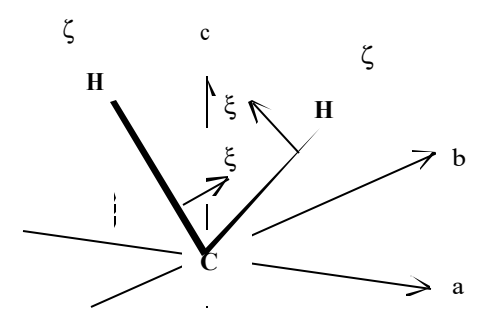
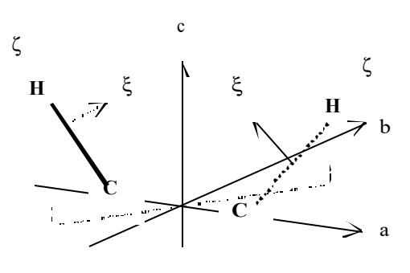
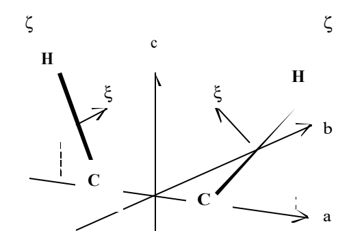

# 4.10 CH₂基团及HCCH基团的欧拉角

> 本轮状态：全8页原页对照、译校及参考排版完成；Q195—Q197保留待核。

> 原作：广瀬千秋；中文翻译：章力。按8页原稿译校。文件名已按本节内容修订（2026-10-21）。

## 阅读引导与目录

| 部分 | PDF页 | 内容概括 |
|---|---|---|
| 1 坐标轴 | 1—2 | 用三幅原图区分分子系、CH键系与表面系 |
| 2、2a | 2—6 | 用单位向量和二面角处理CH₂的纯扭转、纯倾斜及三类组合取向 |
| 2b | 6 | 平面HCCH交替倾斜、扭转HCCH坐标重合 |
| CH键系到分子系 | 6—8 | CH₂、平面及扭转HCCH的两键欧拉角关系 |

## 1. 坐标轴

**分子固定$(abc)$系。** CH₂的$c$轴沿HCH角外向角平分线，$a$轴在分子面内并平行于H—H连线。HCCH的$a$轴取向被氢化的碳原子方向，$c$轴沿二重轴。两个HCC面共面时有C₂ᵥ对称，$ac$面即该平面；若位阻使两个CH键相对原HCCH面同向偏移，$a,c$轴也随之偏移。两HCC面成角度时有C₂对称，$ac$面位于两平面锐角一侧的角平分面上，即假设无位阻时的HCCH面。

**CH键固定$(\xi\eta\zeta)$系。** $\zeta$轴沿CH键；CH₂的$\xi$轴在HCH面内指向C₂轴，HCCH的$\xi$轴在HCC面内指向C₂轴。

图中字母与箭头保留。HCCCH型单元也可采用与HCCH相同的形式。

**表面固定$(xyz)$系。** $z$轴取表面外向法线；$x$轴取无位阻时CH₂或HCCH分子面相互对齐并排列的方向。

> **局部约定：** 此稿法线向外，与4.8、4.9第2部分的向内约定不同，跨稿引用须明确转换。

## 2. 取向CH₂、HCCH相对表面系的欧拉角

经三个旋转$R_z(\chi)R_{b\prime}(\theta)R_c(\phi)$使$(abc)$与$(xyz)$重合时，旋转角$(\chi,\theta,\phi)$称为欧拉角。$\theta$为$z,c$两轴夹角，也是$xy,ab$两面二面角；$\phi$为两面交线与$b$轴夹角，也是$zc$平面与分子面夹角；$\chi$为交线与$y$轴夹角，也是$zc$平面与$xz$面夹角。

同一官能团覆盖表面时，将相邻、彼此对顶的两个CH键作为一对单元，则无论来自CH₂或HCCH，两键均相互扭转；可使固定在键对上的坐标系与表面系重合，但两类键对所需角度不同，求解较为费力。氢化部分若改变排列方向90°，需出现台阶，台阶中段存在CH基团。

### 2a. 取向CH₂基团

无位阻时，表面CH₂垂直于表面、分子面彼此平行。若位阻引起绕竖直$c$轴的扭转$\gamma$及倾斜$\theta$，可有下列旋转方式。描述平面分子时，用主轴偏离$z$轴的倾角，以及分子面或交线方向与表面的二面角更直观。以下必要时同时列出分子面$ac$与表面$xy$间二面角$\tau$与欧拉角的关系。

求解时，先分别以二面角、欧拉角表示$a,b,c$轴单位向量在表面系中的分量；再利用$b,z$轴夹角对应二面角，故内积绝对值为$\cos\tau$。二面角取锐角，$\cos\tau>0$。使两种表达式一致即可确定欧拉角。

$$
\begin{gathered}e_{a}=\begin{pmatrix}\cos\chi\cos\phi\cos\theta-\sin\chi\sin\phi\\-\sin\chi\cos\phi\cos\theta-\cos\chi\sin\phi\\\cos\phi\sin\theta\end{pmatrix},\quad e_{b}=\begin{pmatrix}\cos\chi\sin\phi\cos\theta+\sin\chi\cos\phi\\-\sin\chi\sin\phi\cos\theta+\cos\chi\cos\phi\\\sin\phi\sin\theta\end{pmatrix},\\e_{c}=\begin{pmatrix}-\cos\chi\sin\theta\\+\sin\chi\sin\theta\\+\cos\theta\end{pmatrix},\quad e_z\cdot e_b=\sin\phi\sin\theta.\end{gathered}
$$

$R_c(\phi)$使$b$轴垂直于$z$轴，即垂直于$zc$面；$R_{b\prime}(\pm\theta)$使$c,z$轴及$xy,ab$面重合；$R_z(\chi)$使$b,y$轴及$xz$面与分子面重合。

#### 只有绕z轴的扭转

相邻CH₂同向扭转以增大H—H间距。

$$
\begin{gathered}R_z(\chi=\gamma)R_{b\prime}(\theta=0)R_c(\phi=0)\quad\text{或}\\R_z(\chi=-\gamma)R_{b\prime}(\theta=0)R_c(\phi=0),\quad\tau=\pi/2.\tag{Eu-1}\end{gathered}
$$

$$
\begin{aligned}
\sin \chi  &= \sin \gamma ,\quad \sin 2\chi  = \sin 2\gamma ,\quad \sin 3\chi  = \sin 3\gamma \qquad\cos \chi  = \cos \gamma ,\quad \cos 2\chi  = \cos 2\gamma ,\quad \cos 3\chi  = \cos 3\gamma
\end{aligned}
$$

$$
\begin{aligned}
\sin \phi  &= 0,\quad \sin 2\phi  = 0,\quad \sin 3\phi  = 0  \qquad\cos \phi  = 1,\quad \cos 2\phi  = -1,\quad \cos 3\phi  = 1\\
&\quad (\sin \gamma  /-\sin \gamma ), (\sin 2\gamma  /-\sin 2\gamma ), (\sin 3\gamma  /-\sin 3\gamma )  \text{成对}
\end{aligned}
$$

相邻CH₂同取$+\gamma$或同取$-\gamma$，不交替。

> **原文疑点Q195（p3）：** $\phi=0$后原列$\cos2\phi=-1$，候选$+1$未采用。

#### 只有倾斜，情形1

相邻CH₂绕x轴旋转，向表面沿±y方向倒伏，以增大H—H间距。

$$
\begin{gathered}e_{a}=\begin{pmatrix}1\\0\\0\end{pmatrix},\quad e_{b}=\begin{pmatrix}0\\\cos\theta\\\sin\theta\end{pmatrix},\\e_{c}=\begin{pmatrix}0\\-\sin\theta\\+\cos\theta\end{pmatrix},\quad e_z\cdot e_b=\sin\theta.\end{gathered}
$$

$$
\begin{gathered}R_z(\chi=-\pi/2)R_{b\prime}(-\theta)R_c(\phi=\pi/2)\quad\text{或}\\R_z(\chi=-\pi/2)R_{b\prime}(\theta)R_c(\phi=\pi/2).\tag{Eu-2a}\end{gathered}
$$

$\tau=\pi/2-\theta$，严格地说$\cos\tau=\sin\theta$。

$$
\begin{aligned}
\sin \chi  &= -1,\quad \sin 2\chi  = 0,\quad \sin 3\chi  = +1  \qquad\cos \chi  = 0,\quad \cos 2\chi  = -1,\quad \cos 3\chi  = 0
\end{aligned}
$$

$$
\begin{aligned}
\sin \phi  &= +1,\quad \sin 2\phi  = 0,\quad \sin 3\phi  = -1  \qquad\cos \phi  = 0,\quad \cos 2\phi  = -1,\quad \cos 3\phi  = 0\\
&\quad (\sin \theta  /-\sin \theta )\text{成对}
\end{aligned}
$$

> **原式括号提示（Q193）：** 本式原页括号未配对，按原位置保留；页、行位置见本批覆盖记录，不补写因子或调整括号范围。

相邻CH₂交替取$+\theta$与$-\theta$。

#### 只有倾斜，情形2

相邻CH₂绕y轴旋转，向表面沿±x方向倒伏，以增大H—H间距。

$$
\begin{gathered}e_{a}=\begin{pmatrix}\cos\theta\\0\\-\sin\theta\end{pmatrix},\quad e_{b}=\begin{pmatrix}0\\1\\0\end{pmatrix},\\e_{c}=\begin{pmatrix}+\sin\theta\\0\\+\cos\theta\end{pmatrix},\quad e_z\cdot e_b=0.\end{gathered}
$$

$$
\begin{gathered}R_z(\chi=\pi)R_{b\prime}(\theta)R_c(\phi=\pi)\quad\text{或}\\R_z(\chi=-\pi)R_{b\prime}(-\theta)R_c(\phi=\pi),\quad\tau=\pi/2.\tag{Eu-2b}\end{gathered}
$$

$$
\begin{aligned}
\sin \chi  &= 0,\quad \sin 2\chi  = 0,\quad \sin 3\chi  = 0\qquad\cos \chi  = -1,\quad \cos 2\chi  = +1,\quad \cos 3\chi  = -1
\end{aligned}
$$

$$
\begin{aligned}
\sin \phi  &= 0,\quad \sin 2\phi  = 0,\quad \sin 3\phi  = 0\qquad\cos \phi  = -1,\quad \cos 2\phi  = +1,\quad \cos 3\phi  = -1\\
&\quad \text{取} \sin \theta  /\text{或} -\sin \theta
\end{aligned}
$$

相邻CH₂“交替取$+\theta$或$-\theta$之一”，同时“异号者不相邻”。

> **原文疑点Q196（p4）：** 两项排列说法有歧义，保留原文，未据旧译选定取向分布。

#### 同时有扭转和倾斜

实际可分为(a)—(c)三种，欧拉角各不相同。

**(a) 沿y方向倾斜。** 分子轴在yz面上，xy面投影与y轴重合，扭转与y方向倾斜同时发生。

$$
\begin{gathered}e_{a}=\begin{pmatrix}\cos\gamma\\\sin\gamma\cos\theta\\\sin\gamma\sin\theta\end{pmatrix},\quad e_{b}=\begin{pmatrix}-\sin\gamma\\\cos\gamma\cos\theta\\\cos\gamma\sin\theta\end{pmatrix},\\e_{c}=\begin{pmatrix}0\\-\sin\theta\\+\cos\theta\end{pmatrix},\quad e_z\cdot e_b=\cos\gamma\sin\theta.\end{gathered}
$$

$\sin\chi=-1,\cos\chi=0$，即$\chi=3\pi/2,-\pi/2$。$\sin\phi=\cos\gamma,\cos\phi=\sin\gamma$，即$\phi=\pi/2-\gamma$；$\cos\gamma=\cos\tau/\sin\theta$。

$$
\begin{aligned}
\sin \chi  &= -1,\quad \sin 2\chi  = 0,\quad \sin 3\chi  = -1\qquad\cos \chi  = 0,\quad \cos 2\chi  = -1,\quad \cos 3\chi  = 0
\end{aligned}
$$

$$
\begin{aligned}
\sin \phi  &= \cos \gamma  = \cos \tau /\sin \theta ,\quad  \sin 2\phi  = \sin 2\gamma  = 2\cos \tau \sqrt{\sin ^{2}\theta -\cos ^{2}\tau }/\sin ^{2}\theta ,
\end{aligned}
$$

$$
\begin{aligned}
\cos \phi  &= \sin \gamma  = \sqrt{\sin ^{2}\theta -\cos ^{2}\tau }/\sin \theta ,\quad   \cos 2\phi  = -\cos 2\gamma  = (\sin ^{2}\theta  - 2\cos ^{2}\tau )/\sin ^{2}\theta ,\quad 
\end{aligned}
$$

$$
\begin{aligned}
\sin 3\phi  &= -\cos 3\gamma  = \cos \tau (3\sin ^{2}\theta  - 4\cos ^{2}\tau )/\sin ^{3}\theta ,\quad \cos 3\phi  = -\sin 3\gamma  = (\sin ^{2}\theta  - 4\cos ^{2}\tau )\sqrt{\sin ^{2}\theta -\cos ^{2}\tau }/\sin ^{3}\theta\\
&\quad \text{取} (\sin \gamma ,\quad \sin 2\gamma ,\quad \sin 3\gamma )  \text{组}\text{或} (-\sin 2\gamma ,\quad -\sin 2\gamma ,\quad -\sin 3\gamma )  \text{组}\\
&\quad (\sin \theta  /- \sin \theta ) \text{成对}
\end{aligned}\tag{Eu-3a}
$$

相邻CH₂同取$+\gamma$或同取$-\gamma$，$\theta$符号交替。

> **Q195续（p4—5）：** 原列$\sin\chi=-1$却写$\sin3\chi=-1$，负号组首项原为$-\sin2\gamma$；候选分别为$+1$、$-\sin\gamma$，未采用。

**(b) 沿x方向倾斜。** 分子轴在xz面上，xy面投影与x轴重合，扭转与x方向倾斜同时发生。

$$
\begin{gathered}e_{a}=\begin{pmatrix}\cos\gamma\cos\theta\\\sin\gamma\\-\cos\gamma\sin\theta\end{pmatrix},\quad e_{b}=\begin{pmatrix}-\sin\gamma\cos\theta\\\cos\gamma\\\sin\gamma\sin\theta\end{pmatrix},\\e_{c}=\begin{pmatrix}\sin\theta\\0\\\cos\theta\end{pmatrix},\quad e_z\cdot e_b=\sin\gamma\sin\theta.\end{gathered}
$$

$\sin\chi=0,\cos\chi=-1$，即$\chi=\pi$；$\sin\phi=\sin\gamma,\cos\phi=-\cos\gamma$，即$\phi=\pi-\gamma$；$\sin\gamma=\cos\tau/\sin\theta$。

$$
\begin{aligned}
\sin \chi  &= 0, \sin 2\chi  = 0, \sin 3\chi  = 0,  \qquad\cos \chi  = -1, \cos 2\chi  = +1, \cos 3\chi  = -1
\end{aligned}
$$

$$
\begin{aligned}
\sin \phi  &= \sin \gamma  = \cos \tau /\sin \theta ,  \sin 2\phi  = -\sin 2\gamma  = -2\cos \tau \sqrt{\sin ^{2}\theta -\cos ^{2}\tau }/\sin ^{2}\theta ,
\end{aligned}
$$

$$
\begin{aligned}
\cos \phi  &= -\cos \gamma  = -\sqrt{\sin ^{2}\theta -\cos ^{2}\tau }/\sin \theta ,\cos 2\phi  = \cos 2\gamma  = (\sin ^{2}\theta  - 2\cos ^{2}\tau )/\sin ^{2}\theta ,
\end{aligned}
$$

$$
\begin{aligned}
\sin 3\phi  &= \sin 3\gamma  = \cos t(3\sin ^{2}\theta  - 4\cos ^{2}\tau )/\sin ^{3}\theta ,
\end{aligned}
$$

$$
\begin{aligned}
\cos 3\phi  &= -\cos 3\gamma  = -(\sin ^{2}\theta  - 4\cos ^{2}\tau )\sqrt{\sin ^{2}\theta -\cos ^{2}\tau }/\sin ^{3}\theta\\
&\quad (+\gamma , +\theta ) \text{组}, (+\gamma , -\theta ) \text{组}, (-\gamma , +\theta ) \text{组},\text{或} (-\gamma , -\theta ) \text{组}
\end{aligned}\tag{Eu-3b}
$$

相邻CH₂同取$+\gamma$或同取$-\gamma$，$\theta$也同号。

**(c) 同时有扭转和倾斜，分子轴在xy面投影与x轴成角γ。** 可视为在(b)基础上再旋转$\chi^*$。原文先称γ、随后以χ*表示附加转角，均保留。

$$
\begin{gathered}e_{a}=\begin{pmatrix}\cos\chi^*\cos\gamma\cos\theta-\sin\chi^*\sin\gamma\\+\sin\chi^*\cos\gamma\cos\theta-\cos\chi^*\sin\gamma\\-\cos\gamma\sin\theta\end{pmatrix},\quad e_{b}=\begin{pmatrix}-\cos\chi^*\sin\gamma\cos\theta-\sin\chi^*\cos\gamma\\-\sin\chi^*\sin\gamma\cos\theta+\cos\chi^*\cos\gamma\\\sin\gamma\sin\theta\end{pmatrix},\\e_{c}=\begin{pmatrix}\cos\chi^*\sin\theta\\\sin\chi^*\sin\theta\\\cos\theta\end{pmatrix},\quad e_z\cdot e_b=\sin\gamma\sin\theta.\end{gathered}
$$

$\sin\chi=\sin\chi^*,\cos\chi=-\cos\chi^*$，即$\chi=\pi-\chi^*$；$\sin\phi=\sin\gamma,\cos\phi=-\cos\gamma$，即$\phi=\pi-\gamma$；$\sin\gamma=\cos\tau/\sin\theta$。

$$
\begin{aligned}
\sin \chi  &= \sin \chi *,\quad \sin 2\chi  = -\sin 2\chi *,\quad \sin 3\chi  = \sin 3\chi *
\end{aligned}
$$

$$
\begin{aligned}
\cos \chi  &= -\cos \chi *,\quad \cos 2\chi  = +\cos 2\chi *,\quad \cos 3\chi  = -\cos 3\chi *
\end{aligned}
$$

$$
\begin{aligned}
\sin \phi  &= \sin \gamma  =  \cos \tau /\sin \theta ,\quad  \sin 2\phi  = -\sin 2\gamma  = -2\cos \tau \sqrt{\sin ^{2}\theta -\cos ^{2}\tau }/\sin ^{2}\theta ,\quad 
\end{aligned}
$$

$$
\begin{aligned}
\cos \phi  &= -\cos \gamma  = -\sqrt{\sin ^{2}\theta -\cos ^{2}\tau }/\sin \theta ,\quad \cos 2\phi  = \cos 2\gamma  = (\sin ^{2}\theta  - 2\cos ^{2}\tau )/\sin ^{2}\theta ,\quad 
\end{aligned}
$$

$$
\begin{aligned}
\sin 3\phi  &= \sin 3\gamma  = \cos \tau  (3\sin ^{2}\theta  - 4\cos ^{2}\tau )/\sin ^{3}\theta ,\quad 
\end{aligned}
$$

$$
\begin{aligned}
\cos 3\phi  &= -\cos 3\gamma  = -(\sin ^{2}\theta  - 4\cos ^{2}\tau )\sqrt{\sin ^{2}\theta -\cos ^{2}\tau }/\sin ^{3}\theta\\
&\quad \text{取} (\sin \gamma ,\quad \sin 2\gamma ,\quad in3\gamma )  \text{组}\text{或} (-\sin 2\gamma ,\quad -\sin 2\gamma ,\quad -\sin 3\gamma )  \text{组}\\
&\quad \text{对于}\text{取} \text{下列之一} (+\gamma , +\theta ) \text{组},\quad  (+\gamma , -\theta ) \text{组},\quad  (-\gamma , +\theta ) \text{组},\quad \text{或} (-\gamma , -\theta ) \text{组}
\end{aligned}\tag{Eu-3c}
$$

相邻CH₂的γ与θ分别同号，χ*符号交替。

> **Q195续（p6）：** 原取向组中的“in3γ”和负号组首项“−sin2γ”照录，未补字或改倍角。

> **Q195续：** 式(Eu-3b)中“cos t”的拉丁t原写保留；不直接视为τ的正常转写。

### 2b. 取向HCCH基团

平面HCCH（C₂ᵥ）无需考虑扭转，只需给出$ac$面相对$xz$面绕$a$轴的旋转$\tau$。相邻基团如下。

$$
\begin{aligned}
R_{z}(\chi  &= -\pi /2) R_{b\prime }(\theta  = -\tau ) R_{c}(\phi  = \pi /2),\quad R_{z}(\chi  = -\pi /2) R_{b\prime }(\theta  = +\tau ) R_{c}(\phi  = \pi /2),\quad  \tau  = \pi /2 - \theta
\end{aligned}\tag{Eu-4}
$$

$$
\begin{aligned}
\sin \chi  &= -1,\quad \sin 2\chi  = 0,\quad \sin 3\chi  = +1\qquad\cos \chi  = 0,\quad \cos 2\chi  = -1,\quad \cos 3\chi  = 0
\end{aligned}
$$

$$
\begin{aligned}
\sin \phi  &= +1,\quad \sin 2\phi  = 0,\quad \sin 3\phi  = -1\qquad\cos \phi  = 0,\quad \cos 2\phi  = -1,\quad \cos 3\phi  = 0
\end{aligned}
$$

$$
\begin{aligned}
\sin \theta  &= -(\pm )\sin \tau \qquad\cos \theta  = \cos \tau\\
&\quad (-\sin \tau  /+\sin \tau )\text{成对}
\end{aligned}
$$

> **原式括号提示（Q193）：** 本式原页括号未配对，按原位置保留；页、行位置见本批覆盖记录，不补写因子或调整括号范围。

相邻HCCH交替取$-\tau$与$+\tau$。扭转HCCH（C₂）可认为$xz$与$ac$面，进而两套坐标系本身重合。

> **Q196续（p6）：** 原稿并列θ=±τ与τ=π/2−θ，角度含义不直接统一；原式保留。

## CH键固定$(\xi\eta\zeta)$系到分子固定$(abc)$系的欧拉角

### CH₂基团

设HCH角为α，两个CH键的坐标系分别作下列旋转。

$$
\begin{aligned}
R_{c}(\chi  &= \pi ) R_{\eta }( \theta  = \alpha /2) R_{\zeta }(\phi  = 0),   R_{c}(\chi  = 0) R_{\eta }( \theta  = \alpha /2) R_{\zeta }(\phi  = 0)
\end{aligned}\tag{Eu-5}
$$

$$
\begin{aligned}
\sin \chi  &= 0,\quad \sin 2\chi  = 0,\quad \sin 3\chi  = 0  \qquad\cos \chi  = \pm 1,\quad \cos 2\chi  = +1,\quad \cos 3\chi  = \pm 1
\end{aligned}
$$

$$
\begin{aligned}
\sin \phi  &= 0,\quad \sin 2\phi  = 0,\quad \sin 3\phi  = 0  \qquad\cos \phi  = +1,\quad \cos 2\phi  = +1,\quad \cos 3\phi  = +1
\end{aligned}
$$

$$
\begin{aligned}
\sin \theta  &= \sin (\alpha /2),\quad   \qquad\cos \theta  = \cos (\alpha /2)
\end{aligned}
$$

### 平面HCCH基团（C₂ᵥ）

原文称“HCH角”为α，两个CH键的坐标系分别作下列旋转。

> **原文疑点Q197（p7）：** HCCH小节称α为“HCH角”，候选为“HCC/CCH角”；原称保留，未采用候选。

$$
\begin{aligned}
R_{c}(\chi  &= \pi ) R_{\eta }(\theta  = \alpha  - \pi /2) R_{\zeta }(\phi  = 0),\quad R_{c}(\chi  = 0) R_{\eta }(\theta  = \alpha  - \pi /2) R_{\zeta }(\phi  = 0)
\end{aligned}\tag{Eu-6}
$$

$$
\begin{aligned}
\sin \chi  &= 0,\quad \sin 2\chi  = 0,\quad \sin 3\chi  = 0,\quad \qquad\cos \chi  = \pm 1,\quad \cos 2\chi  = +1,\quad \cos 3\chi  = \pm 1
\end{aligned}
$$

$$
\begin{aligned}
\sin \phi  &= 0,\quad \sin 2\phi  = 0,\quad \sin 3\phi  = 0,\quad \qquad\cos \phi  = +1,\quad \cos 2\phi  = +1,\quad \cos 3\phi  = +1
\end{aligned}
$$

$$
\begin{aligned}
\sin \theta  &= -\cos \alpha ,,\quad \qquad\cos \theta  = \sin \alpha
\end{aligned}
$$

### 扭转HCCH基团（C₂）

采用结构化学常用的CCH角α与两个CCH面间二面角τ；后二面角由从面交线上一点向两面所作垂线的夹角定义。ξ、ζ轴均在CCH面上，该面与ac面间二面角为τ/2。将两条CH键的单位向量在abc系中并列如下：左列对应朝a轴正向、偏向b轴的键，右列对应相反方向的键。

$$
e_{\xi}=\begin{pmatrix}-\sin\alpha\\-\cos\alpha\sin(\tau/2)\\-\cos\alpha\cos(\tau/2)\end{pmatrix},\qquad e_{\xi}=\begin{pmatrix}+\sin\alpha\\+\cos\alpha\sin(\tau/2)\\-\cos\alpha\cos(\tau/2)\end{pmatrix}\tag{Eu-7a}
$$

$$
e_{\eta}=\begin{pmatrix}0\\-\cos(\tau/2)\\+\sin(\tau/2)\end{pmatrix},\qquad e_{\eta}=\begin{pmatrix}0\\+\cos(\tau/2)\\+\sin(\tau/2)\end{pmatrix}\tag{Eu-7b}
$$

$$
e_{\zeta}=\begin{pmatrix}-\cos\alpha\\+\sin\alpha\sin(\tau/2)\\+\sin\alpha\cos(\tau/2)\end{pmatrix},\qquad e_{\zeta}=\begin{pmatrix}+\cos\alpha\\-\sin\alpha\sin(\tau/2)\\+\sin\alpha\cos(\tau/2)\end{pmatrix}\tag{Eu-7c}
$$

$e_\zeta$与$e_c$的夹角θ由原写内积$e_z\cdot e_c=\cos\theta$求出。

$$
\begin{aligned}
\cos \theta  &= \sin \alpha \cos (\tau /2),   \sin \theta  = \sqrt{1-\sin ^{2}\alpha \cos ^{2}(\tau /2)}
\end{aligned}\tag{Eu-8}
$$

垂直于$e_\zeta$与$e_c$的单位向量$e_{\eta\prime}$，原文将“向量积$e_\zeta\cdot e_c$”的方向定义为正向，得到：

$$
e_{\eta\prime}=\begin{pmatrix}+\sin\alpha\sin(\tau/2)/\sin\theta\\+\cos\alpha/\sin\theta\\+0\end{pmatrix},\qquad e_{\eta\prime}=\begin{pmatrix}-\sin\alpha\sin(\tau/2)/\sin\theta\\-\cos\alpha/\sin\theta\\+0\end{pmatrix}\tag{Eu-9}
$$

由此，$e_{\eta\prime}$与$e_\eta$间的角φ，以及$e_{\eta\prime}$与$e_b$间的角χ分别为下式。两列对应前述两条CH键。

> **Q197续（p7）：** 求θ时原下标为拉丁z而前文为ζ；“向量积”却使用点号。候选分别为ζ及叉乘号×，原写保留，未采用候选。

$$
\begin{aligned}\sin\phi&=\frac{\sin(\tau/2)}{\sin\theta},&\sin\phi&=\frac{\sin(\tau/2)}{\sin\theta},\\\cos\phi&=-\frac{\cos\alpha\cos(\tau/2)}{\sin\theta},&\cos\phi&=-\frac{\cos\alpha\cos(\tau/2)}{\sin\theta}.\end{aligned}\tag{Eu-10}
$$

$$
\begin{aligned}\sin\chi&=\frac{\sin\alpha\sin(\tau/2)}{\sin\theta},&\sin\chi&=-\frac{\sin\alpha\sin(\tau/2)}{\sin\theta},\\\cos\chi&=\frac{\cos\alpha}{\sin\theta},&\cos\chi&=-\frac{\cos\alpha}{\sin\theta}.\end{aligned}\tag{Eu-11}
$$

两个CH键之间有$\phi\leftrightarrow\phi$、$\chi\leftrightarrow\chi+\pi$的关系。坐标变换时，含χ与3χ的三角函数在两键间反号。若平面HCCH也采用与此相同的abc系，则χ部分变为$\chi\leftrightarrow\pi-\chi$。

利用上述欧拉角，结合《从分子固定系到空间固定系.doc》，可用CH键和频张量表示CH₂、HCCH的分子固定系和频张量；《CH₂的取向与张量分量.doc》亦可参考。

