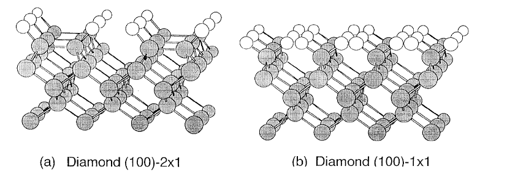

# 4.8 氢化金刚石表面CH的和频张量

> 本轮状态：全38页原页对照、译校及参考排版完成；Q189—Q193保留待核。

> 原作：广瀬千秋；中文翻译：章力。本轮按38页原稿重新核对。
> 旧译的“面内弯曲”主题及若干说明与底本不符，现按原题修复；文件名已按本节内容修订（2026-10-21）。

## 阅读引导与目录

| 部分 | 原PDF实际页 | 阅读要点 |
|---|---|---|
| 1—2 绪论与坐标 | 1—3 | 表面位阻、三套坐标及欧拉角 |
| 3 分子张量 | 3—5 | 由两个CH键叠加，并给四面体角近似 |
| 4a—4b HCCH表面张量 | 5—8 | 平面倾斜与扭转两种构型 |
| 5a—5f CH₂表面张量 | 8—22 | 绕轴扭转、后仰、侧倾及组合取向 |
| 6a—6c 实验室系张量 | 22—30 | 用表面旋转联系光路与分量 |
| 6d | 30 | 原稿明确“尚未着手” |
| 附录A | 30—38 | C₂ᵥ与C₂两种对称性、两种伸缩模式的一般式 |

## 1. 绪论

*原PDF p1结构图，原图标签保留：(a) Diamond (100)-2×1；(b) Diamond (100)-1×1。*

以氢化金刚石表面的CH伸缩振动为例，下面讨论有助于分析单晶表面化学键和频光谱的若干事项。

首先概述氢化C(100)表面。通常的说法是：切割所得（as cut）表面的C原子伸出两根悬挂键（dangling bond），其中一根与相邻C原子的悬挂键形成单键，造成表面重构；剩下的一根被氢化（上图(a)，下称单氢化模型，monohydride）。不过，从构想上说，也可能保持切割所得表面的结构，使两根悬挂键都被氢化（上图(b)，下称双氢化模型，dihydride）。由图可见，若关注CH键，前者以HCCH为单元，后者以CH₂为单元。由于这些单元在表面上具有一定的空间延展，表面单胞的对称性不同于裸表面的对称性。本文考察HCCH及CH₂单元所对应的和频张量。

金刚石晶体的晶格常数为$3.567\ \text{Å}$，因此C—C键长为$1.545\ \text{Å}$。切割所得表面上露出的C原子间距为$2.51\ \text{Å}$。关于重构表面，有文献报告表面单胞尺寸为$2.51\times5.1\ \text{Å}$（R. E. Stallcup等，*Appl. Phys. Lett.* **66**, 2331 (1995)）。若假定重构形成的C—C键原子间距为$2.0\ \text{Å}$，则非键合碳原子间距为$3.1\ \text{Å}$。

C—H键长为$1.1\sim1.2\ \text{Å}$。表面CH₂基团按图(b)取向时，相邻CH₂基团的H原子间距约为$0.7\ \text{Å}$。表面HCCH单元按图(a)取向时，相邻单元的H原子间距约为$2\ \text{Å}$；这是将CH键与表面法线的夹角假定为$30^\circ$时的数值，若该角仍为$55^\circ$，间距还会更短。

氢原子之间存在排斥力。可用H原子的范德瓦耳斯半径估计这种排斥开始起作用的距离尺度，其值为$1.20\ \text{Å}$。因此，H原子中心间距降至约$2.4\ \text{Å}$以下时，应会出现位阻。显然图(b)属于这种情况。图(a)中，相邻HCCH单元的H原子间距也相当短，因而同样很可能存在位阻。因此，为缓解位阻，表面CH键的取向很可能发生某种畸变。

缓解位阻时，可以设想两种状态：相互顶近的H原子一边保持距表面的距离相同，一边前后错开；或者其中一个H原子向表面侧下移，另一个向上移。对于CH₂基团，可以通过绕$C_2$轴旋转或使分子面倾斜，以及绕垂直于分子面的轴旋转来实现。对于HCCH基团，则可考虑CH键绕表面法线旋转、HCC键角增大或减小，以及分子面倾斜（保持平面）或扭转（分子面发生扭曲）。无论哪种情形，位阻的缓解都发生在相邻单元所属的CH键之间。因此，单元发生的变化也应与它们在表面上的排列方式有关。

考察HCCH单元的对称性，可有$C_{2v}$与$C_2$两种情况。H原子不受位阻影响时，或者为缓解位阻而保持分子共面、各单元相对于表面的倾斜交替变化时，对应$C_{2v}$对称性。相反，如果为避让而发生的左右CH键偏移，相对于原来的HCCH面方向相反，则对应$C_2$对称性。

CH₂单元具有三原子分子的特性，仍保持平面结构。又由于两个H原子等价，$C_{2v}$对称性得以保持。

## 2. 分子固定坐标系与空间固定坐标系

**1. 分子固定坐标系：** 记为$(abc)$系。

对于CH₂基团，沿$C_2$对称轴向外取$c$轴，在分子面内取$a$轴。

对于HCCH基团，沿$C_2$对称轴向外取$c$轴。平面形（$C_{2v}$对称）在分子面内取$a$轴；扭转形（$C_2$对称）则在平分两个CCH面的平面（即CCC面）内取$a$轴。

**2a. 表面固定坐标系：** 记为$(xyz)$系。

**2b. 空间固定坐标系：** 记为$(XYZ)$系。

**3. 分子取向：** 欧拉角$(\chi,\theta,\phi)$按将分子固定$(abc)$系与表面固定$(xyz)$系重合时的变换定义。

所用欧拉角$(\chi,\theta,\phi)$具体说明如下。

**(1) 内部旋转角$\phi$：** 指$ac$面（对这里讨论的CH₂及HCCH基团，原文称为分子面）相对于表面的扭转角。它既是绕$c$轴使$ac$面垂直于表面所需的旋转角，也是使$a$轴与$z$轴在$ab$面上的投影重合所需的旋转角。（取使沿$a$轴与沿$x$轴的矢量内积为正的重合方向。）$ac$面垂直于表面时，$\phi=0$或$\pi$；$ac$面与表面相对时，$\phi=\pi/2$或$3\pi/2$。若分子的内部旋转角随机，$\phi$在$0$至$2\pi$内以相同权重取任意值。

**(2) 倾斜角（tilt角）$\theta_{\mathrm{tilt}}$：** 按通常定义，取$c$轴与外向法线$(-z)$之间的夹角。绕$N$轴（同时垂直于$z$轴和$c$轴的直线，即$ab$面与$xy$面的交线）使$c$轴与外向法线重合的方向为正向旋转。由于$z$轴为向下的法线，欧拉角为$\theta=\pi-\theta_{\mathrm{tilt}}$。

**(3) 面内取向角$\chi_{\mathrm{in\text{-}plane}}$（简记$\chi_{\mathrm{ip}}$）：** 定义为绕$z$轴使$c$轴在$xy$面上的投影与$x$轴重合所需的旋转角。按此处$z$轴的方向，沿$x$轴看去，投影在左侧时为正。由于$z$轴指向基板内部，对应欧拉角为$\chi=\pi/2+\chi_{\mathrm{ip}}$。分子面内取向随机时，$\chi_{\mathrm{ip}}$在$0$至$2\pi$内以相同权重取任意值。

> **译者注（原文疑点Q189，PDF p2）：** 扭转HCCH的$a$轴参考面原称“CCC面”，但这里未说明第三个C原子；后文又将CH₂及HCCH的$ac$面统称为“分子面”。原称保留，扭转形中的候选理解为取向参考面，而非四原子共面，尚未作为原文修正采用。后续表中的角度应结合各处独立定义核验，不把本段$\theta$或$\phi$直接代成尚未核验的$\tau$。

## 3. 分子固定$(abc)$系中的张量分量

由对称性可筛出非零分量。C₂ᵥ分子（CH₂及平面HCCH基团）为$\beta_{aac}$、$\beta_{bbc}$、$\beta_{ccc}$、$\beta_{caa}=\beta_{aca}$、$\beta_{cbb}=\beta_{bcb}$；C₂分子（扭转HCCH基团）还允许$\beta_{abc}=\beta_{bac}$、$\beta_{bca}=\beta_{cba}$、$\beta_{cab}=\beta_{acb}$。若假设可直接沿用CH键的张量分量，则可参照《欧拉角》及《从分子固定系到空间固定系》估算各分量。

### CH₂基团

根据《欧拉角》式(Eu-5)，两个CH键的$\chi$相差$\pi$，故含$\sin\chi$、$\sin3\chi$、$\cos\chi$、$\cos3\chi$的项相加为零。又因$\chi=0,\pi$，有$\sin2\chi=0$、$\cos2\chi=1$，含$\sin2\chi$和$1-\cos2\chi$的项也为零。$\phi=0$时，各正弦及$1-\cos2\phi$项均消失，各余弦均为1。按《从分子固定系到空间固定系》叠加两个CH键的张量，得到下式。

$$
\begin{aligned}
\beta_{aac} &= 2\{\beta_{\xi \xi \zeta }\cos ^{3}(\alpha /2)+ \beta_{\zeta \zeta \zeta }[\cos (\alpha /2) - \cos ^{3}(\alpha /2)]\}
\end{aligned}\tag{3-1a}
$$

$$
\begin{aligned}
\beta_{bbc} &= 2\beta_{\eta \eta \zeta }\cos (\alpha /2)
\end{aligned}\tag{3-1b}
$$

$$
\begin{aligned}
\beta_{ccc} &= 2\{\beta_{\xi \xi \zeta }[\cos (\alpha /2) - \cos ^{3}(\alpha /2)] + \beta_{\zeta \zeta \zeta }\cos ^{3}(\alpha /2)\}
\end{aligned}\tag{3-1c}
$$

$$
\begin{aligned}
\beta_{caa} &= \beta_{aca} = -2(\beta_{\xi \xi \zeta } - \beta_{\zeta \zeta \zeta })[\cos (\alpha /2) - \cos ^{3}(\alpha /2)]
\end{aligned}\tag{3-2}
$$

$$
\begin{aligned}
\beta_{cbb} &= \beta_{bcb} = 0
\end{aligned}\tag{3-3}
$$

CH伸缩振动无$b$轴方向的分量，因此最右侧下标为$b$的张量分量为零。

取HCH角为四面体角，则$\cos\alpha=-1/3$、$\sin\alpha=2\sqrt2/3$，故$\cos(\alpha/2)=\sqrt{1/3}$，可得：

$$
\begin{aligned}
\beta_{aac} &= (2\sqrt{3}/9)(\beta_{\xi \xi \zeta } + 2\beta_{\zeta \zeta \zeta })
\end{aligned}\tag{3-4a}
$$

$$
\begin{aligned}
\beta_{bbc} &= (2\sqrt{3}/9)(3\beta_{\eta \eta \zeta })
\end{aligned}\tag{3-4b}
$$

$$
\begin{aligned}
\beta_{ccc} &= (2\sqrt{3}/9)(2\beta_{\xi \xi \zeta } + \beta_{\zeta \zeta \zeta })
\end{aligned}\tag{3-4c}
$$

$$
\begin{aligned}
\beta_{caa} &= \beta_{aca} = -(4\sqrt{3}/9)(\beta_{\xi \xi \zeta } - \beta_{\zeta \zeta \zeta })
\end{aligned}\tag{3-5}
$$

注意：与单独CH基团不同，这里$\beta_{aac}\sim\beta_{ccc}$。

### 平面HCCH基团

推导与上面相同。《欧拉角》的(Eu-6)与(Eu-5)相比，以$\alpha-\pi/2$代替$\alpha/2$；这里$\alpha$指HCC角。因而得到：

$$
\begin{aligned}
\beta_{aac} &= 2[\beta_{\xi \xi \zeta }\sin ^{3}\alpha  + \beta_{\zeta \zeta \zeta }(\sin \alpha  - \sin ^{3}\alpha )]
\end{aligned}\tag{3-6a}
$$

$$
\begin{aligned}
\beta_{bbc} &= 2\beta_{\eta \eta \zeta }\sin \alpha
\end{aligned}\tag{3-6b}
$$

$$
\begin{aligned}
\beta_{ccc} &= 2[\beta_{\xi \xi \zeta }(\sin \alpha  - \sin ^{3}\alpha ) + \beta_{\zeta \zeta \zeta }\sin ^{3}\alpha ]
\end{aligned}\tag{3-6c}
$$

$$
\begin{aligned}
\beta_{caa} &=  \beta_{aca} = -2(\beta_{\xi \xi \zeta } - \beta_{\zeta \zeta \zeta })(\sin \alpha  - \sin ^{3}\alpha )
\end{aligned}\tag{3-7}
$$

取HCC角为四面体角，$\cos\alpha=-1/3$、$\sin\alpha=2\sqrt2/3$，得到：

$$
\begin{aligned}
\beta_{aac} &= (4\sqrt{2}/37)(8\beta_{\xi \xi \zeta } + \beta_{\zeta \zeta \zeta })
\end{aligned}\tag{3-8a}
$$

$$
\begin{aligned}
\beta_{bbc} &= (4\sqrt{2}/37)(9\beta_{\eta \eta \zeta })
\end{aligned}\tag{3-8b}
$$

$$
\begin{aligned}
\beta_{ccc} &= (4\sqrt{2}/37)(\beta_{\xi \xi \zeta } + 8\beta_{\zeta \zeta \zeta })
\end{aligned}\tag{3-8c}
$$

$$
\begin{aligned}
\beta_{caa} &=  \beta_{aca} = -(4\sqrt{2}/37)(\beta_{\xi \xi \zeta } - \beta_{\zeta \zeta \zeta })
\end{aligned}\tag{3-9}
$$

这里应注意$\beta_{aac}<\beta_{ccc},\beta_{caa}$。

### 扭转HCCH基团

先根据《欧拉角》的(Eu-8)、(Eu-10)、(Eu-10)得到欧拉角表达式，再将欧拉角与HCC角及二面角联系起来。这一步较为繁复。《从分子固定系到空间固定系》给出的欧拉角表达式如下。原文重复列出(Eu-10)，照录。

$$
\begin{aligned}
\beta_{aac} &= (\beta_{\xi \xi \zeta } + \beta_{\eta \eta \zeta })\cos \theta\\
&\quad - (1/2)(\beta_{\xi \xi \zeta } + \beta_{\eta \eta \zeta } - 2\beta_{\zeta \zeta \zeta })(\cos \theta  - \cos ^{3}\theta )(1 + \cos 2\chi )\\
&\quad - (1/2)(\beta_{\xi \xi \zeta } - \beta_{\eta \eta \zeta })\{[\cos \theta (1 - \cos 2\chi ) - \cos ^{3}\theta (1 + \cos 2\chi )]\cos 2\phi  + 2\cos ^{2}\theta \sin 2\chi \sin 2\phi \}
\end{aligned}\tag{3-10a}
$$

$$
\begin{aligned}
\beta_{bbc} &= (\beta_{\xi \xi \zeta } + \beta_{\eta \eta \zeta })\cos \theta\\
&\quad - (1/2)(\beta_{\xi \xi \zeta } + \beta_{\eta \eta \zeta } - 2\beta_{\zeta \zeta \zeta })(\cos \theta  - \cos ^{3}\theta )(1 - \cos 2\chi )\\
&\quad - (1/2)(\beta_{\xi \xi \zeta } - \beta_{\eta \eta \zeta })\{[\cos \theta (1 + \cos 2\chi ) - \cos ^{3}\theta (1 - \cos 2\chi )]\cos 2\phi  - 2\cos ^{2}\theta \sin 2\chi \sin 2\phi \}
\end{aligned}\tag{3-10b}
$$

$$
\begin{aligned}
\beta_{ccc} &= (\beta_{\xi \xi \zeta }+ \beta_{\eta \eta \zeta })\cos \theta\\
&\quad - (\beta_{\xi \xi \zeta }+ \beta_{\eta \eta \zeta } - 2\beta_{\zeta \zeta \zeta })\cos ^{3}\theta\\
&\quad + (\beta_{\xi \xi \zeta } - \beta_{\eta \eta \zeta })(\cos \theta  - \cos ^{3}\theta )\cos 2\phi 1
\end{aligned}\tag{3-10c}
$$

$$
\begin{aligned}
\beta_{abc} &= \beta_{bac} = (1/2)(\beta_{\xi \xi \zeta } + \beta_{\eta \eta \zeta } - 2\beta_{\zeta \zeta \zeta })(\cos \theta  - \cos ^{3}\theta )\sin 2\chi\\
&\quad - (1/2)(\beta_{\xi \xi \zeta } - \beta_{\eta \eta \zeta })[(\cos \theta  + \cos ^{3}\theta )\sin 2\chi \cos 2\phi  + 2\cos ^{2}\theta \cos 2\chi \sin 2\phi ]
\end{aligned}\tag{3-10d}
$$

$$
\begin{aligned}
\beta_{caa} &= \beta_{aca} = -(1/2)(\beta_{\xi \xi \zeta } + \beta_{\eta \eta \zeta } - 2\beta_{\zeta \zeta \zeta })(\cos \theta  - \cos ^{3}\theta )(1 + \cos 2\chi )\\
&\quad - (1/2)(\beta_{\xi \xi \zeta } - \beta_{\eta \eta \zeta })[(\cos \theta  - \cos ^{3}\theta )(1 + \cos 2\chi )\cos 2\phi  - \sin ^{2}\theta \sin 2\chi \sin 2\phi ]
\end{aligned}\tag{3-11a}
$$

$$
\begin{aligned}
\beta_{bca} &= \beta_{cba} = (1/2)(\beta_{\xi \xi \zeta } + \beta_{\eta \eta \zeta } - 2\beta_{\zeta \zeta \zeta })(\cos \theta  - \cos ^{3}\theta )\sin 2\chi\\
&\quad + (1/2)(\beta_{\xi \xi \zeta } - \beta_{\eta \eta \zeta })[(\cos \theta  - \cos ^{3}\theta )\sin 2\chi \cos 2\phi  + \sin ^{2}\theta  (1 + \cos 2\chi )\sin 2\phi ]
\end{aligned}\tag{3-11b}
$$

$$
\begin{aligned}
\beta_{cbb} &= \beta_{bcb} = -(1/2)(\beta_{\xi \xi \zeta } + \beta_{\eta \eta \zeta } - 2\beta_{\zeta \zeta \zeta })(\cos \theta  - \cos ^{3}\theta )(1 - \cos 2\chi )\\
&\quad - (1/2)(\beta_{\xi \xi \zeta } - \beta_{\eta \eta \zeta })[(\cos \theta  - \cos ^{3}\theta )(1 - \cos 2\chi )\cos 2\phi  + \sin ^{2}\theta \sin 2\chi \sin 2\phi ]
\end{aligned}\tag{3-12a}
$$

$$
\begin{aligned}
\beta_{cab} &= \beta_{acb} = (1/2)(\beta_{\xi \xi \zeta } + \beta_{\eta \eta \zeta } - 2\beta_{\zeta \zeta \zeta })(\cos \theta  - \cos ^{3}\theta )\sin 2\chi\\
&\quad + (1/2)(\beta_{\xi \xi \zeta } - \beta_{\eta \eta \zeta })[(\cos \theta  - \cos ^{3}\theta )\sin 2\chi \cos 2\phi  - \sin ^{2}\theta  (1 - \cos 2\chi )\sin 2\phi ]
\end{aligned}\tag{3-12b}
$$

将这些式子改写成$\alpha$与$\tau$的表达式，直接代换后整理，得到：

$$
\begin{aligned}
\beta_{aac} &= 2(\beta_{\xi \xi \zeta }\sin ^{2}\alpha  + \beta_{\zeta \zeta \zeta }\cos ^{2}\alpha )\sin \alpha \cos (\tau /2)
\end{aligned}\tag{3-13a}
$$

$$
\begin{aligned}
\beta_{bbc} &= 2[\beta_{\xi \xi \zeta }\cos ^{2}\alpha \sin ^{2}(\tau /2) + \beta_{\eta \eta \zeta }\cos ^{2}(\tau /2) + \beta_{\zeta \zeta \zeta }\sin ^{2}\alpha \sin ^{2}(\tau /2)]\sin \alpha \cos (\tau /2)
\end{aligned}\tag{3-13b}
$$

$$
\begin{aligned}
\beta_{ccc} &= 2[\beta_{\xi \xi \zeta }\cos ^{2}\alpha \cos ^{2}(\tau /2) + \beta_{\eta \eta \zeta }\sin ^{2}(\tau /2) + \beta_{\zeta \zeta \zeta }\sin ^{2}\alpha \cos ^{2}(\tau /2)]\sin \alpha \cos (\tau /2)
\end{aligned}\tag{3-13c}
$$

$$
\begin{aligned}
\beta_{abc} &=  \beta_{bac} = 2(\beta_{\xi \xi \zeta } - \beta_{\zeta \zeta \zeta })[\sin \alpha \cos \alpha \sin (\tau /2)]\sin \alpha \cos (\tau /2)
\end{aligned}\tag{3-13d}
$$

$$
\begin{aligned}
\beta_{caa} &=  \beta_{aca} = -2(\beta_{\xi \xi \zeta } - \beta_{\zeta \zeta \zeta })\sin \alpha \cos ^{2}\alpha \cos (\tau /2)
\end{aligned}\tag{3-14a}
$$

$$
\begin{aligned}
\beta_{bca} &=  \beta_{cba} = -2[\beta_{\xi \xi \zeta }\cos ^{2}\alpha  - \beta_{\eta \eta \zeta } + \beta_{\zeta \zeta \zeta }\sin ^{2}\alpha ]\cos \alpha \sin (\tau /2)\cos (\tau /2)
\end{aligned}\tag{3-14b}
$$

$$
\begin{aligned}
\beta_{cbb} &=  \beta_{bcb} = +2[\beta_{\xi \xi \zeta }\cos ^{2}\alpha  - \beta_{\eta \eta \zeta } + \beta_{\zeta \zeta \zeta }\sin ^{2}\alpha ]\sin \alpha \sin ^{2}(\tau /2)\cos (\tau /2)
\end{aligned}\tag{3-15a}
$$

$$
\begin{aligned}
\beta_{cab} &=  \beta_{acb} = -2(\beta_{\xi \xi \zeta } - \beta_{\zeta \zeta \zeta })\sin ^{2}\alpha \cos \alpha \cos (\tau /2)
\end{aligned}\tag{3-15b}
$$

取HCC角为四面体角，$\cos\alpha=-1/3$、$\sin\alpha=2\sqrt2/3$，得到：

$$
\begin{aligned}
\beta_{aac} &= (4\sqrt{2}/27)(8\beta_{\xi \xi \zeta } + \beta_{\zeta \zeta \zeta })\cos (\tau /2)
\end{aligned}\tag{3-16a}
$$

$$
\begin{aligned}
\beta_{bbc} &= (4\sqrt{2}/27)[(\beta_{\xi \xi \zeta } - 9\beta_{\eta \eta \zeta } + 8\beta_{\zeta \zeta \zeta })\sin ^{2}(\tau /2) + 9\beta_{\eta \eta \zeta }]\cos (\tau /2)
\end{aligned}\tag{3-16b}
$$

$$
\begin{aligned}
\beta_{ccc} &= (4\sqrt{2}/27)[(\beta_{\xi \xi \zeta } - 9\beta_{\eta \eta \zeta } + 8\beta_{\zeta \zeta \zeta })\cos ^{2}(\tau /2) + 9\beta_{\eta \eta \zeta }]\cos (\tau /2)
\end{aligned}\tag{3-16c}
$$

$$
\begin{aligned}
\beta_{abc} &=  \beta_{bac} = -(4\sqrt{2}/27)(\beta_{\xi \xi \zeta } - \beta_{\zeta \zeta \zeta })(2\sqrt{2})\sin (\tau /2)\cos (\tau /2)
\end{aligned}\tag{3-16d}
$$

$$
\begin{aligned}
\beta_{caa} &=  \beta_{aca} = -(4\sqrt{2}/27)(\beta_{\xi \xi \zeta } - \beta_{\zeta \zeta \zeta })\cos (\tau /2)
\end{aligned}\tag{3-17a}
$$

$$
\begin{aligned}
\beta_{bca} &=  \beta_{cba} = +(2/27)[\beta_{\xi \xi \zeta } - 9\beta_{\eta \eta \zeta } + 8\beta_{\zeta \zeta \zeta }]\sin (\tau /2)\cos (\tau /2)
\end{aligned}\tag{3-17b}
$$

$$
\begin{aligned}
\beta_{cbb} &=  \beta_{bcb} = +(4\sqrt{2}/27)[\beta_{\xi \xi \zeta } - 9\beta_{\eta \eta \zeta } + 8\beta_{\zeta \zeta \zeta }]\sin ^{2}(\tau /2)\cos (\tau /2)
\end{aligned}\tag{3-18a}
$$

$$
\begin{aligned}
\beta_{cab} &=  \beta_{acb} = +(8/27)(\beta_{\xi \xi \zeta } - \beta_{\zeta \zeta \zeta })\cos (\tau /2)
\end{aligned}\tag{3-18b}
$$

> **原文疑点Q190（p4—5）：** 式(3-8)、(3-9)原分母为37，后续对应的四面体角表达式多用27；原37保留，候选27未采用。式(3-10c)行末有孤立数字1，原样保留。对(Eu-10)的重复引用也未改号。

## 4. 表面固定$(xyz)$系中HCCH基团的张量分量

以下求典型取向的表面系张量。附录A给出一般取向的表达式，代入相应欧拉角即可得到各式。下文$\tau$指分子面（$ac$面）与表面（$xy$面）之间的二面角。

### 4a. 倾斜的平面HCCH基团

设分子面$ac$相对表面倾斜$\tau$。两种倾斜方式对应的欧拉角如下，参见《欧拉角》式(Eu-4)。$\alpha$为CCH键角。

$$
\begin{aligned}
R_{z}(\chi  &= -\pi /2) R_{b\prime }(\theta  = -\tau ) R_{c}(\phi  = \pi /2),\quad  R_{z}(\chi  = -\pi /2) R_{b\prime }(\theta  = +\tau ) R_{c}(\phi  = \pi /2),\quad \tau  = \pi /2 - \theta
\end{aligned}
$$

$$
\begin{aligned}
\sin \chi  &= -1,\quad \sin 2\chi  = 0,\quad \sin 3\chi  = +1  \qquad\cos \chi  = 0,\quad \cos 2v = -1,\quad \cos 3\chi  = 0
\end{aligned}
$$

$$
\begin{aligned}
\sin \phi  &= +1,\quad \sin 2\phi  = 0,\quad \sin 3v = -1  \qquad\cos \phi  = 0,\quad \cos 2\phi  = -1,\quad \cos 3\phi  = 0
\end{aligned}
$$

$$
\begin{aligned}
\sin \theta  &= -(\pm )\sin \tau ,\quad   \qquad\cos \theta  = \cos \tau
\end{aligned}\tag{4a-1}
$$

相邻HCCH基团交替取$-\tau$和$+\tau$，据此得到下列分量。

#### 对称伸缩振动

**(ppp)**

$$
\begin{aligned}
\chi_{xxz} &= \beta_{aac}\cos t
\end{aligned}
$$

$$
\begin{aligned}
\chi_{zzz} &= -(\beta_{bbc} - \beta_{ccc})\cos ^{3}\tau  + \beta_{bbc}\cos \tau
\end{aligned}
$$

**(spp)**

$$
\begin{aligned}
\chi_{yzz} &= \pm (\beta_{bbc} - \beta_{ccc})(\sin \tau  - \sin ^{3}\tau )
\end{aligned}
$$

**(ssp)**

$$
\begin{aligned}
\chi_{yyz} &= (\beta_{bbc} - \beta_{ccc})\cos ^{3}\tau  + \beta_{ccc}\cos \tau
\end{aligned}
$$

**(psp)**

$$
\begin{aligned}
\chi_{zyz} &= \pm (\beta_{bbc} - \beta_{ccc})(\sin \tau  - \sin ^{3}\tau )
\end{aligned}
$$

**(sps)**

$$
\begin{aligned}
\chi_{yzy} &= -(\beta_{bbc} - \beta_{ccc})(\cos \tau  - \cos ^{3}\tau )
\end{aligned}
$$

**(pps)**

$$
\begin{aligned}
\chi_{xxy} &= -(\pm )\beta_{aac}\sin \tau
\end{aligned}
$$

$$
\begin{aligned}
\chi_{zzy} &= -(\pm )\beta_{bbc}\sin ^{3}\tau  - (\pm )\beta_{ccc}(\sin \tau  - \sin ^{3}\tau )
\end{aligned}
$$

**(pss)**

$$
\begin{aligned}
\chi_{zyy} &= -(\beta_{bbc} - \beta_{ccc})(\cos \tau  - \cos ^{3}\tau )
\end{aligned}
$$

**(sss)**

$$
\begin{aligned}
\chi_{yyy} &= -(\pm )\beta_{bbc}(\sin \tau  - \sin ^{3}\tau ) - (\pm )\beta_{ccc}\sin ^{3}\tau
\end{aligned}\tag{4a-2}
$$

#### 反对称伸缩振动

**(ppp)**

$$
\begin{aligned}
\chi_{zxx} &= \beta_{caa}\cos \tau
\end{aligned}
$$

$$
\begin{aligned}
\chi_{xzx} &= \beta_{caa}\cos \tau
\end{aligned}
$$

**(spp)**

$$
\begin{aligned}
\chi_{yxx} &= -(\pm )\beta_{caa}\sin \tau
\end{aligned}
$$

**(ssp)**

无（原文none）。

**(psp)**

$$
\begin{aligned}
\chi_{xyx} &= -(\pm )\beta_{caa}\sin \tau
\end{aligned}
$$

**(sps)**

无（原文none）。

**(pps)**

无（原文none）。

**(pss)**

无（原文none）。

**(sss)**

无（原文none）。 (4a-3)

用CH基团张量表示时，在式(3-6)中取四面体角，即使用式(3-8)，得到下式。

#### 对称伸缩振动

**(ppp)**

$$
\begin{aligned}
\chi_{xxz} &= (4\sqrt{2}/27)(8\beta_{\xi \xi \zeta } + \beta_{\zeta \zeta \zeta })\cos \tau
\end{aligned}
$$

$$
\begin{aligned}
\chi_{zzz} &= (4\sqrt{2}/27)(\beta_{\xi \xi \zeta } - 9\beta_{\eta \eta \zeta } + 8\beta_{\zeta \zeta \zeta })\cos ^{3}\tau
\end{aligned}
$$

**(spp)**

$$
\begin{aligned}
\chi_{yzz} &= -(\pm )(4\sqrt{2}/27)(\beta_{\xi \xi \zeta } - 9\beta_{\eta \eta \zeta } + 8\beta_{\zeta \zeta \zeta })(\sin \tau  - \sin ^{3}\tau )
\end{aligned}
$$

**(ssp)**

$$
\begin{aligned}
\chi_{yyz} &= (4\sqrt{2}/27)[-(\beta_{\xi \xi \zeta } - 9\beta_{\eta \eta \zeta } + 8\beta_{\zeta \zeta \zeta })(\cos \tau  - \cos ^{3}\tau ) + 9\beta_{\eta \eta \zeta }\cos \tau ]
\end{aligned}
$$

**(psp)**

$$
\begin{aligned}
\chi_{zyz} &= -(\pm )(4\sqrt{2}/27)(\beta_{\xi \xi \zeta } - 9\beta_{\eta \eta \zeta } + 8\beta_{\zeta \zeta \zeta })(\sin \tau  - \sin ^{3}\tau )
\end{aligned}
$$

**(sps)**

$$
\begin{aligned}
\chi_{yzy} &= (4\sqrt{2}/27)(\beta_{\xi \xi \zeta } - 9\beta_{\eta \eta \zeta } + 8\beta_{\zeta \zeta \zeta })(\cos \tau  - \cos ^{3}\tau )
\end{aligned}
$$

**(pps)**

$$
\begin{aligned}
\chi_{xxy} &= -(\pm )(4\sqrt{2}/27)(9\beta_{\eta \eta \zeta })\sin \tau
\end{aligned}
$$

$$
\begin{aligned}
\chi_{zzy} &= -(\pm )(4\sqrt{2}/27)[(\beta_{\xi \xi \zeta } - 9\beta_{\eta \eta \zeta } + 8\beta_{\zeta \zeta \zeta })(\sin \tau  - \sin ^{3}\tau ) - 9\beta_{\eta \eta \zeta }\sin \tau ]
\end{aligned}
$$

**(pss)**

$$
\begin{aligned}
\chi_{zyy} &= (4\sqrt{2}/27)(\beta_{\xi \xi \zeta } - 9\beta_{\eta \eta \zeta } + 8\beta_{\zeta \zeta \zeta })(\cos \tau  - \cos ^{3}\tau )
\end{aligned}
$$

**(sss)**

$$
\begin{aligned}
\chi_{yyy} &= -(\pm )(4\sqrt{2}/27)[(\beta_{\xi \xi \zeta } - 9\beta_{\eta \eta \zeta } + 8\beta_{\zeta \zeta \zeta })\sin ^{3}\tau  + 9\beta_{\eta \eta \zeta }\sin \tau ]
\end{aligned}\tag{4a-4}
$$

#### 反对称伸缩振动

**(ppp)**

$$
\begin{aligned}
\chi_{zxx} &= -(4\sqrt{2}/27)(\beta_{\xi \xi \zeta } - \beta_{\zeta \zeta \zeta })\cos \tau
\end{aligned}
$$

$$
\begin{aligned}
\chi_{xzx} &= -(4\sqrt{2}/27)(\beta_{\xi \xi \zeta } - \beta_{\zeta \zeta \zeta })\cos \tau
\end{aligned}
$$

**(spp)**

$$
\begin{aligned}
\chi_{yxx} &= (\pm )(4\sqrt{2}/27)(\beta_{\xi \xi \zeta } - \beta_{\zeta \zeta \zeta })\sin \tau
\end{aligned}
$$

**(ssp)**

无（原文none）。

**(psp)**

$$
\begin{aligned}
\chi_{xxx} &= -(\pm )(4\sqrt{2}/27)(\beta_{\xi \xi \zeta } - \beta_{\zeta \zeta \zeta })\sin \tau
\end{aligned}
$$

**(sps)**

无（原文none）。

**(pps)**

无（原文none）。

**(pss)**

无（原文none）。

**(sss)**

无（原文none）。 (4a-5)

> **原文疑点Q191（p5—6）：** τ的定义、θ=±τ及τ=π/2−θ的并列写法存在局部约定差异，参见4.7的Q183。此页还印有cos2v、sin3v等未定义符号，按原字形保留，不默换成χ或φ。

### 4b. 扭转HCCH基团

扭转HCCH的$ac$面可视为与$xz$面重合。因此，式(3-10)—(3-18)左侧下标由$(abc)$改为$(xyz)$后便直接适用。这里$\alpha$为CCH键角，$\tau$为两个CCH面之间的二面角。

$$
\begin{aligned}
R_{z}(\chi  &= 0) R_{b\prime }(\theta  = 0) R_{c}(\phi  = 0),\quad \tau  = 0
\end{aligned}\tag{4b-1}
$$

据此得到以下表达式；同时列出用CH键张量的式(3-13)整理后的结果。

#### 对称伸缩振动

**(ppp)**

$$
\begin{aligned}
\chi_{xxz} &= \beta_{aac} = 2(\beta_{\xi \xi \zeta }\sin ^{2}\alpha  + \beta_{\zeta \zeta \zeta }\cos ^{2}\alpha )\sin \alpha \cos (\tau /2)
\end{aligned}
$$

$$
\begin{aligned}
\chi_{zzz} &= \beta_{ccc} = 2[\beta_{\xi \xi \zeta }\cos ^{2}\alpha \cos ^{2}(\tau /2) + \beta_{\eta \eta \zeta }\sin ^{2}(\tau /2) + \beta_{\zeta \zeta \zeta }\sin ^{2}\alpha \cos ^{2}(\tau /2)]\sin \alpha \cos (\tau /2)
\end{aligned}
$$

**(spp)**

$$
\begin{aligned}
\chi_{yxz} &= \beta_{abc} =  2(\beta_{\xi \xi \zeta } - \beta_{\zeta \zeta \zeta })[\sin \alpha \cos \alpha \sin (\tau /2)]\sin \alpha \cos (\tau /2)
\end{aligned}
$$

**(ssp)**

$$
\begin{aligned}
\chi_{yyz} &= \beta_{bbc} = 2[\beta_{\xi \xi \zeta }\cos ^{2}\alpha \sin ^{2}(\tau /2) + \beta_{\eta \eta \zeta }\cos ^{2}(\tau /2) + \beta_{\zeta \zeta \zeta }\sin ^{2}\alpha \sin ^{2}(\tau /2)]\sin \alpha \cos (\tau /2)
\end{aligned}
$$

**(psp)**

$$
\begin{aligned}
\chi_{xyz} &= \beta_{abc} = 2(\beta_{\xi \xi \zeta } - \beta_{\zeta \zeta \zeta })[\sin \alpha \cos \alpha \sin (\tau /2)]\sin \alpha \cos (\tau /2)
\end{aligned}
$$

**(sps)**

无（原文none）。

**(pps)**

无（原文none）。

**(pss)**

无（原文none）。

**(sss)**

无（原文none）。(4b-2)

#### 反对称伸缩振动

**(ppp)**

$$
\begin{aligned}
\chi_{zxx} &= \beta_{caa} = -2(\beta_{\xi \xi \zeta } - \beta_{\zeta \zeta \zeta })\sin \alpha \cos ^{2}\alpha \cos (\tau /2)
\end{aligned}
$$

$$
\begin{aligned}
\chi_{xzx} &= \beta_{caa} = -2(\beta_{\xi \xi \zeta } - \beta_{\zeta \zeta \zeta })\sin \alpha \cos ^{2}\alpha \cos (\tau /2)
\end{aligned}
$$

**(spp)**

$$
\begin{aligned}
\chi_{yzx} &= \beta_{bca} = -2(\beta_{\xi \xi \zeta }\cos ^{2}\alpha  - \beta_{\eta \eta \zeta } + \beta_{\zeta \zeta \zeta }\sin ^{2}\alpha )\cos \alpha \sin (\tau /2)\cos (\tau /2)
\end{aligned}
$$

**(ssp)**

无（原文none）。

**(psp)**

$$
\begin{aligned}
\chi_{zyx} &= \beta_{bca} = -2(\beta_{\xi \xi \zeta }\cos ^{2}\alpha  - \beta_{\eta \eta \zeta } + \beta_{\zeta \zeta \zeta }\sin ^{2}\alpha )\cos \alpha \sin (\tau /2)\cos (\tau /2)
\end{aligned}
$$

**(sps)**

$$
\begin{aligned}
\chi_{yzy} &= \beta_{cbb} = +2(\beta_{\xi \xi \zeta }\cos ^{2}\alpha  - \beta_{\eta \eta \zeta } + \beta_{\zeta \zeta \zeta }\sin ^{2}\alpha )\sin \alpha \sin 2(\tau /2)\cos (\tau /2)
\end{aligned}
$$

**(pps)**

$$
\begin{aligned}
\chi_{zxy} &= \beta_{cab} = -2(\beta_{\xi \xi \zeta } - \beta_{\zeta \zeta \zeta })\sin ^{2}\alpha \cos \alpha \cos (\tau /2)
\end{aligned}
$$

$$
\begin{aligned}
\chi_{xzy} &= \beta_{cab} = -2(\beta_{\xi \xi \zeta } - \beta_{\zeta \zeta \zeta })\sin ^{2}\alpha \cos \alpha \cos (\tau /2)
\end{aligned}
$$

**(pss)**

$$
\begin{aligned}
\chi_{zyy} &= \beta_{cbb} = +2(\beta_{\xi \xi \zeta }\cos ^{2}\alpha  - \beta_{\eta \eta \zeta } + \beta_{\zeta \zeta \zeta }\sin ^{2}\alpha )\sin \alpha \sin ^{2}(\tau /2)\cos (\tau /2)
\end{aligned}
$$

**(sss)**

无（原文none）。(4b-3)

进一步取四面体角，$\cos\alpha=-1/3$、$\sin\alpha=2\sqrt2/3$，得到：

#### 对称伸缩振动

**(ppp)**

$$
\begin{aligned}
\chi_{xxz} &= \beta_{aac} = (4\sqrt{2}/27)(8\beta_{\xi \xi \zeta } + \beta_{\eta \eta \zeta })\cos (\tau /2)
\end{aligned}
$$

$$
\begin{aligned}
\chi_{zzz} &= \beta_{ccc} = (4\sqrt{2}/27)[(\beta_{\xi \xi \zeta } - 9\beta_{\eta \eta \zeta } + 8\beta_{\zeta \zeta \zeta })\cos ^{2}(\tau /2) + 9\beta_{\eta \eta \zeta }]\cos (\tau /2)
\end{aligned}
$$

**(spp)**

$$
\begin{aligned}
\chi_{yxz} &= \beta_{abc} = -(4\sqrt{2}/27)(\beta_{\xi \xi \zeta } - \beta_{\zeta \zeta \zeta })(2\sqrt{2})\sin (\tau /2)\cos (\tau /2)
\end{aligned}
$$

**(ssp)**

$$
\begin{aligned}
\chi_{yyz} &= \beta_{bbc} = (4\sqrt{2}/27)[(\beta_{\xi \xi \zeta } - 9\beta_{\eta \eta \zeta } + 8\beta_{\zeta \zeta \zeta })\sin ^{2}(\tau /2) + 9\beta_{\eta \eta \zeta }]\cos (\tau /2)
\end{aligned}
$$

**(psp)**

$$
\begin{aligned}
\chi_{xyz} &= \beta_{abc} = -(4\sqrt{2}/27)(\beta_{\xi \xi \zeta } - \beta_{\zeta \zeta \zeta })(2\sqrt{2})\sin (\tau /2)\cos (\tau /2)
\end{aligned}
$$

**(sps)**

无（原文none）。

**(pps)**

无（原文none）。

**(pss)**

无（原文none）。

**(sss)**

无（原文none）。(4b-4)

#### 反对称伸缩振动

**(ppp)**

$$
\begin{aligned}
\chi_{zxx} &= \beta_{caa} = -(4\sqrt{2}/27)(\beta_{\xi \xi \zeta } - \beta_{\zeta \zeta \zeta })\cos (\tau /2)
\end{aligned}
$$

$$
\begin{aligned}
\chi_{xzx} &= \beta_{caa} = -(4\sqrt{2}/27)(\beta_{\xi \xi \zeta } - \beta_{\zeta \zeta \zeta })\cos (\tau /2)
\end{aligned}
$$

**(spp)**

$$
\begin{aligned}
\chi_{yzx} &= \beta_{bca} = (2/27)(\beta_{\xi \xi \zeta } - 9\beta_{\eta \eta \zeta } + 8\beta_{\zeta \zeta \zeta })\sin (\tau /2)\cos (\tau /2)
\end{aligned}
$$

**(ssp)**

无（原文none）。

**(psp)**

$$
\begin{aligned}
\chi_{zyx} &= \beta_{bca} = (2/27)(\beta_{\xi \xi \zeta } - 9\beta_{\eta \eta \zeta } + 8\beta_{\zeta \zeta \zeta })\sin (\tau /2)\cos (\tau /2)
\end{aligned}
$$

**(sps)**

$$
\begin{aligned}
\chi_{yzy} &= \beta_{cbb} = (4\sqrt{2}/27)(\beta_{\xi \xi \zeta } - 9\beta_{\eta \eta \zeta } + 8\beta_{\zeta \zeta \zeta })\sin ^{2}(\tau /2)\cos (\tau /2)
\end{aligned}
$$

**(pps)**

$$
\begin{aligned}
\chi_{zxy} &= \beta_{cab} = (8/27)(\beta_{\xi \xi \zeta } - \beta_{\zeta \zeta \zeta })\cos (\tau /2)
\end{aligned}
$$

$$
\begin{aligned}
\chi_{xzy} &= \beta_{cab} = (8/27)(\beta_{\xi \xi \zeta } - \beta_{\zeta \zeta \zeta })\cos (\tau /2)
\end{aligned}
$$

**(pss)**

$$
\begin{aligned}
\chi_{zyy} &= \beta_{cbb} = (4\sqrt{2}/27)(\beta_{\xi \xi \zeta } - 9\beta_{\eta \eta \zeta } + 8\beta_{\zeta \zeta \zeta })\sin ^{2}(\tau /2)\cos (\tau /2)
\end{aligned}
$$

**(sss)**

无（原文none）。(4b-5)

> **Q191续（p7）：** 本处τ指两个CCH面间的二面角，与前部“ac面和xy面”的τ不同；旋转条件中原写τ=0，均保留局部原约定。

## 5. 表面固定$(xyz)$系中CH₂基团的张量分量

### 5a. 扭转的CH₂基团

为消除位阻，基团绕C₂轴扭转$\gamma$时，由《欧拉角》式(Eu-1)得到下式。$\alpha$为HCH键角。

$$
\begin{aligned}
R_{z}(\chi  &= \gamma ) R_{b\prime }(\theta  = 0) R_{c}(\phi  = 0),\quad R_{z}(\chi  = -\gamma ) R_{b\prime }(\theta  = 0) R_{c}(\phi  = 0),\quad \tau  = \pi /2
\end{aligned}
$$

$$
\begin{aligned}
\sin \chi  &= \sin \gamma ,\quad \sin 2\chi  = \sin 2\gamma ,\quad \sin 3\chi  = \sin 3\gamma \qquad\cos \chi  = \cos \gamma ,\quad \cos 2\chi  = -\cos 2\gamma ,\quad \cos 3\chi  = \cos 3\gamma
\end{aligned}
$$

$$
\begin{aligned}
\sin \phi  &= 0,\quad \sin 2\phi  = 0,\quad \sin 3\phi  = 0\qquad\cos \phi  = 1,\quad \cos 2\phi = 1,\quad \cos 3\phi  = 1\\
&\quad (\sin \gamma /-\sin \gamma ),\quad (\sin 2\gamma /-\sin 2\gamma ),\quad (\sin 3\gamma /-\sin 3\gamma )  \text{成对}
\end{aligned}\tag{5a-1}
$$

相邻CH₂基团同取$+\gamma$或同取$-\gamma$，不交替。由此得到：

#### 对称伸缩振动

**(ppp)**

$$
\begin{aligned}
\chi_{xxz} &= (1/2)[\beta_{aac}(1 + \cos 2\chi ) + \beta_{bbc}(1 - \cos 2\chi )]
\end{aligned}
$$

$$
\begin{aligned}
\chi_{zzz} &= \beta_{ccc}
\end{aligned}
$$

**(spp)**

$$
\begin{aligned}
\chi_{yxz} &= -(1/2)(\beta_{aac} - \beta_{bbc})\sin 2\chi
\end{aligned}
$$

**(ssp)**

$$
\begin{aligned}
\chi_{yyz} &= (1/2)[(\beta_{aac}(1 - \cos 2\chi ) + \beta_{bbc}(1 + \cos 2\chi )]
\end{aligned}
$$

> **原式括号提示（Q193）：** 本式原页括号未配对，按原位置保留；页、行位置见本批覆盖记录，不补写因子或调整括号范围。

**(psp)**

$$
\begin{aligned}
\chi_{xyz} &= -(1/2)(\beta_{aac} - \beta_{bbc})\sin 2\chi
\end{aligned}
$$

**(sps)**

无（原文none）。

**(pps)**

无（原文none）。

**(pss)**

无（原文none）。

**(sss)**

无（原文none）。(5a-2)

#### 反对称伸缩振动

**(ppp)**

$$
\begin{aligned}
\chi_{zxx} &= (1/2)\beta_{caa}(1 + \cos 2\chi )
\end{aligned}
$$

$$
\begin{aligned}
\chi_{xzx} &= (1/2)\beta_{caa}(1 + \cos 2\chi )
\end{aligned}
$$

**(spp)**

$$
\begin{aligned}
\chi_{yzx} &= -(1/2)\beta_{caa}\sin 2\chi
\end{aligned}
$$

**(ssp)**

无（原文none）。

**(psp)**

$$
\begin{aligned}
\chi_{zyx} &= -(1/2)\beta_{caa}\sin 2\chi
\end{aligned}
$$

**(sps)**

$$
\begin{aligned}
\chi_{yzy} &= (1/2)\beta_{caa}(1 - \cos 2\chi )
\end{aligned}
$$

**(pps)**

$$
\begin{aligned}
\chi_{zxy} &= -(1/2)\beta_{caa}\sin 2\chi
\end{aligned}
$$

$$
\begin{aligned}
\chi_{xzy} &= -(1/2)\beta_{caa}\sin 2\chi
\end{aligned}
$$

**(pss)**

$$
\begin{aligned}
\chi_{zyy} &= (1/2)\beta_{caa}(1 - \cos 2\chi )
\end{aligned}
$$

**(sss)**

无（原文none）。(5a-3)

若用CH键张量表示并取四面体角，可按式(3-4)、(3-5)进一步整理。

#### 对称伸缩振动

**(ppp)**

$$
\begin{aligned}
\chi_{xxz} &= (\sqrt{3}/9)[(\beta_{\xi \xi \zeta } + 3\beta_{\eta \eta \zeta } + 2\beta_{\zeta \zeta \zeta }) + (\beta_{\xi \xi \zeta } - 3\beta_{\eta \eta \zeta } + 2\beta_{\zeta \zeta \zeta })\cos 2\chi ]
\end{aligned}
$$

$$
\begin{aligned}
\chi_{zzz} &= (2\sqrt{3}/9)(2\beta_{\xi \xi \zeta } + \beta_{\zeta \zeta \zeta })
\end{aligned}
$$

**(spp)**

$$
\begin{aligned}
\chi_{yxz} &= -(\sqrt{3}/9)(\beta_{\xi \xi \zeta } - 3\beta_{\eta \eta \zeta } + 2\beta_{\zeta \zeta \zeta })\sin 2\chi
\end{aligned}
$$

**(ssp)**

$$
\begin{aligned}
\chi_{yyz} &= (\sqrt{3}/9)[(\beta_{\xi \xi \zeta } + 3\beta_{\eta \eta \zeta } + 2\beta_{\zeta \zeta \zeta }) - (\beta_{\xi \xi \zeta } - 3\beta_{\eta \eta \zeta } + 2\beta_{\zeta \zeta \zeta })\cos 2\chi ]
\end{aligned}
$$

**(psp)**

$$
\begin{aligned}
\chi_{xyz} &= -(\sqrt{3}/9)(\beta_{\xi \xi \zeta } - 3\beta_{\eta \eta \zeta } + 2\beta_{\zeta \zeta \zeta })\sin 2\chi
\end{aligned}
$$

**(sps)**

无（原文none）。

**(pps)**

无（原文none）。

**(pss)**

无（原文none）。

**(sss)**

无（原文none）。(5a-4)

#### 反对称伸缩振动

**(ppp)**

$$
\begin{aligned}
\chi_{zxx} &= -(\sqrt{3}/9)(\beta_{\xi \xi \zeta } - \beta_{\zeta \zeta \zeta })(1 + \cos 2\chi )
\end{aligned}
$$

$$
\begin{aligned}
\chi_{xzx} &= -(\sqrt{3}/9)(\beta_{\xi \xi \zeta } - \beta_{\zeta \zeta \zeta })(1 + \cos 2\chi )
\end{aligned}
$$

**(spp)**

$$
\begin{aligned}
\chi_{yzx} &= (\sqrt{3}/9)(\beta_{\xi \xi \zeta } - \beta_{\zeta \zeta \zeta })\beta_{caa}\sin 2\chi
\end{aligned}
$$

**(ssp)**

无（原文none）。

**(psp)**

$$
\begin{aligned}
\chi_{zyx} &= (\sqrt{3}/9)(\beta_{\xi \xi \zeta } - \beta_{\zeta \zeta \zeta })\sin 2\chi
\end{aligned}
$$

**(sps)**

$$
\begin{aligned}
\chi_{yzy} &= -(\sqrt{3}/9)(\beta_{\xi \xi \zeta } - \beta_{\zeta \zeta \zeta })(1 - \cos 2\chi )
\end{aligned}
$$

**(pps)**

$$
\begin{aligned}
\chi_{zxy} &= (\sqrt{3}/9)(\beta_{\xi \xi \zeta } - \beta_{\zeta \zeta \zeta })\sin 2\chi
\end{aligned}
$$

$$
\begin{aligned}
\chi_{xzy} &= (\sqrt{3}/9)(\beta_{\xi \xi \zeta } - \beta_{\zeta \zeta \zeta })\sin 2\chi
\end{aligned}
$$

**(pss)**

$$
\begin{aligned}
\chi_{zyy} &= -(\sqrt{3}/9)(\beta_{\xi \xi \zeta } - \beta_{\zeta \zeta \zeta })(1 - \cos 2\chi )
\end{aligned}
$$

**(sss)**

无（原文none）。(5a-5)

> **Q191续（p8）：** χ=±γ时原仍写cos2χ=−cos2γ；保留原负号，候选去负号未采用。

### 5b. 后仰的CH₂基团

分子面由$xz$面沿$\pm y$方向后仰$\theta$以消除位阻时，由《欧拉角》式(Eu-2a)得到下式。$\alpha$为HCH键角。

$$
\begin{aligned}
R_{z}(\chi  &= -\pi /2) R_{b\prime }(-\theta ) R_{c}(\phi  = \pi /2),\quad R_{z}(\chi  = -\pi /2) R_{b\prime }(\theta ) R_{c}(\phi  = \pi /2),\quad \tau  = \pi /2 - \theta
\end{aligned}
$$

$$
\begin{aligned}
\sin \chi  &= -1,\quad \sin 2\chi  = 0,\quad \sin 3\chi  = +1  \qquad\cos \chi  = 0,\quad \cos 2\chi  = -1,\quad \cos 3\chi  = 0
\end{aligned}
$$

$$
\begin{aligned}
\sin \phi  &= +1,\quad \sin 2\phi  = 0,\quad \sin 3\phi  = -1  \qquad\cos \phi  = 0,\quad \cos 2\phi  = -1,\quad \cos 3\phi  = 0
\end{aligned}
$$

$$
\begin{aligned}
\sin \theta  &= -(\pm )\cos \tau ,\quad \qquad\cos \theta  = \sin \tau
\end{aligned}\tag{5b-1}
$$

$\sin\theta/-\sin\theta$成对出现；相邻CH₂基团交替取$+\theta$与$-\theta$。据此得到：

#### 对称伸缩振动

**(ppp)**

$$
\begin{aligned}
\chi_{xxz} &= \beta_{aac}\cos \theta
\end{aligned}
$$

$$
\begin{aligned}
\chi_{zzz} &= \beta_{bbc}(\cos \theta  - \cos ^{3}\theta ) + \beta_{ccc}\cos ^{3}\theta
\end{aligned}
$$

**(spp)**

$$
\begin{aligned}
\chi_{yzz} &= (\beta_{bbc} - \beta_{ccc})(\sin \theta  - \sin ^{3}\theta )
\end{aligned}
$$

**(ssp)**

$$
\begin{aligned}
\chi_{yyz} &= (\beta_{bbc} - \beta_{ccc})\cos ^{3}\theta  + \beta_{ccc}\cos \theta
\end{aligned}
$$

**(psp)**

$$
\begin{aligned}
\chi_{zyz} &= (\beta_{bbc} - \beta_{ccc})(\sin \theta  - \sin ^{3}\theta )
\end{aligned}
$$

**(sps)**

$$
\begin{aligned}
\chi_{yzy} &= -(\beta_{bbc} - \beta_{ccc})(\cos \theta  - \cos ^{3}\theta )
\end{aligned}
$$

**(pps)**

$$
\begin{aligned}
\chi_{xxy} &= -\beta_{aac}\sin \theta
\end{aligned}
$$

$$
\begin{aligned}
\chi_{zzy} &= -(\beta_{bbc} - \beta_{ccc})\sin ^{3}\theta  - \beta_{ccc}\sin \theta
\end{aligned}
$$

**(pss)**

$$
\begin{aligned}
\chi_{zyy} &= -(\beta_{bbc} - \beta_{ccc})(\cos \theta  - \cos ^{3}\theta )
\end{aligned}
$$

**(sss)**

$$
\begin{aligned}
\chi_{yyy} &= -\beta_{bbc}\sin \theta  + (\beta_{bbc} - \beta_{ccc})\sin ^{3}\theta
\end{aligned}\tag{5b-2}
$$

#### 反对称伸缩振动

**(ppp)**

$$
\begin{aligned}
\chi_{zxx} &= \beta_{caa}\cos \theta
\end{aligned}
$$

$$
\begin{aligned}
\chi_{xzx} &= \beta_{caa}\cos \theta
\end{aligned}
$$

**(spp)**

$$
\begin{aligned}
\chi_{yxx} &= -\beta_{caa}\sin \theta
\end{aligned}
$$

**(ssp)**

无（原文none）。

**(psp)**

$$
\begin{aligned}
\chi_{xyx} &= -\beta_{caa}\sin \theta
\end{aligned}
$$

**(sps)**

无（原文none）。

**(pps)**

无（原文none）。

**(pss)**

无（原文none）。

**(sss)**

无（原文none）。(5b-3)

若用CH键张量表示并取四面体角，可按式(3-4)、(3-5)进一步整理。

#### 对称伸缩振动

**(ppp)**

$$
\begin{aligned}
\chi_{xxz} &= (2\sqrt{3}/9)(\beta_{\xi \xi \zeta } + 2\beta_{\zeta \zeta \zeta })\cos \theta
\end{aligned}
$$

$$
\begin{aligned}
\chi_{zzz} &= (2\sqrt{3}/9)[(2\beta_{\xi \xi \zeta } - 3\beta_{\eta \eta \zeta } + \beta_{\zeta \zeta \zeta })\cos ^{3}\theta  + 3\beta_{\eta \eta \zeta }\cos \theta ]
\end{aligned}
$$

**(spp)**

$$
\begin{aligned}
\chi_{yzz} &= -(2\sqrt{3}/9)(2\beta_{\xi \xi \zeta } - 3\beta_{\eta \eta \zeta } + \beta_{\zeta \zeta \zeta })(\sin \theta  - \sin ^{3}\theta )
\end{aligned}
$$

**(ssp)**

$$
\begin{aligned}
\chi_{yyz} &= (2\sqrt{3}/9)(2\beta_{\xi \xi \zeta } - 3\beta_{\eta \eta \zeta } + \beta_{\zeta \zeta \zeta })(\cos \theta  - \cos ^{3}\theta ) + 3\beta_{\eta \eta \zeta }\cos \theta ]
\end{aligned}
$$

> **原式括号提示（Q193）：** 本式原页括号未配对，按原位置保留；页、行位置见本批覆盖记录，不补写因子或调整括号范围。

**(psp)**

$$
\begin{aligned}
\chi_{zyz} &= -(2\sqrt{3}/9)(2\beta_{\xi \xi \zeta } - 3\beta_{\eta \eta \zeta } + \beta_{\zeta \zeta \zeta })(\sin \theta  - \sin ^{3}\theta )
\end{aligned}
$$

**(sps)**

$$
\begin{aligned}
\chi_{yzy} &= (2\sqrt{3}/9)(2\beta_{\xi \xi \zeta } - 3\beta_{\eta \eta \zeta } + \beta_{\zeta \zeta \zeta })(\cos \theta  - \cos ^{3}\theta )
\end{aligned}
$$

**(pps)**

$$
\begin{aligned}
\chi_{xxy} &= -(2\sqrt{3}/9)(\beta_{\xi \xi \zeta } + 2\beta_{\zeta \zeta \zeta })\sin \theta
\end{aligned}
$$

$$
\begin{aligned}
\chi_{zzy} &= -(2\sqrt{3}/9)[(2\beta_{\xi \xi \zeta } - 3\beta_{\eta \eta \zeta } + \beta_{\zeta \zeta \zeta })(\sin \theta  - \sin ^{3}\theta ) + 3\beta_{\eta \eta \zeta }\sin \theta ]
\end{aligned}
$$

**(pss)**

$$
\begin{aligned}
\chi_{zyy} &= (2\sqrt{3}/9)(2\beta_{\xi \xi \zeta } - 3\beta_{\eta \eta \zeta } + \beta_{\zeta \zeta \zeta })(\cos \theta  - \cos ^{3}\theta )
\end{aligned}
$$

**(sss)**

$$
\begin{aligned}
\chi_{yyy} &= -(2\sqrt{3}/9)[(2\beta_{\xi \xi \zeta } - 3\beta_{\eta \eta \zeta } + \beta_{\zeta \zeta \zeta })\sin ^{3}\theta  + 3\beta_{\eta \eta \zeta }\sin \theta ]
\end{aligned}\tag{5b-4}
$$

#### 反对称伸缩振动

**(ppp)**

$$
\begin{aligned}
\chi_{zxx} &= -(4\sqrt{3}/9)(\beta_{\xi \xi \zeta } - \beta_{\zeta \zeta \zeta })\cos \theta
\end{aligned}
$$

$$
\begin{aligned}
\chi_{xzx} &= -(4\sqrt{3}/9)(\beta_{\xi \xi \zeta } - \beta_{\zeta \zeta \zeta })\cos \theta
\end{aligned}
$$

**(spp)**

$$
\begin{aligned}
\chi_{yxx} &= (4\sqrt{3}/9)(\beta_{\xi \xi \zeta } - \beta_{\zeta \zeta \zeta })\sin \theta
\end{aligned}
$$

**(ssp)**

无（原文none）。

**(psp)**

$$
\begin{aligned}
\chi_{xyx} &= (4\sqrt{3}/9)(\beta_{\xi \xi \zeta } - \beta_{\zeta \zeta \zeta })\sin \theta
\end{aligned}
$$

**(sps)**

无（原文none）。

**(pps)**

无（原文none）。

**(pss)**

无（原文none）。

**(sss)**

无（原文none）。(5b-5)

### 5c. 向侧方倾斜的CH₂基团

分子面在$xz$面内沿$\pm x$方向侧倾$\theta$以消除位阻时，由《欧拉角》式(Eu-2b)得到下式。$\alpha$为HCH键角。

$$R_z(\chi=\pi)R_{b\prime}(\theta)R_c(\phi=\pi)\quad\text{或}\quad R_z(\chi=-\pi)R_{b\prime}(-\theta)R_c(\phi=\pi),\quad\tau=\pi/2.$$

$$
\begin{aligned}
\sin \chi  &= 0,\quad \sin 2\chi  = 0,\quad \sin 3\chi  = 0  \qquad\cos \chi  = -1,\quad \cos 2\chi  = +1,\quad \cos 3\chi  = -1
\end{aligned}
$$

$$
\begin{aligned}
\sin \phi  &= 0,\quad \sin 2\phi  = 0,\quad \sin 3\phi  = 0  \qquad\cos \phi  = -1,\quad \cos 2\phi  = +1,\quad \cos 3\phi  = -1
\end{aligned}
$$

$$
\begin{aligned}
\sin \theta  &= \pm \sin \theta ,\quad \qquad\cos \theta  = \cos \theta\\
&\quad \text{取} \sin \theta  /\text{或} - \sin \theta
\end{aligned}\tag{5c-1}
$$

原文称相邻CH₂基团“交替取$+\theta$或$-\theta$之一”，同时又称“异号者不相邻”；这两项表述均保留，排列条件的歧义见Q191。

#### 对称伸缩振动

**(ppp)**

$$
\begin{aligned}
\chi_{xxx} &= \beta_{aac}(\sin \theta  - \sin ^{3}\theta ) + \beta_{ccc}\sin ^{3}\theta
\end{aligned}
$$

$$
\begin{aligned}
\chi_{xzz} &= -(\beta_{aac} - \beta_{ccc})(\sin \theta  - \sin ^{3}\theta )
\end{aligned}
$$

$$
\begin{aligned}
\chi_{zxz} &= -(\beta_{aac} - \beta_{ccc})(\sin \theta  - \sin ^{3}\theta )
\end{aligned}
$$

$$
\begin{aligned}
\chi_{zzx} &= \beta_{aac}\sin ^{3}\theta  + \beta_{ccc}(\sin \theta  - \sin ^{3}\theta )
\end{aligned}
$$

$$
\begin{aligned}
\chi_{xzx} &= -(\beta_{aac} - \beta_{ccc})(\cos \theta  - \cos ^{3}\theta )
\end{aligned}
$$

$$
\begin{aligned}
\chi_{zxx} &= -(\beta_{aac} - \beta_{ccc})(\cos \theta  - \cos ^{3}\theta )
\end{aligned}
$$

$$
\begin{aligned}
\chi_{xxz} &= \beta_{aac}\cos ^{3}\theta  + \beta_{ccc}(\cos \theta  - \cos ^{3}\theta )
\end{aligned}
$$

$$
\begin{aligned}
\chi_{zzz} &= \beta_{aac}(\cos \theta  - \cos ^{3}\theta ) + \beta_{ccc}\cos ^{3}\theta
\end{aligned}
$$

**(spp)**

无（原文none）。

**(ssp)**

$$
\begin{aligned}
\chi_{yyx} &= \beta_{bbc}\sin \theta
\end{aligned}
$$

$$
\begin{aligned}
\chi_{yyz} &= \beta_{bbc}\cos \theta
\end{aligned}
$$

**(psp)**

无（原文none）。

**(sps)**

$$
\begin{aligned}
\chi_{yzy} &= -(\beta_{aac} - \beta_{ccc})(\cos \theta  - \cos ^{3}\theta )
\end{aligned}
$$

**(pps)**

无（原文none）。

**(pss)**

$$
\begin{aligned}
\chi_{zyy} &= -(\beta_{aac} - \beta_{ccc})(\cos \theta  - \cos ^{3}\theta )
\end{aligned}
$$

**(sss)**

无（原文none）。(5c-2)

#### 反对称伸缩振动

**(ppp)**

$$
\begin{aligned}
\chi_{zxx} &= \beta_{caa}\cos \theta
\end{aligned}
$$

$$
\begin{aligned}
\chi_{xzx} &= \beta_{caa}\cos \theta
\end{aligned}
$$

**(spp)**

无（原文none）。

**(ssp)**

无（原文none）。

**(psp)**

无（原文none）。

**(sps)**

$$
\begin{aligned}
\chi_{yxy} &= \beta_{caa}\sin \theta
\end{aligned}
$$

**(pps)**

无（原文none）。

**(pss)**

$$
\begin{aligned}
\chi_{xyy} &= \beta_{caa}\sin \theta
\end{aligned}
$$

**(sss)**

无（原文none）。(5c-3)

若用CH键张量表示并取四面体角，可按式(3-4)、(3-5)进一步整理。

#### 对称伸缩振动

**(ppp)**

$$
\begin{aligned}
\chi_{xxx} &= -(2\sqrt{3}/9)[(\beta_{\xi \xi \zeta } - \beta_{\zeta \zeta \zeta })(\sin \theta  - \sin ^{3}\theta ) - (2\beta_{\xi \xi \zeta } + \beta_{\zeta \zeta \zeta })\sin \theta ]
\end{aligned}
$$

$$
\begin{aligned}
\chi_{xzz} &= (2\sqrt{3}/9)(\beta_{\xi \xi \zeta } - \beta_{\zeta \zeta \zeta })(\sin \theta  - \sin ^{3}\theta )
\end{aligned}
$$

$$
\begin{aligned}
\chi_{zxz} &= (2\sqrt{3}/9)(\beta_{\xi \xi \zeta } - \beta_{\zeta \zeta \zeta })(\sin \theta  - \sin ^{3}\theta )
\end{aligned}
$$

$$
\begin{aligned}
\chi_{zzx} &= (2\sqrt{3}/9)[(\beta_{\xi \xi \zeta } - \beta_{\zeta \zeta \zeta })(\sin \theta  - \sin ^{3}\theta ) - (2\beta_{\xi \xi \zeta } + \beta_{\zeta \zeta \zeta })\sin \theta ]
\end{aligned}
$$

$$
\begin{aligned}
\chi_{xzx} &= (2\sqrt{3}/9)(\beta_{\xi \xi \zeta } - \beta_{\zeta \zeta \zeta })(\cos \theta  - \cos ^{3}\theta )
\end{aligned}
$$

$$
\begin{aligned}
\chi_{zxx} &= (2\sqrt{3}/9)(\beta_{\xi \xi \zeta } - \beta_{\zeta \zeta \zeta })(\cos \theta  - \cos ^{3}\theta )
\end{aligned}
$$

$$
\begin{aligned}
\chi_{xxz} &= (2\sqrt{3}/9)[(\beta_{\xi \xi \zeta } - \beta_{\zeta \zeta \zeta })(\cos \theta  - \cos ^{3}\theta ) - (2\beta_{\xi \xi \zeta } + \beta_{\zeta \zeta \zeta })\cos \theta ]
\end{aligned}
$$

$$
\begin{aligned}
\chi_{zzz} &= -(2\sqrt{3}/9)[(\beta_{\xi \xi \zeta } - \beta_{\zeta \zeta \zeta })(\cos \theta  - \cos ^{3}\theta ) - (2\beta_{\xi \xi \zeta } + \beta_{\zeta \zeta \zeta })\cos \theta ]
\end{aligned}
$$

**(spp)**

无（原文none）。

**(ssp)**

$$
\begin{aligned}
\chi_{yyx} &= (6\sqrt{3}/9) \beta_{\eta \eta \zeta }\sin \theta
\end{aligned}
$$

$$
\begin{aligned}
\chi_{yyz} &= (6\sqrt{3}/9) \beta_{\eta \eta \zeta }\cos \theta
\end{aligned}
$$

**(psp)**

无（原文none）。

**(sps)**

$$
\begin{aligned}
\chi_{yzy} &= (2\sqrt{3}/9)(\beta_{\xi \xi \zeta } - \beta_{\zeta \zeta \zeta })(\cos \theta  - \cos ^{3}\theta )
\end{aligned}
$$

**(pps)**

无（原文none）。

**(pss)**

$$
\begin{aligned}
\chi_{zyy} &= (2\sqrt{3}/9)(\beta_{\xi \xi \zeta } - \beta_{\zeta \zeta \zeta })(\cos \theta  - \cos ^{3}\theta )
\end{aligned}
$$

**(sss)**

无（原文none）。(5c-4)

#### 反对称伸缩振动

**(ppp)**

$$
\begin{aligned}
\chi_{zxx} &= -(4\sqrt{3}/9)(\beta_{\xi \xi \zeta } - \beta_{\zeta \zeta \zeta })\cos \theta
\end{aligned}
$$

$$
\begin{aligned}
\chi_{xzx} &= -(4\sqrt{3}/9)(\beta_{\xi \xi \zeta } - \beta_{\zeta \zeta \zeta })\cos \theta
\end{aligned}
$$

**(spp)**

无（原文none）。

**(ssp)**

无（原文none）。

**(psp)**

无（原文none）。

**(sps)**

$$
\begin{aligned}
\chi_{yxy} &= -(4\sqrt{3}/9)(\beta_{\xi \xi \zeta } - \beta_{\zeta \zeta \zeta })\sin \theta
\end{aligned}
$$

**(pps)**

无（原文none）。

**(pss)**

$$
\begin{aligned}
\chi_{xyy} &= -(4\sqrt{3}/9)(\beta_{\xi \xi \zeta } - \beta_{\zeta \zeta \zeta })\sin \theta
\end{aligned}
$$

**(sss)**

无（原文none）。(5c-5)

> **Q191续（p11）：** 原文同时写“交替”与“异号者不相邻”，排列条件未确定；不根据旧译选择其中一种。

### 5d. 绕$z$轴扭转后再后仰的CH₂基团

分子面绕$z$轴扭转$\gamma$，同时从$xz$面沿$\pm y$方向后仰$\theta$时，由《欧拉角》式(Eu-3a)得到下式。$\alpha$为HCH键角。

$$
\begin{aligned}
\sin \chi  &= -1,\quad \sin 2\chi  = 0,\quad \sin 3\chi  = -1  \qquad\cos \chi  = 0,\quad \cos 2\chi  = -1,\quad \cos 3\chi  = 0,\quad 
\end{aligned}
$$

$$
\begin{aligned}
\sin \phi  &= \cos \gamma  = \cos \tau /\sin \theta ,\quad  \sin 2\phi  = \sin 2\gamma  = 2\cos \tau  \sqrt{\sin ^{2}\theta -\cos ^{2}\tau }/\sin ^{2}\theta ,\quad 
\end{aligned}
$$

$$
\begin{aligned}
\cos \phi  &= \sin \gamma  = \sqrt{\sin ^{2}\theta -\cos ^{2}\tau }/\sin \theta ,\quad \cos 2\phi  = -\cos 2\gamma  = (\sin ^{2}\theta  - 2\cos ^{2}\tau )/\sin ^{2}\theta ,\quad \\
&\quad 1 + \cos 2\phi  = 1 - \cos 2\gamma  = 2(\sin ^{2}\theta  - \cos ^{2}\tau )/\sin ^{2}\theta ,\quad 1 - \cos \phi  = 1 + \cos 2\gamma  = 2\cos ^{2}\tau /\sin ^{2}\theta\\
&\quad \text{取} (\sin \gamma ,  \sin 2\gamma ,  \sin 3\gamma )  \text{组}\text{或} (-\sin 2\gamma ,  -\sin 2\gamma ,  -\sin 3\gamma )  \text{组}\\
&\quad (\sin \theta  /-\sin \theta )\text{成对}
\end{aligned}\tag{5d-1}
$$

> **原式括号提示（Q193）：** 本式原页括号未配对，按原位置保留；页、行位置见本批覆盖记录，不补写因子或调整括号范围。

相邻CH₂基团同取$+\gamma$或同取$-\gamma$，而$\theta$的符号交替。由此得到：

#### 对称伸缩振动

**(ppp)**

$$
\begin{aligned}
\chi_{xxx} &= -(1/2)(\beta_{aac} - \beta_{bbc})\sin \theta \cos \theta \sin 2\phi
\end{aligned}
$$

$$
\begin{aligned}
\chi_{xzz} &= (1/2)(\beta_{aac} - \beta_{bbc})\sin \theta \cos \theta \sin 2\phi
\end{aligned}
$$

$$
\begin{aligned}
\chi_{zxz} &= (1/2)(\beta_{aac} - \beta_{bbc})\sin \theta \cos \theta \sin 2\phi
\end{aligned}
$$

$$
\begin{aligned}
\chi_{xxz} &= (1/2)[\beta_{aac}(1 - \cos 2\phi ) + \beta_{bbc}(1 + \cos 2\phi )]\cos \theta
\end{aligned}
$$

$$
\begin{aligned}
\chi_{zzz} &= (1/2)[\beta_{aac}(1 - \cos 2\phi ) + \beta_{bbc}(1 + \cos 2\phi )](\cos \theta  - \cos ^{3}\theta ) + \beta_{ccc}\cos ^{3}\theta
\end{aligned}
$$

**(spp)**

$$
\begin{aligned}
\chi_{yxx} &= (1/4)[\beta_{aac}(1 + \cos 2\phi ) + \beta_{bbc}(1 - \cos 2\phi )]\sin ^{3}\theta  + (1/2)\beta_{ccc}\sin ^{3}\theta  - (1/2)(\beta_{aac} - \beta_{bbc})\sin \theta \cos 2\phi
\end{aligned}
$$

$$
\begin{aligned}
\chi_{yzz} &= (1/2)[\beta_{aac}(1 + \cos 2\phi ) + \beta_{bbc}(1 - \cos 2\phi )](\sin \theta  - \sin ^{3}\theta ) - \beta_{ccc}(\sin \theta  - \sin ^{3}\theta )
\end{aligned}
$$

$$
\begin{aligned}
\chi_{yxz} &= (1/2)(\beta_{aac} - \beta_{bbc})\cos ^{2}\theta \sin 2\theta
\end{aligned}
$$

**(ssp)**

$$
\begin{aligned}
\chi_{yyx} &= (1/2)(\beta_{aac} - \beta_{bbc})\sin \theta \cos \theta \sin 2\phi
\end{aligned}
$$

$$
\begin{aligned}
\chi_{yyz} &= (1/2)[\beta_{aac}(1 + \cos 2\phi ) + \beta_{bbc}(1 - \cos 2\phi )]\cos ^{3}\theta  + \beta_{ccc}(\cos \theta  - \cos ^{3}\theta )
\end{aligned}
$$

**(psp)**

$$
\begin{aligned}
\chi_{xyx} &= (1/4)[\beta_{aac}(1 + \cos 2\phi ) + \beta_{bbc}(1 - \cos 2\phi )]\sin ^{3}\theta  + (1/2)\beta_{ccc}\sin ^{3}\theta  - (1/2)(\beta_{aac} - \beta_{bbc})\sin \theta \cos 2\phi
\end{aligned}
$$

$$
\begin{aligned}
\chi_{zyz} &= (1/2)[\beta_{aac}(1 + \cos 2\phi ) + \beta_{bbc}(1 - \cos 2\phi )] (\sin \theta  - \sin ^{3}\theta ) - \beta_{ccc}(\sin \theta  - \sin ^{3}\theta )
\end{aligned}
$$

**(sps)**

$$
\begin{aligned}
\chi_{yzy} &= -(1/2)[\beta_{aac}(1 + \cos 2\phi ) + \beta_{bbc}(1 - \cos 2\phi )](\cos \theta  - \cos ^{3}\theta ) + \beta_{ccc}(\cos \theta  - \cos ^{3}\theta )
\end{aligned}
$$

**(pps)**

$$
\begin{aligned}
\chi_{xxy} &= -(1/4)(\beta_{aac} - \beta_{bbc})(1 - \cos 2\phi ) - (1/2)( \beta_{aac} + \beta_{bbc})\sin \theta  + (1/2)(\beta_{aac} - \beta_{ccc})\sin ^{3}\theta
\end{aligned}
$$

$$
\begin{aligned}
\chi_{zzy} &= -(1/2)[\beta_{aac}(1 + \cos 2\phi ) + \beta_{bbc}(1 - \cos 2\phi )]\sin ^{3}\theta  - \beta_{ccc}(\sin \theta  - \sin ^{3}\theta )
\end{aligned}
$$

**(pss)**

$$
\begin{aligned}
\chi_{zyy} &= -(1/2)[\beta_{aac}(1 + \cos 2\phi ) + \beta_{bbc}(1 - \cos 2\phi )] (\cos \theta  - \cos ^{3}\theta ) + \beta_{ccc}(\cos \theta  - \cos ^{3}\theta )
\end{aligned}
$$

**(sss)**

$$
\begin{aligned}
\chi_{yyy} &= (1/4)[\beta_{aac}(1 + \cos 2\phi ) + \beta_{bbc}(1 - \cos 2\phi )]\sin ^{3}\theta  - (1/2)(\beta_{aac} + \beta_{bbc})\sin \theta  - (1/2)\beta_{ccc}\sin ^{3}\theta
\end{aligned}\tag{5d-2}
$$

#### 反对称伸缩振动

**(ppp)**

$$
\begin{aligned}
\chi_{xxx} &= -\beta_{caa}\sin \theta \cos \theta \sin 2\phi
\end{aligned}
$$

$$
\begin{aligned}
\chi_{zxx} &= \beta_{caa}\cos \theta
\end{aligned}
$$

$$
\begin{aligned}
\chi_{xzx} &= \beta_{caa}\cos \theta
\end{aligned}
$$

**(spp)**

$$
\begin{aligned}
\chi_{yzz} &= (1/2)\beta_{caa}(\sin \theta  - 2\sin ^{3}\theta )(1 + \cos 2\phi )
\end{aligned}
$$

**(ssp)**

无（原文none）。

**(psp)**

无（原文none）。

**(sps)**

$$
\begin{aligned}
\chi_{yxy} &= (1/2)\beta_{caa}\sin \theta \cos \theta \sin 2\phi
\end{aligned}
$$

**(pps)**

无（原文none）。

**(pss)**

$$
\begin{aligned}
\chi_{xyy} &= (1/2)\beta_{caa}\sin \theta \cos \theta \sin 2\phi
\end{aligned}
$$

**(sss)**

$$
\begin{aligned}
\chi_{yyy} &= -(1/2)\beta_{caa}[(\sin \theta  - \sin ^{3}\theta )(1 + \cos 2\phi ) + \sin \theta  (1 - \cos 2\phi )]
\end{aligned}\tag{5d-3}
$$

若用CH键张量表示并取四面体角，可按式(3-4)、(3-5)进一步整理。

#### 对称伸缩振动

**(ppp)**

$$
\begin{aligned}
\chi_{xxx} &= -(2\sqrt{3}/9)[(\beta_{\xi \xi \zeta } - 3\beta_{\eta \eta \zeta } + 2\beta_{\zeta \zeta \zeta })\cos \tau \sqrt{\sin ^{2}\theta -\cos ^{2}\tau }]\cos \theta
\end{aligned}
$$

$$
\begin{aligned}
\chi_{xzz} &= (2\sqrt{3}/9)[(\beta_{\xi \xi \zeta } - 3\beta_{\eta \eta \zeta } + 2\beta_{\zeta \zeta \zeta })\cos \tau \sqrt{\sin ^{2}\theta -\cos ^{2}\tau }]\cos \theta
\end{aligned}
$$

$$
\begin{aligned}
\chi_{zxz} &= (2\sqrt{3}/9)[(\beta_{\xi \xi \zeta } - 3\beta_{\eta \eta \zeta } + 2\beta_{\zeta \zeta \zeta })\cos \tau \sqrt{\sin ^{2}\theta -\cos ^{2}\tau }]\cos \theta
\end{aligned}
$$

$$
\begin{aligned}
\chi_{xxz} &= (2\sqrt{3}/9)[3\beta_{\eta \eta z} + (\beta_{\xi \xi \zeta } + 2\beta_{\zeta \zeta \zeta })\cos ^{2}\tau /\sin ^{2}\theta ]\cos \theta
\end{aligned}
$$

$$
\begin{aligned}
\chi_{zzz} &= (2\sqrt{3}/9)[( \beta_{\xi \xi \zeta } - 3\beta_{\eta \eta \zeta } + 2\beta_{\zeta \zeta \zeta }) \cos ^{2}\tau /\sin ^{2}\theta  + 3\beta_{\eta \eta \zeta }](\cos \theta  - \cos ^{3}\theta )\\
&\quad + (2\beta_{\xi \xi \zeta } + \beta_{\zeta \zeta \zeta })\cos ^{3}\theta \}
\end{aligned}
$$

> **原式括号提示（Q193）：** 本式原页括号未配对，按原位置保留；页、行位置见本批覆盖记录，不补写因子或调整括号范围。

**(spp)**

$$
\begin{aligned}
\chi_{yxx} &= (\sqrt{3}/9)[-(\beta_{\xi \xi \zeta } - 3\beta_{\eta \eta \zeta } + 2\beta_{\zeta \zeta \zeta })(1 + \cos ^{2}\tau  - 2\cos ^{2}\tau /\sin ^{2}\theta )\\
&\quad + 3(\beta_{\xi \xi \zeta } + \beta_{\zeta \zeta \zeta })\sin ^{2}\theta ]\sin \theta
\end{aligned}
$$

$$
\begin{aligned}
\chi_{yzz} &= (2\sqrt{3}/9)[-(\beta_{\xi \xi \zeta } - 3\beta_{\eta \eta \zeta } + 2\beta_{\zeta \zeta \zeta })\cos ^{2}\tau /\sin ^{2}\theta\\
&\quad - (\beta_{\xi \xi \zeta } - \beta_{\zeta \zeta \zeta })](\sin \theta  - \sin ^{3}\theta )]
\end{aligned}
$$

> **原式括号提示（Q193）：** 本式原页括号未配对，按原位置保留；页、行位置见本批覆盖记录，不补写因子或调整括号范围。

$$
\begin{aligned}
\chi_{yxz} &= (2\sqrt{3}/9)[(\beta_{\xi \xi \zeta } - 3\beta_{\eta \eta \zeta } + 2\beta_{\zeta \zeta \zeta })\cos \tau \sqrt{\sin ^{2}\theta -\cos ^{2}\tau }]\cos ^{2}\theta /\sin \theta
\end{aligned}
$$

**(ssp)**

$$
\begin{aligned}
\chi_{yyx} &= (2\sqrt{3}/9)[(\beta_{\xi \xi \zeta } - 3\beta_{\eta \eta \zeta } + 2\beta_{\zeta \zeta \zeta })\cos \tau \sqrt{\sin ^{2}\theta -\cos ^{2}\tau }]\cos \theta
\end{aligned}
$$

$$
\begin{aligned}
\chi_{yyz} &= -(2\sqrt{3}/9)[(\beta_{\xi \xi \zeta } - 3\beta_{\eta \eta \zeta } + 2\beta_{\zeta \zeta \zeta })\cos ^{2}\tau /\sin ^{2}\theta\\
&\quad - (\beta_{\xi \xi \zeta } + 2\beta_{\zeta \zeta \zeta })]\cos ^{3}\theta\\
&\quad - (2\beta_{\xi \xi \zeta } + \beta_{\zeta \zeta \zeta })(\cos \theta  - \cos ^{3}\theta )\}
\end{aligned}
$$

> **原式括号提示（Q193）：** 本式原页括号未配对，按原位置保留；页、行位置见本批覆盖记录，不补写因子或调整括号范围。

**(psp)**

$$
\begin{aligned}
\chi_{xyx} &= -(\sqrt{3}/9)[(\beta_{\xi \xi \zeta } - 3\beta_{\eta \eta \zeta } + 2\beta_{\zeta \zeta \zeta })(1 + \cos ^{2}\tau  - 2\cos ^{2}\tau /\sin ^{2}\theta )\\
&\quad - 3(\beta_{\xi \xi \zeta } + \beta_{\zeta \zeta \zeta })\sin ^{2}\theta ]\sin \theta
\end{aligned}
$$

$$
\begin{aligned}
\chi_{zyz} &= -(2\sqrt{3}/9)[(\beta_{\xi \xi \zeta } - 3\beta_{\eta \eta \zeta } + 2\beta_{\zeta \zeta \zeta })\cos ^{2}\tau /\sin ^{2}\theta\\
&\quad + (\beta_{\xi \xi \zeta } + 2\beta_{\zeta \zeta \zeta })](\sin \theta  - \sin ^{3}\theta )
\end{aligned}
$$

**(sps)**

$$
\begin{aligned}
\chi_{yzy} &= (2\sqrt{3}/9)[(\beta_{\xi \xi \zeta } - 3\beta_{\eta \eta \zeta } + 2\beta_{\zeta \zeta \zeta })\cos ^{2}\tau /\sin ^{2}\theta\\
&\quad - 3(\beta_{\xi \xi \zeta } + \beta_{\zeta \zeta \zeta })](\cos \theta  - \cos ^{3}\theta )
\end{aligned}
$$

**(pps)**

$$
\begin{aligned}
\chi_{xxy} &= -(2\sqrt{3}/9)[(\beta_{\xi \xi \zeta } - 3\beta_{\eta \eta \zeta } + 2\beta_{\zeta \zeta \zeta })(\sin \theta  - \sin ^{3}\theta  + \cos ^{2}\tau /\sin ^{2}\theta )\\
&\quad + 6\beta_{\zeta \zeta \zeta }\sin \theta ]
\end{aligned}
$$

$$
\begin{aligned}
\chi_{zzy} &= (2\sqrt{3}/9)[(\beta_{\xi \xi \zeta } - 3\beta_{\eta \eta \zeta } + 2\beta_{\zeta \zeta \zeta })\cos ^{2}\tau \sin \theta\\
&\quad + (\beta_{\xi \xi \zeta } + 2\beta_{\zeta \zeta \zeta })\sin ^{3}\theta\\
&\quad + (2\beta_{\xi \xi \zeta } + \beta_{\zeta \zeta \zeta })(\sin \theta  - \sin ^{3}\theta )]
\end{aligned}
$$

**(pss)**

$$
\begin{aligned}
\chi_{zyy} &= (2\sqrt{3}/9)[(\beta_{\xi \xi \zeta } - 3\beta_{\eta \eta \zeta } + 2\beta_{\zeta \zeta \zeta })\cos ^{2}\tau /\sin ^{2}\theta\\
&\quad - 3(\beta_{\xi \xi \zeta } + \beta_{\zeta \zeta \zeta })](\cos \theta  - \cos ^{3}\theta )
\end{aligned}
$$

**(sss)**

$$
\begin{aligned}
\chi_{yyy} &= -(\sqrt{3}/9) [(\beta_{\xi \xi \zeta } - 3\beta_{\eta \eta \zeta } + 2\beta_{\zeta \zeta \zeta })(\sin \theta  + \cos ^{2}\tau \sin \theta )\\
&\quad + (\beta_{\xi \xi \zeta } - \beta_{\zeta \zeta \zeta })\sin ^{3}\theta\\
&\quad + 6\beta_{\eta \eta \zeta }\sin \theta ]
\end{aligned}\tag{5d-4}
$$

#### 反对称伸缩振动

**(ppp)**

$$
\begin{aligned}
\chi_{xxx} &= (8\sqrt{3}/9)(\beta_{\xi \xi \zeta } - \beta_{\zeta \zeta \zeta })\cos \tau \sqrt{\sin ^{2}\theta -\cos ^{2}\tau }\cos \theta
\end{aligned}
$$

$$
\begin{aligned}
\chi_{zxx} &= -(4\sqrt{3}/9)(\beta_{\xi \xi \zeta } - \beta_{\zeta \zeta \zeta })\cos \theta
\end{aligned}
$$

$$
\begin{aligned}
\chi_{xzx} &= -(4\sqrt{3}/99)(\beta_{\xi \xi \zeta } - \beta_{\zeta \zeta \zeta })\cos \theta
\end{aligned}
$$

**(spp)**

$$
\begin{aligned}
\chi_{yzz} &= -(4\sqrt{3}/9)(\beta_{\xi \xi \zeta } - \beta_{\zeta \zeta \zeta })(\sin \theta  - 2\sin ^{3}\tau )(1 - \cos ^{2}\tau /\sin ^{2}\theta )
\end{aligned}
$$

**(ssp)**

无（原文none）。

**(psp)**

无（原文none）。

**(sps)**

$$
\begin{aligned}
\chi_{yxy} &= -(4\sqrt{3}/9)(\beta_{\xi \xi \zeta } - \beta_{\zeta \zeta \zeta })\cos \tau \sqrt{\sin ^{2}\theta -\cos ^{2}\tau }\cos \theta
\end{aligned}
$$

**(pps)**

无（原文none）。

**(pss)**

$$
\begin{aligned}
\chi_{xyy} &= -(4\sqrt{3}/9)(\beta_{\xi \xi \zeta } - \beta_{\zeta \zeta \zeta })\cos \tau \sqrt{\sin ^{2}\theta -\cos ^{2}\tau }\cos \theta
\end{aligned}
$$

**(sss)**

$$
\begin{aligned}
\chi_{yyy} &= (4\sqrt{3}/9)(\beta_{\xi \xi \zeta } - \beta_{\zeta \zeta \zeta })[(\sin \theta  - \sin ^{3}\theta ) + \cos ^{2}\tau \sin \theta ]
\end{aligned}\tag{5d-5}
$$

> **Q191续（p13）：** sinχ=−1与sin3χ=−1、1+cosφ及负号组首项−sin2γ均按原页照录；与通常恒等式或相邻式不一致处未自行修正。

### 5e. 绕$z$轴扭转后再侧倾的CH₂基团

分子面绕$z$轴扭转$\gamma$，同时在$xz$面内沿$\pm x$方向侧倾$\theta$时，由《欧拉角》式(Eu-3b)得到下式。$\alpha$为HCH键角。

$$
\begin{aligned}
\sin \chi  &= 0,\quad \sin 2\chi  = 0,\quad \sin 3\chi  = 0  \qquad\cos \chi  = -1,\quad \cos 2\chi  = +1,\quad \cos 3\chi  = -1,\quad 
\end{aligned}
$$

$$
\begin{aligned}
\sin \phi  &= \sin \gamma  = \cos \tau in\theta ,\quad   \sin 2\phi  = -\sin 2\gamma  = -2\cos \tau \sqrt{\sin ^{2}\theta -\cos ^{2}\tau }/\sin ^{2}\theta ,\quad 
\end{aligned}
$$

$$
\begin{aligned}
\cos \phi  &= -\cos \gamma  = -\sqrt{\sin ^{2}\theta -\cos ^{2}\tau }/\sin \theta ,\quad \cos 2\phi  = \cos 2\gamma  = (\sin ^{2}\theta  - 2\cos ^{2}\tau )/\sin ^{2}\theta ,\quad \\
&\quad 1 + \cos 2\phi  = 1 + \cos 2\gamma  = 2(\sin ^{2}\theta  - \cos ^{2}\tau )/\sin ^{2}\theta ,\quad 1 - \cos 2\phi  = 1 - \cos 2\gamma  = 2\cos ^{2}\tau /\sin ^{2}\theta\\
&\quad (+\gamma , +\theta ) \text{组},\quad (+\gamma , -\theta ) \text{组},\quad (-\gamma , +\theta ) \text{组},\quad\text{或} (-\gamma , -\theta ) \text{组}
\end{aligned}\tag{5e-1}
$$

相邻CH₂基团同取$+\gamma$或同取$-\gamma$，且$\theta$也同号。由此得到：

#### 对称伸缩振动

**(ppp)**

$$
\begin{aligned}
\chi_{xxx} &= (1/2)[\beta_{aac}(1 + \cos 2\phi ) + \beta_{bbc}(1 - \cos 2\phi )](\sin \theta  - \sin ^{3}\theta ) + \beta_{ccc}\sin ^{3}\theta
\end{aligned}
$$

$$
\begin{aligned}
\chi_{xzz} &= -(1/2)[\beta_{aac}(1 + \cos 2\phi ) + \beta_{bbc}(1 - \cos 2\phi )](\sin \theta  - \sin ^{3}\theta ) + \beta_{ccc}(\sin \theta  - \sin ^{3}\theta )
\end{aligned}
$$

$$
\begin{aligned}
\chi_{zxz} &= -(1/2)[\beta_{aac}(1 + \cos 2\phi ) + \beta_{bbc}(1 - \cos 2\phi )](\sin \theta  - \sin ^{3}\theta ) + \beta_{ccc}(\sin \theta  - \sin ^{3}\theta )
\end{aligned}
$$

$$
\begin{aligned}
\chi_{zzx} &= -(1/2)[\beta_{aac}(1 + \cos 2\phi ) + \beta_{bbc}(1 - \cos 2\phi )]\sin ^{3}\theta  + \beta_{ccc}(\sin \theta  - \sin ^{3}\theta )
\end{aligned}
$$

$$
\begin{aligned}
\chi_{xzx} &= -(1/2)[\beta_{aac}(1 + \cos 2\phi ) + \beta_{bbc}(1 - \cos 2\phi )](\cos \theta  - \cos ^{3}\theta ) + \beta_{ccc}(\cos \theta  - \cos ^{3}\theta )
\end{aligned}
$$

$$
\begin{aligned}
\chi_{zxx} &= -(1/2)[\beta_{aac}(1 + \cos 2\phi ) + \beta_{bbc}(1 - \cos 2\phi )](\cos \theta  - \cos ^{3}\theta ) + \beta_{ccc}(\cos \theta  - \cos ^{3}\theta )
\end{aligned}
$$

$$
\begin{aligned}
\chi_{xxz} &= (1/2)[\beta_{aac}(1 + \cos 2\phi ) + \beta_{bbc}(1 - \cos 2\phi )]\cos ^{3}\theta  + \beta_{ccc}(\cos \theta  - \cos ^{3}\theta )
\end{aligned}
$$

$$
\begin{aligned}
\chi_{zzz} &= (1/2)[\beta_{aac}(1 + \cos 2\phi ) + \beta_{bbc}(1 - \cos 2\phi )](\cos \theta  - \cos ^{3}\theta ) + \beta_{ccc}\cos ^{3}\theta
\end{aligned}
$$

**(spp)**

$$
\begin{aligned}
\chi_{yxx} &= -(1/2)(\beta_{aac} - \beta_{bbc})\sin \theta \cos \theta \sin 2\phi
\end{aligned}
$$

$$
\begin{aligned}
\chi_{yzz} &= (1/2)(\beta_{aac} - \beta_{bbc})\sin \theta \cos \theta \sin 2\phi
\end{aligned}
$$

$$
\begin{aligned}
\chi_{yzx} &= (1/2)(\beta_{aac} - \beta_{bbc})\sin ^{2}\theta \sin 2\phi
\end{aligned}
$$

$$
\begin{aligned}
\chi_{yxz} &= -(1/2)(\beta_{aac} - \beta_{bbc})\cos ^{2}\theta \sin 2\phi
\end{aligned}
$$

**(ssp)**

$$
\begin{aligned}
\chi_{yyx} &= (1/2)[\beta_{aac}(1 - \cos 2\phi ) + \beta_{bbc}(1 + \cos 2\phi )]\sin \theta
\end{aligned}
$$

$$
\begin{aligned}
\chi_{yyz} &= (1/2)[\beta_{aac}(1 - \cos 2\phi ) + \beta_{bbc}(1 + \cos 2f)]\cos \theta
\end{aligned}
$$

**(psp)**

$$
\begin{aligned}
\chi_{xyx} &= -(1/2)(\beta_{aac} - \beta_{bbc})\sin \theta \cos \theta \sin 2\phi
\end{aligned}
$$

$$
\begin{aligned}
\chi_{zyz} &= (1/2)(\beta_{aac} - \beta_{bbc})\sin \theta \cos \theta \sin 2\phi
\end{aligned}
$$

$$
\begin{aligned}
\chi_{xyz} &= -(1/2)(\beta_{aac} - \beta_{bbc})\cos ^{2}\theta \sin 2\phi
\end{aligned}
$$

$$
\begin{aligned}
\chi_{zyx} &=  (1/2)(\beta_{aac} - \beta_{bbc})\sin ^{2}\theta \sin 2\phi
\end{aligned}
$$

**(sps)**

无（原文none）。

**(pps)**

无（原文none）。

**(pss)**

无（原文none）。

**(sss)**

无（原文none）。(5e-2)

#### 反对称伸缩振动

**(ppp)**

$$
\begin{aligned}
\chi_{xxx} &= \beta_{caa}(\sin \theta  - \sin ^{3}\theta )(1 + \cos 2\phi )
\end{aligned}
$$

$$
\begin{aligned}
\chi_{xzz} &= -(1/2)\beta_{caa}(\sin \theta  - \sin ^{3}\theta )(1 + \cos 2\phi )
\end{aligned}
$$

$$
\begin{aligned}
\chi_{zxz} &= -(1/2)\beta_{caa}(\sin \theta  - 2\sin ^{3}\theta )(1 + \cos 2\phi )
\end{aligned}
$$

$$
\begin{aligned}
\chi_{zzx} &= -\beta_{caa}(\sin \theta  - \sin ^{3}\theta )(1 + \cos 2\phi )
\end{aligned}
$$

$$
\begin{aligned}
\chi_{zxx} &= -(1/2)\beta_{caa}(\cos \theta  - 2\cos ^{3}\theta )(1 + \cos 2\phi )
\end{aligned}
$$

$$
\begin{aligned}
\chi_{xzx} &= -(1/2)\beta_{caa}(\cos \theta  - 2\cos ^{3}\theta )(1 + \cos 2\phi )
\end{aligned}
$$

$$
\begin{aligned}
\chi_{xxz} &= -\beta_{caa}(\cos \theta  - \cos ^{3}\theta )(1 + \cos 2\phi )
\end{aligned}
$$

$$
\begin{aligned}
\chi_{zzz} &= \beta_{caa}(\cos \theta  - \cos ^{3}\theta )(1 + \cos 2\phi )
\end{aligned}
$$

**(spp)**

$$
\begin{aligned}
\chi_{yxx} &= -(1/2)\beta_{caa}\sin \theta \cos \theta \sin 2\phi
\end{aligned}
$$

$$
\begin{aligned}
\chi_{yzz} &= (1/2)\beta_{caa}\sin \theta \cos \theta \sin 2\phi
\end{aligned}
$$

$$
\begin{aligned}
\chi_{yzx} &= -(1/2)\beta_{caa}\cos ^{2}\theta \sin 2\phi
\end{aligned}
$$

$$
\begin{aligned}
\chi_{yxz} &= (1/2)\beta_{caa}\sin ^{2}\theta \sin 2\phi
\end{aligned}
$$

**(ssp)**

无（原文none）。

**(psp)**

$$
\begin{aligned}
\chi_{xyx} &= -(1/2)\beta_{caa}\sin \theta \cos \theta \sin 2\phi
\end{aligned}
$$

$$
\begin{aligned}
\chi_{zyz} &= (1/2)\beta_{caa}\sin \theta \cos \theta \sin 2\phi
\end{aligned}
$$

$$
\begin{aligned}
\chi_{xyz} &= (1/2)\beta_{caa}\sin ^{2}\theta \sin 2\phi
\end{aligned}
$$

$$
\begin{aligned}
\chi_{zyx} &= -(1/2)\beta_{caa}\cos ^{2}\theta \sin 2\phi
\end{aligned}
$$

**(sps)**

$$
\begin{aligned}
\chi_{yxy} &= (1/2)\beta_{caa}\sin \theta (1 - \cos 2\phi )
\end{aligned}
$$

$$
\begin{aligned}
\chi_{yzy} &= (1/2)\beta_{caa}\cos \theta  (1 - \cos 2\phi )
\end{aligned}
$$

**(pps)**

$$
\begin{aligned}
\chi_{xxy} &= -\beta_{caa}\sin \theta \cos \theta \sin 2\phi
\end{aligned}
$$

$$
\begin{aligned}
\chi_{zzy} &= \beta_{caa}\sin \theta \cos \theta \sin 2\phi
\end{aligned}
$$

$$
\begin{aligned}
\chi_{zxy} &= (1/2)\beta_{caa}(1 - 2\cos ^{2}\theta )\sin 2\phi
\end{aligned}
$$

$$
\begin{aligned}
\chi_{xzy} &= (1/2)\beta_{caa}(1 - 2\cos ^{2}\theta )\sin 2\phi
\end{aligned}
$$

**(pss)**

$$
\begin{aligned}
\chi_{xyy} &= (1/2)\beta_{caa}\sin \theta (1 - \cos 2\phi )
\end{aligned}
$$

$$
\begin{aligned}
\chi_{zyy} &= (1/2)\beta_{caa}\cos \theta (1 - \cos 2\phi )
\end{aligned}
$$

**(sss)**

无（原文none）。(5e-3)

若用CH键张量表示并取四面体角，可按式(3-4)、(3-5)进一步整理。

#### 对称伸缩振动

**(ppp)**

$$
\begin{aligned}
\chi_{xxx} &= (2\sqrt{3}/9)\{[( \beta_{\xi \xi \zeta } - 3\beta_{\eta \eta \zeta } + 2\beta_{\zeta \zeta \zeta })(1 - \cos ^{2}\tau /\sin ^{2}\theta ) + 3\beta_{\eta \eta \zeta }]\cos ^{2}\theta  + (2\beta_{\xi \xi \zeta } + \beta_{\zeta \zeta \zeta })\sin ^{2}\theta \}\sin \theta
\end{aligned}
$$

$$
\begin{aligned}
\chi_{xzz} &= -(2\sqrt{3}/9)[( \beta_{\xi \xi \zeta } - 3\beta_{\eta \eta \zeta } + 2\beta_{\zeta \zeta \zeta })(1 - \cos ^{2}\tau /\sin ^{2}\theta ) + (2\beta_{\xi \xi \zeta } - 3\beta_{\eta \eta \zeta } + \beta_{\zeta \zeta \zeta })]\sin \theta \cos ^{2}\theta
\end{aligned}
$$

$$
\begin{aligned}
\chi_{zxz} &= -(2\sqrt{3}/9)[( \beta_{\xi \xi \zeta } - 3\beta_{\eta \eta \zeta } + 2\beta_{\zeta \zeta \zeta })(1 - \cos ^{2}\tau /\sin ^{2}\theta ) + (2\beta_{\xi \xi \zeta } - 3\beta_{\eta \eta \zeta } + \beta_{\zeta \zeta \zeta })]\sin \theta \cos ^{2}\theta
\end{aligned}
$$

$$
\begin{aligned}
\chi_{zzx} &= -(2\sqrt{3}/9)\{[( \beta_{\xi \xi \zeta } - 3\beta_{\eta \eta \zeta } + 2\beta_{\zeta \zeta \zeta })(1 - \cos ^{2}\tau /\sin ^{2}\theta ) + 3\beta_{\eta \eta \zeta }]\sin ^{2}\theta  - (2\beta_{\xi \xi \zeta } + \beta_{\zeta \zeta \zeta })\cos ^{2}\theta \}\sin \theta
\end{aligned}
$$

$$
\begin{aligned}
\chi_{xzx} &= -(2\sqrt{3}/9)[( \beta_{\xi \xi \zeta } - 3\beta_{\eta \eta \zeta } + 2\beta_{\zeta \zeta \zeta })(1 - \cos ^{2}\tau /\sin ^{2}\theta ) - (2\beta_{\xi \xi \zeta } - 3\beta_{\eta \eta \zeta } + \beta_{\zeta \zeta \zeta })]\sin ^{2}\theta \cos \theta
\end{aligned}
$$

$$
\begin{aligned}
\chi_{zxx} &= -(2\sqrt{3}/9)[( \beta_{\xi \xi \zeta } - 3\beta_{\eta \eta \zeta } + 2\beta_{\zeta \zeta \zeta })(1 - \cos ^{2}\tau /\sin ^{2}\theta ) - (2\beta_{\xi \xi \zeta } - 3\beta_{\eta \eta \zeta } + \beta_{\zeta \zeta \zeta })]\sin ^{2}\theta \cos \theta
\end{aligned}
$$

$$
\begin{aligned}
\chi_{xxz} &= (2\sqrt{3}/9)\{[( \beta_{\xi \xi \zeta } - 3\beta_{\eta \eta \zeta } + 2\beta_{\zeta \zeta \zeta })(1 - \cos ^{2}\tau /\sin ^{2}\theta ) + 3\beta_{\eta \eta \zeta }]\cos ^{2}\theta  + (2\beta_{\xi \xi \zeta } + \beta_{\zeta \zeta \zeta })\sin ^{2}\theta \}\cos \theta
\end{aligned}
$$

$$
\begin{aligned}
\chi_{zzz} &= (2\sqrt{3}/9)\{[( \beta_{\xi \xi \zeta } - 3\beta_{\eta \eta \zeta } + 2\beta_{\zeta \zeta \zeta })(1 - \cos ^{2}\tau /\sin ^{2}\theta ) + 3\beta_{\eta \eta \zeta }]\cos ^{2}\theta  + (2\beta_{\xi \xi \zeta } + \beta_{\zeta \zeta \zeta })\sin ^{2}\theta \}\cos \theta
\end{aligned}
$$

**(spp)**

$$
\begin{aligned}
\chi_{yxx} &= (2\sqrt{3}/9)( \beta_{\xi \xi \zeta } - 3\beta_{\eta \eta \zeta } + 2\beta_{\zeta \zeta \zeta })\cos \tau \sqrt{1-\cos ^{2}\tau /\sin ^{2}\theta }\cos \theta
\end{aligned}
$$

$$
\begin{aligned}
\chi_{yzza} &= -(2\sqrt{3}/9)( \beta_{\xi \xi \zeta } - 3\beta_{\eta \eta \zeta } + 2\beta_{\zeta \zeta \zeta })\cos \tau \sqrt{1-\cos ^{2}\tau /\sin ^{2}\theta }n^{2}\theta )\sin \theta
\end{aligned}
$$

> **原式括号提示（Q193）：** 本式原页括号未配对，按原位置保留；页、行位置见本批覆盖记录，不补写因子或调整括号范围。

$$
\begin{aligned}
\chi_{yxz} &= (2\sqrt{3}/9)( \beta_{\xi \xi \zeta } - 3\beta_{\eta \eta \zeta } + 2\beta_{\zeta \zeta \zeta })\cos \tau \sqrt{1-\cos ^{2}\tau /\sin ^{2}\theta }\cos ^{2}\theta /\sin \theta
\end{aligned}
$$

**(ssp)**

$$
\begin{aligned}
\chi_{yyx} &= (2\sqrt{3}/9)\{[( \beta_{\xi \xi \zeta } - 3\beta_{\eta \eta \zeta } + 2\beta_{\zeta \zeta \zeta })\cos ^{2}\tau /\sin ^{2}\theta  + 3\beta_{\eta \eta \zeta }]\sin \theta
\end{aligned}
$$

> **原式括号提示（Q193）：** 本式原页括号未配对，按原位置保留；页、行位置见本批覆盖记录，不补写因子或调整括号范围。

$$
\begin{aligned}
\chi_{yyz} &= (2\sqrt{3}/9)\{[( \beta_{\xi \xi \zeta } - 3\beta_{\eta \eta \zeta } + 2\beta_{\zeta \zeta \zeta })\cos ^{2}\tau /\sin ^{2}\theta  + 3\beta_{\eta \eta \zeta }]\cos \theta
\end{aligned}
$$

> **原式括号提示（Q193）：** 本式原页括号未配对，按原位置保留；页、行位置见本批覆盖记录，不补写因子或调整括号范围。

**(psp)**

$$
\begin{aligned}
\chi_{xyx} &= (2\sqrt{3}/9)( \beta_{\xi \xi \zeta } - 3\beta_{\eta \eta \zeta } + 2\beta_{\zeta \zeta \zeta })\cos \tau \sqrt{1-\cos ^{2}\tau /\sin ^{2}\theta }\cos \theta
\end{aligned}
$$

$$
\begin{aligned}
\chi_{zyz} &= -(2\sqrt{3}/9)( \beta_{\xi \xi \zeta } - 3\beta_{\eta \eta \zeta } + 2\beta_{\zeta \zeta \zeta })\cos \tau \sqrt{1-\cos ^{2}\tau /\sin ^{2}\theta }\cos \theta
\end{aligned}
$$

$$
\begin{aligned}
\chi_{xyz} &= (2\sqrt{3}/9)( \beta_{\xi \xi \zeta } - 3\beta_{\eta \eta \zeta } + 2\beta_{\zeta \zeta \zeta })\cos \tau \sqrt{1-\cos ^{2}\tau /\sin ^{2}\theta }\cos ^{2}\theta /\sin \theta
\end{aligned}
$$

$$
\begin{aligned}
\chi_{zyx} &= -(2\sqrt{3}/9)( \beta_{\xi \xi \zeta } - 3\beta_{\eta \eta \zeta } + 2\beta_{\zeta \zeta \zeta })\cos \tau \sqrt{1-\cos ^{2}\tau /\sin ^{2}\theta }\sin \theta
\end{aligned}
$$

**(sps)**

无（原文none）。

**(pps)**

无（原文none）。

**(pss)**

无（原文none）。

**(sss)**

无（原文none）。(5e-4)

#### 反对称伸缩振动

**(ppp)**

$$
\begin{aligned}
\chi_{xxx} &= -(8\sqrt{3}/9)(\beta_{\xi \xi \zeta } - \beta_{\zeta \zeta \zeta })(\sin \theta  - \sin ^{3}\theta )(1 - \cos ^{2}\tau /\sin ^{2}\theta )
\end{aligned}
$$

$$
\begin{aligned}
\chi_{xzz} &= (4\sqrt{3}/9)(\beta_{\xi \xi \zeta } - \beta_{\zeta \zeta \zeta })(\sin \theta  - 2\sin ^{3}\theta )(1 - \cos ^{2}\tau /\sin ^{2}\theta )
\end{aligned}
$$

$$
\begin{aligned}
\chi_{zxz} &= (4\sqrt{3}/9)(\beta_{\xi \xi \zeta } - \beta_{\zeta \zeta \zeta })(\sin \theta  - 2\sin ^{3}\theta )(1 - \cos ^{2}\tau /\sin ^{2}\theta )
\end{aligned}
$$

$$
\begin{aligned}
\chi_{zzx} &= (8\sqrt{3}/9)(\beta_{\xi \xi \zeta } - \beta_{\zeta \zeta \zeta })(\sin \theta  - \sin ^{3}\theta )(1 - \cos ^{2}\tau /\sin ^{2}\theta )
\end{aligned}
$$

$$
\begin{aligned}
\chi_{zxx} &= (4\sqrt{3}/9)(\beta_{\xi \xi \zeta } - \beta_{\zeta \zeta \zeta })(\cos \theta  - 2\cos ^{3}\theta )(1 - \cos ^{2}\tau /\sin ^{2}\theta )
\end{aligned}
$$

$$
\begin{aligned}
\chi_{xzx} &= (4\sqrt{3}/9)(\beta_{\xi \xi \zeta } - \beta_{\zeta \zeta \zeta })(\cos \theta  - 2\cos ^{3}\theta )(1 - \cos ^{2}\tau /\sin ^{2}\theta )
\end{aligned}
$$

$$
\begin{aligned}
\chi_{xxz} &= (8\sqrt{3}/9)(\beta_{\xi \xi \zeta } - \beta_{\zeta \zeta \zeta })(\cos \theta  - \cos ^{3}\theta )(1 - \cos ^{2}\tau /\sin ^{2}\theta )
\end{aligned}
$$

$$
\begin{aligned}
\chi_{zzz} &= (8\sqrt{3}/9)(\beta_{\xi \xi \zeta } - \beta_{\zeta \zeta \zeta })(\cos \theta  - \cos ^{3}\theta )(1 - \cos ^{2}\tau /\sin ^{2}\theta )
\end{aligned}
$$

**(spp)**

$$
\begin{aligned}
\chi_{yxx} &= (4\sqrt{3}/9)(\beta_{\xi \xi \zeta } - \beta_{\zeta \zeta \zeta })\cos \tau \sqrt{1-\cos ^{2}\tau /\sin ^{2}\theta }\cos \theta
\end{aligned}
$$

$$
\begin{aligned}
\chi_{yzz} &= -(4\sqrt{3}/9)(\beta_{\xi \xi \zeta } - \beta_{\zeta \zeta \zeta })\cos \tau \sqrt{1-\cos ^{2}\tau /\sin ^{2}\theta }\cos \theta
\end{aligned}
$$

$$
\begin{aligned}
\chi_{yzx} &= (4\sqrt{3}/9)(\beta_{\xi \xi \zeta } - \beta_{\zeta \zeta \zeta })\cos \tau \sqrt{1-\cos ^{2}\tau /\sin ^{2}\theta }\cos ^{2}\theta /\sin \theta
\end{aligned}
$$

$$
\begin{aligned}
\chi_{yxz} &= -(4\sqrt{3}/9)(\beta_{\xi \xi \zeta } - \beta_{\zeta \zeta \zeta })\cos \tau \sqrt{1-\cos ^{2}\tau /\sin ^{2}\theta }\sin \theta
\end{aligned}
$$

**(ssp)**

无（原文none）。

**(psp)**

$$
\begin{aligned}
\chi_{xyx} &= (4\sqrt{3}/9)(\beta_{\xi \xi \zeta } - \beta_{\zeta \zeta \zeta })\cos \tau \sqrt{1-\cos ^{2}\tau /\sin ^{2}\theta }\cos \theta
\end{aligned}
$$

$$
\begin{aligned}
\chi_{zyz} &= -(4\sqrt{3}/9)(\beta_{\xi \xi \zeta } - \beta_{\zeta \zeta \zeta })\cos \tau \sqrt{1-\cos ^{2}\tau /\sin ^{2}\theta }\cos \theta
\end{aligned}
$$

$$
\begin{aligned}
\chi_{xyz} &= -(4\sqrt{3}/9)(\beta_{\xi \xi \zeta } - \beta_{\zeta \zeta \zeta })\cos \tau \sqrt{1-\cos ^{2}\tau /\sin ^{2}\theta }\sin \theta
\end{aligned}
$$

$$
\begin{aligned}
\chi_{zyx} &= (4\sqrt{3}/9)(\beta_{\xi \xi \zeta } - \beta_{\zeta \zeta \zeta })\cos \tau \sqrt{1-\cos ^{2}\tau /\sin ^{2}\theta }\cos ^{2}\theta /\sin \theta
\end{aligned}
$$

**(sps)**

$$
\begin{aligned}
\chi_{yxy} &= -(4\sqrt{3}/9)(\beta_{\xi \xi \zeta } - \beta_{\zeta \zeta \zeta })\sin \theta \cos ^{2}\tau /\sin ^{2}\theta
\end{aligned}
$$

$$
\begin{aligned}
\chi_{yzy} &= -(4\sqrt{3}/9)(\beta_{\xi \xi \zeta } - \beta_{\zeta \zeta \zeta })\cos \theta \cos ^{2}\tau /\sin ^{2}\theta
\end{aligned}
$$

**(pps)**

$$
\begin{aligned}
\chi_{xxy} &= (8\sqrt{3}/9)(\beta_{\xi \xi \zeta } - \beta_{\zeta \zeta \zeta })\cos \tau \sqrt{1-\cos ^{2}\tau /\sin ^{2}\theta }\cos \theta
\end{aligned}
$$

$$
\begin{aligned}
\chi_{zzy} &= -(8\sqrt{3}/9)(\beta_{\xi \xi \zeta } - \beta_{\zeta \zeta \zeta })\cos \tau \sqrt{1-\cos ^{2}\tau /\sin ^{2}\theta }\cos \theta
\end{aligned}
$$

$$
\begin{aligned}
\chi_{zxy} &= -(4\sqrt{3}/9)(\beta_{\xi \xi \zeta } - \beta_{\zeta \zeta \zeta })(1 - 2\cos ^{2}\theta )\cos \tau \sqrt{1-\cos ^{2}\tau /\sin ^{2}\theta }/\sin \theta
\end{aligned}
$$

$$
\begin{aligned}
\chi_{xzy} &= -(4\sqrt{3}/9)(\beta_{\xi \xi \zeta } - \beta_{\zeta \zeta \zeta })(1 - 2\cos ^{2}\theta )\cos \tau \sqrt{1-\cos ^{2}\tau /\sin ^{2}\theta }/\sin \theta
\end{aligned}
$$

**(pss)**

$$
\begin{aligned}
\chi_{xyy} &= -(4\sqrt{3}/9)(\beta_{\xi \xi \zeta } - \beta_{\zeta \zeta \zeta })\sin \theta \cos ^{2}\tau /\sin ^{2}\theta
\end{aligned}
$$

$$
\begin{aligned}
\chi_{zyy} &= -(4\sqrt{3}/9)(\beta_{\xi \xi \zeta } - \beta_{\zeta \zeta \zeta })\cos \theta \cos ^{2}\tau /\sin ^{2}\theta
\end{aligned}
$$

**(sss)**

无（原文none）。(5e-5)

> **Q191续：** 本组条件中原写“cosτ inθ”等缺少明确运算关系的文字，按原字形保留，不直接补作除以sinθ。

### 5f. 同时具有扭转和倾斜的CH₂基团

分子轴偏离$z$轴$\pm\theta$，且分子面与表面成二面角$\tau$，以此消除位阻时，由《欧拉角》式(Eu-3c)得到下式。$\alpha$为HCH键角。

$R_c(\phi)$使$b$轴垂直于$z$轴，即垂直于$z$、$c$两轴组成的平面；$R_{b\prime}(\pm\theta)$使$c$轴与$z$轴重合，即使$xy$与$ab$面重合；$R_z(\chi)$使$b$轴与$y$轴重合，即使$xz$面与分子面重合。将相对于情形5e的旋转角记为$\chi^*$。

$$
\begin{aligned}
\sin \chi  &= \sin \chi *,\quad \sin 2\chi  = -\sin 2\chi *,\quad \sin 3\chi  = \sin 3\chi *\qquad\cos \chi  = -\cos \chi *,\quad \cos 2c = +\cos 2\chi *,\quad \cos 3\chi  = -\cos 3\chi *,\quad 
\end{aligned}
$$

$$
\begin{aligned}
\sin \phi  &= \sin \gamma  = \cos \tau /\sin \theta ,\quad   \sin 2\phi  = -\sin 2\gamma  = -2\cos \tau \sqrt{\sin ^{2}\theta  - \cos ^{2}\tau }/\sin ^{2}\theta ,\quad 
\end{aligned}
$$

$$
\begin{aligned}
\cos \phi  &= -\cos \gamma  = -\sqrt{\sin ^{2}\theta  - \cos ^{2}\tau }/\sin \theta ,\quad  \cos 2\phi  = \cos 2\gamma  = (\sin ^{2}\theta  - 2\cos ^{2}\tau )/\sin ^{2}\theta ,\quad \\
&\quad 1 + \cos 2\phi  = 1 + \cos 2\gamma  = 2(\sin ^{2}\theta  - \cos ^{2}\tau )/\sin ^{2}\theta ,\quad 1 - \cos 2\phi  = 1 - \cos 2\gamma  = 2\cos ^{2}\tau /\sin ^{2}\theta\\
&\quad \text{对于}\text{取} \text{下列之一} (+\gamma , +\theta ) \text{组},\quad (+\gamma , -\theta ) \text{组},\quad (-\gamma , +\theta ) \text{组},\quad\text{或} (-\gamma , -\theta ) \text{组}
\end{aligned}\tag{5f-1}
$$

相邻CH₂基团同取$+\gamma$或同取$-\gamma$，$\theta$同号，而$\chi^*$的符号交替。由此得到：

#### 对称伸缩振动

**(ppp)**

$$
\begin{aligned}
\chi_{xxx} &= (1/2)(\beta_{aac} + \beta_{bbc})\sin \theta \cos \chi *\\
&\quad -(1/8)(\beta_{aac} + \beta_{bbc} - 2\beta_{ccc})\sin ^{3}\theta (3\cos \chi * + \cos 3\chi *)\\
&\quad -(1/8)(\beta_{aac} - \beta_{bbc})\{[\sin \theta (\cos \chi * - \cos 3\chi *) - (\sin \theta  - \sin ^{3}\theta )(3\cos \chi * + \cos 3\chi *)]\cos 2\phi\\
&\quad - 2\sin \theta \cos \theta (\sin \chi * + \sin 3\chi *)\sin 2\phi \}
\end{aligned}
$$

$$
\begin{aligned}
\chi_{xzz} &= -(1/2)(\beta_{aac} + \beta_{bbc} - 2\beta_{ccc})(\sin \theta  - \sin ^{3}\theta )\cos \chi *\\
&\quad - (1/2)(\beta_{aac} - \beta_{bbc})[(\sin \theta  - \sin ^{3}\theta )\cos \chi *\cos 2\phi  + \sin \theta \cos \theta \sin \chi *\sin 2\phi ]
\end{aligned}
$$

$$
\begin{aligned}
\chi_{zxz} &= -(1/2)(\beta_{aac} + \beta_{bbc} - 2\beta_{ccc})(\sin \theta  - \sin ^{3}\theta )\cos \chi *\\
&\quad - (1/3)(\beta_{aac} - \beta_{bbc})[(\sin \theta  - \sin ^{3}\theta )\cos \chi *\cos 2\phi  + \sin \theta \cos \theta \sin \chi *\sin 2\phi ]
\end{aligned}
$$

$$
\begin{aligned}
\chi_{zzx} &= (1/2)(\beta_{aac} + \beta_{bbc})\sin \theta \cos \chi *\\
&\quad - (1/2)(\beta_{aac} + \beta_{bbc} - 2\beta_{ccc})(\sin \theta  - \sin ^{3}\theta )\cos \chi *\\
&\quad +(1/2)(\beta_{aac} - \beta_{bbc})\cos \chi *\sin ^{3}\theta \cos 2\phi
\end{aligned}
$$

$$
\begin{aligned}
\chi_{xzx} &= -(1/4)(\beta_{aac} + \beta_{bbc} - 2\beta_{ccc})(\cos \theta  - \cos ^{3}\theta )(1 + \cos 2\chi *)\\
&\quad - (1/4)(\beta_{aac} - \beta_{bbc})[(\cos \theta  - \cos ^{3}\theta )(1 + \cos 2\chi *)\cos 2\phi  + \sin ^{2}\theta \sin 2\chi *\sin 2\phi ]
\end{aligned}
$$

$$
\begin{aligned}
\chi_{zxx} &= -(1/4)(\beta_{aac} + \beta_{bbc} - 2\beta_{ccc})(\cos \theta  - \cos ^{3}\theta )(1 + \cos 2\chi *)\\
&\quad - (1/4)(\beta_{aac} - \beta_{bbc})[(\cos \theta  - \cos ^{3}\theta )(1 + \cos 2\chi *)\cos 2\phi  + \sin ^{2}\theta \sin 2\chi *\sin 2\phi ]
\end{aligned}
$$

$$
\begin{aligned}
\chi_{xxz} &= (1/2)(\beta_{aac} + \beta_{bbc})\cos \theta\\
&\quad - (1/4)(\beta_{aac} + \beta_{bbc} - 2\beta_{ccc})(\cos \theta  - \cos ^{3}\theta )(1 + \cos 2\chi *)\\
&\quad - (1/4)(\beta_{aac} - \beta_{bbc})\{[(\cos \theta  - \cos ^{3}\theta ) - (\cos \theta  + \cos ^{3}\theta )\cos 2\chi *]\cos 2\phi  - 2\cos ^{2}\theta \sin 2\chi *\sin 2\phi \}
\end{aligned}
$$

$$
\begin{aligned}
\chi_{zzz} &= (1/2)(\beta_{aac} + \beta_{bbc})\cos \theta\\
&\quad - (1/2)(\beta_{aac} + \beta_{bbc} - 2\beta_{ccc})\cos ^{3}\theta\\
&\quad + (1/2)(\beta_{aac} - \beta_{bbc})(\cos \theta  - \cos ^{3}\theta )\cos 2\phi
\end{aligned}
$$

**(spp)**

$$
\begin{aligned}
\chi_{yxx} &= -(1/8)(\beta_{aac} + \beta_{bbc} - 2\beta_{ccc})\sin ^{3}\theta (\sin \chi * + \sin 3\chi *)\\
&\quad + (1/8)(\beta_{aac} - \beta_{bbc})[(2\sin \theta  - \sin ^{3}\theta )(\sin \chi * + \sin 3\chi *)\cos 2\phi  - 2\sin \theta \cos \theta  (\cos \chi * + \cos 3\chi *)\sin 2\phi ]
\end{aligned}
$$

$$
\begin{aligned}
\chi_{yzz} &= -(1/2)(\beta_{aac} + \beta_{bbc} - 2\beta_{ccc})(\sin \theta  - \sin ^{3}\theta )\sin \chi *\\
&\quad - (1/2)(\beta_{aac} - \beta_{bbc})[(\sin \theta  - \sin ^{3}\theta )\sin \chi *\cos 2\phi  - \sin \theta \cos \theta \cos \chi *\sin 2\phi ]
\end{aligned}
$$

$$
\begin{aligned}
\chi_{yzx} &= -(1/4)(\beta_{aac} + \beta_{bbc} - 2\beta_{ccc})(\cos \theta  - \cos ^{3}\theta )\sin 2\chi *\\
&\quad - (1/4)(\beta_{aac} - \beta_{bbc})[(\cos \theta  - \cos ^{3}\theta )\sin 2\chi *\cos 2\phi  - \sin ^{2}\theta (1 + \cos 2\chi *)\sin 2\phi ]
\end{aligned}
$$

$$
\begin{aligned}
\chi_{yxz} &= -(1/4)(\beta_{aac} + \beta_{bbc} - 2\beta_{ccc})(\cos \theta  - \cos ^{3}\theta )\sin 2\chi *\\
&\quad + (1/4)(\beta_{aac} - \beta_{bbc})[(\cos \theta  + \cos ^{3}\theta )\sin 2\chi *\cos 2\phi  - 2\cos ^{2}\theta \cos 2\chi *\sin 2\phi ]
\end{aligned}
$$

**(ssp)**

$$
\begin{aligned}
\chi_{yyx} &= (1/2)(\beta_{aac} + \beta_{bbc})\sin \theta \cos \chi *\\
&\quad - (1/8)(\beta_{aac} + \beta_{bbc} - 2\beta_{ccc})\sin ^{3}\theta (\cos \chi * - \cos 3\chi *)\\
&\quad - (1/8)(\beta_{aac} - \beta_{bbc})\{[\sin \theta (3\cos \chi * + \cos 3\chi *) - (\sin \theta  - \sin ^{3}\theta )(\cos \chi * - \cos 3\chi *)]\cos 2\phi\\
&\quad + 2\sin \theta \cos \theta (\sin \chi * + \sin 3\chi *)\sin 2\phi \}
\end{aligned}
$$

$$
\begin{aligned}
\chi_{yyz} &= (1/2)(\beta_{aac} + \beta_{bbc})\cos \theta\\
&\quad - (1/4)(\beta_{aac} + \beta_{bbc} - 2\beta_{ccc})(\cos \theta  - \cos ^{3}\theta )(1 - \cos 2\chi *)\\
&\quad - (1/4)(\beta_{aac} - \beta_{bbc})\{[(\cos \theta  - \cos ^{3}\theta ) + (\cos \theta  + \cos ^{3}\theta )\cos 2\chi *]\cos 2\phi  + 2\cos ^{2}\theta \sin 2\chi *\sin 2\phi \}
\end{aligned}
$$

**(psp)**

$$
\begin{aligned}
\chi_{xyx} &= -(1/8)(\beta_{aac} + \beta_{bbc} - 2\beta_{ccc})\sin ^{3}\theta (\sin \chi * + \sin 3\chi *)\\
&\quad + (1/8)(\beta_{aac} - \beta_{bbc})[(2\sin \theta  - \sin ^{3}\theta )(\sin \chi * + \sin 3\chi *)\cos 2\phi  - 2\sin \theta \cos \theta (\cos \chi * + \cos 3\chi *)\sin 2\phi ]
\end{aligned}
$$

$$
\begin{aligned}
\chi_{zyz} &= -(1/2)(\beta_{aac} + \beta_{bbc} - 2\beta_{ccc})(\sin \theta  - \sin ^{3}\theta )\sin \chi *\\
&\quad - (1/2)(\beta_{aac} - \beta_{bbc})[(\sin \theta  - \sin ^{3}\theta )\sin \chi *\cos 2\phi  - \sin \theta \cos \theta \cos \chi *\sin 2\phi ]
\end{aligned}
$$

$$
\begin{aligned}
\chi_{xyz} &= -(1/4)(\beta_{aac} + \beta_{bbc} - 2\beta_{ccc})(\cos \theta  - \cos ^{3}\theta )\sin 2\chi *\\
&\quad + (1/4)(\beta_{aac} - \beta_{bbc})[(\cos \theta  + \cos ^{3}\theta )\sin 2\chi *\cos 2\phi  - 2\cos ^{2}\theta \cos 2\chi *\sin 2\phi ]
\end{aligned}
$$

$$
\begin{aligned}
\chi_{zyx} &= -(1/4)(\beta_{aac} + \beta_{bbc} - 2\beta_{ccc})(\cos \theta  - \cos ^{3}\theta )\sin 2\chi *\\
&\quad - (1/4)(\beta_{aac} - \beta_{bbc})[(\cos \theta  - \cos ^{3}\theta )\sin 2\chi *\cos 2\phi  - \sin ^{2}\theta (1 + \cos 2\chi *)\sin 2\phi ]
\end{aligned}
$$

**(sps)**

$$
\begin{aligned}
\chi_{yxy} &= -(1/8)(\beta_{aac} + \beta_{bbc} - 2\beta_{ccc})\sin ^{3}\theta (\cos \chi * - \cos 3\chi *)\\
&\quad + (1/8)(\beta_{aac} - \beta_{bbc})[(2\sin \theta  - \sin ^{3}\theta )(\cos \chi * - \cos 3\chi *)\cos 2\phi  + 2\sin \theta \cos \theta  (\sin \chi * - \sin 3\chi *)\sin 2\phi ]
\end{aligned}
$$

$$
\begin{aligned}
\chi_{yzy} &= -(1/4)(\beta_{aac} + \beta_{bbc} - 2\beta_{ccc})(\cos \theta  - \cos ^{3}\theta )(1 - \cos 2\chi *)\\
&\quad - (1/4)(\beta_{aac} - \beta_{bbc})[(\cos \theta  - \cos ^{3}\theta )(1 - \cos 2\chi *)\cos 2\phi  - \sin ^{2}\theta \sin 2\chi *\sin 2\phi ]
\end{aligned}
$$

**(pps)**

$$
\begin{aligned}
\chi_{xxy} &= (1/2)(\beta_{aac} + \beta_{bbc})\sin qsin\chi *\\
&\quad - (1/8)(\beta_{aac} + \beta_{bbc} - 2\beta_{ccc})\sin ^{3}\theta (\sin c* + \sin 3\chi *)\\
&\quad + (1/8)(\beta_{aac} - \beta_{bbc})\{[(\sin \theta  - \sin ^{3}\theta )(\sin c* + \sin 3\chi *) - \sin \theta (3\sin \chi * - \sin 3\chi *)\cos 2\phi ]
\end{aligned}
$$

> **原式括号提示（Q193）：** 本式原页括号未配对，按原位置保留；页、行位置见本批覆盖记录，不补写因子或调整括号范围。

$$
\begin{aligned}
\chi_{zzy} &= (1/2)(\beta_{aac} + \beta_{bbc})\sin \theta \sin \chi *\\
&\quad - (1/2)(\beta_{aac} + \beta_{bbc} - 2\beta_{ccc})(\sin \theta  - \sin ^{3}\theta )\sin \chi *\\
&\quad + (1/2)(\beta_{aac} - \beta_{bbc})\sin ^{3}\theta \sin \chi *\cos 2\phi
\end{aligned}
$$

$$
\begin{aligned}
\chi_{xzy} &= -(1/4)(\beta_{aac} + \beta_{bbc} - 2\beta_{ccc})(\cos \theta  - \cos ^{3}\theta )\sin 2\chi *\\
&\quad - (1/4)(\beta_{aac} - \beta_{bbc})[(\cos \theta  - \cos ^{3}\theta )\sin 2\chi *\cos 2\phi  + \sin ^{2}\theta (1 - \cos 2\chi *)\sin 2\phi ]
\end{aligned}
$$

$$
\begin{aligned}
\chi_{zxy} &= -(1/4)(\beta_{aac} + \beta_{bbc} - 2\beta_{ccc})(\cos \theta  - \cos ^{3}\theta )\sin 2\chi *\\
&\quad - (1/4)(\beta_{aac} - \beta_{bbc})[(\cos \theta  - \cos ^{3}\theta )\sin 2\chi *\cos 2\phi  + \sin ^{2}\theta (1 - \cos 2\chi *)\sin 2\phi ]
\end{aligned}
$$

**(pss)**

$$
\begin{aligned}
\chi_{xyy} &= -(1/8)(\beta_{aac} + \beta_{bbc} - 2\beta_{ccc})\sin ^{3}\theta (\cos \chi * - \cos 3\chi *)\\
&\quad + (1/8)(\beta_{aac} - \beta_{bbc})[(2\sin \theta  - \sin ^{3}\theta )(\cos \chi * - \cos 3\chi *)\cos 2\phi  + 2\sin \theta \cos \theta  (\sin \chi * - \sin 3\chi *)\sin 2\phi ]
\end{aligned}
$$

$$
\begin{aligned}
\chi_{zyy} &= -(1/4)(\beta_{aac} + \beta_{bbc} - 2\beta_{ccc})(\cos \theta  - \cos ^{3}\theta )(1 - \cos 2\chi *)\\
&\quad - (1/4)(\beta_{aac} - \beta_{bbc})[(\cos \theta  - \cos ^{3}\theta )(1 - \cos 2\chi *)\cos 2\phi  - \sin ^{2}\theta \sin 2\chi *\sin 2\phi ]
\end{aligned}
$$

**(sss)**

$$
\begin{aligned}
\chi_{yyy} &= (1/2)(\beta_{aac} + \beta_{bbc})\sin \theta \sin \chi *\\
&\quad - (1/8)(\beta_{aac} + \beta_{bbc} - 2\beta_{ccc})\sin ^{3}\theta  (3\sin \chi * - \sin 3\chi *)\\
&\quad - (1/8)(\beta_{aac} - \beta_{bbc})\{[\sin \theta (\sin \chi * + \sin 3\chi *) - (\sin \theta  - \sin ^{3}\theta )(3\sin \chi * - \sin 3\chi *)]\cos 2\phi\\
&\quad + 2\sin \theta \cos \theta  (\cos \chi * - \cos 3\chi *)\sin 2\phi \}
\end{aligned}\tag{5f-2}
$$

#### 反对称伸缩振动

**(ppp)**

$$
\begin{aligned}
\chi_{xxx} &= (1/4)\beta_{caa}\{[(\sin \theta  - \sin ^{3}\theta )(3\cos \chi * + \cos 3\chi *)(1 + \cos 2\phi ) + \sin \theta (\cos \chi * - \cos 3\chi *)(1 - \cos 2\phi )]\\
&\quad + 2\sin \theta \cos \theta (\sin \chi * + \sin 3\chi *)\sin 2\phi \}
\end{aligned}
$$

$$
\begin{aligned}
\chi_{xzz} &= -(1/2)\beta_{caa}[(\sin \theta  - 2\sin ^{3}\theta )\cos \chi *(1 + \cos 2\phi ) + \sin \theta \cos \theta \sin \chi *\sin 2\phi ]
\end{aligned}
$$

$$
\begin{aligned}
\chi_{zxz} &= -(1/2)\beta_{caa}[(\sin \theta  - 2\sin ^{3}\theta )\cos \chi *(1 + \cos 2\phi ) + \sin \theta \cos \theta \sin \chi *\sin 2\phi ]
\end{aligned}
$$

$$
\begin{aligned}
\chi_{zzx} &= -\beta_{caa}[(\sin \theta  - \sin ^{3}\theta )\cos \chi *(1 + \cos 2\phi ) + \sin \theta \cos \theta \sin \chi *\sin 2\phi ]
\end{aligned}
$$

$$
\begin{aligned}
\chi_{zxx} &= (1/4)\beta_{caa}\{2[\cos \theta (1 + \cos 2\phi \cos 2\chi *) - (\cos \theta  - \cos ^{3}\theta )(1 + \cos 2\chi *)(1 + \cos 2\phi )]\\
&\quad - (1 - 3\cos ^{2}\theta )\sin 2\chi *\sin 2\phi \}
\end{aligned}
$$

$$
\begin{aligned}
\chi_{xzx} &= (1/4)\beta_{caa}\{2[\cos \theta (1 + \cos 2\phi \cos 2\chi *) - (\cos \theta  - \cos ^{3}\theta )(1 + \cos 2\chi *)(1 + \cos 2\phi )]\\
&\quad - (1 - 3\cos ^{2}\theta )\sin 2\chi *\sin 2\phi \}
\end{aligned}
$$

$$
\begin{aligned}
\chi_{xxz} &= -(1/2)\beta_{caa}[(\cos \theta  - \cos ^{3}\theta )(1 + \cos 2\chi *)(1 + \cos 2\phi ) + \sin ^{2}\theta \sin 2\chi *\sin 2\phi ]
\end{aligned}
$$

$$
\begin{aligned}
\chi_{zzz} &= \beta_{caa}(\cos \theta  - \cos ^{3}\theta )(1 + \cos 2\phi )
\end{aligned}
$$

**(spp)**

$$
\begin{aligned}
\chi_{yxx} &= (1/4)\beta_{caa}\{[(\sin \theta  - \sin ^{3}\theta )(\sin \chi * + \sin 3\chi *)(1 + \cos 2\phi ) + \sin \theta (\sin \chi * - \sin 3\chi *)(1 - \cos 2\phi )]\\
&\quad - 2\sin \theta \cos \theta \cos 3\chi *\sin 2\phi \}
\end{aligned}
$$

$$
\begin{aligned}
\chi_{yzz} &= -(1/2)\beta_{caa}[(\sin \theta  - 2\sin ^{3}\theta )\sin \chi *(1 + \cos 2\phi ) - \sin \theta \cos \theta \cos \chi *\sin 2\phi ]
\end{aligned}
$$

$$
\begin{aligned}
\chi_{yzx} &= -(1/4)\beta_{caa}\{2[(\cos \theta  - \cos ^{3}\theta )(1 + \cos 2\phi ) - \cos \theta \cos 2\phi ]\sin 2\chi *\\
&\quad - [-\sin ^{2}\theta  + (1 - 3\cos ^{2}\theta )\cos 2\chi *]\sin 2\phi \}
\end{aligned}
$$

$$
\begin{aligned}
\chi_{yxz} &= -(1/2)\beta_{caa}[(\cos \theta  - \cos ^{3}\theta )\sin 2\chi *(1 + \cos 2\phi ) - \sin ^{2}\theta \cos 2\chi *\sin 2\phi ]
\end{aligned}
$$

**(ssp)**

$$
\begin{aligned}
\chi_{yyx} &= -(1/4)\beta_{caa}\{[-(\sin \theta  - \sin ^{3}\theta )(1 + \cos 2\phi ) + \sin \theta (1 - \cos 2\phi )](\cos \chi * - \cos 3\chi *)\\
&\quad - 2\sin \theta \cos \theta (\sin \chi * - \sin 3\chi *)\sin 2\phi \}
\end{aligned}
$$

$$
\begin{aligned}
\chi_{yyz} &= -(1/2)\beta_{caa}[(\cos \theta  - \cos ^{3}\theta )(1 - \cos 2\chi *)(1 + \cos 2\phi ) - \sin ^{2}\theta \sin 2\chi *\sin 2\phi ]
\end{aligned}
$$

**(psp)**

$$
\begin{aligned}
\chi_{xyx} &= (1/4)\beta_{caa}\{[(\sin \theta  - \sin ^{3}\theta )(\sin \chi * + \sin 3\chi *)(1 + \cos 2\phi ) + \sin \theta (\sin \chi * - \sin 3\chi *)(1 - \cos 2\phi )]\\
&\quad - 2\sin \theta \cos \theta \cos 3\chi *\sin 2\phi \}
\end{aligned}
$$

$$
\begin{aligned}
\chi_{zyz} &= -(1/2)\beta_{caa}[(\sin \theta  - 2\sin ^{3}\theta )\sin \chi *(1 + \cos 2\phi ) - \sin \theta \cos \theta \cos \chi *\sin 2\phi ]
\end{aligned}
$$

$$
\begin{aligned}
\chi_{xyz} &= -(1/2)\beta_{caa}[(\cos \theta  - \cos ^{3}\theta )\sin 2\chi *(1 + \cos 2\phi ) - \sin ^{2}\theta \cos 2\chi *\sin 2\phi ]
\end{aligned}
$$

$$
\begin{aligned}
\chi_{zyx} &= -(1/4)\beta_{caa}\{2[(\cos \theta  - \cos ^{3}\theta )(1 + \cos 2\phi ) - \cos \theta \cos 2\phi ]\sin 2\chi *\\
&\quad + [-\sin ^{2}\theta  - (1 - 3\cos ^{2}\theta )\cos 2\chi *]\sin 2\phi \}
\end{aligned}
$$

**(sps)**

$$
\begin{aligned}
\chi_{yxy} &= (1/4)\beta_{caa}\{[(\sin \theta  - \sin ^{3}\theta )(\cos \chi * - \cos 3\chi *)(1 + \cos 2\phi ) + \sin \theta (\cos \chi * + \cos 3\chi *)(1 - \cos 2\phi )]\\
&\quad - 2\sin \theta \cos \theta \sin 3\chi *\sin 2\phi \}
\end{aligned}
$$

$$
\begin{aligned}
\chi_{yzy} &= (1/4)\beta_{caa}\{2[\cos \theta (1 - \cos 2\phi \cos 2\chi *) - (\cos \theta  - \cos ^{3}\theta )(1 - \cos 2\chi *)(1 + \cos 2\phi )]\\
&\quad + (1 - 3\cos ^{2}\theta )\sin 2\chi *\sin 2\phi \}
\end{aligned}
$$

**(pps)**

$$
\begin{aligned}
\chi_{xxy} &= (1/4)\beta_{caa}\{[(\sin \theta  - \sin ^{3}\theta )(1 + \cos 2\phi ) - \sin \theta (1 - \cos 2\phi )](\sin \chi * + \sin 3\chi *)\\
&\quad - 2\sin \theta \cos \theta  (\cos \chi * + \cos 3\chi *)\sin 2\phi \}
\end{aligned}
$$

$$
\begin{aligned}
\chi_{zzy} &= -\beta_{caa}[(\sin \theta  - \sin ^{3}\theta )\sin \chi *(1 + \cos 2\phi ) - \sin \theta \cos \theta \cos \chi *\sin 2\phi ]
\end{aligned}
$$

$$
\begin{aligned}
\chi_{zxy} &= -(1/4)\beta_{caa}\{2[(\cos \theta  - \cos ^{3}\theta )(1 + \cos 2\phi ) - \cos \theta \cos 2\phi ]\sin 2\chi *\\
&\quad - [\sin ^{2}\theta  + (1 - 3\cos ^{2}\theta )\cos 2\chi *]\sin 2\phi \}
\end{aligned}
$$

$$
\begin{aligned}
\chi_{xzy} &= -(1/4)\beta_{caa}\{2[(\cos \theta  - \cos ^{3}\theta )(1 + \cos 2\phi ) - \cos \theta \cos 2\phi ]\sin 2\chi *\\
&\quad - [\sin ^{2}\theta  + (1 - 3\cos ^{2}\theta )\cos 2\chi *]\sin 2\phi \}
\end{aligned}
$$

**(pss)**

$$
\begin{aligned}
\chi_{xyy} &= (1/4)\beta_{caa}\{[(\sin \theta  - \sin ^{3}\theta )(\cos \chi * - \cos 3\chi *)(1 + \cos 2\phi ) + \sin \theta (\cos \chi * + \cos 3\chi *)(1 - \cos 2\phi )]\\
&\quad - 2\sin \theta \cos \theta \sin 3\chi *\sin 2\phi \}
\end{aligned}
$$

$$
\begin{aligned}
\chi_{zyy} &= (1/4)\beta_{caa}\{2[\cos \theta (1 - \cos 2\phi \cos 2\chi *) - (\cos \theta  - \cos ^{3}\theta )(1 - \cos 2\chi *)(1 + \cos 2\phi )]\\
&\quad + (1 - 3\cos ^{2}\theta )\sin 2\chi *\sin 2\phi \}
\end{aligned}
$$

**(sss)**

$$
\begin{aligned}
\chi_{yyy} &= (1/4)\beta_{caa}\{[(\sin \theta  - \sin ^{3}\theta )(3\sin \chi * - \sin 3\chi *)(1 + \cos 2\phi ) + \sin \theta (\sin \chi * + \sin 3\chi *)(1 - \cos 2\phi )]\\
&\quad - 2\sin \theta  \cos \theta (\cos \chi * - \cos 3\chi *)\sin 2\phi \}
\end{aligned}\tag{5f-3}
$$

利用$1\pm\cos2\phi$与$\theta,\tau$的关系，再在CH键张量表达式中取四面体角，也可按式(3-4)、(3-5)进一步整理。不过预期收获不大，这里不再展开。

> **Q191续：** 原角度条件中的拉丁c以及其他未定义原写保留；不因本节主角记χ而自动改字母。

## 6. 实验室固定$(XYZ)$系中的张量分量

以下求按光路定义的实验室系张量。设$(XYZ)$系由表面系$(xyz)$绕$z$轴旋转$\chi$而得，参见《表面的旋转》。

### 6a. 倾斜的平面HCCH基团

#### 对称伸缩振动

**(ppp)**

$$
\begin{aligned}
\chi_{XXX} &= [(\beta_{bbc} - \beta_{ccc})\sin ^{2}\tau  - \beta_{bbc}]\sin \tau \sin ^{3}\chi  - \beta_{aac}\sin \tau \sin \chi \cos ^{2}\chi
\end{aligned}
$$

$$
\begin{aligned}
\chi_{XZZ} &= (\beta_{bbc} - \beta_{ccc})\sin \tau \cos ^{2}\tau \sin \chi
\end{aligned}
$$

$$
\begin{aligned}
\chi_{ZXZ} &= (\beta_{bbc} - \beta_{ccc})\sin \tau \cos ^{2}\tau \sin \chi
\end{aligned}
$$

$$
\begin{aligned}
\chi_{ZZX} &= -[(\beta_{bbc} - \beta_{ccc})\sin \tau \cos ^{2}\tau  + \beta_{ccc}\sin \tau ]\sin \chi
\end{aligned}
$$

$$
\begin{aligned}
\chi_{ZXX} &= -(\beta_{bbc} - \beta_{ccc})\sin ^{2}\tau \cos \tau \sin ^{2}\chi
\end{aligned}
$$

$$
\begin{aligned}
\chi_{XZX} &= -(\beta_{bbc} - \beta_{ccc})\sin ^{2}\tau \cos \tau \sin ^{2}\chi
\end{aligned}
$$

$$
\begin{aligned}
\chi_{XXZ} &= [(\beta_{bbc} - \beta_{ccc})\cos ^{2}\tau  + \beta_{ccc}]\cos \tau \sin ^{2}\chi  + \beta_{aac}\cos \tau \cos ^{2}\chi
\end{aligned}
$$

$$
\begin{aligned}
\chi_{ZZZ} &= -[(\beta_{bbc} - \beta_{ccc})\cos ^{2}\tau  - \beta_{bbc}]\cos \tau
\end{aligned}
$$

**(spp)**

$$
\begin{aligned}
\chi_{YXX} &= [(\beta_{bbc} - \beta_{ccc})\sin ^{2}\tau  + (\beta_{aac} - \beta_{bbc})]\sin \tau \sin ^{2}\chi \cos \chi
\end{aligned}
$$

$$
\begin{aligned}
\chi_{YZZ} &= (\beta_{bbc} - \beta_{ccc})\sin \tau \cos ^{2}\tau \cos \chi
\end{aligned}
$$

$$
\begin{aligned}
\chi_{YZX} &= (\beta_{bbc} - \beta_{ccc})\sin ^{2}\tau \cos \tau \sin \chi \cos \chi
\end{aligned}
$$

$$
\begin{aligned}
\chi_{YXZ} &= [(\beta_{bbc} - \beta_{ccc})\cos ^{2}\tau  - (\beta_{aac} - \beta_{ccc})]\cos \tau \sin \chi \cos \chi
\end{aligned}
$$

**(ssp)**

$$
\begin{aligned}
\chi_{YYX} &= [(\beta_{bbc} - \beta_{ccc})\sin ^{2}\tau  + (\beta_{aac} - \beta_{bbc})]\sin \tau \sin \chi \cos ^{2}\chi  - \beta_{aac}\sin \tau \sin \chi
\end{aligned}
$$

$$
\begin{aligned}
\chi_{YYZ} &= [(\beta_{bbc} - \beta_{ccc})\cos ^{2}\tau  + \beta_{ccc}]\cos \tau \sin ^{2}\chi  + \beta_{aac}\cos \tau \cos ^{2}\chi
\end{aligned}
$$

**(psp)**

$$
\begin{aligned}
\chi_{XYX} &= [(\beta_{bbc} - \beta_{ccc})\sin ^{2}\tau  + (\beta_{aac} - \beta_{bbc})]\sin \tau \sin ^{2}\chi \cos \chi
\end{aligned}
$$

$$
\begin{aligned}
\chi_{ZYZ} &= (\beta_{bbc} - \beta_{ccc})\sin \tau \cos ^{2}\tau \cos \chi
\end{aligned}
$$

$$
\begin{aligned}
\chi_{XYZ} &= [(\beta_{bbc} - \beta_{ccc})\cos ^{2}\tau  - (\beta_{aac} - \beta_{ccc})]\cos \tau \sin \chi \cos \chi
\end{aligned}
$$

$$
\begin{aligned}
\chi_{ZYX} &= (\beta_{bbc} - \beta_{ccc})\sin ^{2}\tau \cos \tau \sin \chi \cos \chi
\end{aligned}
$$

**(sps)**

$$
\begin{aligned}
\chi_{YXY} &= [(\beta_{bbc} - \beta_{ccc})\sin ^{2}\tau  + (\beta_{aac} - \beta_{bbc})]\sin \tau \sin \chi \cos ^{2}\chi
\end{aligned}
$$

$$
\begin{aligned}
\chi_{YZY} &= -(\beta_{bbc} - \beta_{ccc})\sin ^{2}\tau \cos \tau \cos ^{2}\chi
\end{aligned}
$$

**(pps)**

$$
\begin{aligned}
\chi_{XXY} &= [(\beta_{bbc} - \beta_{ccc})\sin ^{2}\tau  + (\beta_{aac} - \beta_{bbc})]\sin \tau \sin ^{2}\chi \cos \chi  - \beta_{aac}\sin \tau \cos \chi
\end{aligned}
$$

$$
\begin{aligned}
\chi_{ZZY} &= -[(\beta_{bbc} - \beta_{ccc})\sin ^{2}\tau  + \beta_{ccc}]\sin \tau \cos \chi
\end{aligned}
$$

$$
\begin{aligned}
\chi_{ZXY} &= -(\beta_{bbc} - \beta_{ccc})\sin ^{2}\tau \cos \tau \sin \chi \cos \chi
\end{aligned}
$$

$$
\begin{aligned}
\chi_{XZY} &= -(\beta_{bbc} -\beta_{ccc})\sin ^{2}\tau \cos \tau \sin \chi \cos \chi
\end{aligned}
$$

**(pss)**

$$
\begin{aligned}
\chi_{XYY} &= [(\beta_{bbc} - \beta_{ccc})\sin ^{2}\tau  + (\beta_{aac} - \beta_{bbc})]\sin \tau \sin \chi \cos ^{2}\chi
\end{aligned}
$$

$$
\begin{aligned}
\chi_{ZYY} &= -(\beta_{bbc} - \beta_{ccc})\sin ^{2}\tau \cos \tau \cos ^{2}\chi
\end{aligned}
$$

**(sss)**

$$
\begin{aligned}
\chi_{YYY} &= [(\beta_{bbc} - \beta_{ccc})\sin ^{2}\tau  - \beta_{bbc}]\sin \tau \cos ^{3}\chi  - \beta_{aac}\sin \tau \sin ^{2}\chi \cos \chi
\end{aligned}\tag{6a-1}
$$

#### 反对称伸缩振动

**(ppp)**

$$
\begin{aligned}
\chi_{XXX} &= 0
\end{aligned}
$$

$$
\begin{aligned}
\chi_{XZZ} &= 0
\end{aligned}
$$

$$
\begin{aligned}
\chi_{ZXZ} &= 0
\end{aligned}
$$

$$
\begin{aligned}
\chi_{ZZX} &= 0
\end{aligned}
$$

$$
\begin{aligned}
\chi_{ZXX} &= \beta_{caa}\cos \tau \cos ^{2}\chi
\end{aligned}
$$

$$
\begin{aligned}
\chi_{XZX} &= \beta_{caa}\cos \tau \cos ^{2}\chi
\end{aligned}
$$

$$
\begin{aligned}
\chi_{XXZ} &= 0
\end{aligned}
$$

$$
\begin{aligned}
\chi_{ZZZ} &= 0
\end{aligned}
$$

**(spp)**

$$
\begin{aligned}
\chi_{YXX} &= 2\beta_{caa}\sin \tau \sin ^{2}\chi \cos \chi
\end{aligned}
$$

$$
\begin{aligned}
\chi_{YZZ} &= 0
\end{aligned}
$$

$$
\begin{aligned}
\chi_{YZX} &= -\beta_{caa}\cos \tau \sin \chi \cos \chi
\end{aligned}
$$

$$
\begin{aligned}
\chi_{YXZ} &= 0
\end{aligned}
$$

**(ssp)**

$$
\begin{aligned}
\chi_{YYX} &= 2\beta_{caa}\sin \tau \sin \chi \cos ^{2}\chi
\end{aligned}
$$

$$
\begin{aligned}
\chi_{YYZ} &= 0
\end{aligned}
$$

**(psp)**

$$
\begin{aligned}
\chi_{XYX} &= 2\beta_{caa}\sin \tau \sin ^{2}\chi \cos \chi
\end{aligned}
$$

$$
\begin{aligned}
\chi_{ZYZ} &= 0
\end{aligned}
$$

$$
\begin{aligned}
\chi_{XYZ} &= 0
\end{aligned}
$$

$$
\begin{aligned}
\chi_{ZYX} &= -\beta_{caa}\cos \tau \sin \chi \cos \chi
\end{aligned}
$$

**(sps)**

$$
\begin{aligned}
\chi_{YXY} &= 2\beta_{caa}\sin \tau \sin \chi \cos ^{2}\chi
\end{aligned}
$$

$$
\begin{aligned}
\chi_{YZY} &= \beta_{caa}\cos \tau \sin ^{2}\chi
\end{aligned}
$$

**(pps)**

$$
\begin{aligned}
\chi_{XXY} &= 2\beta_{caa}\sin \tau \sin ^{2}\chi \cos \chi
\end{aligned}
$$

$$
\begin{aligned}
\chi_{ZZY} &= 0
\end{aligned}
$$

$$
\begin{aligned}
\chi_{ZXY} &= -\beta_{caa}\cos \tau \sin \chi \cos \chi
\end{aligned}
$$

$$
\begin{aligned}
\chi_{XZY} &= -\beta_{caa}\cos \tau \sin \chi \cos \chi
\end{aligned}
$$

**(pss)**

$$
\begin{aligned}
\chi_{XYY} &= 2\beta_{caa}\sin \tau \sin \chi \cos ^{2}\chi
\end{aligned}
$$

$$
\begin{aligned}
\chi_{ZYY} &= \beta_{caa}\cos \tau \sin ^{2}\chi
\end{aligned}
$$

**(sss)**

$$
\begin{aligned}
\chi_{YYY} &= -2\beta_{caa}\sin \tau \sin ^{2}\chi \cos \chi
\end{aligned}\tag{6a-2}
$$

使用式(3-8)，得到：

#### 对称伸缩振动

**(ppp)**

$$
\begin{aligned}
\chi_{XXX} &= -(4\sqrt{2}/27)\{[(\beta_{\xi \xi \zeta } - 9\beta_{\eta \eta \zeta } + 8\beta_{\zeta \zeta \zeta })\sin ^{2}\tau  - 9\beta_{\eta \eta \zeta }]\sin \tau \sin ^{3}\chi  + (8\beta_{\xi \xi \zeta } + \beta_{\zeta \zeta \zeta })\sin \tau \sin \chi \cos ^{2}\chi \}
\end{aligned}
$$

$$
\begin{aligned}
\chi_{XZZ} &= -(4\sqrt{2}/27)(\beta_{\xi \xi \zeta } - 9\beta_{\eta \eta \zeta } + 8\beta_{\zeta \zeta \zeta })\sin \tau \cos ^{2}\tau \sin \chi
\end{aligned}
$$

$$
\begin{aligned}
\chi_{ZXZ} &= -(4\sqrt{2}/27)(\beta_{\xi \xi \zeta } - 9\beta_{\eta \eta \zeta } + 8\beta_{\zeta \zeta \zeta })\sin \tau \cos ^{2}\tau \sin \chi
\end{aligned}
$$

$$
\begin{aligned}
\chi_{ZZX} &= (4\sqrt{2}/27)[(\beta_{\xi \xi \zeta } - 9\beta_{\eta \eta \zeta } + 8\beta_{\zeta \zeta \zeta })\sin \tau \cos ^{2}\tau  - (\beta_{\xi \xi \zeta } + 8\beta_{\zeta \zeta \zeta })\sin \tau ]\sin \chi
\end{aligned}
$$

$$
\begin{aligned}
\chi_{ZXX} &= (4\sqrt{2}/27)(\beta_{\xi \xi \zeta } - 9\beta_{\eta \eta \zeta } + 8\beta_{\zeta \zeta \zeta })\sin ^{2}\tau \cos \tau \sin ^{2}\chi
\end{aligned}
$$

$$
\begin{aligned}
\chi_{XZX} &= (4\sqrt{2}/27)(\beta_{\xi \xi \zeta } - 9\beta_{\eta \eta \zeta } + 8\beta_{\zeta \zeta \zeta })\sin ^{2}\tau \cos \tau \sin ^{2}\chi
\end{aligned}
$$

$$
\begin{aligned}
\chi_{XXZ} &= -(4\sqrt{2}/27)\{[(\beta_{\xi \xi \zeta } - 9\beta_{\eta \eta \zeta } + 8\beta_{\zeta \zeta \zeta })\cos ^{2}\tau  - (\beta_{\xi \xi \zeta } + 8\beta_{\zeta \zeta \zeta })]\cos \tau \sin ^{2}\chi\\
&\quad + (8\beta_{\xi \xi \zeta } + \beta_{\zeta \zeta \zeta })\cos \tau \cos ^{2}\chi \}
\end{aligned}
$$

$$
\begin{aligned}
\chi_{ZZZ} &= (4\sqrt{2}/27)[(\beta_{\xi \xi \zeta } - 9\beta_{\eta \eta \zeta } + 8\beta_{\zeta \zeta \zeta })\cos ^{2}\tau  + 9\beta_{\eta \eta \zeta }]\cos \tau
\end{aligned}
$$

**(spp)**

$$
\begin{aligned}
\chi_{YXX} &= -(4\sqrt{2}/27)[(\beta_{\xi \xi \zeta } - 9\beta_{\eta \eta \zeta } + 8\beta_{\zeta \zeta \zeta })\sin ^{2}\tau  - (8\beta_{\xi \xi \zeta } - 9\beta_{\eta \eta \zeta } + \beta_{\zeta \zeta \zeta })]\sin \tau \sin ^{2}\chi \cos \chi
\end{aligned}
$$

$$
\begin{aligned}
\chi_{YZZ} &= -(4\sqrt{2}/27)(\beta_{\xi \xi \zeta } - 9\beta_{\eta \eta \zeta } + 8\beta_{\zeta \zeta \zeta })\sin \tau \cos ^{2}\tau \cos \chi
\end{aligned}
$$

$$
\begin{aligned}
\chi_{YZX} &= -(4\sqrt{2}/27)(\beta_{\xi \xi \zeta } - 9\beta_{\eta \eta \zeta } + 8\beta_{\zeta \zeta \zeta })\sin ^{2}\tau \cos \tau \sin \chi \cos \chi
\end{aligned}
$$

$$
\begin{aligned}
\chi_{YXZ} &= -(4\sqrt{2}/27)[(\beta_{\xi \xi \zeta } - 9\beta_{\eta \eta \zeta } + 8\beta_{\zeta \zeta \zeta })\cos ^{2}\tau  + (8\beta_{\xi \xi \zeta } - 9\beta_{\eta \eta \zeta } + \beta_{\zeta \zeta \zeta })]\cos \tau \sin \chi \cos \chi
\end{aligned}
$$

**(ssp)**

$$
\begin{aligned}
\chi_{YYX} &= -(4\sqrt{2}/27)\{[(\beta_{\xi \xi \zeta } - 9\beta_{\eta \eta \zeta } + 8\beta_{\zeta \zeta \zeta })\sin ^{2}\tau  + (8\beta_{\xi \xi \zeta } - 9\beta_{\eta \eta \zeta } + \beta_{\zeta \zeta \zeta })]\sin \tau \sin \chi \cos ^{2}\chi\\
&\quad + (8\beta_{\xi \xi \zeta } + \beta_{\zeta \zeta \zeta })\sin \tau \sin \chi \}
\end{aligned}
$$

$$
\begin{aligned}
\chi_{YYZ} &= -(4\sqrt{2}/27)\{[(\beta_{\xi \xi \zeta } - 9\beta_{\eta \eta \zeta } + 8\beta_{\zeta \zeta \zeta })\cos ^{2}\tau  - (\beta_{\xi \xi \zeta } + 8\beta_{\zeta \zeta \zeta })]\cos \tau \sin ^{2}\chi  - (8\beta_{\xi \xi \zeta } + \beta_{\zeta \zeta \zeta })\cos \tau \cos ^{2}\chi \}
\end{aligned}
$$

**(psp)**

$$
\begin{aligned}
\chi_{XYX} &= -(4\sqrt{2}/27)\{[(\beta_{\xi \xi \zeta } - 9\beta_{\eta \eta \zeta } + 8\beta_{\zeta \zeta \zeta })\sin ^{2}\tau  - (8\beta_{\xi \xi \zeta } - 9\beta_{\eta \eta \zeta } + \beta_{\zeta \zeta \zeta })]\sin \tau \sin \chi \cos ^{2}\chi
\end{aligned}
$$

> **原式括号提示（Q193）：** 本式原页括号未配对，按原位置保留；页、行位置见本批覆盖记录，不补写因子或调整括号范围。

$$
\begin{aligned}
\chi_{ZYZ} &= -(4\sqrt{2}/27)(\beta_{\xi \xi \zeta } - 9\beta_{\eta \eta \zeta } + 8\beta_{\zeta \zeta \zeta })\sin \tau \cos ^{2}\tau \cos \chi
\end{aligned}
$$

$$
\begin{aligned}
\chi_{XYZ} &= -(4\sqrt{2}/27)[(\beta_{\xi \xi \zeta } - 9\beta_{\eta \eta \zeta } + 8\beta_{\zeta \zeta \zeta })\cos ^{2}\tau  + (8\beta_{\xi \xi \zeta } - 9\beta_{\eta \eta \zeta } + \beta_{\zeta \zeta \zeta })]\cos \tau \sin \chi \cos \chi
\end{aligned}
$$

$$
\begin{aligned}
\chi_{ZYX} &= -(4\sqrt{2}/27)(\beta_{\xi \xi \zeta } - 9\beta_{\eta \eta \zeta } + 8\beta_{\zeta \zeta \zeta })\sin ^{2}\tau \cos \tau \sin \chi \cos \chi
\end{aligned}
$$

**(sps)**

$$
\begin{aligned}
\chi_{YXY} &= -(4\sqrt{2}/27)[(\beta_{\xi \xi \zeta } - 9\beta_{\eta \eta \zeta } + 8\beta_{\zeta \zeta \zeta })\sin ^{2}\tau  - (8\beta_{\xi \xi \zeta } - 9\beta_{\eta \eta \zeta } + \beta_{\zeta \zeta \zeta })]\sin \tau \sin \chi \cos ^{2}\chi
\end{aligned}
$$

$$
\begin{aligned}
\chi_{YZY} &= (4\sqrt{2}/27)(\beta_{\xi \xi \zeta } - 9\beta_{\eta \eta \zeta } + 8\beta_{\zeta \zeta \zeta })\sin ^{2}\tau \cos \tau \cos ^{2}\chi
\end{aligned}
$$

**(pps)**

$$
\begin{aligned}
\chi_{XXY} &= -(4\sqrt{2}/27)\{[(\beta_{\xi \xi \zeta } - 9\beta_{\eta \eta \zeta } + 8\beta_{\zeta \zeta \zeta })\sin ^{2}\tau  - (8\beta_{\xi \xi \zeta } - 9\beta_{\eta \eta \zeta } + \beta_{\zeta \zeta \zeta })]\sin \tau \sin ^{2}\chi \cos \chi\\
&\quad + (8\beta_{\xi \xi \zeta } + \beta_{\zeta \zeta \zeta })\sin \tau \cos \chi \}
\end{aligned}
$$

$$
\begin{aligned}
\chi_{ZZY} &= (4\sqrt{2}/27)[(\beta_{\xi \xi \zeta } - 9\beta_{\eta \eta \zeta } + 8\beta_{\zeta \zeta \zeta }) - (\beta_{\xi \xi \zeta } + 8\beta_{\zeta \zeta \zeta })]\sin \tau \cos \chi
\end{aligned}
$$

$$
\begin{aligned}
\chi_{ZXY} &= (4\sqrt{2}/27)(\beta_{\xi \xi \zeta } - 9\beta_{\eta \eta \zeta } + 8\beta_{\zeta \zeta \zeta })\sin ^{2}\tau \cos \tau \sin \chi \cos \chi
\end{aligned}
$$

$$
\begin{aligned}
\chi_{XZY} &= (4\sqrt{2}/27)(\beta_{\xi \xi \zeta } - 9\beta_{\eta \eta \zeta } + 8\beta_{\zeta \zeta \zeta })\sin ^{2}\tau \cos \tau \sin \chi \cos \chi
\end{aligned}
$$

**(pss)**

$$
\begin{aligned}
\chi_{XYY} &= -(4\sqrt{2}/27)[(\beta_{\xi \xi \zeta } - 9\beta_{\eta \eta \zeta } + 8\beta_{\zeta \zeta \zeta })\sin ^{2}\tau  - (8\beta_{\xi \xi \zeta } - 9\beta_{\eta \eta \zeta } + \beta_{\zeta \zeta \zeta })]\sin \tau \sin \chi \cos ^{2}\chi
\end{aligned}
$$

$$
\begin{aligned}
\chi_{ZYY} &= (4\sqrt{2}/27)(\beta_{\xi \xi \zeta } - 9\beta_{\eta \eta \zeta } + 8\beta_{\zeta \zeta \zeta })\sin ^{2}\tau \cos \tau \cos ^{2}\chi
\end{aligned}
$$

**(sss)**

$$
\begin{aligned}
\chi_{YYY} &= -(4\sqrt{2}/27)\{[(\beta_{\xi \xi \zeta } - 9\beta_{\eta \eta \zeta } + 8\beta_{\zeta \zeta \zeta })\sin ^{2}\tau  + 9\beta_{\eta \eta \zeta }]\sin \tau \cos ^{3}\chi  + (8\beta_{\xi \xi \zeta } + \beta_{\zeta \zeta \zeta })\sin \tau \sin ^{2}\chi \cos \chi \}
\end{aligned}\tag{6a-3}
$$

#### 反对称伸缩振动

**(ppp)**

$$
\begin{aligned}
\chi_{XXX} &= 0
\end{aligned}
$$

$$
\begin{aligned}
\chi_{XZZ} &= 0
\end{aligned}
$$

$$
\begin{aligned}
\chi_{ZXZ} &= 0
\end{aligned}
$$

$$
\begin{aligned}
\chi_{ZZX} &= 0
\end{aligned}
$$

$$
\begin{aligned}
\chi_{ZXX} &= -(4\sqrt{2}/27)(\beta_{\xi \xi \zeta } - \beta_{\zeta \zeta \zeta })\cos \tau \cos ^{2}\chi
\end{aligned}
$$

$$
\begin{aligned}
\chi_{XZX} &= -(4\sqrt{2}/27)(\beta_{\xi \xi \zeta } - \beta_{\zeta \zeta \zeta })\cos \tau \cos ^{2}\chi
\end{aligned}
$$

$$
\begin{aligned}
\chi_{XXZ} &= 0
\end{aligned}
$$

$$
\begin{aligned}
\chi_{ZZZ} &= 0
\end{aligned}
$$

**(spp)**

$$
\begin{aligned}
\chi_{YXX} &= -(8\sqrt{2}/27)(\beta_{\xi \xi \zeta } - \beta_{\zeta \zeta \zeta })\sin \tau \sin ^{2}\chi \cos \chi
\end{aligned}
$$

$$
\begin{aligned}
\chi_{YZZ} &= 0
\end{aligned}
$$

$$
\begin{aligned}
\chi_{YZX} &= (4\sqrt{2}/27)(\beta_{\xi \xi \zeta } - \beta_{\zeta \zeta \zeta })\cos \tau \sin \chi \cos \chi
\end{aligned}
$$

$$
\begin{aligned}
\chi_{YXZ} &= 0
\end{aligned}
$$

**(ssp)**

$$
\begin{aligned}
\chi_{YYX} &= -(8\sqrt{2}/27)(\beta_{\xi \xi \zeta } - \beta_{\zeta \zeta \zeta })\sin \tau \sin \chi \cos ^{2}\chi
\end{aligned}
$$

$$
\begin{aligned}
\chi_{YYZ} &= 0
\end{aligned}
$$

**(psp)**

$$
\begin{aligned}
\chi_{XYX} &= -(8\sqrt{2}/27)(\beta_{\xi \xi \zeta } - \beta_{\zeta \zeta \zeta })\sin \tau \sin ^{2}\chi \cos \chi
\end{aligned}
$$

$$
\begin{aligned}
\chi_{ZYZ} &= 0
\end{aligned}
$$

$$
\begin{aligned}
\chi_{XYZ} &= 0
\end{aligned}
$$

$$
\begin{aligned}
\chi_{ZYX} &= (4\sqrt{2}/27)(\beta_{\xi \xi \zeta } - \beta_{\zeta \zeta \zeta })\cos \tau \sin \chi \cos \chi
\end{aligned}
$$

**(sps)**

$$
\begin{aligned}
\chi_{YXY} &= -(8\sqrt{2}/27)(\beta_{\xi \xi \zeta } - \beta_{\zeta \zeta \zeta })\sin \tau \sin \chi \cos ^{2}\chi
\end{aligned}
$$

$$
\begin{aligned}
\chi_{YZY} &= -(4\sqrt{2}/27)(\beta_{\xi \xi \zeta } - \beta_{\zeta \zeta \zeta })\cos \tau \sin ^{2}\chi
\end{aligned}
$$

**(pps)**

$$
\begin{aligned}
\chi_{XXY} &= -(8\sqrt{2}/27)(\beta_{\xi \xi \zeta } - \beta_{\zeta \zeta \zeta })\sin \tau \sin ^{2}\chi \cos \chi
\end{aligned}
$$

$$
\begin{aligned}
\chi_{ZZY} &= 0
\end{aligned}
$$

$$
\begin{aligned}
\chi_{ZXY} &= (4\sqrt{2}/27)(\beta_{\xi \xi \zeta } - \beta_{\zeta \zeta \zeta })\cos \tau \sin \chi \cos \chi
\end{aligned}
$$

$$
\begin{aligned}
\chi_{XZY} &= (4\sqrt{2}/27)(\beta_{\xi \xi \zeta } - \beta_{\zeta \zeta \zeta })\cos \tau \sin \chi \cos \chi
\end{aligned}
$$

**(pss)**

$$
\begin{aligned}
\chi_{XYY} &= -(6\sqrt{2}/27)(\beta_{\xi \xi \zeta } - \beta_{\zeta \zeta \zeta })\sin \tau \sin \chi \cos ^{2}\chi
\end{aligned}
$$

$$
\begin{aligned}
\chi_{ZYY} &= -(4\sqrt{2}/27)(\beta_{\xi \xi \zeta } - \beta_{\zeta \zeta \zeta })\cos \tau \sin ^{2}\chi
\end{aligned}
$$

**(sss)**

$$
\begin{aligned}
\chi_{YYY} &= (8\sqrt{2}/27)(\beta_{\xi \xi \zeta } - \beta_{\zeta \zeta \zeta })\sin \tau \sin ^{2}\chi \cos \chi
\end{aligned}\tag{6a-4}
$$

### 6b. 扭转HCCH基团

#### 对称伸缩振动

**(ppp)**

$$
\begin{aligned}
\chi_{XXZ} &= \beta_{aac}\cos ^{2}\chi  + \beta_{bbc}\sin ^{2}\chi  + 2\beta_{abc}\sin \chi \cos \chi
\end{aligned}
$$

$$
\begin{aligned}
\chi_{ZZZ} &= \beta_{ccc}
\end{aligned}
$$

**(spp)**

$$
\begin{aligned}
\chi_{YXZ} &= -(\beta_{aac} - \beta_{bbc})\sin \chi \cos \chi  + \beta_{abc}(\cos ^{2}\chi  - \sin ^{2}\chi )
\end{aligned}
$$

**(ssp)**

$$
\begin{aligned}
\chi_{YYZ} &= \beta_{aac}\sin ^{2}\chi  + \beta_{bbc}\cos ^{2}\chi  - 2\beta_{abc}\sin \chi \cos \chi
\end{aligned}
$$

**(psp)**

$$
\begin{aligned}
\chi_{XYZ} &= -(\beta_{aac} - \beta_{bbc})\sin \chi \cos \chi  + \beta_{abc}(\cos ^{2}\chi  - \sin ^{2}\chi )
\end{aligned}
$$

**(sps)**

无（原文none）。

**(pps)**

无（原文none）。

**(pss)**

无（原文none）。

**(sss)**

无（原文none）。(6b-1)

#### 反对称伸缩振动

**(ppp)**

$$
\begin{aligned}
\chi_{ZXX} &= \beta_{caa}\cos ^{2}\chi  + \beta_{cbb}\sin ^{2}\chi  + (\beta_{cab} + \beta_{bca})\sin \chi \cos \chi
\end{aligned}
$$

$$
\begin{aligned}
\chi_{XZX} &= \beta_{caa}\cos ^{2}\chi  + \beta_{cbb}\sin ^{2}\chi  + (\beta_{cab} + \beta_{bca})\sin \chi \cos \chi
\end{aligned}
$$

**(spp)**

$$
\begin{aligned}
\chi_{YZX} &= -(\beta_{caa} - \beta_{cbb})\sin \chi \cos \chi  + (\beta_{bca}\cos ^{2}\chi  - \beta_{cab}\sin ^{2}\chi )
\end{aligned}
$$

**(ssp)**

无（原文none）。

**(psp)**

$$
\begin{aligned}
\chi_{ZYX} &= -(\beta_{caa} - \beta_{cbb})\sin \chi \cos \chi  + (\beta_{bca}\cos ^{2}\chi  - \beta_{cab}\sin ^{2}\chi )
\end{aligned}
$$

**(sps)**

$$
\begin{aligned}
\chi_{YZY} &= \beta_{caa}\sin ^{2}\chi  +\beta_{cbb}\cos ^{2}\chi  - (\beta_{cab} + \beta_{bca})\sin \chi \cos \chi
\end{aligned}
$$

**(pps)**

$$
\begin{aligned}
\chi_{ZXY} &= -(\beta_{caa} - \beta_{cbb})\sin \chi \cos \chi  + (\beta_{bca}\cos ^{2}\chi  - \beta_{cab}\sin ^{2}\chi )
\end{aligned}
$$

$$
\begin{aligned}
\chi_{XZY} &= -(\beta_{caa} - \beta_{cbb})\sin \chi \cos \chi  + (\beta_{bca}\cos ^{2}\chi  - \beta_{cab}\sin ^{2}\chi )
\end{aligned}
$$

**(pss)**

$$
\begin{aligned}
\chi_{ZYY} &= \beta_{caa}\sin ^{2}\chi  + \beta_{cbb}\cos ^{2}\chi  - (\beta_{cab} + \beta_{bca})\sin \chi \cos \chi
\end{aligned}
$$

**(sss)**

$$
\begin{aligned}
\chi_{YYY} &= 0
\end{aligned}\tag{6b-2}
$$

使用式(3-16)—(3-18)，得到：

#### 对称伸缩振动

**(ppp)**

$$
\begin{aligned}
\chi_{XXZ} &= (4\sqrt{2}/27)\{(8\beta_{\xi \xi \zeta } + \beta_{\eta \eta \zeta })\cos ^{2}\chi  + [(\beta_{\xi \xi \zeta } - 9\beta_{\eta \eta \zeta } + 8\beta_{\zeta \zeta \zeta })\sin ^{2}(\tau /2) + 9\beta_{\eta \eta \zeta }]\sin ^{2}\chi\\
&\quad - 4\sqrt{2} (\beta_{\xi \xi \zeta } - \beta_{\zeta \zeta \zeta })\sin (\tau /2)\sin \chi \cos \chi \}\cos (\tau /2)
\end{aligned}
$$

$$
\begin{aligned}
\chi_{ZZZ} &= (4\sqrt{2}/27)[(\beta_{\xi \xi \zeta } - 9\beta_{\eta \eta \zeta } + 8\beta_{\zeta \zeta \zeta })\cos ^{2}(\tau /2) + 9\beta_{\eta \eta \zeta }]\cos (\tau /2)
\end{aligned}
$$

**(spp)**

$$
\begin{aligned}
\chi_{YXZ} &= -(4\sqrt{2}/27)\{[(8\beta_{\xi \xi \zeta } - 8\beta_{\eta \eta \zeta }) - (\beta_{\xi \xi \zeta } - 9\beta_{\eta \eta \zeta } + 8\beta_{\zeta \zeta \zeta })\sin ^{2}(\tau /2)]\sin \chi \cos \chi\\
&\quad - 2\sqrt{2} (\beta_{\xi \xi \zeta } - \beta_{\zeta \zeta \zeta })\sin (\tau /2)(\cos ^{2}\chi  - \sin ^{2}\chi )\}\cos (\tau /2)
\end{aligned}
$$

**(ssp)**

$$
\begin{aligned}
\chi_{YYZ} &= (4\sqrt{2}/27)\{(8\beta_{\xi \xi \zeta } + \beta_{\eta \eta \zeta })\sin ^{2}\chi  + [(\beta_{\xi \xi \zeta } - 9\beta_{\eta \eta \zeta } + 8\beta_{\zeta \zeta \zeta })\sin ^{2}(\tau /2) + 9\beta_{\eta \eta \zeta }]\cos ^{2}\chi\\
&\quad +4\sqrt{2} (\beta_{\xi \xi \zeta } - \beta_{\zeta \zeta \zeta })\sin (\tau /2)\sin \chi \cos \chi \}\cos (\tau /2)
\end{aligned}
$$

**(psp)**

$$
\begin{aligned}
\chi_{XYZ} &= -(4\sqrt{2}/27)\{[(8\beta_{\xi \xi \zeta } - 8\beta_{\eta \eta \zeta }) - (\beta_{\xi \xi \zeta } - 9\beta_{\eta \eta \zeta } + 8\beta_{\zeta \zeta \zeta })\sin ^{2}(\tau /2)]\sin \chi \cos \chi\\
&\quad - 2\sqrt{2} (\beta_{\xi \xi \zeta } - \beta_{\zeta \zeta \zeta })\sin (\tau /2)(\cos ^{2}\chi  - \sin ^{2}\chi )\}\cos (\tau /2)
\end{aligned}
$$

**(sps)**

无（原文none）。

**(pps)**

无（原文none）。

**(pss)**

无（原文none）。

**(sss)**

无（原文none）。(6b-3)

#### 反对称伸缩振动

**(ppp)**

$$
\begin{aligned}
\chi_{ZXX} &= (4\sqrt{2}/27)\{-(\beta_{\xi \xi \zeta } - \beta_{\zeta \zeta \zeta })\cos ^{2}\chi  + (\beta_{\xi \xi \zeta } - 9\beta_{\eta \eta \zeta } + 8\beta_{\zeta \zeta \zeta })\sin ^{2}(\tau /2)\sin ^{2}\chi\\
&\quad + [(\sqrt{2}/4)(\beta_{\xi \xi \zeta } - 9\beta_{\eta \eta \zeta } + 8\beta_{\zeta \zeta \zeta })\sin (\tau /2) + \sqrt{2} (\beta_{\xi \xi \zeta } - \beta_{\zeta \zeta \zeta })]\sin \chi \cos \chi \}\cos (\tau /2)
\end{aligned}
$$

$$
\begin{aligned}
\chi_{XZX} &= (4\sqrt{2}/27)\{-(\beta_{\xi \xi \zeta } - \beta_{\zeta \zeta \zeta })\cos ^{2}\chi  + (\beta_{\xi \xi \zeta } - 9\beta_{\eta \eta \zeta } + 8\beta_{\zeta \zeta \zeta })\sin ^{2}(\tau /2)\sin ^{2}\chi\\
&\quad + [(\sqrt{2}/4)(\beta_{\xi \xi \zeta } - 9\beta_{\eta \eta \zeta } + 8\beta_{\zeta \zeta \zeta })\sin (\tau /2) + \sqrt{2} (\beta_{\xi \xi \zeta } - \beta_{\zeta \zeta \zeta })]\sin \chi \cos \chi \}\cos (\tau /2)
\end{aligned}
$$

**(spp)**

$$
\begin{aligned}
\chi_{YZX} &= (4\sqrt{2}/27)\{[(\beta_{\xi \xi \zeta } - \beta_{\zeta \zeta \zeta })+(\beta_{\xi \xi \zeta } - 9\beta_{\eta \eta \zeta } + 8\beta_{\zeta \zeta \zeta })\sin ^{2}(\tau /2)]\sin \chi \cos \chi\\
&\quad - [(\sqrt{2}/4)(\beta_{\xi \xi \zeta } - 9\beta_{\eta \eta \zeta } + 8\beta_{\zeta \zeta \zeta })\sin (\tau /2)\cos ^{2}\chi  - \sqrt{2} (\beta_{\xi \xi \zeta } - \beta_{\zeta \zeta \zeta })\sin ^{2}\chi ]\}\cos (\tau /2)
\end{aligned}
$$

**(ssp)**

无（原文none）。

**(psp)**

$$
\begin{aligned}
\chi_{ZYX} &= (4\sqrt{2}/27)\{[(\beta_{\xi \xi \zeta } - \beta_{\zeta \zeta \zeta })+(\beta_{\xi \xi \zeta } - 9\beta_{\eta \eta \zeta } + 8\beta_{\zeta \zeta \zeta })\sin ^{2}(\tau /2)]\sin \chi \cos \chi\\
&\quad - [(\sqrt{2}/4)(\beta_{\xi \xi \zeta } - 9\beta_{\eta \eta \zeta } + 8\beta_{\zeta \zeta \zeta })\sin (\tau /2)\cos ^{2}\chi  - \sqrt{2} (\beta_{\xi \xi \zeta } - \beta_{\zeta \zeta \zeta })\sin ^{2}\chi ]\}\cos (\tau /2)
\end{aligned}
$$

**(sps)**

$$
\begin{aligned}
\chi_{YZY} &= (4\sqrt{2}/27)\{-(\beta_{\xi \xi \zeta } - \beta_{\zeta \zeta \zeta })\sin ^{2}\chi  + (\beta_{\xi \xi \zeta } - 9\beta_{\eta \eta \zeta } + 8\beta_{\zeta \zeta \zeta })\sin ^{2}(\tau /2)\cos ^{2}\chi\\
&\quad - [(\sqrt{2}/4)(\beta_{\xi \xi \zeta } - 9\beta_{\eta \eta \zeta } + 8\beta_{\zeta \zeta \zeta })\sin (\tau /2) + \sqrt{2} (\beta_{\xi \xi \zeta } - \beta_{\zeta \zeta \zeta })]\sin \chi \cos \chi \}\cos (\tau /2)
\end{aligned}
$$

**(pps)**

$$
\begin{aligned}
\chi_{ZXY} &= (4\sqrt{2}/27)\{[(\beta_{\xi \xi \zeta } - \beta_{\zeta \zeta \zeta })+(\beta_{\xi \xi \zeta } - 9\beta_{\eta \eta \zeta } + 8\beta_{\zeta \zeta \zeta })\sin ^{2}(\tau /2)]\sin \chi \cos \chi\\
&\quad - [(\sqrt{2}/4)(\beta_{\xi \xi \zeta } - 9\beta_{\eta \eta \zeta } + 8\beta_{\zeta \zeta \zeta })\sin (\tau /2)\cos ^{2}\chi  - \sqrt{2} (\beta_{\xi \xi \zeta } - \beta_{\zeta \zeta \zeta })\sin ^{2}\chi ]\}\cos (\tau /2)
\end{aligned}
$$

$$
\begin{aligned}
\chi_{XZY} &= (4\sqrt{2}/27)\{[(\beta_{\xi \xi \zeta } - \beta_{\zeta \zeta \zeta })+(\beta_{\xi \xi \zeta } - 9\beta_{\eta \eta \zeta } + 8\beta_{\zeta \zeta \zeta })\sin ^{2}(\tau /2)]\sin \chi \cos \chi\\
&\quad - [(\sqrt{2}/4)(\beta_{\xi \xi \zeta } - 9\beta_{\eta \eta \zeta } + 8\beta_{\zeta \zeta \zeta })\sin (\tau /2)\cos ^{2}\chi  - \sqrt{2} (\beta_{\xi \xi \zeta } - \beta_{\zeta \zeta \zeta })\sin ^{2}\chi ]\}\cos (\tau /2)
\end{aligned}
$$

**(pss)**

$$
\begin{aligned}
\chi_{ZYY} &= (4\sqrt{2}/27)\{-(\beta_{\xi \xi \zeta } - \beta_{\zeta \zeta \zeta })\sin ^{2}\chi  + (\beta_{\xi \xi \zeta } - 9\beta_{\eta \eta \zeta } + 8\beta_{\zeta \zeta \zeta })\sin ^{2}(\tau /2)\cos ^{2}\chi\\
&\quad - [(\sqrt{2}/4)(\beta_{\xi \xi \zeta } - 9\beta_{\eta \eta \zeta } + 8\beta_{\zeta \zeta \zeta })\sin (\tau /2) + \sqrt{2} (\beta_{\xi \xi \zeta } - \beta_{\zeta \zeta \zeta })]\sin \chi \cos \chi \}\cos (\tau /2)
\end{aligned}
$$

**(sss)**

无（原文none）。(6b-4)

### 6c. 后仰的CH₂基团

以分子固定系张量表示时，方式与式(6a-1)、(6a-2)相同；差别出现在用CH键固定系张量作近似的阶段。

#### 对称伸缩振动

**(ppp)**

$$
\begin{aligned}
\chi_{XXX} &= [(\beta_{bbc} - \beta_{ccc})\sin ^{2}\tau  - \beta_{bbc}]\sin \tau \sin ^{3}\chi  - \beta_{aac}\sin \tau \sin \chi \cos ^{2}\chi
\end{aligned}
$$

$$
\begin{aligned}
\chi_{XZZ} &= (\beta_{bbc} - \beta_{ccc})\sin \tau \cos ^{2}\tau \sin \chi
\end{aligned}
$$

$$
\begin{aligned}
\chi_{ZXZ} &= (\beta_{bbc} - \beta_{ccc})\sin \tau \cos ^{2}\tau \sin \chi
\end{aligned}
$$

$$
\begin{aligned}
\chi_{ZZX} &= -[(\beta_{bbc} - \beta_{ccc})\sin \tau \cos ^{2}\tau  + \beta_{ccc}\sin \tau ]\sin \chi
\end{aligned}
$$

$$
\begin{aligned}
\chi_{ZXX} &= -(\beta_{bbc} - \beta_{ccc})\sin ^{2}\tau \cos \tau \sin ^{2}\chi
\end{aligned}
$$

$$
\begin{aligned}
\chi_{XZX} &= -(\beta_{bbc} - \beta_{ccc})\sin ^{2}\tau \cos \tau \sin ^{2}\chi
\end{aligned}
$$

$$
\begin{aligned}
\chi_{XXZ} &= [(\beta_{bbc} - \beta_{ccc})\cos ^{2}\tau  + \beta_{ccc}]\cos \tau \sin ^{2}\chi  + \beta_{aac}\cos \tau \cos ^{2}\chi
\end{aligned}
$$

$$
\begin{aligned}
\chi_{ZZZ} &= -[(\beta_{bbc} - \beta_{ccc})\cos ^{2}\tau  - \beta_{bbc}]\cos \tau
\end{aligned}
$$

**(spp)**

$$
\begin{aligned}
\chi_{YXX} &= (1/4)[(\beta_{bbc} - \beta_{ccc})\sin ^{2}\tau  + (\beta_{aac} - \beta_{bbc})]\sin \tau \sin ^{2}\chi \cos \chi
\end{aligned}
$$

$$
\begin{aligned}
\chi_{YZZ} &= (\beta_{bbc} - \beta_{ccc})\sin \tau \cos ^{2}\tau \cos \chi
\end{aligned}
$$

$$
\begin{aligned}
\chi_{YZX} &= (\beta_{bbc} - \beta_{ccc})\sin ^{2}\tau \cos \tau \sin \chi \cos \chi
\end{aligned}
$$

$$
\begin{aligned}
\chi_{YXZ} &= [(\beta_{bbc} - \beta_{ccc})\cos ^{2}\tau  - (\beta_{aac} - \beta_{ccc})]\cos \tau \sin \chi \cos \chi
\end{aligned}
$$

**(ssp)**

$$
\begin{aligned}
\chi_{YYX} &= [(\beta_{bbc} - \beta_{ccc})\sin ^{2}\tau  + (\beta_{aac} - \beta_{bbc})]\sin \tau \sin \chi \cos ^{2}\chi  - \beta_{aac}\sin \tau \sin \chi
\end{aligned}
$$

$$
\begin{aligned}
\chi_{YYZ} &= [(\beta_{bbc} - \beta_{ccc})\cos ^{2}\tau  + \beta_{ccc}]\cos \tau \sin ^{2}\chi  + \beta_{aac}\cos \tau \cos ^{2}\chi
\end{aligned}
$$

**(psp)**

$$
\begin{aligned}
\chi_{XYX} &= [(\beta_{bbc} - \beta_{ccc})\sin ^{2}\tau  + (\beta_{aac} - \beta_{bbc})]\sin \tau \sin ^{2}\chi \cos \chi
\end{aligned}
$$

$$
\begin{aligned}
\chi_{ZYZ} &= (\beta_{bbc} - \beta_{ccc})\sin \tau \cos ^{2}\tau \cos \chi
\end{aligned}
$$

$$
\begin{aligned}
\chi_{XYZ} &= [(\beta_{bbc} - \beta_{ccc})\cos ^{2}\tau  - (\beta_{aac} - \beta_{bbc})]\cos \tau \sin \chi \cos \chi
\end{aligned}
$$

$$
\begin{aligned}
\chi_{ZYX} &= (\beta_{bbc} - \beta_{ccc})\sin ^{2}\tau \cos \tau \sin \chi \cos \chi
\end{aligned}
$$

**(sps)**

$$
\begin{aligned}
\chi_{YXY} &= [(\beta_{bbc} - \beta_{ccc})\sin ^{2}\tau  + (\beta_{aac} - \beta_{bbc})]\sin \tau \sin \chi \cos ^{2}\chi
\end{aligned}
$$

$$
\begin{aligned}
\chi_{YZY} &= -(\beta_{bbc} - \beta_{ccc})\sin ^{2}\tau \cos \tau \cos ^{2}\chi
\end{aligned}
$$

**(pps)**

$$
\begin{aligned}
\chi_{XXY} &= [(\beta_{bbc} - \beta_{ccc})\sin ^{2}\tau  + (\beta_{aac} - \beta_{bbc})]\sin \tau \sin ^{2}\chi \cos \chi  - \beta_{aac}\sin \tau \cos \chi
\end{aligned}
$$

$$
\begin{aligned}
\chi_{ZZY} &= -[(\beta_{bbc} - \beta_{ccc})\sin ^{2}\tau  + \beta_{ccc}]\sin \tau \cos \chi
\end{aligned}
$$

$$
\begin{aligned}
\chi_{ZXY} &= -(\beta_{bbc} - \beta_{ccc})\sin ^{2}\tau \cos \tau \sin \chi \cos \chi
\end{aligned}
$$

$$
\begin{aligned}
\chi_{XZY} &= -(\beta_{bbc} - \beta_{ccc})\sin ^{2}\tau \cos \tau \sin \chi \cos \chi
\end{aligned}
$$

**(pss)**

$$
\begin{aligned}
\chi_{XYY} &= [(\beta_{bbc} - \beta_{ccc})\sin ^{2}\tau  + (\beta_{aac} - \beta_{bbc})]\sin \tau \sin \chi \cos ^{2}\chi
\end{aligned}
$$

$$
\begin{aligned}
\chi_{ZYY} &= -(\beta_{bbc} - \beta_{ccc})\sin ^{2}\tau \cos \tau \cos ^{2}\chi
\end{aligned}
$$

**(sss)**

$$
\begin{aligned}
\chi_{YYY} &= [(\beta_{bbc} - \beta_{ccc})\sin ^{2}\tau  - \beta_{bbc})]\sin \tau \cos ^{3}\chi  - \beta_{aac}\sin \tau \sin ^{2}\chi \cos \chi
\end{aligned}\tag{6c-1}
$$

> **原式括号提示（Q193）：** 本式原页括号未配对，按原位置保留；页、行位置见本批覆盖记录，不补写因子或调整括号范围。

#### 反对称伸缩振动

**(ppp)**

$$
\begin{aligned}
\chi_{XXX} &= 0
\end{aligned}
$$

$$
\begin{aligned}
\chi_{XZZ} &= 0
\end{aligned}
$$

$$
\begin{aligned}
\chi_{ZXZ} &= 0
\end{aligned}
$$

$$
\begin{aligned}
\chi_{ZZX} &= 0
\end{aligned}
$$

$$
\begin{aligned}
\chi_{ZXX} &= \beta_{caa}\cos \tau \cos ^{2}\chi
\end{aligned}
$$

$$
\begin{aligned}
\chi_{XZX} &= \beta_{caa}\cos \tau \cos ^{2}\chi
\end{aligned}
$$

$$
\begin{aligned}
\chi_{XXZ} &= 0
\end{aligned}
$$

$$
\begin{aligned}
\chi_{ZZZ} &= 0
\end{aligned}
$$

**(spp)**

$$
\begin{aligned}
\chi_{YXX} &= 2\beta_{caa}\sin \tau \sin ^{2}\chi \cos \chi
\end{aligned}
$$

$$
\begin{aligned}
\chi_{YZZ} &= 0
\end{aligned}
$$

$$
\begin{aligned}
\chi_{YZX} &= -\beta_{caa}\cos \tau \sin \chi \cos \chi
\end{aligned}
$$

$$
\begin{aligned}
\chi_{YXZ} &= 0
\end{aligned}
$$

**(ssp)**

$$
\begin{aligned}
\chi_{YYX} &= 2\beta_{caa}\sin \tau \sin \chi \cos ^{2}\chi
\end{aligned}
$$

$$
\begin{aligned}
\chi_{YYZ} &= 0
\end{aligned}
$$

**(psp)**

$$
\begin{aligned}
\chi_{XYX} &= 2\beta_{caa}\sin \tau \sin ^{2}\chi \cos \chi
\end{aligned}
$$

$$
\begin{aligned}
\chi_{ZYZ} &= 0
\end{aligned}
$$

$$
\begin{aligned}
\chi_{XYZ} &= 0
\end{aligned}
$$

$$
\begin{aligned}
\chi_{ZYX} &= -\beta_{caa}\cos \tau \sin \chi \cos \chi
\end{aligned}
$$

**(sps)**

$$
\begin{aligned}
\chi_{YXY} &= 2\beta_{caa}\sin \tau \sin \chi \cos ^{2}\chi
\end{aligned}
$$

$$
\begin{aligned}
\chi_{YZY} &= \beta_{caa}\cos \tau \sin ^{2}\chi
\end{aligned}
$$

**(pps)**

$$
\begin{aligned}
\chi_{XXY} &= 2\beta_{caa}\sin \tau \sin ^{2}\chi \cos \chi
\end{aligned}
$$

$$
\begin{aligned}
\chi_{ZZY} &= 0
\end{aligned}
$$

$$
\begin{aligned}
\chi_{ZXY} &= -\beta_{caa}\cos \tau \sin \chi \cos \chi
\end{aligned}
$$

$$
\begin{aligned}
\chi_{XZY} &= -\beta_{caa}\cos \tau \sin \chi \cos \chi
\end{aligned}
$$

**(pss)**

$$
\begin{aligned}
\chi_{XYY} &= 2\beta_{caa}\sin \tau \sin \chi \cos ^{2}\chi
\end{aligned}
$$

$$
\begin{aligned}
\chi_{ZYY} &= \beta_{caa}\cos \tau \sin ^{2}\chi
\end{aligned}
$$

**(sss)**

$$
\begin{aligned}
\chi_{YYY} &= -2\beta_{caa}\sin \tau \sin ^{2}\chi \cos \chi
\end{aligned}\tag{6c-2}
$$

使用式(3-4)、(3-5)，得到：

#### 对称伸缩振动

**(ppp)**

$$
\begin{aligned}
\chi_{XXX} &= (2\sqrt{3}/9)\{[(2\beta_{\xi \xi \zeta } - 3\beta_{\eta \eta \zeta } + \beta_{\zeta \zeta \zeta })\sin ^{2}\tau  - 3\beta_{\eta \eta \zeta }]\sin \tau \sin ^{3}\chi  - (\beta_{\xi \xi \zeta } + 2\beta_{\zeta \zeta \zeta })\sin \tau \sin \chi \cos ^{2}\chi \}
\end{aligned}
$$

$$
\begin{aligned}
\chi_{XZZ} &= (2\sqrt{3}/9)(2\beta_{\xi \xi \zeta } - 3\beta_{\eta \eta \zeta } + \beta_{\zeta \zeta \zeta })\sin \tau \cos ^{2}\tau \sin \chi
\end{aligned}
$$

$$
\begin{aligned}
\chi_{ZXZ} &= (2\sqrt{3}/9)(2\beta_{\xi \xi \zeta } - 3\beta_{\eta \eta \zeta } + \beta_{\zeta \zeta \zeta })\sin \tau \cos ^{2}\tau \sin \chi
\end{aligned}
$$

$$
\begin{aligned}
\chi_{ZZX} &= -(2\sqrt{3}/9)(2\beta_{\xi \xi \zeta } - 3\beta_{\eta \eta \zeta } + \beta_{\zeta \zeta \zeta })\sin \tau \cos ^{2}\tau  + (2\beta_{\xi \xi \zeta } + \beta_{\zeta \zeta \zeta })\sin \tau
\end{aligned}
$$

$$
\begin{aligned}
\chi_{ZXX} &= -(2\sqrt{3}/9)(2\beta_{\xi \xi \zeta } - 3\beta_{\eta \eta \zeta } + \beta_{\zeta \zeta \zeta })\sin ^{2}\tau \cos \tau \sin ^{2}\chi
\end{aligned}
$$

$$
\begin{aligned}
\chi_{XZX} &= -(2\sqrt{3}/9)(2\beta_{\xi \xi \zeta } - 3\beta_{\eta \eta \zeta } + \beta_{\zeta \zeta \zeta })\sin ^{2}\tau \cos \tau \sin ^{2}\chi
\end{aligned}
$$

$$
\begin{aligned}
\chi_{XXZ} &= (2\sqrt{3}/9)\{[(2\beta_{\xi \xi \zeta } - 3\beta_{\eta \eta \zeta } + \beta_{\zeta \zeta \zeta })\cos ^{2}\tau  + (2\beta_{\xi \xi \zeta } + \beta_{\zeta \zeta \zeta })]\cos \tau \sin ^{2}\chi  + (\beta_{\xi \xi \zeta } + 2\beta_{\zeta \zeta \zeta })\cos \tau \cos ^{2}\chi \}
\end{aligned}
$$

$$
\begin{aligned}
\chi_{ZZZ} &= -(2\sqrt{3}/9)[(2\beta_{\xi \xi \zeta } - 3\beta_{\eta \eta \zeta } + \beta_{\zeta \zeta \zeta })\cos ^{2}\tau  - 3\beta_{\eta \eta \zeta }]\cos \tau
\end{aligned}
$$

**(spp)**

$$
\begin{aligned}
\chi_{YXX} &= (2\sqrt{3}/9)[(2\beta_{\xi \xi \zeta } - 3\beta_{\eta \eta \zeta } + \beta_{\zeta \zeta \zeta })\sin ^{2}\tau  + (\beta_{\xi \xi \zeta } - 3\beta_{\eta \eta \zeta } + 2\beta_{\zeta \zeta \zeta })]\sin \tau \sin ^{2}\chi \cos \chi
\end{aligned}
$$

$$
\begin{aligned}
\chi_{YZZ} &= (2\sqrt{3}/9)(2\beta_{\xi \xi \zeta } - 3\beta_{\eta \eta \zeta } + \beta_{\zeta \zeta \zeta })\sin \tau \cos ^{2}\tau \cos \chi
\end{aligned}
$$

$$
\begin{aligned}
\chi_{YZX} &= (2\sqrt{3}/9)(2\beta_{\xi \xi \zeta } - 3\beta_{\eta \eta \zeta } + \beta_{\zeta \zeta \zeta })\sin ^{2}\tau \cos \tau \sin \chi \cos \chi
\end{aligned}
$$

$$
\begin{aligned}
\chi_{YXZ} &= (2\sqrt{3}/9)[(2\beta_{\xi \xi \zeta } - 3\beta_{\eta \eta \zeta } + \beta_{\zeta \zeta \zeta })\cos ^{2}\tau  + (\beta_{\xi \xi \zeta } - 3\beta_{\zeta \zeta \zeta })]\cos \tau \sin \chi \cos \chi
\end{aligned}
$$

**(ssp)**

$$
\begin{aligned}
\chi_{YYX} &= (2\sqrt{3}/9)\{[(2\beta_{\xi \xi \zeta } - 3\beta_{\eta \eta \zeta } + \beta_{\zeta \zeta \zeta })\sin ^{2}\tau  + (\beta_{\xi \xi \zeta } - 3\beta_{\eta \eta \zeta } + 2\beta_{\zeta \zeta \zeta })]\sin \tau \sin \chi \cos ^{2}\chi\\
&\quad - (\beta_{\xi \xi \zeta } + 2\beta_{\zeta \zeta \zeta })\sin \tau \sin \chi \}
\end{aligned}
$$

$$
\begin{aligned}
\chi_{YYZ} &= (2\sqrt{3}/9)[(2\beta_{\xi \xi \zeta } - 3\beta_{\eta \eta \zeta } + \beta_{\zeta \zeta \zeta })\cos ^{2}\tau  + (2\beta_{\xi \xi \zeta } - \beta_{\zeta \zeta \zeta })]\cos \tau \sin ^{2}\chi  + (\beta_{\xi \xi \zeta } + 2\beta_{\zeta \zeta \zeta })_{c}\cos \tau \cos ^{2}\chi \}
\end{aligned}
$$

> **原式括号提示（Q193）：** 本式原页括号未配对，按原位置保留；页、行位置见本批覆盖记录，不补写因子或调整括号范围。

**(psp)**

$$
\begin{aligned}
\chi_{XYX} &= (2\sqrt{3}/9)[(2\beta_{\xi \xi \zeta } - 3\beta_{\eta \eta \zeta } + \beta_{\zeta \zeta \zeta })\sin ^{2}\tau  + (\beta_{\xi \xi \zeta } - 3\beta_{\eta \eta \zeta } + 2\beta_{\zeta \zeta \zeta })]\sin \tau \sin ^{2}\chi \cos \chi
\end{aligned}
$$

$$
\begin{aligned}
\chi_{ZYZ} &= (2\sqrt{3}/9)(2\beta_{\xi \xi \zeta } - 3\beta_{\eta \eta \zeta } + \beta_{\zeta \zeta \zeta })\sin \tau \cos ^{2}\tau \cos \chi
\end{aligned}
$$

$$
\begin{aligned}
\chi_{XYZ} &= (2\sqrt{3}/9)[(2\beta_{\xi \xi \zeta } - 3\beta_{\eta \eta \zeta } + \beta_{\zeta \zeta \zeta })\cos ^{2}\tau  - (\beta_{\xi \xi \zeta } - 3\beta_{\eta \eta \zeta } + 2\beta_{\zeta \zeta \zeta })]\cos \tau \sin \chi \cos \chi
\end{aligned}
$$

$$
\begin{aligned}
\chi_{ZYX} &= (2\sqrt{3}/9)(2\beta_{\xi \xi \zeta } - 3\beta_{\eta \eta \zeta } + \beta_{\zeta \zeta \zeta })\sin ^{2}\tau \cos \tau \sin \chi \cos \chi
\end{aligned}
$$

**(sps)**

$$
\begin{aligned}
\chi_{YXY} &= (2\sqrt{3}/9)[(2\beta_{\xi \xi \zeta } - 3\beta_{\eta \eta \zeta } + \beta_{\zeta \zeta \zeta })\sin ^{2}\tau  + (\beta_{\xi \xi \zeta } - 3\beta_{\eta \eta \zeta } + 2\beta_{\zeta \zeta \zeta })]\sin \tau \sin \chi \cos ^{2}\chi
\end{aligned}
$$

$$
\begin{aligned}
\chi_{YZY} &= -(2\sqrt{3}/9)(2\beta_{\xi \xi \zeta } - 3\beta_{\eta \eta \zeta } + \beta_{\zeta \zeta \zeta })\sin ^{2}\tau \cos \tau \cos ^{2}\chi
\end{aligned}
$$

**(pps)**

$$
\begin{aligned}
\chi_{XXY} &= (2\sqrt{3}/9)[(2\beta_{\xi \xi \zeta } - 3\beta_{\eta \eta \zeta } + \beta_{\zeta \zeta \zeta })\sin ^{2}\tau  + (\beta_{\xi \xi \zeta } - 3\beta_{\eta \eta \zeta } + 2\beta_{\zeta \zeta \zeta })]\sin \tau \sin ^{2}\chi \cos \chi\\
&\quad - (\beta_{\xi \xi \zeta } + 2\beta_{\zeta \zeta \zeta })\sin \tau \cos \chi \}
\end{aligned}
$$

> **原式括号提示（Q193）：** 本式原页括号未配对，按原位置保留；页、行位置见本批覆盖记录，不补写因子或调整括号范围。

$$
\begin{aligned}
\chi_{ZZY} &= -(2\sqrt{3}/9)[(2\beta_{\xi \xi \zeta } - 3\beta_{\eta \eta \zeta } + \beta_{\zeta \zeta \zeta })\sin ^{2}\tau  + (2\beta_{\xi \xi \zeta } - \beta_{\zeta \zeta \zeta })]\sin \tau \cos \chi
\end{aligned}
$$

$$
\begin{aligned}
\chi_{ZXY} &= -(2\sqrt{3}/9)(2\beta_{\xi \xi \zeta } - 3\beta_{\eta \eta \zeta } + \beta_{\zeta \zeta \zeta })\sin ^{2}\tau \cos \tau \sin \chi \cos \chi
\end{aligned}
$$

$$
\begin{aligned}
\chi_{XZY} &= -(2\sqrt{3}/9)(2\beta_{\xi \xi \zeta } - 3\beta_{\eta \eta \zeta } + \beta_{\zeta \zeta \zeta })\sin ^{2}\tau \cos \tau \sin \chi \cos \chi
\end{aligned}
$$

**(pss)**

$$
\begin{aligned}
\chi_{XYY} &= (2\sqrt{3}/9)[(2\beta_{\xi \xi \zeta } - 3\beta_{\eta \eta \zeta } + \beta_{\zeta \zeta \zeta })\sin ^{2}\tau  + (\beta_{\xi \xi \zeta } - 3\beta_{\eta \eta \zeta } + 2\beta_{\zeta \zeta \zeta })]\sin \tau \sin \chi \cos ^{2}\chi
\end{aligned}
$$

$$
\begin{aligned}
\chi_{ZYY} &= -(2\sqrt{3}/9)(2\beta_{\xi \xi \zeta } - 3\beta_{\eta \eta \zeta } + \beta_{\zeta \zeta \zeta })\sin ^{2}\tau \cos \tau \cos ^{2}\chi
\end{aligned}
$$

**(sss)**

$$
\begin{aligned}
\chi_{YYY} &= (2\sqrt{3}/9)\{[(2\beta_{\xi \xi \zeta } - 3\beta_{\eta \eta \zeta } + \beta_{\zeta \zeta \zeta })\sin ^{2}\tau  - 3\beta_{\eta \eta \zeta }]\sin \tau \cos ^{3}\chi  - [(\beta_{\xi \xi \zeta } + 2\beta_{\zeta \zeta \zeta })\sin \tau \sin ^{2}\chi \cos \chi \}
\end{aligned}\tag{6c-3}
$$

> **原式括号提示（Q193）：** 本式原页括号未配对，按原位置保留；页、行位置见本批覆盖记录，不补写因子或调整括号范围。

#### 反对称伸缩振动

**(ppp)**

$$
\begin{aligned}
\chi_{XXX} &= 0
\end{aligned}
$$

$$
\begin{aligned}
\chi_{XZZ} &= 0
\end{aligned}
$$

$$
\begin{aligned}
\chi_{ZXZ} &= 0
\end{aligned}
$$

$$
\begin{aligned}
\chi_{ZZX} &= 0
\end{aligned}
$$

$$
\begin{aligned}
\chi_{ZXX} &= -(4\sqrt{3}/9)(\beta_{\xi \xi \zeta } - \beta_{\zeta \zeta \zeta })\cos \tau \cos ^{2}\chi
\end{aligned}
$$

$$
\begin{aligned}
\chi_{XZX} &= -(4\sqrt{3}/9)(\beta_{\xi \xi \zeta } - \beta_{\zeta \zeta \zeta })\cos \tau \cos ^{2}\chi
\end{aligned}
$$

$$
\begin{aligned}
\chi_{XXZ} &= 0
\end{aligned}
$$

$$
\begin{aligned}
\chi_{ZZZ} &= 0
\end{aligned}
$$

**(spp)**

$$
\begin{aligned}
\chi_{YXX} &= -(8\sqrt{3}/9)(\beta_{\xi \xi \zeta } - \beta_{\zeta \zeta \zeta })\sin \tau \sin ^{2}\chi \cos \chi
\end{aligned}
$$

$$
\begin{aligned}
\chi_{YZZ} &= 0
\end{aligned}
$$

$$
\begin{aligned}
\chi_{YZX} &= (4\sqrt{3}/9)(\beta_{\xi \xi \zeta } - \beta_{\zeta \zeta \zeta })\cos \tau \sin \chi \cos \chi
\end{aligned}
$$

$$
\begin{aligned}
\chi_{YXZ} &= 0
\end{aligned}
$$

**(ssp)**

$$
\begin{aligned}
\chi_{YYX} &= -(8\sqrt{3}/9)(\beta_{\xi \xi \zeta } - \beta_{\zeta \zeta \zeta })\sin \tau \sin \chi \cos ^{2}\chi
\end{aligned}
$$

$$
\begin{aligned}
\chi_{YYZ} &= 0
\end{aligned}
$$

**(psp)**

$$
\begin{aligned}
\chi_{XYX} &= -(8\sqrt{3}/9)(\beta_{\xi \xi \zeta } - \beta_{\zeta \zeta \zeta })\sin \tau \sin ^{2}\chi \cos \chi
\end{aligned}
$$

$$
\begin{aligned}
\chi_{ZYZ} &= 0
\end{aligned}
$$

$$
\begin{aligned}
\chi_{XYZ} &= 0
\end{aligned}
$$

$$
\begin{aligned}
\chi_{ZYX} &= (4\sqrt{3}/9)(\beta_{\xi \xi \zeta } - \beta_{\zeta \zeta \zeta })\cos \tau \sin \chi \cos \chi
\end{aligned}
$$

**(sps)**

$$
\begin{aligned}
\chi_{YXY} &= -(8\sqrt{3}/9)(\beta_{\xi \xi \zeta } - \beta_{\zeta \zeta \zeta })\sin \tau \sin \chi \cos ^{2}\chi
\end{aligned}
$$

$$
\begin{aligned}
\chi_{YZY} &= -(4\sqrt{3}/9)(\beta_{\xi \xi \zeta } - \beta_{\zeta \zeta \zeta })\cos \tau \sin ^{2}\chi
\end{aligned}
$$

**(pps)**

$$
\begin{aligned}
\chi_{XXY} &= -(8\sqrt{3}/9)(\beta_{\xi \xi \zeta } - \beta_{\zeta \zeta \zeta })\sin \tau \sin ^{2}\chi \cos \chi
\end{aligned}
$$

$$
\begin{aligned}
\chi_{ZZY} &= 0
\end{aligned}
$$

$$
\begin{aligned}
\chi_{ZXY} &= (4\sqrt{3}/9)(\beta_{\xi \xi \zeta } - \beta_{\zeta \zeta \zeta })\cos \tau \sin \chi \cos \chi
\end{aligned}
$$

$$
\begin{aligned}
\chi_{XZY} &= (4\sqrt{3}/9)(\beta_{\xi \xi \zeta } - \beta_{\zeta \zeta \zeta })\cos \tau \sin \chi \cos \chi
\end{aligned}
$$

**(pss)**

$$
\begin{aligned}
\chi_{XYY} &= -(8\sqrt{3}/9)(\beta_{\xi \xi \zeta } - \beta_{\zeta \zeta \zeta })\sin \tau \sin \chi \cos ^{2}\chi
\end{aligned}
$$

$$
\begin{aligned}
\chi_{ZYY} &= -(4\sqrt{3}/9)(\beta_{\xi \xi \zeta } - \beta_{\zeta \zeta \zeta })\cos \tau \sin ^{2}\chi
\end{aligned}
$$

**(sss)**

$$
\begin{aligned}
\chi_{YYY} &= (8\sqrt{3}/9)(\beta_{\xi \xi \zeta } - \beta_{\zeta \zeta \zeta })\sin \tau \sin ^{2}\chi \cos \chi
\end{aligned}\tag{6c-4}
$$

### 6d. 绕z轴扭转后再后仰的CH₂基团

原文：尚未着手。

> **原文范围说明（Q192）：** 本小节的缺项属于作者原稿未写，不补造推导。原目录将6d与附录A的起页列为p29，实际均从PDF p30开始。

## 附录A　C(100)面双氢化基团及单氢化基团对的和频张量

设分子固定$(abc)$系通过欧拉角$(\chi,\theta,\phi)$与空间固定$(XYZ)$系重合，所得$(XYZ)$系张量如下。

### CH₂及平面HCCH基团（C₂ᵥ对称）

#### 对称伸缩振动

**(ppp)**

$$
\begin{aligned}
\chi_{XXX} &= -(1/2)(\beta_{aac} + \beta_{bbc})\sin \theta \cos \chi\\
&\quad + (1/8)(\beta_{aac} + \beta_{bbc} - 2\beta_{ccc})\sin ^{3}\theta (3\cos \chi + \cos 3\chi )\\
&\quad + (1/8)(\beta_{aac} - \beta_{bbc})\{[\sin \theta (\cos \chi  - \cos 3\chi ) - (\sin \theta  - \sin ^{3}\theta )(3\cos \chi  + \cos 3\chi )]\cos 2\phi\\
&\quad + 2\sin \theta \cos \theta (\sin \chi  + \sin 3\chi )\sin 2\phi \}
\end{aligned}
$$

$$
\begin{aligned}
\chi_{XZZ} &= (1/2)(\beta_{aac} + \beta_{bbc} - 2\beta_{ccc})(\sin \theta  - \sin ^{3}\theta )\cos \chi\\
&\quad + (1/2)(\beta_{aac} - \beta_{bbc})[(\sin \theta  - \sin ^{3}\theta )\cos \chi \cos 2\phi  - \sin \theta \cos \theta \sin \chi \sin 2\phi ]
\end{aligned}
$$

$$
\begin{aligned}
\chi_{ZXZ} &= (1/2)(\beta_{aac} + \beta_{bbc} - 2\beta_{ccc})(\sin \theta  - \sin ^{3}\theta )\cos \chi\\
&\quad + (1/2)(\beta_{aac} - \beta_{bbc})[(\sin \theta  - \sin ^{3}\theta )\cos \chi \cos 2\phi  - \sin \theta \cos \theta \sin \chi \sin 2\phi ]
\end{aligned}
$$

$$
\begin{aligned}
\chi_{ZZX} &= -(1/2)(\beta_{aac} + \beta_{bbc})\sin \theta \cos \chi\\
&\quad + (1/2)(\beta_{aac} + \beta_{bbc} - 2\beta_{ccc})(\sin \theta  - \sin ^{3}\theta )\cos \chi\\
&\quad - (1/2)(\beta_{aac} - \beta_{bbc})\sin ^{3}\theta \cos \chi \cos 2\phi
\end{aligned}
$$

$$
\begin{aligned}
\chi_{XZX} &= -(1/4)(\beta_{aac} + \beta_{bbc} - 2\beta_{ccc})(\cos \theta  - \cos ^{3}\theta )(1 + \cos 2\chi )\\
&\quad - (1/4)(\beta_{aac} - \beta_{bbc})[(\cos \theta  - \cos ^{3}\theta )(1 + \cos 2\chi )\cos 2\phi  - \sin ^{2}\theta \sin 2\chi \sin 2\phi ]
\end{aligned}
$$

$$
\begin{aligned}
\chi_{ZXX} &= -(1/4)(\beta_{aac} + \beta_{bbc} - 2\beta_{ccc})(\cos \theta  - \cos ^{3}\theta )(1 + \cos 2\chi )\\
&\quad - (1/4)(\beta_{aac} - \beta_{bbc})[(\cos \theta  - \cos ^{3}\theta )(1 + \cos 2\chi )\cos 2\phi  - \sin ^{2}\theta \sin 2\chi \sin 2\phi ]
\end{aligned}
$$

$$
\begin{aligned}
\chi_{XXZ} &= (1/2)(\beta_{aac} + \beta_{bbc})\cos \theta\\
&\quad - (1/4)(\beta_{aac} + \beta_{bbc} - 2\beta_{ccc})(\cos \theta  - \cos ^{3}\theta )(1 + \cos 2\chi )\\
&\quad - (1/4)(\beta_{aac} - \beta_{bbc})\{[(\cos \theta  - \cos ^{3}\theta ) - (\cos \theta  + \cos ^{3}\theta )\cos 2\chi ]\cos 2\phi  + 2\cos ^{2}\theta \sin 2\chi \sin 2\phi \}
\end{aligned}
$$

$$
\begin{aligned}
\chi_{ZZZ} &= (1/2)(\beta_{aac} + \beta_{bbc})\cos \theta\\
&\quad - (1/2)(\beta_{aac} + \beta_{bbc} - 2\beta_{ccc})\cos ^{3}\theta\\
&\quad + (1/2)(\beta_{aac} - \beta_{bbc})(\cos \theta  - \cos ^{3}\theta )\cos 2\phi
\end{aligned}
$$

**(spp)**

$$
\begin{aligned}
\chi_{YXX} &= -(1/8)(\beta_{aac} + \beta_{bbc} - 2\beta_{ccc})\sin ^{3}\theta (\sin \chi  + \sin 3\chi )\\
&\quad + (1/8)(\beta_{aac} - \beta_{bbc})[(2\sin \theta  - \sin ^{3}\theta )(\sin \chi  + \sin 3\chi )\cos 2\phi  + 2\sin \theta \cos \theta (\cos \chi  + \cos 3\chi )\sin 2\phi ]
\end{aligned}
$$

$$
\begin{aligned}
\chi_{YZZ} &= -(1/2)(\beta_{aac} + \beta_{bbc} - 2\beta_{ccc})(\sin \theta  - \sin ^{3}\theta )\sin \chi\\
&\quad - (1/2)(\beta_{aac} - \beta_{bbc})[(\sin \theta  - \sin ^{3}\theta )\sin \chi \cos 2\phi  + \sin \theta \cos \theta \cos \chi \sin 2\phi ]
\end{aligned}
$$

$$
\begin{aligned}
\chi_{YZX} &= (1/4)(\beta_{aac} + \beta_{bbc} - 2\beta_{ccc})(\cos \theta  - \cos ^{3}\theta )\sin 2\chi\\
&\quad + (1/4)(\beta_{aac} - \beta_{bbc})[(\cos \theta  - \cos ^{3}\theta )\sin 2\chi \cos 2\phi  + \sin ^{2}\theta (1 + \cos 2\chi )\sin 2\phi ]
\end{aligned}
$$

$$
\begin{aligned}
\chi_{YXZ} &= (1/4)(\beta_{aac} + \beta_{bbc} - 2\beta_{ccc})(\cos \theta  - \cos ^{3}\theta )\sin 2\chi\\
&\quad - (1/4)(\beta_{aac} - \beta_{bbc})[(\cos \theta  + \cos ^{3}\theta )\sin 2\chi \cos 2\phi  + 2\cos ^{2}\theta \cos 2\chi \sin 2\phi ]
\end{aligned}
$$

**(ssp)**

$$
\begin{aligned}
\chi_{YYX} &= -(1/2)(\beta_{aac} + \beta_{bbc})\sin \theta \cos \chi\\
&\quad + (1/8)(\beta_{aac} + \beta_{bbc} - 2\beta_{ccc})\sin ^{3}\theta (\cos \chi  - \cos 3\chi )\\
&\quad + (1/8)(\beta_{aac} - \beta_{bbc})\{[\sin \theta (3\cos \chi  + \cos 3\chi ) - (\sin \theta  - \sin ^{3}\theta )(\cos \chi  - \cos 3\chi )]\cos 2\phi\\
&\quad - 2\sin \theta \cos \theta (\sin \chi  + \sin 3\chi )\sin 2\phi \}
\end{aligned}
$$

$$
\begin{aligned}
\chi_{YYZ} &= (1/2)(\beta_{aac} + \beta_{bbc})\cos \theta\\
&\quad - (1/4)(\beta_{aac} + \beta_{bbc} - 2\beta_{ccc})(\cos \theta  - \cos ^{3}\theta )(1 - \cos 2\chi )\\
&\quad - (1/4)(\beta_{aac} - \beta_{bbc})\{[(\cos \theta  - \cos ^{3}\theta ) + (\cos \theta  + \cos ^{3}\theta )\cos 2\chi ]\cos 2\phi  - 2\cos ^{2}\theta \sin 2\chi \sin 2\phi \}
\end{aligned}
$$

**(psp)**

$$
\begin{aligned}
\chi_{XYX} &= -(1/8)(\beta_{aac} + \beta_{bbc} - 2\beta_{ccc})\sin ^{3}\theta (\sin \chi  + \sin 3\chi )\\
&\quad + (1/8)(\beta_{aac} - \beta_{bbc})[(2\sin \theta  - \sin ^{3}\theta )(\sin \chi  + \sin 3\chi )\cos 2\phi  + 2\sin \theta \cos \theta (\cos \chi  + \cos 3\chi )\sin 2\phi ]
\end{aligned}
$$

$$
\begin{aligned}
\chi_{ZYZ} &= -(1/2)(\beta_{aac} + \beta_{bbc} - 2\beta_{ccc})(\sin \theta  - \sin ^{3}\theta )\sin \chi\\
&\quad - (1/2)(\beta_{aac} - \beta_{bbc})[(\sin \theta  - \sin ^{3}\theta )\sin \chi \cos 2\phi  + \sin \theta \cos \theta \cos \chi \sin 2\phi ]
\end{aligned}
$$

$$
\begin{aligned}
\chi_{XYZ} &= (1/4)(\beta_{aac} + \beta_{bbc} - 2\beta_{ccc})(\cos \theta  - \cos ^{3}\theta )\sin 2\chi\\
&\quad - (1/4)(\beta_{aac} - \beta_{bbc})[(\cos \theta  + \cos ^{3}\theta )\sin 2\chi \cos 2\phi  + 2\cos ^{2}\theta \cos 2\chi \sin 2\phi ]
\end{aligned}
$$

$$
\begin{aligned}
\chi_{ZYX} &= (1/4)(\beta_{aac} + \beta_{bbc} - 2\beta_{ccc})(\cos \theta  - \cos ^{3}\theta )\sin 2\chi\\
&\quad + (1/4)(\beta_{aac} - \beta_{bbc})[(\cos \theta  - \cos ^{3}\theta )\sin 2\chi \cos 2\phi  + \sin ^{2}\theta (1 + \cos 2\chi )\sin 2\phi ]
\end{aligned}
$$

**(sps)**

$$
\begin{aligned}
\chi_{YXY} &= (1/8)(\beta_{aac} + \beta_{bbc} - 2\beta_{ccc})\sin ^{3}\theta (\cos \chi  - \cos 3\chi )\\
&\quad - (1/8)(\beta_{aac} - \beta_{bbc})[(2\sin \theta  - \sin ^{3}\theta )(\cos \chi  - \cos 3\chi )\cos 2\phi  - 2\sin \theta \cos \theta (\sin \chi  - \sin 3\chi )\sin 2\phi ]
\end{aligned}
$$

$$
\begin{aligned}
\chi_{YZY} &= -(1/4)(\beta_{aac} + \beta_{bbc} - 2\beta_{ccc})(\cos \theta  - \cos ^{3}\theta )(1 - \cos 2\chi )\\
&\quad - (1/4)(\beta_{aac} - \beta_{bbc})[(\cos \theta  - \cos ^{3}\theta )(1 - \cos 2\chi )\cos 2\phi  + \sin ^{2}\theta \sin 2\chi \sin 2\phi ]
\end{aligned}
$$

**(pps)**

$$
\begin{aligned}
\chi_{XXY} &= (1/2)(\beta_{aac} + \beta_{bbc})\sin \theta \sin \chi\\
&\quad - (1/8)(\beta_{aac} + \beta_{bbc} - 2\beta_{ccc})\sin ^{3}\theta (\sin \chi  + \sin 3\chi )\\
&\quad + (1/8)(\beta_{aac} - \beta_{bbc})\{[(\sin \theta  - \sin ^{3}\theta )(\sin \chi  + \sin 3\chi ) - \sin \theta (3\sin \chi  - \sin 3\chi )\cos 2\phi ]
\end{aligned}
$$

> **原式括号提示（Q193）：** 本式原页括号未配对，按原位置保留；页、行位置见本批覆盖记录，不补写因子或调整括号范围。

$$
\begin{aligned}
\chi_{ZZY} &= (1/2)(\beta_{aac} + \beta_{bbc})\sin \theta \sin \chi\\
&\quad - (1/2)(\beta_{aac} + \beta_{bbc} - 2\beta_{ccc})(\sin \theta  - \sin ^{3}\theta )\sin \chi\\
&\quad + (1/2)(\beta_{aac} - \beta_{bbc})\sin ^{3}\theta  \sin \chi \cos 2\phi
\end{aligned}
$$

$$
\begin{aligned}
\chi_{XZY} &= (1/4)(\beta_{aac} + \beta_{bbc} - 2\beta_{ccc})(\cos \theta  - \cos ^{3}\theta )\sin 2\chi\\
&\quad + (1/4)(\beta_{aac} - \beta_{bbc})[(\cos \theta  - \cos ^{3}\theta )\sin 2\chi \cos 2\phi  - \sin ^{2}\theta (1 - \cos 2\chi )\sin 2\phi ]
\end{aligned}
$$

$$
\begin{aligned}
\chi_{ZXY} &= (1/4)(\beta_{aac} + \beta_{bbc} - 2\beta_{ccc})(\cos \theta  - \cos ^{3}\theta )\sin 2\chi\\
&\quad + (1/4)(\beta_{aac} - \beta_{bbc})[(\cos \theta  - \cos ^{3}\theta )\sin 2\chi \cos 2\phi  - \sin ^{2}\theta (1 - \cos 2\chi )\sin 2\phi ]
\end{aligned}
$$

**(pss)**

$$
\begin{aligned}
\chi_{XYY} &= (1/8)(\beta_{aac} + \beta_{bbc} - 2\beta_{ccc})\sin ^{3}\theta (\cos \chi  - \cos 3\chi )\\
&\quad - (1/8)(\beta_{aac} - \beta_{bbc})[(2\sin \theta  - \sin ^{3}\theta )(\cos \chi  - \cos 3\chi )\cos 2\phi  - 2\sin \theta \cos \theta (\sin \chi  - \sin 3\chi )\sin 2\phi ]
\end{aligned}
$$

$$
\begin{aligned}
\chi_{ZYY} &= -(1/4)(\beta_{aac} + \beta_{bbc} - 2\beta_{ccc})(\cos \theta  - \cos ^{3}\theta )(1 - \cos 2\chi )\\
&\quad - (1/4)(\beta_{aac} - \beta_{bbc})[(\cos \theta  - \cos ^{3}\theta )(1 - \cos 2\chi )\cos 2\phi  + \sin ^{2}\theta \sin 2\chi \sin 2\phi ]
\end{aligned}
$$

**(sss)**

$$
\begin{aligned}
\chi_{YYY} &= (1/2)(\beta_{aac} + \beta_{bbc})\sin \theta \sin \chi\\
&\quad - (1/8)(\beta_{aac} + \beta_{bbc} - 2\beta_{ccc})\sin ^{3}\theta (3\sin \chi  - \sin 3\chi )\\
&\quad - (1/8)(\beta_{aac} - \beta_{bbc})\{[\sin \theta (\sin \chi  + \sin 3\chi ) - (\sin \theta  - \sin ^{3}\theta )(3\sin \chi  - \sin 3\chi )]\cos 2\phi\\
&\quad - 2\sin \theta \cos \theta (\cos \chi  - \cos 3\chi )\sin 2\phi \}
\end{aligned}
$$

> **原文范围说明Q192：** 6d的未完成状态属于原稿内容，不计作译文漏译。附录从p30中部开始，目录p29保留为原目录页界信息。

#### 反对称伸缩振动

**(ppp)**

$$
\begin{aligned}
\chi_{XXX} &= -(1/4)\beta_{caa}\{[(\sin \theta  - \sin ^{3}\theta )(3\cos \chi  + \cos 3\chi )(1 + \cos 2\phi ) + \sin \theta (\cos \chi  - \cos 3\chi )(1 - \cos 2\phi )]\\
&\quad - 2\sin \theta \cos \theta (\sin \chi  + \sin 3\chi )\sin 2\phi \}
\end{aligned}
$$

$$
\begin{aligned}
\chi_{XZZ} &= (1/2)\beta_{caa}[(\sin \theta  - 2\sin ^{3}\theta )\cos \chi (1 + \cos 2\phi ) - \sin \theta \cos \theta \sin \chi \sin 2\phi ]
\end{aligned}
$$

$$
\begin{aligned}
\chi_{ZXZ} &= (1/2)\beta_{caa}[(\sin \theta  - 2\sin ^{3}\theta )\cos \chi (1 + \cos 2\phi ) - \sin \theta \cos \theta \sin \chi \sin 2\phi ]
\end{aligned}
$$

$$
\begin{aligned}
\chi_{ZZX} &= \beta_{caa}[(\sin \theta  - \sin ^{3}\theta )\cos \chi (1 + \cos 2\phi ) - \sin \theta \cos \theta \sin \chi \sin 2\varpi ]
\end{aligned}
$$

$$
\begin{aligned}
\chi_{ZXX} &= (1/4)\beta_{caa}\{2[\cos \theta (1 + \cos 2\phi \cos 2\chi ) - (\cos \theta  - \cos ^{3}\theta )(1 + \cos 2\chi )(1 + \cos 2\phi )]\\
&\quad + (1 - 3\cos ^{2}\theta )\sin 2\chi \sin 2\phi \}
\end{aligned}
$$

$$
\begin{aligned}
\chi_{XZX} &= (1/4)\beta_{caa}\{2[\cos \theta (1 + \cos 2\phi \cos 2\chi ) - (\cos \theta  - \cos ^{3}\theta )(1 + \cos 2\chi )(1 + \cos 2\phi )]\\
&\quad + (1 - 3\cos ^{2}\theta )\sin 2\chi \sin 2\phi \}
\end{aligned}
$$

$$
\begin{aligned}
\chi_{XXZ} &= -(1/2)\beta_{caa}[(\cos \theta  - \cos ^{3}\theta )(1 + \cos 2\chi )(1 + \cos 2\phi ) - \sin ^{2}\theta \sin 2\chi \sin 2\phi ]
\end{aligned}
$$

$$
\begin{aligned}
\chi_{ZZZ} &= \beta_{caa}(\cos \theta  - \cos ^{3}\theta )(1 + \cos 2\phi )
\end{aligned}
$$

**(spp)**

$$
\begin{aligned}
\chi_{YXX} &= (1/4)\beta_{caa}\{[(\sin \theta  - \sin ^{3}\theta )(\sin \chi  + \sin 3\chi )(1 + \cos 2\phi ) + \sin \theta (\sin \chi  - \sin 3\chi )(1 - \cos 2\phi )]\\
&\quad + 2\sin \theta \cos \theta \cos 3\chi \sin 2\phi \}
\end{aligned}
$$

$$
\begin{aligned}
\chi_{YZZ} &= -(1/2)\beta_{caa}[(\sin \theta  - 2\sin ^{3}\theta )\sin \chi (1 + \cos 2\phi ) + \sin \theta \cos \theta \cos \chi \sin 2\phi ]
\end{aligned}
$$

$$
\begin{aligned}
\chi_{YZX} &= (1/4)\beta_{caa}\{2[(\cos \theta  - \cos ^{3}\theta )(1 + \cos 2\phi ) - \cos \theta \cos 2\phi ]\sin 2\chi  + [ - \sin ^{2}\theta  + (1 - 3\cos ^{2}\theta )\cos 2\chi ]\sin 2\phi \}
\end{aligned}
$$

$$
\begin{aligned}
\chi_{YXZ} &= (1/2)\beta_{caa}[(\cos \theta  - \cos ^{3}\theta )\sin 2\chi (1 + \cos 2\phi ) + \sin ^{2}\theta \cos 2\chi \sin 2\phi ]
\end{aligned}
$$

**(ssp)**

$$
\begin{aligned}
\chi_{YYX} &= (1/4)\beta_{caa}\{[-(\sin \theta  - \sin ^{3}\theta )(1 + \cos 2\phi ) + \sin \theta (1 - \cos 2\phi )](\cos \chi  - \cos 3\chi )\\
&\quad + 2\sin \theta \cos \theta (\sin \chi  - \sin 3\chi )\sin 2\phi \}
\end{aligned}
$$

$$
\begin{aligned}
\chi_{YYZ} &= -(1/2)\beta_{caa}[(\cos \theta  - \cos ^{3}\theta )(1 - \cos 2\chi )(1 + \cos 2\phi ) + \sin ^{2}\theta \sin 2\chi \sin 2\phi ]
\end{aligned}
$$

**(psp)**

$$
\begin{aligned}
\chi_{XYX} &= (1/4)\beta_{caa}\{[(\sin \theta  - \sin ^{3}\theta )(\sin \chi  + \sin 3\chi )(1 + \cos 2\phi ) + \sin \theta (\sin \chi  - \sin 3\chi )(1 - \cos 2\phi )]\\
&\quad + 2\sin \theta \cos \theta \cos 3\chi \sin 2\phi \}
\end{aligned}
$$

$$
\begin{aligned}
\chi_{ZYZ} &= -(1/2)\beta_{caa}[(\sin \theta  - 2\sin ^{3}\theta )\sin \chi (1 + \cos 2\phi ) + \sin \theta \cos \theta \cos \chi \sin 2\phi ]
\end{aligned}
$$

$$
\begin{aligned}
\chi_{XYZ} &= (1/2)\beta_{caa}[(\cos \theta  - \cos ^{3}\theta )\sin 2\chi (1 + \cos 2\phi ) + \sin ^{2}\theta \cos 2\chi \sin 2\phi ]
\end{aligned}
$$

$$
\begin{aligned}
\chi_{ZYX} &= (1/4)\beta_{caa}\{2[(\cos \theta  - \cos ^{3}\theta )(1 + \cos 2\phi ) - \cos \theta \cos 2\phi ]\sin 2\chi  + [-\sin ^{2}\theta  + (1 - 3\cos ^{2}\theta )\cos 2\chi ]\sin 2\phi \}
\end{aligned}
$$

**(sps)**

$$
\begin{aligned}
\chi_{YXY} &= -((1/4)\beta_{caa}\{[(\sin \theta  - \sin ^{3}\theta )(\cos \chi  - \cos 3\chi )(1 + \cos 2\phi ) + \sin \theta (\cos \chi  + \cos 3\chi )(1 - \cos 2\phi )]\\
&\quad + 2\sin \theta \cos \theta \sin 3\chi \sin 2\phi \}
\end{aligned}
$$

> **原式括号提示（Q193）：** 本式原页括号未配对，按原位置保留；页、行位置见本批覆盖记录，不补写因子或调整括号范围。

$$
\begin{aligned}
\chi_{YZY} &= (1/4)\beta_{caa}\{2[\cos \theta (1 - \cos 2\chi \cos 2\phi ) - (\cos \theta  - \cos ^{3}\theta )(1 - \cos 2\chi )(1 + \cos 2\phi )]\\
&\quad - (1 - 3\cos ^{2}\theta )\sin 2\chi \sin 2\phi \}
\end{aligned}
$$

**(pps)**

$$
\begin{aligned}
\chi_{XXY} &= (1/4)\beta_{caa}\{[(\sin \theta  - \sin ^{3}\theta )(1 + \cos 2\phi ) - \sin \theta (1 - \cos 2\phi )](\sin \chi  + \sin 3\chi )\\
&\quad + 2\sin \theta \cos \theta (\cos \chi  + \cos 3\chi )\sin 2\phi \}
\end{aligned}
$$

$$
\begin{aligned}
\chi_{ZZY} &= -\beta_{caa}[(\sin \theta  - \sin ^{3}\theta )\sin \chi (1 + \cos 2\phi ) + \sin \theta \cos \theta \cos \chi \sin 2\phi ]
\end{aligned}
$$

$$
\begin{aligned}
\chi_{ZXY} &= (1/4)\beta_{caa}\{2[(\cos \theta  - \cos ^{3}\theta )(1 + \cos 2\phi ) - \cos \theta \cos 2\phi ]\sin 2\chi  + [\sin ^{2}\theta  + (1 - 3\cos ^{2}\theta )\cos 2\chi ]\sin 2\phi \}
\end{aligned}
$$

$$
\begin{aligned}
\chi_{XZY} &= (1/4)\beta_{caa}\{2[(\cos \theta  - \cos ^{3}\theta )(1 + \cos 2\phi ) - \cos \theta \cos 2\phi ]\sin 2\chi  + [\sin ^{2}\theta  + (1 - 3\cos ^{2}\theta )\cos 2\chi ]\sin 2\phi \}
\end{aligned}
$$

**(pss)**

$$
\begin{aligned}
\chi_{XYY} &= -(1/4)\beta_{caa}\{[(\sin \theta  - \sin ^{3}\theta )(\cos \chi  - \cos 3\chi )(1 + \cos 2\phi ) + \sin \theta (\cos \chi  + \cos 3\chi )(1 - \cos 2\phi )]\\
&\quad + 2\sin \theta \cos \theta \sin 3\chi \sin 2\phi \}
\end{aligned}
$$

$$
\begin{aligned}
\chi_{ZYY} &= (1/4)\beta_{caa}\{2[\cos \theta (1 - \cos 2\phi \cos 2\chi ) - (\cos \theta  - \cos ^{3}\theta )(1 - \cos 2\chi )(1 + \cos 2\phi )]\\
&\quad - (1 - 3\cos ^{2}\theta )\sin 2\chi \sin 2\phi \}
\end{aligned}
$$

**(sss)**

$$
\begin{aligned}
\chi_{YYY} &= (1/4)\beta_{caa}\{[(\sin \theta  - \sin ^{3}\theta )(3\sin \chi  - \sin 3\chi )(1 + \cos 2\phi ) + \sin \theta (\sin \chi  + \sin 3\chi )(1 - \cos 2\phi )]\\
&\quad + 2\sin \theta \cos \theta (\cos \chi  - \cos 3\chi )\sin 2\phi \}
\end{aligned}
$$

### 扭转HCCH基团（C₂对称）

#### 对称伸缩振动

**(ppp)**

$$
\begin{aligned}
\chi_{XXX} &= -(1/2)(\beta_{aac} + \beta_{bbc})\sin \theta \cos \chi\\
&\quad + (1/8)(\beta_{aac} + \beta_{bbc} - 2\beta_{ccc})\sin ^{3}\theta (3\cos \chi  + \cos 3\chi )\\
&\quad + (1/8)(\beta_{aac} - \beta_{bbc})\{[\sin \theta (\cos \chi  - \cos 3\chi ) - (\sin \theta  - \sin ^{3}\theta )(3\cos \chi  + \cos 3\chi )]\cos 2\phi\\
&\quad + 2\sin \theta \cos \theta (\sin \chi  + \sin 3\chi )\sin 2\phi \}\\
&\quad + (1/4)\beta_{abc}\{[\sin \theta (\cos \chi  - \cos 3\chi ) - (\sin \theta  - \sin ^{3}\theta )(3\cos \chi  + \cos 3\chi )]\sin 2\phi\\
&\quad - 2\sin \theta \cos \theta (\sin \chi  + \sin 3\chi )\cos 2\phi \}
\end{aligned}
$$

$$
\begin{aligned}
\chi_{XZZ} &= (1/2)(\beta_{aac} + \beta_{bbc} - 2\beta_{ccc})(\sin \theta  - \sin ^{3}\theta )\cos \chi\\
&\quad + (1/2)(\beta_{aac} - \beta_{bbc})[(\sin \theta  - \sin ^{3}\theta )\cos \chi \cos 2\phi  - \sin \theta \cos \theta \sin \chi \sin 2\phi ]\\
&\quad + \beta_{abc}[(\sin \theta  - \sin ^{3}\theta )\cos \chi \sin 2\phi  + \sin \theta \cos \theta \sin \chi \cos 2\phi ]
\end{aligned}
$$

$$
\begin{aligned}
\chi_{ZXZ} &= (1/2)(\beta_{aac} + \beta_{bbc} - 2\beta_{ccc})(\sin \theta  - \sin ^{3}\theta )\cos \chi\\
&\quad + (1/2)(\beta_{aac} - \beta_{bbc})[(\sin \theta  - \sin ^{3}\theta )\cos \chi \cos 2\phi  - \sin \theta \cos \theta \sin \chi \sin 2\phi ]\\
&\quad + \beta_{abc}[(\sin \theta  - \sin ^{3}\theta )\cos \chi \sin 2\phi  + \sin \theta \cos \theta \sin \chi \cos 2\phi ]
\end{aligned}
$$

$$
\begin{aligned}
\chi_{ZZX} &= -(1/2)(\beta_{aac} + \beta_{bbc})\sin \theta \cos \chi\\
&\quad + (1/2)(\beta_{aac} + \beta_{bbc} - 2\beta_{ccc})(\sin \theta  - \sin ^{3}\theta )\cos \chi\\
&\quad - (1/2)(\beta_{aac} - \beta_{bbc})\cos \chi \sin ^{3}\theta \cos 2\phi\\
&\quad - \beta_{abc}(2\sin \theta  - \sin ^{3}\theta )\cos \chi \sin 2\phi
\end{aligned}
$$

$$
\begin{aligned}
\chi_{XZX} &= -(1/4)(\beta_{aac} + \beta_{bbc} - 2\beta_{ccc})(\cos \theta  - \cos ^{3}\theta )(1 + \cos 2\chi )\\
&\quad - (1/4)(\beta_{aac} - \beta_{bbc})[(\cos \theta  - \cos ^{3}\theta )(1 + \cos 2\chi )\cos 2\phi  - \sin ^{2}\theta \sin 2\chi \sin 2\phi ]\\
&\quad - (1/2)\beta_{abc}[(\cos \theta  - \cos ^{3}\theta )(1 + \cos 2\chi )\sin 2\phi  + \sin ^{2}\theta \sin 2\chi \cos 2\phi ]
\end{aligned}
$$

$$
\begin{aligned}
\chi_{ZXX} &= -(1/4)(\beta_{aac} + \beta_{bbc} - 2\beta_{ccc})(\cos \theta  - \cos ^{3}\theta )(1 + \cos 2\chi )\\
&\quad - (1/4)(\beta_{aac} - \beta_{bbc})[(\cos \theta  - \cos ^{3}\theta )(1 + \cos 2\chi )\cos 2\phi  - \sin ^{2}\theta \sin 2\chi \sin 2\phi ]\\
&\quad - (1/2)\beta_{abc}[(\cos \theta  - \cos ^{3}\theta )(1 + \cos 2\chi )\sin 2\phi  + \sin ^{2}\theta \sin 2\chi \cos 2\phi ]
\end{aligned}
$$

$$
\begin{aligned}
\chi_{XXZ} &= (1/2)(\beta_{aac} + \beta_{bbc})\cos \theta\\
&\quad - (1/4)(\beta_{aac} + \beta_{bbc} - 2\beta_{ccc})(\cos \theta  - \cos ^{3}\theta )(1 + \cos 2\chi )\\
&\quad -(1/4)(\beta_{aac} - \beta_{bbc}\{[(\cos \theta  - \cos ^{3}\theta ) - (\cos \theta  + \cos ^{3}\theta )\cos 2\chi ]\cos 2\phi  + 2\cos ^{2}\theta \sin 2\chi \sin 2\phi \}\\
&\quad - (1/2)\beta_{abc}\{[(\cos \theta  - \cos ^{3}\theta ) - (\cos \theta  + \cos ^{3}\theta )\cos 2\chi ]\sin 2\phi  - 2\cos ^{2}\theta \sin 2\chi \cos 2\phi ]\}
\end{aligned}
$$

> **原式括号提示（Q193）：** 本式原页括号未配对，按原位置保留；页、行位置见本批覆盖记录，不补写因子或调整括号范围。

$$
\begin{aligned}
\chi_{ZZZ} &= (1/2)(\beta_{aac} + \beta_{bbc})\cos \theta\\
&\quad - (1/2)(\beta_{aac} + \beta_{bbc} - 2\beta_{ccc})\cos ^{3}\theta\\
&\quad + (1/2)(\beta_{aac} - \beta_{bbc})(\cos \theta  - \cos ^{3}\theta )\cos 2\phi\\
&\quad + \beta_{abc}(\cos \theta  - \cos ^{3}\theta )\sin 2\phi
\end{aligned}
$$

**(spp)**

$$
\begin{aligned}
\chi_{YXX} &= -(1/8)(\beta_{aac} + \beta_{bbc} - 2\beta_{ccc})\sin ^{3}\theta (\sin \chi  + \sin 3\chi )\\
&\quad + (1/8)(\beta_{aac} - \beta_{bbc})[(2\sin \theta  - \sin ^{3}\theta )(\sin \chi  + \sin 3\chi )\cos 2\phi  + 2\sin \theta \cos \theta (\cos \chi  + \cos 3\chi )\sin 2\phi ]\\
&\quad + (1/2)\beta_{abc}[2(2\sin \theta  - \sin ^{3}\theta )(\sin \chi  + \sin 3\chi )\sin 2\phi  - \sin \theta \cos \theta (\cos \chi  + \cos 3\chi )\cos 2\phi ]
\end{aligned}
$$

$$
\begin{aligned}
\chi_{YZZ} &= -(1/2)(\beta_{aac} + \beta_{bbc} - 2\beta_{ccc})(\sin \theta  - \sin ^{3}\theta )\sin \chi\\
&\quad - (1/2)(\beta_{aac} - \beta_{bbc})[(\sin \theta  - \sin ^{3}\theta )\sin \chi \cos 2\phi  + \sin \theta \cos \theta \cos \chi \sin 2\phi ]\\
&\quad - \beta_{abc}[(\sin \theta  - \sin ^{3}\theta )\sin \chi \sin 2\phi  - \sin \theta \cos \theta \cos \chi \cos 2\phi ]
\end{aligned}
$$

$$
\begin{aligned}
\chi_{YZX} &= (1/4)(\beta_{aac} + \beta_{bbc} - 2\beta_{ccc})(\cos \theta  - \cos ^{3}\theta )\sin 2\chi\\
&\quad + (1/4)(\beta_{aac} - \beta_{bbc})[(\cos \theta  - \cos ^{3}\theta )\sin 2\chi \cos 2\phi  + \sin ^{2}\theta (1 + \cos 2\chi )\sin 2\phi ]\\
&\quad + (1/2)\beta_{abc}[(\cos \theta  - \cos ^{3}\theta )\sin 2\chi \sin 2\phi  - \sin ^{2}\theta (1 + \cos 2\chi )\cos 2\phi ]
\end{aligned}
$$

$$
\begin{aligned}
\chi_{YXZ} &= (1/4)(\beta_{aac} + \beta_{bbc} - 2\beta_{ccc})(\cos \theta  - \cos ^{3}\theta )\sin 2\chi\\
&\quad - (1/4)(\beta_{aac} - \beta_{bbc})[(\cos \theta  + \cos ^{3}\theta )\sin 2\chi \cos 2\phi  + 2\cos ^{2}\theta \cos 2\chi \sin 2\phi ]\\
&\quad - (1/2)\beta_{abc}[(\cos \theta  + \cos ^{3}\theta )\sin 2\chi \sin 2\phi  - 2\cos ^{2}\theta \cos 2\chi \cos 2\phi ]
\end{aligned}
$$

**(ssp)**

$$
\begin{aligned}
\chi_{YYX} &= -(1/2)(\beta_{aac} + \beta_{bbc})\sin \theta \cos \chi\\
&\quad + (1/8)(\beta_{aac} + \beta_{bbc} - 2\beta_{ccc})\sin ^{3}\theta (\cos \chi  - \cos 3\chi )\\
&\quad + (1/8)(\beta_{aac} - \beta_{bbc})\{[\sin \theta (3\cos \chi  + \cos 3\chi ) - (\sin \theta  - \sin ^{3}\theta )(\cos \chi  - \cos 3\chi )]\cos 2\phi\\
&\quad - 2\sin \theta \cos \theta (\sin \chi  + \sin 3\chi )\sin 2\phi \}\\
&\quad + (1/4)\beta_{abc}\{[4 \sin \theta \cos \chi  - (2\sin \theta  - \sin ^{3}\theta )]\sin 2\phi  + 2\sin \theta \cos \theta (\sin \chi  + \sin 3\chi )\cos 2\phi \}
\end{aligned}
$$

$$
\begin{aligned}
\chi_{YYZ} &= (1/2)(\beta_{aac} + \beta_{bbc})\cos \theta\\
&\quad -(1/4)(\beta_{aac} + \beta_{bbc} - 2\beta_{ccc})(\cos \theta  - \cos ^{3}\theta )(1 - \cos 2\chi )\\
&\quad - (1/4)(\beta_{aac} - \beta_{bbc})\{[(\cos \theta  - \cos ^{3}\theta ) + (\cos \theta  + \cos ^{3}\theta )\cos 2\chi ]\cos 2\phi  - 2\cos ^{2}\theta \sin 2\chi \sin 2\phi \}\\
&\quad - (1/2)\beta_{abc}\{[(\cos \theta  - \cos ^{3}\theta ) + (\cos \theta  + \cos ^{3}\theta )\cos 2\chi ]\sin 2\phi  + \cos ^{2}\theta \sin 2\chi \cos 2\phi \}
\end{aligned}
$$

**(psp)**

$$
\begin{aligned}
\chi_{XYX} &= -(1/8)(\beta_{aac} + \beta_{bbc} - 2\beta_{ccc})\sin ^{3}\theta (\sin \chi  + \sin 3\chi )\\
&\quad + (1/8)(\beta_{aac} - \beta_{bbc})[(2\sin \theta  - \sin ^{3}\theta )(\sin \chi  + \sin 3\chi )\cos 2\phi  + 2\sin \theta \cos \theta (\cos \chi  + \cos 3\chi )\sin 2\phi ]\\
&\quad + (1/4)\beta_{abc}[(2\sin \theta  - \sin ^{3}\theta )(\sin \chi  + \sin 3\chi )\sin 2\phi  - 2\sin \theta \cos \theta (\cos \chi  + \cos 3\chi )\cos 2\phi
\end{aligned}
$$

> **原式括号提示（Q193）：** 本式原页括号未配对，按原位置保留；页、行位置见本批覆盖记录，不补写因子或调整括号范围。

$$
\begin{aligned}
\chi_{ZYZ} &= -(1/2)(\beta_{aac} + \beta_{bbc} - 2\beta_{ccc})(\sin \theta  - \sin ^{3}\theta )\sin \chi\\
&\quad - (1/2)(\beta_{aac} - \beta_{bbc})[(\sin \theta  - \sin ^{3}\theta )\sin \chi \cos 2\phi  + \sin \theta \cos \theta \cos \chi \sin 2\phi ]\\
&\quad - \beta_{abc}[(\sin \theta  - \sin ^{3}\theta )\sin \chi \sin 2\phi  - \sin \theta \cos \theta \cos \chi \cos 2\phi ]
\end{aligned}
$$

$$
\begin{aligned}
\chi_{XYZ} &= (1/4)(\beta_{aac} + \beta_{bbc} - 2\beta_{ccc})(\cos \theta  - \cos ^{3}\theta )\sin 2\chi\\
&\quad - (1/4)(\beta_{aac} - \beta_{bbc})[(\cos \theta  + \cos ^{3}\theta )\sin 2\chi \cos 2\phi  + 2\cos ^{2}\theta \cos 2\chi \sin 2\phi ]\\
&\quad - (1/2)\beta_{abc}[(\cos \theta  + \cos ^{3}\theta )\sin 2\chi \sin 2\phi  - 2\cos ^{2}\theta \cos 2\chi \cos 2\phi ]
\end{aligned}
$$

$$
\begin{aligned}
\chi_{ZYX} &= (1/4)(\beta_{aac} + \beta_{bbc} - 2\beta_{ccc})(\cos \theta  - \cos ^{3}\theta )\sin 2\chi\\
&\quad + (1/4)(\beta_{aac} - \beta_{bbc})[(\cos \theta  - \cos ^{3}\theta )\sin 2\chi \cos 2\phi  + \sin ^{2}\theta (1 + \cos 2\chi )\sin 2\phi ]\\
&\quad + (1/2)\beta_{abc}[(\cos \theta  - \cos ^{3}\theta )\sin 2\chi \sin 2\phi  - \sin ^{2}\theta (1 + \cos 2\chi )\cos 2\phi ]
\end{aligned}
$$

**(sps)**

$$
\begin{aligned}
\chi_{YXY} &= (1/8)(\beta_{aac} + \beta_{bbc} - 2\beta_{ccc})\sin ^{3}\theta (\cos \chi  - \cos 3\chi )\\
&\quad - (1/8)(\beta_{aac} - \beta_{bbc})[(2\sin \theta  - \sin ^{3}\theta )(\cos \chi  - \cos 3\chi )\cos 2\phi  - 2\sin \theta \cos \theta (\sin \chi  - \sin 3\chi )\sin 2\phi ]\\
&\quad - (1/4)\beta_{abc}[(2\sin \theta  - \sin ^{3}\theta )(\cos \chi  - \cos 3\chi )\sin 2\phi  + 2\sin \theta \cos \theta (\sin \chi  + \sin 3\chi )\cos 2\phi ]]
\end{aligned}
$$

> **原式括号提示（Q193）：** 本式原页括号未配对，按原位置保留；页、行位置见本批覆盖记录，不补写因子或调整括号范围。

$$
\begin{aligned}
\chi_{YZY} &= -(1/4)(\beta_{aac} + \beta_{bbc} - 2\beta_{ccc})(\cos \theta  - \cos ^{3}\theta )(1 - \cos 2\chi )\\
&\quad - (1/4)(\beta_{aac} - \beta_{bbc})[(\cos \theta  - \cos ^{3}\theta )(1 - \cos 2\chi )\cos 2\phi  + \sin ^{2}\theta \sin 2\chi \sin 2\phi ]\\
&\quad - (1/2)\beta_{abc}[(\cos \theta  - \cos ^{3}\theta )(1 - \cos 2\chi )\sin 2\phi  - \sin ^{2}\theta \sin 2\chi \cos 2\phi ]
\end{aligned}
$$

**(pps)**

$$
\begin{aligned}
\chi_{XXY} &= (1/2)(\beta_{aac} + \beta_{bbc})\sin \theta \sin \chi\\
&\quad - (1/8)(\beta_{aac} + \beta_{bbc} - 2\beta_{ccc})\sin ^{3}\theta (\sin \chi  + \sin 3\chi )\\
&\quad + (1/8)(\beta_{aac} - \beta_{bbc})\{[(\sin \theta  - \sin ^{3}\theta )(\sin \chi  + \sin 3\chi ) - \sin \theta (3\sin \chi  - \sin 3\chi )\cos 2\phi ]\\
&\quad - 2\sin \theta \cos \theta (\cos \chi  - \cos 3\chi )\sin 2\phi \}\\
&\quad + (1/4)\beta_{abc}\{[(2\sin \theta  - \sin ^{3}\theta )(\sin \chi  + \sin 3\chi ) - 4\sin \theta \cos \chi ]\sin 2\phi\\
&\quad + 2\sin \theta \cos \theta (\cos \chi  - \cos 3\chi )\cos 2\phi \}
\end{aligned}
$$

$$
\begin{aligned}
\chi_{ZZY} &= (1/2)(\beta_{aac} + \beta_{bbc})\sin \theta \sin \chi\\
&\quad - (1/2)(\beta_{aac} + \beta_{bbc} - 2\beta_{ccc})(\sin \theta  - \sin ^{3}\theta )\sin \chi\\
&\quad + (1/2)(\beta_{aac} - \beta_{bbc})\sin ^{3}\theta \sin \chi \cos 2\phi\\
&\quad + \beta_{abc}\sin ^{3}\theta \sin \chi \sin 2\phi
\end{aligned}
$$

$$
\begin{aligned}
\chi_{XZY} &= (1/4)(\beta_{aac} + \beta_{bbc} - 2\beta_{ccc})(\cos \theta  - \cos ^{3}\theta )\sin 2\chi\\
&\quad + (1/4)(\beta_{aac} - \beta_{bbc})[(\cos \theta  - \cos ^{3}\theta )\sin 2\chi \cos 2\phi  - \sin ^{2}\theta (1 - \cos 2\chi )\sin 2\phi ]\\
&\quad + (1/2)\beta_{abc}[(\cos \theta  - \cos ^{3}\theta )\sin 2\chi \sin 2\phi  + \sin ^{2}\theta (1 - \cos 2\chi )\cos 2\phi ]
\end{aligned}
$$

$$
\begin{aligned}
\chi_{ZXY} &= (1/4)(\beta_{aac} + \beta_{bbc} - 2\beta_{ccc})(\cos \theta  - \cos ^{3}\theta )\sin 2\chi\\
&\quad + (1/4)(\beta_{aac} - \beta_{bbc})[(\cos \theta  - \cos ^{3}\theta )\sin 2\chi \cos 2\phi  - \sin ^{2}\theta (1 - \cos 2\chi )\sin 2\phi ]\\
&\quad + (1/2)\beta_{abc}[(\cos \theta  - \cos ^{3}\theta )\sin 2\chi \sin 2\phi  + \sin ^{2}\theta (1 - \cos 2\chi )\cos 2\phi ]
\end{aligned}
$$

**(pss)**

$$
\begin{aligned}
\chi_{XYY} &= (1/8)(\beta_{aac} + \beta_{bbc} - 2\beta_{ccc})\sin ^{3}\theta (\cos \chi  - \cos 3\chi )\\
&\quad - (1/8)(\beta_{aac} - \beta_{bbc})[(2\sin \theta  - \sin ^{3}\theta )(\cos \chi  - \cos 3\chi )\cos 2\phi  - 2\sin \theta \cos \theta (\sin \chi  - \sin 3\chi )\sin 2\phi ]\\
&\quad - (1/4)\beta_{abc}[(2\sin \theta  - \sin ^{3}\theta )(\cos \chi  - \cos 3\chi )\sin 2\phi  + 2\sin \theta \cos \theta (\sin \chi  - \sin 3\chi )\cos 2\phi ]
\end{aligned}
$$

$$
\begin{aligned}
\chi_{ZYY} &= -(1/4)(\beta_{aac} + \beta_{bbc} - 2\beta_{ccc})(\cos \theta  - \cos ^{3}\theta )(1 - \cos 2\chi )\\
&\quad - (1/4)(\beta_{aac} - \beta_{bbc})[(\cos \theta  - \cos ^{3}\theta )(1 - \cos 2\chi )\cos 2\phi  + \sin ^{2}\theta \sin 2\chi \sin 2\phi ]\\
&\quad - (1/2)\beta_{abc}[(\cos \theta  - \cos ^{3}\theta )(1 - \cos 2\chi )\sin 2\phi  - \sin ^{2}\theta \sin 2\chi \cos 2\phi ]
\end{aligned}
$$

**(sss)**

$$
\begin{aligned}
\chi_{YYY} &= (1/2)(\beta_{aac} + \beta_{bbc})\sin \theta \sin \chi\\
&\quad - (1/8)(\beta_{aac} + \beta_{bbc} - 2\beta_{ccc})\sin ^{3}\theta (3\sin \chi  - \sin 3\chi )\\
&\quad - (1/8)(\beta_{aac} - \beta_{bbc})\{[\sin \theta (\sin \chi  + \sin 3\chi ) - (\sin \theta  - \sin ^{3}\theta )(3\sin \chi  - \sin 3\chi )]\cos 2\phi\\
&\quad - 2\sin \theta \cos \theta (\cos \chi  - \cos 3\chi )\sin 2\phi \}\\
&\quad + (1/4)\beta_{abc}\{[4(\sin \theta  - \sin ^{3}\theta )\sin \chi  - (2\sin \theta  - \sin ^{3}\theta )(\sin \chi  + \sin 3\chi )]\sin 2\phi\\
&\quad - 2\sin \theta \cos \theta (\cos \chi  - \cos 3\chi )\cos 2\phi \}
\end{aligned}
$$

> **原文疑点Q193（附录p33—35）：** 若干括号不配对、同类分量的因子与系数不同，均按原页位置完整转录；未由C₂ᵥ表复制来覆盖C₂表。

#### 反对称伸缩振动

**(ppp)**

$$
\begin{aligned}
\chi_{XXX} &= -(1/4)\{(\beta_{caa} + \beta_{cbb})[4(\sin \theta  - \sin ^{3}\theta )\cos \chi  + \sin ^{3}\theta (\cos \chi  - \cos 3\chi )]\\
&\quad + (\beta_{caa} - \beta_{cbb})[4(\sin \theta  - \sin ^{3}\theta )\cos \chi  - (2\sin \theta  - \sin ^{3}\theta )(\cos \chi  - \cos 3\chi )]\cos 2\phi \}\\
&\quad - (\beta_{bca} + \beta_{cab})[\sin \theta (\cos \chi  - \cos 3\chi ) - (\sin \theta  - \sin ^{3}\theta )(3\cos \chi  + \cos 3\chi )]\sin 2\phi\\
&\quad - 2\sin \theta \cos \theta (\sin \chi  + \sin 3\chi )\cos 2\phi \}
\end{aligned}
$$

> **原式括号提示（Q193）：** 本式原页括号未配对，按原位置保留；页、行位置见本批覆盖记录，不补写因子或调整括号范围。

$$
\begin{aligned}
\chi_{XZZ} &= (1/2)\{(\beta_{caa} + \beta_{cbb})[(\sin \theta  - 2\sin ^{3}\theta )\cos \chi ]\\
&\quad + (\beta_{caa} - \beta_{cbb})[(\sin \theta  - 2\sin ^{3}\theta )\cos \chi \cos 2\phi  - \sin \theta \cos \theta \sin \chi \sin 2\phi ]\}\\
&\quad + (\beta_{bca} + \beta_{cab})[(\sin \theta  - 2\sin ^{3}\theta )\cos \chi \sin 2\phi  + \sin \theta \cos \theta \sin \chi \cos 2\phi ]\\
&\quad + (\beta_{bca} - \beta_{cab}) \sin \theta \cos \theta \sin \chi \}
\end{aligned}
$$

> **原式括号提示（Q193）：** 本式原页括号未配对，按原位置保留；页、行位置见本批覆盖记录，不补写因子或调整括号范围。

$$
\begin{aligned}
\chi_{ZXZ} &= (1/2)\{(\beta_{caa} + \beta_{cbb})[(\sin \theta  - 2\sin ^{3}\theta )\cos \chi ]\\
&\quad + (\beta_{caa} - \beta_{cbb})[(\sin \theta  - 2\sin ^{3}\theta )\cos \chi \cos 2\phi  - \sin \theta \cos \theta \sin \chi \sin 2\phi ]\}\\
&\quad + (\beta_{bca} + \beta_{cab})[(\sin \theta  - 2\sin ^{3}\theta )\cos \chi \sin 2\phi  + \sin \theta \cos \theta \sin \chi \cos 2\phi ]\\
&\quad + (\beta_{bca} - \beta_{cab})\sin \theta \cos \theta \sin \chi \}
\end{aligned}
$$

> **原式括号提示（Q193）：** 本式原页括号未配对，按原位置保留；页、行位置见本批覆盖记录，不补写因子或调整括号范围。

$$
\begin{aligned}
\chi_{ZZX} &= (\beta_{caa} + \beta_{cbb})(\sin \theta  - \sin ^{3}\theta )\cos \chi\\
&\quad + (\beta_{caa} - \beta_{cbb})[(\sin \theta  - \sin ^{3}\theta )\cos \chi \cos 2\phi  - \sin \theta \cos \theta \sin \chi \sin 2\phi ]\\
&\quad + (\beta_{bca} + \beta_{cab})[(\sin \theta  - \sin ^{3}\theta )\cos \chi \sin 2\phi  + \sin \theta \cos \theta \sin \chi \cos 2\phi ]\\
&\quad - (\beta_{bca} - \beta_{cab})\sin \theta \cos \theta \sin \chi \sin 2\phi
\end{aligned}
$$

$$
\begin{aligned}
\chi_{ZXX} &= (1/4)\{(\beta_{caa} + \beta_{cbb})[2\cos \theta  - (\cos \theta  - \cos ^{3}\theta )(1 + \cos 2\chi )]\\
&\quad + (\beta_{caa} - \beta_{cbb})[2\cos \theta \cos 2\phi \cos 2\chi  - (\cos \theta  - \cos ^{3}\theta )(1 + \cos 2\chi )\cos 2\phi  + (1 - 3\cos ^{2}\theta )\sin 2\chi \sin 2\phi ]\\
&\quad - (\beta_{bca} + \beta_{cab})[2(\cos \theta  - \cos ^{3}\theta ) - \cos ^{3}\theta \cos 2\chi ]\sin 2\phi  + (1 - 3\cos ^{2}\theta )\cos 2\phi \sin 2\chi ]\\
&\quad + (\beta_{bca} - \beta_{cab})\sin ^{2}\theta \sin 2\chi \}
\end{aligned}
$$

> **原式括号提示（Q193）：** 本式原页括号未配对，按原位置保留；页、行位置见本批覆盖记录，不补写因子或调整括号范围。

$$
\begin{aligned}
\chi_{XZX} &= (1/4)\{(\beta_{caa} + \beta_{cbb})[2\cos \theta  - (\cos \theta  - \cos ^{3}\theta )(1 + \cos 2\chi )]\\
&\quad + (\beta_{caa} - \beta_{cbb})[2\cos \theta \cos 2\phi \cos 2\chi  - (\cos \theta  - \cos ^{3}\theta )(1 + \cos 2\chi )\cos 2\phi  + (1 - 3\cos ^{2}\theta )\sin 2\chi \sin 2\phi ]\\
&\quad - (\beta_{bca} + \beta_{cab})[2(\cos \theta  - \cos ^{3}\theta ) - \cos ^{3}\theta \cos 2\chi ]\sin 2\phi  + (1 - 3\cos ^{2}\theta )\cos 2\phi \sin 2\chi ]\\
&\quad + (\beta_{bca} - \beta_{cab})\sin ^{2}\theta \sin 2\chi \}
\end{aligned}
$$

> **原式括号提示（Q193）：** 本式原页括号未配对，按原位置保留；页、行位置见本批覆盖记录，不补写因子或调整括号范围。

$$
\begin{aligned}
\chi_{XXZ} &= -(1/2)\{(\beta_{caa} + \beta_{cbb})(\cos \theta  - \cos ^{3}\theta )(1 + \cos 2\chi )\\
&\quad + (\beta_{caa} - \beta_{cbb})[(\cos \theta  - \cos ^{3}\theta )(1 + \cos 2\chi )\cos 2\phi  - \sin ^{2}\theta \sin 2\chi \sin 2\phi ]\\
&\quad + (\beta_{bca} + \beta_{cab})[(\cos \theta  - \cos ^{3}\theta )(1 + \cos 2\chi )\sin 2\phi  + \sin ^{2}\theta \sin 2\chi \cos 2\phi ]\\
&\quad + (\beta_{bca} - \beta_{cab})\sin ^{2}\theta \sin 2\chi \}
\end{aligned}
$$

$$
\begin{aligned}
\chi_{ZZZ} &= (\beta_{caa} + \beta_{cbb})(\cos \theta  - \cos ^{3}\theta )\\
&\quad + (\beta_{caa} - \beta_{cbb})(\cos \theta  - \cos ^{3}\theta )\cos 2\phi\\
&\quad + (\beta_{bca} + \beta_{cab})(\cos \theta  - \cos ^{3}\theta )\sin 2\phi
\end{aligned}
$$

**(spp)**

$$
\begin{aligned}
\chi_{YXX} &= (1/4)\{(\beta_{caa} + \beta_{cbb})[2\sin \theta \sin \chi  - \sin ^{3}\theta (\sin \chi  + \sin 3\chi )]\\
&\quad + (\beta_{caa} - \beta_{cbb})[(2\sin \theta \sin 3\chi  - \sin ^{3}\theta (\sin \chi  + \sin 3\chi ))\cos 2\phi  + 2\sin \theta \cos \theta \cos 3\chi \sin 2\phi ]\\
&\quad - (\beta_{bca} + \beta_{cab})[\sin \theta (\sin \chi  - \sin 3\chi )\sin 2\phi  + 2\sin \theta \cos \theta \cos 3\chi \cos 2\phi ]\\
&\quad - (\beta_{bca} - \beta_{cab})[(\sin \theta  - \sin ^{3}\theta )(\sin \chi  + \sin 3\chi )\sin 2\phi  + 2\sin \theta \cos \theta \cos \chi \cos 2\phi ]\}
\end{aligned}
$$

$$
\begin{aligned}
\chi_{YZZ} &= -(1/2)\{(\beta_{caa} + \beta_{cbb})(\sin \theta  - 2\sin ^{3}\theta )\sin \chi\\
&\quad + (\beta_{caa} - \beta_{cbb})[(\sin \theta  - 2\sin ^{3}\theta )\cos 2\phi  + \sin \theta \cos \theta \cos \chi \sin 2\phi ]\\
&\quad + (\beta_{bca} + \beta_{cab})[(\sin \theta  - 2\sin ^{3}\theta )\sin 2\chi \sin 2\phi  - \sin \theta \cos \theta \cos \chi \cos 2\phi ]\\
&\quad - (\beta_{bca} - \beta_{cab})\sin \theta \cos \theta \cos \chi \}
\end{aligned}
$$

$$
\begin{aligned}
\chi_{YZX} &= (1/4)\{(\beta_{caa} + \beta_{cbb})[2(\cos \theta  - \cos ^{3}\theta )\sin 2\chi ]\\
&\quad + (\beta_{caa} - \beta_{cbb})[-2\cos ^{3}\theta \sin 2\chi \cos 2\phi  - (\sin ^{2}\theta  - (1 - 3\cos ^{2}\theta )\cos 2\chi )\sin 2\phi ]\\
&\quad + (\beta_{bca} + \beta_{cab})[2\cos ^{3}\theta  \cos 2\phi in2\chi \cos 2\phi  - \sin ^{2}\theta (1 - \cos 2\chi ) + 2\cos ^{2}\theta ]\\
&\quad + (\beta_{bca} - \beta_{cab})[\sin ^{2}\theta (1 - \cos 2\chi ) + 2\cos ^{2}\theta \cos 2\chi ]\cos 2\phi \}
\end{aligned}
$$

$$
\begin{aligned}
\chi_{YXZ} &= (1/2)\{(\beta_{caa} + \beta_{cbb})(\cos \theta  - \cos ^{3}\theta )\sin 2\chi\\
&\quad + (\beta_{caa} - \beta_{cbb})[(\cos \theta  - \cos ^{3}\theta )\cos 2\chi \sin 2\phi  + \sin ^{2}\theta \sin 2\chi \cos 2\phi ]\\
&\quad + (\beta_{bca} + \beta_{cab})[(\cos \theta  - \cos ^{3}\theta )\sin 2\chi \sin 2\phi  - \sin ^{2}\theta \cos 2\chi \cos 2\phi ]\\
&\quad - (\beta_{bca} - \beta_{cab})\sin ^{2}\theta \cos 2\chi \}
\end{aligned}
$$

**(ssp)**

$$
\begin{aligned}
\chi_{YYX} &= (1/4)\{(\beta_{caa} + \beta_{cbb})\sin ^{3}\theta (\cos \chi  - \cos 3\chi )\\
&\quad + (\beta_{caa} - \beta_{cbb})[-(2\sin \theta  - \sin ^{3}\theta )(\cos \chi  - \cos 3\chi )\cos 2\phi  + 2\sin \theta \cos \theta (\sin \chi  - \sin 3\chi )\sin 2\phi ]\\
&\quad - (\beta_{bca} + \beta_{cab})(2\sin \theta  - \sin ^{3}\theta )(\cos \chi  - \cos 3\chi )\sin 2\phi\\
&\quad + (\beta_{bca} - \beta_{cab})[2\sin 2\theta (\sin \chi  + \sin 3\chi )\cos 2\phi ]\}
\end{aligned}
$$

$$
\begin{aligned}
\chi_{YYZ} &= -(1/2)\{(\beta_{caa} + \beta_{cbb})(\cos \theta  - \cos ^{3}\theta )(1 - \cos 2\chi )\\
&\quad + (\beta_{caa} - \beta_{cbb})[(\cos \theta  - \cos ^{3}\theta )(1 - \cos 2\chi )\cos 2\phi  + \sin ^{2}\theta \sin 2\chi \sin 2\phi ]\\
&\quad + (\beta_{bca} + \beta_{cab})[(\cos \theta  - \cos ^{3}\theta )(1 - \cos 2\chi )\sin 2\phi  - \sin ^{2}\theta \sin 2\chi \cos 2\phi ]\\
&\quad - (\beta_{bca} - \beta_{cab})\sin ^{2}\theta \sin 2\chi \}
\end{aligned}
$$

**(psp)**

$$
\begin{aligned}
\chi_{XYX} &= (1/4)\{(\beta_{caa} + \beta_{cbb})[2\sin \theta \sin \chi  - \sin ^{3}\theta (\sin \chi  + \sin 3\chi )]\\
&\quad + (\beta_{caa} - \beta_{cbb})[(-2\sin \theta \sin 3\chi  + \sin ^{3}\theta (\sin \chi  + \sin 3\chi ))\cos 2\phi  + 2\sin \theta \cos \theta \cos 3\chi \sin 2\phi ]\\
&\quad - (\beta_{bca} + \beta_{cab})[(2\sin \theta \sin \chi  - (2\sin \theta  - \sin ^{3}\theta )(\sin \chi  + \sin 3\chi ))\sin 2\phi  + 2\sin \theta \cos \theta \cos 3\chi \cos 2\phi ]\\
&\quad - (\beta_{bca} - \beta_{cab})[2\sin \theta \cos \theta \cos \chi ]\}
\end{aligned}
$$

$$
\begin{aligned}
\chi_{ZYZ} &= -(1/2)\{(\beta_{caa} + \beta_{cbb})(\sin \theta  - 2\sin ^{3}\theta )\sin \chi\\
&\quad + (\beta_{caa} - \beta_{cbb})[(\sin \theta  - 2\sin ^{3}\theta )\sin \chi \cos 2\phi  + \sin \theta \cos \theta \cos \chi \sin 2\phi ]\\
&\quad + (\beta_{bca} + \beta_{cab})[(\sin \theta  - 2\sin ^{3}\theta )\sin \chi \sin 2\phi  - \sin \theta \cos \theta \cos \chi \cos 2\phi ]\\
&\quad - (\beta_{bca} - \beta_{cab})\sin \theta \cos \theta \cos \chi \}
\end{aligned}
$$

$$
\begin{aligned}
\chi_{XYZ} &= (1/2)\{(\beta_{caa} + \beta_{cbb})(\cos \theta  - \cos ^{3}\theta )\sin 2\chi\\
&\quad + (\beta_{caa} - \beta_{cbb})[(\cos \theta  - \cos ^{3}\theta )\sin 2\chi \cos 2\phi  + \sin ^{2}\theta \cos 2\chi \sin 2\phi ]\\
&\quad + (\beta_{bca} + \beta_{cab})[(\cos \theta  - \cos ^{3}\theta )\sin 2\chi \sin 2\phi  - \sin ^{2}\theta \cos 2\chi \cos 2\phi ]\\
&\quad - (\beta_{bca} - \beta_{cab})\sin ^{2}\theta \cos 2\chi \}
\end{aligned}
$$

$$
\begin{aligned}
\chi_{ZYX} &= (1/4)\{(\beta_{caa} + \beta_{cbb})[2(\cos \theta  - \cos ^{3}\theta )\sin 2\chi ]\\
&\quad + (\beta_{caa} - \beta_{cbb})[-2\cos ^{3}\theta \sin 2\chi \cos 2\phi  + (-\sin ^{2}\theta  + (1 - 3\cos ^{2}\theta )\cos 2\chi )\sin 2\phi ]\\
&\quad + (\beta_{bca} + \beta_{cab})[2\cos ^{3}\theta \sin 2\chi \sin 2\phi  - \sin ^{2}\theta (1 - \cos 2\chi ) + 2\cos ^{2}\theta ]
\end{aligned}
$$

> **原式括号提示（Q193）：** 本式原页括号未配对，按原位置保留；页、行位置见本批覆盖记录，不补写因子或调整括号范围。

**(sps)**

$$
\begin{aligned}
\chi_{YXY} &= -(1/4)\{(\beta_{caa} + \beta_{cbb})[2\sin \theta \cos \chi  - \sin ^{3}\theta (\cos \chi  - \cos 3\chi )]\\
&\quad + (\beta_{caa} - \beta_{cbb})[(-2\sin \theta \cos 3\chi  - \sin ^{3}\theta (\cos \chi  - \cos 3\chi ))\cos 2\phi  + 2\sin \theta \cos \theta \sin 3\chi \sin 2\phi ]\\
&\quad - (\beta_{bca} + \beta_{cab})[(2\sin \theta \cos \chi  - (2\sin \theta  - \sin ^{3}\theta )(\cos \chi  - \cos 3\chi ))\sin 2\phi  - 2\sin \theta \cos \theta \sin 3\chi \cos 2\phi\\
&\quad + (\beta_{bca} - \beta_{cab})[2\sin \theta \cos \theta \sin \chi ]\}
\end{aligned}
$$

> **原式括号提示（Q193）：** 本式原页括号未配对，按原位置保留；页、行位置见本批覆盖记录，不补写因子或调整括号范围。

$$
\begin{aligned}
\chi_{YZY} &= (1/4)\{ (\beta_{caa} + \beta_{cbb})[2\cos \theta  - 2(\cos \theta  - \cos ^{3}\theta )(1 - \cos 2\chi )]\\
&\quad + (\beta_{caa} - \beta_{cbb})[-2(\cos \theta \cos 2\chi  + (\cos \theta  - \cos ^{3}\theta )(1 - \cos 2\chi ))\cos 2\phi  - (1 - 3\cos ^{2}\theta )\sin 2\chi \sin 2\phi ]\\
&\quad - (\beta_{bca} + \beta_{cab})[2(\cos \theta  - \cos ^{3}\theta )\sin 2\phi  - (1 - 3\cos ^{2}\theta )\sin 2\chi \cos 2\phi ]\\
&\quad - (\beta_{bca} - \beta_{cab})[-2\cos ^{3}\theta \cos 2\chi \sin 2\phi  + \sin ^{2}\theta \sin 2\chi \cos 2\phi ]\}
\end{aligned}
$$

**(pps)**

$$
\begin{aligned}
\chi_{XXY} &= (1/4)\{(\beta_{caa} + \beta_{cbb})[-\sin ^{3}\theta (\sin \chi  + \sin 3\chi )]\\
&\quad + (\beta_{caa} - \beta_{cbb})[(2\sin \theta  - \sin ^{3}\theta )(\sin \chi  + \sin 3\chi )\cos 2\phi  + 2\sin \theta \cos \theta (\cos \chi  + \cos 3\chi )\sin 2\phi ]\\
&\quad + (\beta_{bca} + \beta_{cab})[(2\sin \theta  - \sin ^{3}\theta )(\sin \chi  + \sin 3\chi )\sin 2\phi ]\\
&\quad + (\beta_{bca} - \beta_{cab})[2\sin \theta \cos \theta (\cos \chi  - \cos 3\chi )\cos 2\phi ]\}
\end{aligned}
$$

$$
\begin{aligned}
\chi_{ZZY} &= \{(\beta_{caa} + \beta_{cbb})[-(\sin \theta  - \sin ^{3}\theta )\sin \chi ]\\
&\quad + (\beta_{caa} - \beta_{cbb})[-(\sin \theta  - \sin ^{3}\theta )\sin \chi \cos 2\phi  - \sin \theta \cos \theta \cos \chi \sin 2\phi ]\\
&\quad + (\beta_{bca} + \beta_{cab})[-(\sin \theta  - \sin ^{3}\theta )\sin \chi \sin 2\phi  + \sin \theta \cos \theta \cos \chi \cos 2\phi ]\\
&\quad + (\beta_{bca} - \beta_{cab})\sin \theta \cos \theta \cos \chi \}
\end{aligned}
$$

$$
\begin{aligned}
\chi_{ZXY} &= (1/4)\{(\beta_{caa} + \beta_{cbb})[2(\cos \theta  - \cos ^{3}\theta )1\sin 2\chi ]\\
&\quad + (\beta_{caa} - \beta_{cbb})[-2\cos ^{3}\theta \sin 2\chi \cos 2\phi  + (\sin ^{2}\theta  + (1 - 3\cos ^{2}\theta )\cos 2\chi )\sin 2\phi ]\\
&\quad + (\beta_{bca} + \beta_{cab})[-\sin ^{2}\theta (1 + \cos 2\chi )\cos 2\phi  + 2\cos ^{2}\theta \cos 2\chi \cos 2\phi ]\\
&\quad + (\beta_{bca} - \beta_{cab})[-2\cos ^{2}\theta  + 2\cos ^{3}\theta \sin 2\chi \sin 2\phi  + \sin ^{2}\theta (1 + \cos 2\chi )]\}
\end{aligned}
$$

$$
\begin{aligned}
\chi_{XZY} &= (1/4)\{(\beta_{caa} + \beta_{cbb})[2(\cos \theta  - \cos ^{3}\theta )1\sin 2\chi ]\\
&\quad + (\beta_{caa} - \beta_{cbb})[-2\cos ^{3}\theta \sin 2\chi \cos 2\phi  + (\sin ^{2}\theta  + (1 - 3\cos ^{2}\theta )\cos 2\chi )\sin 2\phi ]\\
&\quad +(\beta_{bca} + \beta_{cab})[-\sin ^{2}\theta (1 + \cos 2\chi )\cos 2\phi  + 2\cos ^{2}\theta \cos 2\chi \cos 2\phi ]\\
&\quad + (\beta_{bca} - \beta_{cab})[-2\cos ^{2}\theta  + 2\cos ^{3}\theta \sin 2\chi \sin 2\phi  + \sin ^{2}\theta  (1 + \cos 2\chi )]\}
\end{aligned}
$$

**(pss)**

$$
\begin{aligned}
\chi_{XYY} &= -(1/4)\{(\beta_{caa} + \beta_{cbb})[2\sin \theta \cos \chi  - \sin ^{3}\theta (\cos \chi  - \cos 3\chi )]\\
&\quad + (\beta_{caa} - \beta_{cbb})[-2\sin \theta \cos 3\chi  - \sin ^{3}\theta (\cos \chi  - \cos 3\chi )\cos 2\phi  + 2\sin \theta \cos \theta \sin 3\chi \sin 2\phi ]\\
&\quad - (\beta_{bca} + \beta_{cab})[(2\sin \theta \cos \chi  - (2\sin \theta  - \sin ^{3}\theta )(\cos \chi  - \cos 3\chi ))\sin 2\phi  - 2\sin \theta \cos \theta \sin 3\chi \cos 2\phi ]\\
&\quad + (\beta_{bca} - \beta_{cab})[2\sin \theta \cos \theta \sin \chi ]\}
\end{aligned}
$$

$$
\begin{aligned}
\chi_{ZYY} &= (1/4)\{(\beta_{caa} + \beta_{cbb})[2\cos \theta  - 2(\cos \theta  - \cos ^{3}\theta )(1 - \cos 2\chi )]\\
&\quad + (\beta_{caa} - \beta_{cbb})[-2(\cos \theta \cos 2\chi  + (\cos \theta  - \cos ^{3}\theta )(1 - \cos 2\chi ))\cos 2\phi  - (1 - 3\cos ^{2}\theta )\sin 2\chi \sin 2\phi ]\\
&\quad - (\beta_{bca} + \beta_{cab})[2(\cos \theta  - \cos ^{3}\theta )\sin 2\phi  - (1 - 3\cos ^{2}\theta )\sin 2\chi \cos 2\phi ]\\
&\quad - (\beta_{bca} - \beta_{cab})[-2\cos ^{3}\theta \cos 2\chi \sin 2\phi  + \sin ^{2}\theta \sin 2\chi \cos 2\phi ]\}
\end{aligned}
$$

**(sss)**

$$
\begin{aligned}
\chi_{YYY} &= (1/4)\{(\beta_{caa} + \beta_{cbb})[(\sin \theta  - \sin ^{3}\theta )(3\sin \chi  - \sin 3\chi ) + \sin \theta (\sin \chi  + \sin 3\chi )]\\
&\quad + (\beta_{caa} - \beta_{cbb})[(2\sin \theta (\sin \chi  - \sin 3\chi ) - \sin ^{3}\theta (3\sin \chi  - \sin 3\chi ))\cos 2\phi\\
&\quad + 2\sin \theta \cos \theta (\cos \chi  - \cos 3\chi )\sin 2\phi ]\\
&\quad + (\beta_{bca} + \beta_{cab})[4(\sin \theta  - \sin ^{3}\theta )\sin \chi  - (2\sin \theta  - \sin ^{3}\theta )(\sin \chi  + \sin 3\chi )]\sin 2\phi\\
&\quad - 2\sin \theta \cos \theta (\cos \chi  - \cos 3\chi )\cos 2\phi ]\}
\end{aligned}
$$

> **原式括号提示（Q193）：** 本式原页括号未配对，按原位置保留；页、行位置见本批覆盖记录，不补写因子或调整括号范围。

> **Q193续（附录p35—38）：** 保留提前或缺少的闭括号、未定义“in2χ”、显式“1sin2χ”及不一致的角度因子；这些表项需进一步推导核定，不能直接作为已验证的数值公式。
